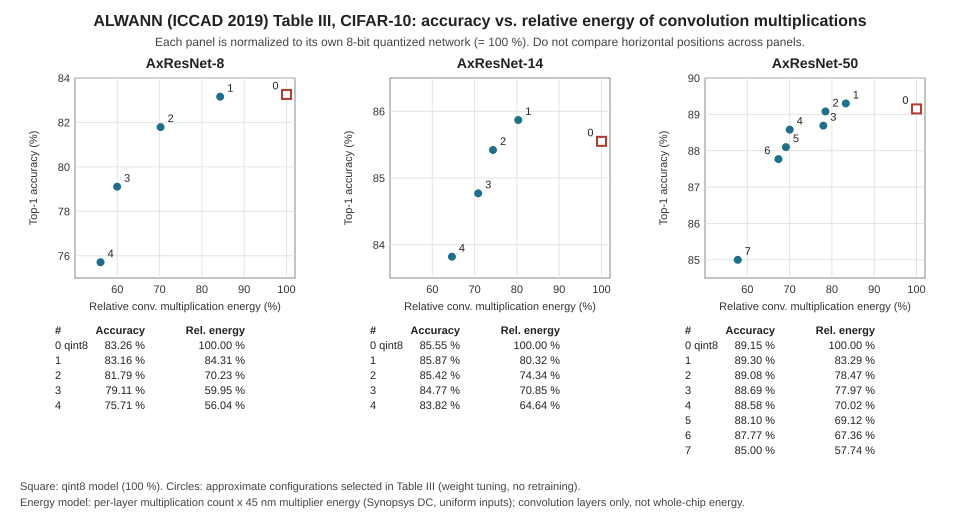

# Why Artificial Intelligence Loves Inexact Math

**You need:** multiplication, addition and the idea of rounding a decimal to the nearest half. No neural-network background, no probability, no linear algebra; every term is defined below.

**After this page you can:**

1. compute one output of a tiny neural layer by hand, and see how much a quantized input moves it;
2. tell **training** from **inference**, and **quantization** from **approximate hardware**;
3. read the ALWANN energy/accuracy figure in four steps, and state what its numbers do **not** license.

**Route:** [Human eyes and pixels](human-eyes-and-pixels.md) → this page → [Approximate multipliers](../taxonomy/multipliers.md).

## Start here: one layer, one weighted sum, by hand

Large AI models — from Large Language Models (LLMs) to vision systems in autonomous vehicles (YOLO, ResNet, Vision Transformers) — use **matrix multiplication** as an important computational kernel, usually written as

$$\mathbf{Y} = \mathbf{W} \cdot \mathbf{X} + \mathbf{b}$$

Read that as: *every output number is a weighted sum of the input numbers, plus a constant.* That is all it is at this level. Take one output with two inputs:

| input $x$ | weight $w$ | product |
|---:|---:|---:|
| 2.3 | 4 | 9.2 |
| 3.2 | 5 | 16.0 |

With bias $b=-1$, this output is $9.2 + 16.0 - 1 = 24.2$.

Now suppose the inputs are stored as **8-bit integers** instead of 32-bit floats. Integer storage needs a scale $S$ and a zero-point $Z$; take $S=0.5$ and $Z=0$ for simplicity. Each value is rounded to the nearest representable step, so

$$q = \operatorname{clip}_{[q_{\min},q_{\max}]}\left(\operatorname{round}\left(\frac{x}{S}\right)+Z\right), \qquad \hat{x}=S(q-Z)$$

Here $\operatorname{round}$ rounds to the nearest integer under a stated tie rule. $\operatorname{clip}$ keeps that integer within the stored range $[q_{\min},q_{\max}]$ by replacing an out-of-range value with the nearest limit; $\hat{x}$ is the reconstructed real value. In this example no value is clipped. The formula gives $2.3 \to \operatorname{round}(4.6)=5 \to 2.5$ and $3.2 \to \operatorname{round}(6.4)=6 \to 3.0$. The layer then computes $4(2.5)+5(3.0)-1 = 24$, against the exact $24.2$. **The arithmetic was exact; the error came from writing the inputs down in fewer bits.** That is the single most useful distinction on this page, and it has a name: quantization.

The same layer is followed by a non-linear step, here **ReLU**: $\text{ReLU}(z)=\max(0,z)$, which passes positive values through and clips everything else to zero. Watch what happens when the preactivation (the weighted sum $z$ before ReLU) is near zero. If the exact value is $-0.2$ and the approximate value is $+0.2$, then after ReLU the outputs are $0$ and $0.2$: a preactivation error of size $0.4$ became an output error of $0.2$. ReLU suppresses a perturbation only when **both** the exact and the perturbed preactivations stay at or below zero; the moment an error crosses the threshold, it passes through (or is created). Neither ReLU nor any other activation eliminates arithmetic error.

## Four words that must not be mixed

| Word | What it changes | Is the arithmetic still exact? |
|---|---|---|
| **Inference** | evaluates a trained model | depends on the chosen arithmetic implementation |
| **Training** | the weights, using gradients to guide small adjustments | depends on the chosen arithmetic implementation |
| **Quantization** | how many bits represent each value | yes — exact on the stored values |
| **Approximate hardware** | the *function* the arithmetic unit computes | no — that is the point |

Training is the phase that computes gradients and changes the weights. A gradient describes how training error changes with the weights; it guides the choice of weight adjustments. No gradient calculation is needed for the examples here. Inference is the phase that only evaluates. They are affected differently by approximation: an error during inference perturbs one answer, while an error during training can perturb the weights themselves and then propagate into every later answer. And a model that trains successfully does not, by itself, tell you what happens when the multipliers are replaced — that has to be measured on the target workload.

The last two rows are the distinction the rest of the page rests on. Quantization reduces a *number's precision* while leaving arithmetic exact on 8-bit integers. Approximate hardware replaces the arithmetic unit itself, so the products and sums are no longer the specified ones. Both can reduce cost under suitable implementation conditions; they are not the same lever, and their errors have different characters — quantization error depends on scale, rounding, range and values; circuit error depends on the circuit and operand patterns.

## Reading the ALWANN figure in four steps

The main case study on this page ([figure and caption below](#alwann-case-study)) plots classification accuracy against modelled multiplier energy. Do not read it as a headline; read it in four steps.

**Step 1 — find the baseline.** Each panel's horizontal axis is normalized to *that network's own* quantized 8-bit (qint8) model, which sits at 100%. So a point at 70.02% means "70.02% of the energy of the same network's exact-multiplier model", not "70% of some universal reference".

**Step 2 — read the points, not the line.** The points are the configurations the paper reports. They are not joined, because the table contains no measurements between them.

**Step 3 — check both axes.** The vertical axis is top-1 accuracy on the CIFAR-10 image dataset: the percentage of test images for which the model's first-choice label is correct. The horizontal axis is *convolution-multiplication* energy: multiplication energy inside image-processing layers that repeatedly form local weighted sums. Both are specific. An improvement on one axis says nothing about the other.

**Step 4 — list what cannot be inferred.** Because each panel is normalized to its own baseline, horizontal positions **cannot rank the absolute energy of different networks**, and the vertical scales differ between panels. The energy covers *multiplications in convolutional layers only* — not accumulation, not memory traffic, not other layers, not the whole chip. And the results are CIFAR-10 results; they say nothing about ImageNet or another task. Most importantly: **a saving measured on one block is not a whole-system saving.** Multiplying a local saving by the number of blocks, or by a device's power draw, is exactly the extrapolation this site refuses to make.

When comparing accuracies, distinguish **percentage points** from a relative percentage: 89.15% to 88.58% is a decrease of 0.57 percentage points. A relative decrease instead divides that difference by the original accuracy.

## Check your understanding

Answer on paper first, then open the check. Your answers are not saved or sent anywhere.

**WB19.** A layer has inputs $x_1 = 1.2$, $x_2 = 5.2$, weights $w_1 = 3$, $w_2 = 2$, and bias $b = -0.5$. (a) Compute the output exactly. (b) Quantize both inputs with $S = 0.5$, $Z = 0$ (round to nearest), recompute, and give the output error. (c) Was the arithmetic in (b) approximate?

Check WB19

(a) $3(1.2) + 2(5.2) - 0.5 = 3.6 + 10.4 - 0.5 = 13.5$. (b) $1.2 \to \operatorname{round}(2.4) = 2 \to 1.0$; $5.2 \to \operatorname{round}(10.4) = 10 \to 5.0$. Then $3(1.0) + 2(5.0) - 0.5 = 3 + 10 - 0.5 = 12.5$, so the error is $12.5 - 13.5 = -1.0$. (c) No — the additions and multiplications were performed exactly; the error entered when the inputs were stored in steps of $0.5$. That is quantization, not approximate hardware.

- If your (b) error came out as $+1.0$, check the sign convention: error is approximate minus exact.
- Note how much the error depends on the step size: with $S = 0.1$, these inputs give $q_1=12$ and $q_2=52$, both representable in 8 bits, and reconstruct exactly. A smaller scale reduces the representable real-value range for a fixed integer range; it does not by itself require more payload bits.

**WB20.** A team reports: "quantizing our model to 8 bits changed accuracy by 0.3%, therefore our approximate-multiplier design will also lose 0.3%." Name the two independent mistakes.

Check WB20

First, it transfers a *quantization* result to *approximate hardware*: those are different levers with differently-shaped errors, and the second one perturbs the products rather than the stored values. Second, the bare accuracy change omits the model, dataset, configuration and whether 0.3% means a relative percentage or percentage points. These conditions are needed even to interpret the first measurement. Even a genuine measurement of one layer does not predict another. The only defensible claim is what was measured, on the stated model, dataset and configuration.

- A useful test: could the two designs have *different* per-layer error profiles? Yes — the two error profiles depend on different representation and circuit choices, as well as on their inputs.

**WB21.** On the ALWANN figure, one AxResNet-50 configuration reports 88.58% top-1 accuracy against 89.15% for its qint8 baseline, at 70.02% relative multiplication energy. (a) What exactly is the 70.02% measured against? (b) Why can you not compare its horizontal position with a point in the AxResNet-8 panel? (c) Does this result tell you the chip uses less energy overall?

Check WB21

(a) Against **that same network's** qint8 model — the exact-multiplier, 8-bit baseline at 100% on that panel's axis. (b) Because each panel normalizes to its **own** baseline, the two panels use different network-specific reference energies; their percentage positions do not rank absolute energy. (c) No. The energy counted is the *multiplication energy inside convolutional layers*, from a 45 nm synthesis model with uniformly distributed inputs. Accumulation, memory traffic, other layers and the rest of the chip are excluded. It is a component result, not a whole-chip or whole-system measurement.

- If you read 70.02% as "the chip uses 30% less energy", that is precisely the local-to-whole-system extrapolation this page warns against.

---

## 🔬 Going deeper: mechanisms, cases and data

Large AI models—from Large Language Models (LLMs) to vision systems in autonomous vehicles (YOLO, ResNet, Vision Transformers)—use matrix multiplication as an important computational kernel: **general matrix multiplication (GEMM)**:

The operation count depends on the model, input size, and batch size. Approximate arithmetic requires application-specific accuracy validation.

### 🧠 Conditional Neural Error Resilience

Training can use stochastic minibatches, dropout, and augmentation. This does not make hardware errors equivalent to training noise: arithmetic errors may be biased, input-dependent, or correlated. Retraining with the intended arithmetic model can help, but accuracy must be measured on the target workload.

Trained weights need not follow a zero-mean Gaussian distribution. Their ranges differ across layers and channels, and outliers can matter. Neither small weights nor parameter redundancy guarantees tolerance to truncation or logarithmic multiplication.

#### Nonlinear Activations (ReLU & GELU)

$$\text{ReLU}(z)=\max(0,z),\qquad \text{GELU}(z)=z\Phi(z)$$

Here $\Phi$ is the standard normal cumulative distribution function. ReLU suppresses a perturbation only when both the exact and perturbed preactivations remain nonpositive; an error can cross the threshold. GELU generally has negative outputs for negative inputs. Neither activation guarantees elimination of arithmetic error.

### 🔬 Quantization vs. Approximate Hardware

Modern AI optimization uses two complementary approaches:

FP32 arithmetic is rounded, rather than mathematically exact. Storing each value in 8 bits instead of 32 bits reduces the payload by a factor of four; scales, zero-points, biases, and accumulators add storage overhead.

1. **Quantization** shrinks the data bit-width from 32-bit floats to 8-bit or 4-bit integers:

    $$
    q = \operatorname{clip}_{[q_{\min},q_{\max}]}\left(\operatorname{round}\left(\frac{x}{S}\right)+Z\right)
    $$

    Here $S>0$, $Z$ is an integer zero-point, and the integer range and rounding rule must be specified. Dequantization uses $\hat{x}=S(q-Z)$.

2. **Approximate Hardware** changes the arithmetic circuit itself. Compressor designs and transistor counts vary; savings require a stated implementation and baseline.

### ⚡ Energy & Accuracy Case Studies

Approximate CNN arithmetic can trade energy against classification accuracy, as studied by Mrázek, Sekanina, and Vašíček on CIFAR-10 and CIFAR-100. Results depend on the circuit, layer, network, and data. Arithmetic-unit savings do not directly determine chip energy or battery life; memory, control, sensors, and other system loads also contribute.

#### Case study: layer-wise approximate multipliers in ResNet (ALWANN)

Mrázek et al. (ALWANN, ICCAD 2019) started from ResNet-8, ResNet-14 and ResNet-50 networks trained on **CIFAR-10** and quantized to 8 bits (qint8). For each convolutional layer they chose one of the 36 approximate 8-bit multipliers in the EvoApproxLib library. The method avoids backpropagation retraining, but the weights do change: a **weight-tuning** step replaces weight values layer by layer, using a mapping precomputed for each approximate multiplier (Section III-B).

In Table III, one AxResNet-50 configuration reaches 88.58% top-1 accuracy on the CIFAR-10 validation set, compared with 89.15% for the qint8 ResNet-50 (−0.57 percentage points). Its relative energy for convolutional-layer multiplications is 70.02% of that qint8 network's.

What that energy number covers:

- Each layer's energy is its multiplication count times the energy of the multiplier chosen for that layer. Multiplier energies come from Synopsys DC synthesis in a 45 nm technology with uniformly distributed inputs (Section IV). This is a model, not a measurement of a chip.
- Only multiplications in convolutional layers are counted. Accumulation, memory traffic, other layers and whole-chip energy are not included.
- For scale, Table I lists 120.3 M multiplications in the convolutional layers of ResNet-50 for one 32 × 32 RGB image.
- These are CIFAR-10 results; they do not establish behavior on ImageNet or other tasks.

*Figure: all 18 rows of ALWANN Table III, including each network's qint8 model at 100%. Each panel's horizontal axis is normalized to that network's own qint8 model, so horizontal positions cannot rank the absolute energy of different networks, and the vertical scales differ between panels. The points are the configurations the paper reports; they are not joined, because the table gives no results between them. Data: [alwann-points.csv](../assets/restored/alwann-points.csv).*

#### Case study: 8-bit integer-only object detection

Quantization is a different lever: the integer arithmetic on quantized values is exact, and the error comes from representing values with fewer bits. Jacob et al. (CVPR 2018, Table 4.4) compared a floating-point MobileNet SSD (depth multiplier 100%) on the COCO dataset with an 8-bit integer-only version:

| MobileNet SSD, DM 100% | COCO mAP | Snapdragon 835 LITTLE core (ms) | Snapdragon 835 big core (ms) |
| :--- | ---: | ---: | ---: |
| Floating point | 22.1 | 778 | 370 |
| 8-bit integer-only | 21.7 | 687 | 272 |

Latency was measured on a single thread on each core type. These are detection accuracy and latency results for quantized inference. They are not energy measurements, and they say nothing about approximate multipliers.

### 📚 Primary Literature

- D. Hendrycks and K. Gimpel, *“Gaussian Error Linear Units (GELUs)”*, arXiv:1606.08415 (2016; revised 2023), [Section 2](https://arxiv.org/html/1606.08415v5).
- B. Jacob et al., *“Quantization and Training of Neural Networks for Efficient Integer-Arithmetic-Only Inference”*, CVPR (2018), [Sections 2–3 and Table 4.4](https://arxiv.org/pdf/1712.05877).
- V. Mrazek, Z. Vasicek, L. Sekanina, M. A. Hanif, and M. Shafique, *“ALWANN: Automatic Layer-Wise Approximation of Deep Neural Network Accelerators without Retraining”*, ICCAD (2019), [author version, Sections III-B and IV, Tables I and III](https://arxiv.org/abs/1907.07229), [DOI: 10.1109/ICCAD45719.2019.8942068](https://doi.org/10.1109/ICCAD45719.2019.8942068).
- V. Mrázek, L. Sekanina, and Z. Vašíček, *“Libraries of Approximate Circuits: Automated Design and Application in CNN Accelerators”*, IEEE JETCAS 10(4), 406–418 (2020), [DOI: 10.1109/JETCAS.2020.3032495](https://doi.org/10.1109/JETCAS.2020.3032495).
