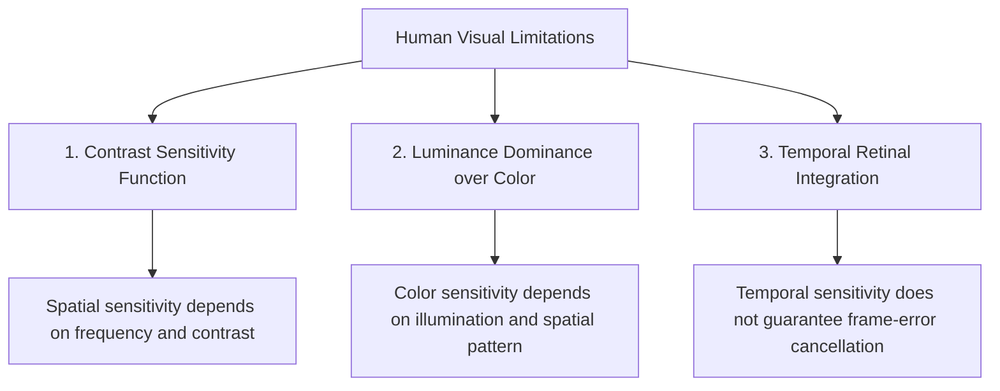

# Why Human Eyes and Ears Forgive Inexact Math

JPEG and MP3 can reduce file size by discarding information according to perceptual models. Compression ratio and perceptual quality depend on the encoder, settings, content, and viewing or listening conditions.

The secret lies in human biology and **perceptual noise masking**.

**You need:** counting, multiplication and the idea of an average. Nothing about images, hearing or circuits is assumed; every term is defined below.

**After this page you can:**

1. say what a pixel and an 8-bit value are, and what a **fixed comparison region** is and why it is required;
2. compute a $3\times 3$ weighted average by hand, and see exactly what one approximate multiplier changes in it;
3. say what a **reference image**, **MSE** and **PSNR** each need before two scores may be compared.

**Route:** [Approximation paradigms](../fundamentals/approx-paradigms.md) → this page → [Why AI loves inexact math](ai-and-approximate-math.md).

## Start here: pixels, 8 bits, and a fixed comparison region

A digital photo is a grid of **pixels**. Each pixel stores one brightness number. In the usual **8-bit** grayscale image that number is an integer from `0` (black) to `255` (white), so a single pixel can only take 256 different values — a photo is already a rounded, finite-precision object before any approximation is added.

Filters then do arithmetic on those numbers. A common filter replaces every pixel by a **weighted average** of itself and its eight neighbours: multiply each neighbour by a fixed weight, add the nine products, divide by the sum of the weights. The weights are called a **stencil** or **kernel**.

Before any two images can be compared numerically, one thing has to be fixed: **which pixels are being compared**. That is the **comparison region**. It matters for two reasons. Edges are special — a pixel on the border has no neighbour outside the image. An implementation may exclude the border or specify a padding rule; this example uses only complete neighbourhoods. And if the two images were produced by different paths, their borders may be treated differently. A score computed over all pixels and a score computed over the inner pixels are different quantities, and a figure that does not say which one it used cannot be compared with another.

## One weighted average, computed by hand

Take a $3\times 3$ patch of an 8-bit image, and the smoothing kernel below. The table shows integer coefficients whose sum is 16; dividing each coefficient by 16 gives non-negative normalized weights that add to $1$, so this filter really is a weighted average — its output always lies between the smallest and largest input in the patch.

| | column 1 | column 2 | column 3 | | kernel |
|---|---:|---:|---:|---|---|
| **row 1** | 120 | 122 | 118 | | 1 2 1 |
| **row 2** | 121 | 120 | 119 | | 2 4 2 |
| **row 3** | 125 | 123 | 121 | | 1 2 1 |

Multiply each pixel by its weight, add, and divide by $16$ (the weights sum to $1+2+1+2+4+2+1+2+1 = 16$):

$$120\cdot 1 + 122\cdot 2 + 118\cdot 1 + 121\cdot 2 + 120\cdot 4 + 119\cdot 2 + 125\cdot 1 + 123\cdot 2 + 121\cdot 1 = 1934$$

$$\frac{1934}{16} = 120.875 \quad\longrightarrow\quad \text{round to the nearest integer} = 121$$

So this pixel becomes `121` in the filtered 8-bit image. The exact intermediate value, $120.875$, is a fraction; a stored 8-bit pixel cannot hold it, so the pipeline must round (or truncate, which is a different rule). Note that the nine multiplications here use only the coefficients $1$, $2$ and $4$ — powers of two — so this filter needs shifts, not a general multiplier array. That is a property of *this* kernel, not of filters in general.

## Now replace one multiplier with an approximate one

Suppose the arithmetic unit computing each pixel–weight product is not exact. Use the unsigned [**DRUM** multiplier](../taxonomy/multipliers.md#mul-cheap) with window width $k=4$: when bits are discarded, the retained window's least-significant bit (**LSB**, its rightmost bit) is set to one. Every pixel in our patch lies between $64$ and $127$, so each value has its leading one at bit 6 and three low bits are discarded. In the worked notation below, `>> 3` means shift right by three binary places, discarding the three rightmost bits. `| 1` means bitwise OR with 1: it forces the remaining rightmost bit to 1 and leaves the other bits alone. `*` means multiplication and `2^3` means 2 cubed. Take $118 = 1110110_2$ as the worked case:

```
118          = 1110110
118 >> 3     = 1110        (keep the top 4 bits)
(118>>3)|1   = 1111 = 15   (force the retained LSB to 1)
15 * 2^3     = 120         (restore the scale)
```

All nine pixels in the patch map to $120$ in the same way, so the sum becomes $120 \cdot 16 = 1920$ and the average is

$$\frac{120\cdot(1+2+1+2+4+2+1+2+1)}{16}=\frac{1920}{16}=120$$

So the approximate pipeline stores `120` where the exact pipeline stored `121`. The difference from the unrounded reference $120.875$ is $0.875$; the difference from the rounded 8-bit output is $1$; and in this particular patch the weighted-sum numerator changed by $1934-1920=14$ counts. The stored output changed by one count after division and rounding. (With the [**RoBA** multiplier](../taxonomy/multipliers.md#mul-cheap) the products here would be exact, because every weight is already a power of two: with $B_r=B$, its approximation $A_rB+AB_r-A_rB_r$ equals $AB$.)

One pixel is not an image. **You cannot read an image-wide PSNR — or an energy saving — off this single output value.** That is the next section.

## How an image is scored: reference, region, MSE, PSNR

To say "how wrong" a filtered image is, the field compares it against a **reference image**: the output of the *specified* arithmetic, produced with known rounding rules. Three things must then be stated, or the score is not reproducible:

1. **the reference** — which image, produced by which exact arithmetic;
2. **the region** — all pixels, or the inner pixels only (our example uses only positions with a complete $3\times3$ neighbourhood; other implementations can produce border outputs using a stated padding rule);
3. **the bit depth** — 8-bit, so the peak value is $255$.

Given those, the **mean squared error** averages the squared pixel differences over the region, and **PSNR** turns that into a decibel score. You need not calculate logarithms on a first read: understand the three comparison conditions and the consequences below; the formulas spell out the calculation for reference:

$$MSE = \frac{1}{M \times N} \sum_{x=0}^{M-1} \sum_{y=0}^{N-1} \Big(I_{\text{exact}}(x, y) - I_{\text{approx}}(x, y)\Big)^2, \qquad PSNR = 10 \cdot \log_{10}\left( \frac{255^2}{MSE} \right)$$

Three consequences follow directly. Identical compared images give $MSE = 0$ and *infinite* PSNR. A large PSNR alone still does not establish perceptual acceptability. A single large pixel difference can dominate a whole MSE budget, because the differences are squared before averaging. And **a fixed PSNR level never guarantees perceptual equivalence**: equal MSE, equal PSNR, can still look completely different, which is the subject of the reference section on SSIM.

### A tempting but wrong shortcut

It is tempting to think that changing the **least-significant bit** (the last binary digit of a pixel value) is safe, because it changes the value by only $1$. Sometimes it is, sometimes it is not, and the reason is worth fixing:

> **Bit position describes amplitude, not spatial frequency.** Changing a pixel's LSB changes that pixel's brightness by a small amount. *Spatial frequency* is a completely different idea: it describes how a pattern varies **across neighbouring pixels**. A small change repeated across a whole image shifts its brightness; the same small change alternating pixel by pixel creates a fine texture. Which of those is visible depends on the pattern, the contrast and the viewing conditions — so an LSB error is not automatically invisible, and "it's only the last bit" is not an argument.

## Check your understanding

Answer on paper first, then open the check. Your answers are not saved or sent anywhere.

<a id="read-f16"></a>

**WB16.** Using the same $3\times3$ kernel, compute the output for a patch whose nine values are all `100`. Then compute it for a patch whose centre value is `100` and whose other eight values are `0`. (Both use the same weights.)

<details markdown="1">
<summary>Check WB16</summary>

All-`100` patch: the weights sum to $16$, so the output is $100\cdot16/16 = 100$. Centre-`100` patch: only the centre weight $4$ multiplies something nonzero, so the numerator is $100\cdot4 = 400$ and the output is $400/16 = 25$. The filter is an average, so its output is always between the patch minimum and maximum — $25$ is between $0$ and $100$, as promised.

- If you got $100$ for the second patch, you may have used only the centre pixel and skipped its normalized weight $4/16$. Dividing the weighted numerator by $9$ would instead give about $44.44$, and would also be incorrect. The denominator is the sum of the *weights*.
- If you got a value below the patch minimum or above its maximum, check the weights: this guarantee only holds when all weights are non-negative.

</details>

<a id="read-f17"></a>

**WB17.** A report says: "The approximate filter achieved 38.2 dB PSNR." State three things the report still has to supply before you can check that number, and say whether a PSNR of 38.2 dB proves the image looks acceptable.

<details markdown="1">
<summary>Check WB17</summary>

It must supply (i) the **reference image** and the exact arithmetic that produced it; (ii) the **region** compared (all pixels, or the inner pixels, or some other mask); (iii) the **bit depth** and hence the peak value used in the formula. It does not prove acceptability: PSNR is a squared-error score, and Wang et al. show that images with identical MSE — hence identical PSNR — can have very different visible structure.

- If you want to argue about how the image *looks*, PSNR alone is the wrong tool; see SSIM in the reference section.

</details>

<a id="read-f18"></a>

**WB18.** A colleague argues: "our approximation only touches the least-significant bits, so no viewer will ever see it." Using the pixel patch above, give one reason the argument needs more than the word "least-significant".

<details markdown="1">
<summary>Check WB18</summary>

Because "least-significant bit" describes *amplitude*, not *spatial frequency*. An LSB change of $1$ on a single pixel is small; the same $+1$ applied to every pixel in a bright flat region shifts the region's brightness, and a change applied to alternating pixels creates a fine spatial pattern whose visibility must be checked. Visibility depends on the pattern and the viewing conditions, so the size of the change is not enough to settle it. In our patch, the DRUM model maps the nine pixel operands to $120$: values below $120$ move up, values above it move down, and $120$ stays unchanged. These are input-dependent errors, not independent random noise.

- A second reason: the error here came from *discarding bits of the operands*, the retained-bit rule can move different values in different directions. Whether the resulting errors cancel or accumulate depends on the inputs and subsequent operations; see [Motivations and challenges](../fundamentals/motivations-and-challenges.md).

</details>

---

## 🔬 Going deeper: the biology, the derivations and the lab

### 👁️ Biology 101: The Human Visual System (HVS)

Human eyes are biological sensors, not perfect digital photo analyzers. Visibility depends on spatial contrast, color, temporal variation, and viewing conditions:



#### 1. The Contrast Sensitivity Function (CSF)
Contrast sensitivity varies with spatial frequency and viewing conditions; sensitivity is not greatest at every low frequency and does not obey a universal exponential decay. Campbell and Robson studied visibility using gratings. A particular fitted CSF is not a guarantee that arbitrary image errors will be invisible.

Changing a least-significant bit (LSB) changes a pixel's intensity by a small amount. **Bit position describes amplitude, not spatial frequency**: spatial frequency describes how a pattern varies across neighboring pixels. A small change repeated across a whole image can shift its brightness; an alternating change creates a different pattern. Visibility depends on that pattern, contrast, and viewing conditions, so an LSB error is not automatically invisible.

### 🖼️ Interactive Lab: Image Filter & Noise Sandbox

Experience perceptual noise masking for yourself! Choose a test pattern and filter kernel below, and test how different approximate multipliers affect picture quality and live **PSNR (dB)** ratings. The lab's static tasks, and which control does what, are described inside the lab itself.

<iframe
  src="../../labs/image-filter-sandbox.html"
  title="Interactive Image Filter Sandbox"
  style="width: 100%; height: 640px; border: none; background: transparent; margin: 12px 0;"
  loading="lazy"
></iframe>

### 🔬 The Mathematics of 2D Image Convolution

Many image filters use a **2D weighted stencil**. The following formula is cross-correlation; convolution reverses the kernel indices. For the symmetric smoothing kernel below the results coincide:

$$\text{Pixel}_{\text{out}}(x, y) = \sum_{i=-1}^{1} \sum_{j=-1}^{1} \text{Pixel}_{\text{in}}(x+i, y+j) \times \text{Kernel}(i, j)$$

#### Step-by-Step Numerical Example ($3 \times 3$ Gaussian Smoothing):

Suppose an image patch has pixel intensities around $120$, and we apply a $3 \times 3$ smoothing filter:

$$\text{Image Patch} = \begin{bmatrix} 120 & 122 & 118 \\ 121 & 120 & 119 \\ 125 & 123 & 121 \end{bmatrix}, \quad \text{Kernel} = \frac{1}{16} \begin{bmatrix} 1 & 2 & 1 \\ 2 & 4 & 2 \\ 1 & 2 & 1 \end{bmatrix}$$

1. **Compute the weighted sum**:

    $$
    \text{Pixel}_{\text{out}} = \frac{120\cdot 1 + 122\cdot 2 + 118\cdot 1 + 121\cdot 2 + 120\cdot 4 + 119\cdot 2 + 125\cdot 1 + 123\cdot 2 + 121\cdot 1}{16} = \frac{1934}{16} = 120.875
    $$

    Rounding this value to the nearest integer gives an 8-bit output pixel of $121$.

2. **Read the kernel as a weighted average**:
   The weights are nonnegative and add up to $16/16 = 1$. This smoothing kernel therefore produces a weighted average of the nine input pixels, between their minimum and maximum values. Edge-detection kernels with negative weights do not share this guarantee.

3. **Separate this calculation from hardware approximation**:
   The integer coefficients $1$, $2$, and $4$ can be implemented by keeping a value, shifting left by one bit, or shifting left by two bits, with enough width to avoid overflow. The integer sum can be divided by $16$ with an explicit rounding rule; a bare right shift would discard the fractional part. This example does not require a general multiplier array. An approximate result needs a specified arithmetic model, and energy savings need measurements. Neither energy savings nor image-wide PSNR can be inferred from this one output pixel.

4. **Apply a specified approximate multiplier model**:
   Suppose each pixel–weight product is instead computed by the unsigned DRUM multiplier with window width $k=4$, as defined on the [multiplier page](../taxonomy/multipliers.md) from the authors' RTL: when bits are discarded, the retained window's least-significant bit is set to one. Every pixel in this patch lies between $64$ and $127$, so its leading one is bit 6 and three low bits are discarded. For example, $118=1110110_2$ gives $(118\gg3)\,\mathrm{OR}\,1=15$, restored as $15\cdot2^3=120$. All nine pixels map to $120$, and the weights $1$, $2$ and $4$ fit in the window and stay exact:

    $$
    \frac{120\cdot(1+2+1+2+4+2+1+2+1)}{16}=\frac{1920}{16}=120
    $$

   This is $0.875$ below the unquantized reference $120.875$ and $1$ below the rounded 8-bit output $121$. The RoBA multiplier gives the exact products here, because every weight is already a power of two: with $B_r=B$, its approximation $A_rB+AB_r-A_rB_r$ equals $AB$. One output pixel still says nothing about image-wide PSNR or energy.

### 🎧 Psychoacoustics: Why Ears Forgive Inexact Audio

Just like our eyes, human ears operate on **Frequency Masking**:

- A masker can raise the detection threshold of another sound. The threshold depends on signal frequency, level, duration, and the listener; two nearby frequencies alone do not establish inaudibility.
- Arithmetic noise needs comparison with a suitable masking model and listening tests. Being below a threshold measured under specified conditions is not a universal guarantee for all listeners and signals.

### 📚 Primary Literature

- F. W. Campbell and J. G. Robson, *“Application of Fourier Analysis to the Visibility of Gratings”*, The Journal of Physiology 197(3), 551–566 (1968), [DOI: 10.1113/jphysiol.1968.sp008574](https://doi.org/10.1113/jphysiol.1968.sp008574).
- H. Fastl and M. Bechly, *“Suppression in Simultaneous Masking”*, JASA 74(3), 754–757 (1983), [author abstract](https://pubmed.ncbi.nlm.nih.gov/6630732/), DOI: 10.1121/1.389862.
