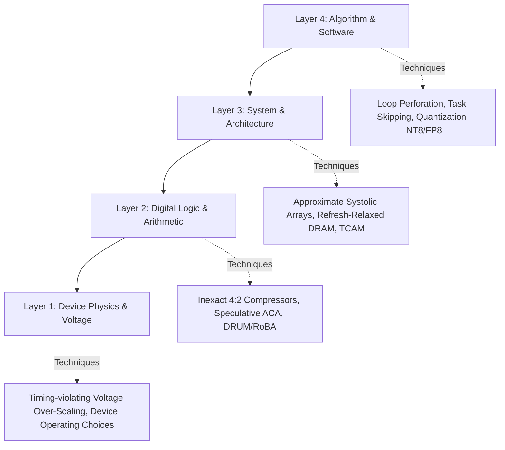

# Approximation Paradigms Across the Stack

**You need:** the cost words (delay, power, energy, area) from [Why inexact computing?](why-approximate-computing.md), and the idea of a weighted average from [Human eyes and pixels](../bridge/human-eyes-and-pixels.md) or any school arithmetic. No probability, no linear algebra, no signal processing.

**After this page you can:**

1. name the four layers at which a system can be approximated, and say what each layer is allowed to touch;
2. tell three different levers apart — **quantization**, **removing work**, and **approximating a circuit** — which are constantly confused;
3. for one concrete image task, say what is being traded away and what absolutely must not be.

**Route:** [Error metrics and mathematical bounds](error-metrics.md) → this page → [Human eyes and pixels](../bridge/human-eyes-and-pixels.md).

## One image task, four layers

Take one ordinary job: **a phone denoises a 12-megapixel photo and sends a smaller version to a friend.** To denoise, the phone runs a filter that replaces every pixel by a weighted average of itself and its neighbours — a weighted sum per pixel, repeated 12 million times. Then it shrinks the image and encodes it.

That job contains arithmetic, memory traffic, communication and a quality requirement ("the friend should not notice the compression"). Approximation can enter at four levels. The useful question at each level is not *can we approximate?* — only under a stated quality requirement — but **what must not be sacrificed.**

| Layer | What lives here | What may be approximated here | What must not be sacrificed |
|---|---|---|---|
| **4. Algorithm & software** | frames, loops, value precision | skip work (every other frame), store values with 8 bits instead of 32 | the task's own success criterion (still recognizable; still readable) |
| **3. System & memory** | the frame buffer, DRAM (memory whose stored charge needs periodic refresh), data movement | refresh less often for non-critical buffers, compress payloads | the bits that matter must not be the ones that are dropped |
| **2. Logic & arithmetic** | the adder/multiplier doing the weighted sums | the arithmetic circuit itself | the stated arithmetic contract (width, rounding, overflow) and the error bound |
| **1. Device & voltage** | transistors, supply voltage, clock | lower the supply voltage | timing: a timing violation must not silently corrupt the result |

Read the table downwards and note that the *kinds* of failure differ. Layer 4 fails visibly (the photo looks wrong). Layer 2 fails numerically (the numbers are off, by a bounded amount if you did your job). Layer 1 fails by *when* the answer arrives, not by what it is — unless the timing is violated inside a computation, in which case bits that are not necessarily the low ones can be wrong, and critical results need explicit protection.

Here is the same idea drawn once, as the taxonomy it is:



"The four-layer diagram is an organizational taxonomy, not a requirement to approximate every layer or a guarantee of energy savings." Nothing forces you to touch all four, and touching four layers does not multiply the savings.

### One number, from the bottom layer

The cheapest lever to explain is at the bottom. For a digital circuit, the dynamic switching power is governed by

$$P_{\text{dynamic}} = \alpha \cdot C_L \cdot V_{DD}^2 \cdot f_{\text{clk}}$$

so lowering the supply voltage from $1.0\,\text{V}$ to $0.7\,\text{V}$, with activity ($\alpha$), load capacitance ($C_L$) and clock frequency ($f_{\text{clk}}$) held fixed, multiplies that term by $0.7^2/1.0^2 = 0.49$ — a **51% reduction in that one term**. It is not "over 51%", it is not a whole-system energy guarantee, and holding the frequency fixed is an assumption that voltage scaling itself tends to break. The voltage-dependent delay, the extra leakage time and the actual runtime all have to be accounted for separately.

## Three levers that are not the same lever

The word "approximate" hides three quite different operations. Keeping them apart is most of the skill on this page.

| Lever | What changes | What stays exact | Where it lives |
|---|---|---|---|
| **Quantization** | how many bits *represent* each value | the arithmetic on those values | layers 4 and 3 (data), layer 2 (accumulation widths) |
| **Removing work** | how much work is *done* | the arithmetic, on whatever is still computed | layers 4 and 3 (skipping, pruning taps) |
| **Circuit approximation** | the *function* the arithmetic unit computes | the declared representation and protected exact operations remain specified | layer 2 (inexact compressors, speculative carry, DRUM/RoBA) |

Concretely, on the same photo: storing the pixel buffer as 8-bit integers instead of 32-bit floats is **quantization**; extending the photo example to video, running the denoiser on every other frame and interpolating the rest is **removing work**; replacing an exact adder inside the filter with a lower-part-OR adder is **circuit approximation**. A quantized multiplication is still exact — the error comes from the values, not the circuit. A perforated loop performs the *same* arithmetic fewer times — the error comes from the missing outputs. Circuit approximation changes the arithmetic unit’s specified function. All three levers need error or quality evaluation against a stated reference; the [metrics](error-metrics.md) apply wherever numerical outputs can be compared.

The payload boundary belongs to the first row and is worth stating carefully. Packing a scalar into 8 bits instead of 32 shrinks the payload by a factor of four, and into 4 bits by a factor of eight. **Total bandwidth and energy need not shrink by those factors**, because scaling metadata, alignment, compression and data movement all remain. A "4× smaller" claim about a payload is not a 4× claim about a system.

## Check your understanding

Answer on paper first, then open the check. Your answers are not saved or sent anywhere.

<a id="read-f13"></a>

**WB13.** Classify each on the photo task: (a) the denoiser stores intermediate pixel values as 8-bit integers instead of 32-bit floats; (b) the denoiser skips every second frame and interpolates; (c) an exact adder inside the filter is replaced by a lower-part OR adder; (d) the DRAM holding the frame buffer is refreshed less often than the manufacturer's default.

<details markdown="1">
<summary>Check WB13</summary>

(a) **Quantization** (layer 4/3 data). (b) **Removing work** (layer 4). (c) **Circuit approximation** (layer 2). (d) A layer-3 memory-side decision, and it is *not* quantization — the values keep their bits, but a retention failure can corrupt them later. Note that (d) also needs a data classification: refreshing non-critical data less often is the whole justification.

- If you called (a) "circuit approximation", remember that the arithmetic on 8-bit integers is still exact; the error came from representation.
- If you called (c) "quantization", the giveaway is that no value's representation changed — the *function* did.

</details>

<a id="read-f14"></a>

**WB14.** A team lowers the supply voltage of their filter block from $1.0\,\text{V}$ to $0.7\,\text{V}$ and claims "51% energy saving". Give the precise version of what they measured, and name the two things they have not established.

<details markdown="1">
<summary>Check WB14</summary>

They measured, or computed, a 51% reduction in the **capacitive switching-power term** of the model $P_{\text{dynamic}} = \alpha C_L V_{DD}^2 f_{\text{clk}}$, at fixed activity, capacitance and frequency. Not established: (i) that the whole block's energy falls by 51% once leakage, delay and the resulting runtime are included; (ii) that the block still meets timing at $0.7\,\text{V}$ — a timing violation can corrupt bits that are not necessarily the low ones.

- "Energy" and "switching power" are different quantities, and 0.49 is the remaining fraction of the switching-power term, not the fraction due to leakage or short-circuit current. Those other contributions are not determined by this ratio.

</details>

<a id="read-f15"></a>

**WB15.** Your pipeline removes 50% of the filter's work by halving the loop, and separately packs the payload from 32 bits to 8 bits. Which of these justifies a claim about time, and which about data size? What would you refuse to infer from either?

<details markdown="1">
<summary>Check WB15</summary>

The loop change directly establishes fewer **compute calls**, and may support a claim about execution time only after measuring the replacement path, including interpolation, control and memory work. The bit-packing is a claim about **payload size** (a factor of four). Refuse to infer **energy** from either without a measurement: halving compute calls does not halve runtime or energy, and shrinking the payload by four does not shrink bandwidth or energy by four, because metadata, alignment and data movement remain.

- This is exactly the loop-perforation result on this page's reference section: for seven PARSEC applications, five had perforations that ran faster with less than 10% accuracy loss — usually at least twice as fast, and the paper reports running time, not energy.

</details>

---

## 🔬 Going deeper: the four layers in detail

### 🏗️ The 4-Layer Approximation Stack

Approximation can be applied at device, circuit, architecture, or software levels. The four-layer diagram above is an organizational taxonomy, not a requirement to approximate every layer or a guarantee of energy savings.

### ⚡ Layer 1: Device Physics & Voltage Scaling

#### 1. Voltage Over-Scaling (VOS)
The dynamic switching power of a CMOS digital circuit is governed by:

$$P_{\text{dynamic}} = \alpha \cdot C_L \cdot V_{DD}^2 \cdot f_{\text{clk}}$$

At fixed activity, capacitance and frequency, the modeled switching-power ratio for $1.0\text{V}$ to $0.7\text{V}$ is $0.7^2/1.0^2=0.49$: a **51% reduction in that term**, not over 51% or a whole-system energy guarantee. Voltage-dependent delay, leakage and runtime must be accounted for separately.

- **The Catch**: Lower voltage can increase delay; a timing budget must be verified for the actual process and operating conditions.
- **The Approximate Lever**: Low-voltage operation is still exact if it meets timing. Voltage over-scaling can violate timing; affected bits are not necessarily LSBs, and critical outputs need explicit protection and error evaluation.

#### 2. Gate-Level Logic Pruning
Approximate synthesis can simplify logic or behavioral descriptions under an error objective. Removing a gate can affect timing, dynamic activity and leakage differently. It is not a universal guarantee that the least important gates consume the most leakage.

### 🎛️ Layer 2: Logic & Arithmetic Microarchitecture

This is the primary focus of silicon hardware designers:

1. **Speculative Addition**: Predicting carries from a limited window can trade accuracy for shorter logic paths. Window size, topology and recovery determine the result and delay.
2. **Inexact Compressors**: Altering a compressor truth table can simplify a partial-product reduction network. No fixed transistor reduction follows from the algorithm name.
3. **Leading-One Detection & Windowing (DRUM)**: Retaining a $k$-bit operand window can reduce the multiplier core width, but leading-one detection, compensation and shifting remain implementation costs; see the specific [multiplier contract](../taxonomy/multipliers.md).
4. **Logarithmic Arithmetic**: For positive real operands, $\log_2(AB)=\log_2(A)+\log_2(B)$. Approximating the log and inverse log changes the numerical result; conversion, zero/signed handling and rounding are not free, and latency is implementation-dependent.

### 🖥️ Layer 3: System & Memory Architecture

1. **Refresh-Relaxed DRAM**: Longer refresh intervals can reduce refresh activity while increasing retention failures. Device, temperature and data classification must be stated; no fixed power saving is implied. As one simulated example, RAIDR (ISCA 2012) refreshes rows according to their measured retention time. In a cycle-accurate simulation of an 8-core system with 32 GB of DDR3-1333, compared with standard auto-refresh, it performed 74.6% fewer refresh operations and used 8.3% (normal temperature range) or 16.1% (extended temperature range) less energy per memory access. The 74.6% counts refreshes, not energy. See the [published refresh studies](../taxonomy/memory.md#published-refresh-studies).
2. **Voltage-Scaled SRAM**: Lowering supply voltage can degrade read, hold or write margins and cause failures. SNM is a noise-margin measure, not itself a supply-voltage threshold.
3. **Approximate Non-Volatile Memory**: Changing write effort may trade write energy or latency against write success or later data correctness. Failure rates and retention effects require a specific device model.

### 🧠 Layer 4: Algorithm & Software Level

1. **Loop Perforation**: Compilers automatically transform long iterative loops:
   ```c
   // Exact Loop: 1000 iterations
   for (int i = 0; i < 1000; i++) { compute_frame(i); }
   
   // Perforated Loop: 500 compute_frame calls plus 500 interpolation calls
   for (int i = 0; i < 1000; i += 2) { compute_frame(i); interpolate(i+1); }
   ```
   Halving compute calls does not prove halved runtime or energy: interpolation, control, memory work and output quality also matter. This is a loop illustration, not a measured encoder.

   <a id="loop-perforation-study"></a>**Published measurement.** Sidiroglou-Douskos, Misailovic, Hoffmann and Rinard (ESEC/FSE 2011) applied loop perforation to seven applications from the PARSEC 1.0 suite on Intel Xeon X5460 servers. For five of the seven, they found perforations that ran faster with less than 10% accuracy loss: usually at least twice as fast on the training inputs, and up to seven times faster for bodytrack. Speedup is a ratio of execution times. Each application's accuracy loss is measured with its own output metric. The paper reports running time, not energy.
2. **Task & Computation Skipping**: Omitting selected work requires a task-specific criterion and validation of the resulting quality.
3. **Model Quantization**: Packed scalar payloads shrink from 32 to 8 or 4 bits by factors of four or eight. Scaling metadata, alignment, compression and data movement mean that total bandwidth and energy need not shrink by those factors.

### 📚 Verified Sources and Scope

- Han and Orshansky, *Approximate Computing: An Emerging Paradigm for Energy-Efficient Design*, ETS, 2013, Sections II, III-D and V ([author manuscript](https://www.ece.ualberta.ca/~jhan8/publications/ApproCompReview_final.pdf), [DOI](https://doi.org/10.1109/ETS.2013.6569370)): circuit and algorithm-level research categories.
- MIT 6.012, Spring 2009, Lecture 13, slide 13 ([official lecture](https://ocw.mit.edu/courses/6-012-microelectronic-devices-and-circuits-spring-2009/de333d22ec4230412f4e7bdd4da3d6ce_MIT6_012S09_lec13.pdf)): capacitive switching-power derivation. The 51% calculation above assumes fixed other parameters.
- S. Sidiroglou-Douskos, S. Misailovic, H. Hoffmann, and M. Rinard, *Managing Performance vs. Accuracy Trade-offs with Loop Perforation*, ESEC/FSE, 2011, pp. 124–134, Sections 1.2, 5 and 6.2 ([author copy](https://people.csail.mit.edu/stelios/papers/fse11.pdf), [DOI](https://doi.org/10.1145/2025113.2025133)): loop-perforation speedups and accuracy losses.
- J. Liu, B. Jaiyen, R. Veras, and O. Mutlu, *RAIDR: Retention-Aware Intelligent DRAM Refresh*, ISCA, 2012, Sections 5 and 6.1–6.3 ([author copy](https://users.ece.cmu.edu/~omutlu/pub/raidr-dram-refresh_isca12.pdf), [DOI](https://doi.org/10.1109/ISCA.2012.6237001)): simulated refresh and energy-per-access results.

The former cross-layer, ABACUS and soft-DSP citations used unrelated DOIs; they are not retained as evidence. The loop-perforation numbers above were checked against the authors' copy of the paper.
