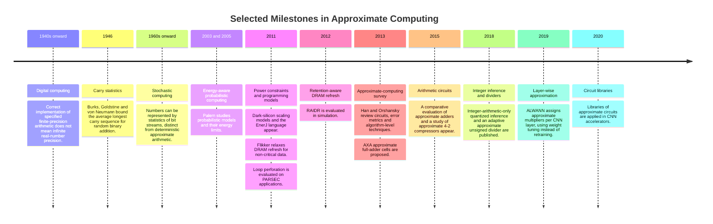

# History & Evolution of Inexact Computing

**You need:** nothing beyond ordinary reading. There is no probability, no circuit theory and no algebra in the main line of this page. Every term used here is defined on the spot.

**After this page you can:**

1. tell four kinds of dated claim apart: a **publication year**, a **prediction from a model**, a **theoretical bound**, and a **measurement**;
2. state what the 1946 carry-statistics result does claim, and the three things it does not;
3. walk the timeline and know which entries you may skip on a first read.

**Route:** [Why inexact computing?](why-approximate-computing.md) → this page → [Motivations and challenges](motivations-and-challenges.md).

**How to read this page (optional-route map).** This is a signpost page, not a skills page, so it is written to be skimmable.

| Route | Read | Skip | Time |
|---|---|---|---|
| **Minimum** | the four short mainline sections below (labels, 1946, predictions, language models), then WB4–WB6 | every Going deeper reference section | ~5 min |
| **Standard** | the minimum, plus the Going deeper timeline | the primary literature list | ~10 min |
| **Full** | everything, including the complete timeline and primary literature | — | ~20 min |

Nothing later in the site depends on the timeline, so the minimum route is a legitimate reading of this page.

## Four labels for a dated claim

Approximate computing is often told as a story of dates, which makes it easy to read a date as if it were a result. This site uses four labels, and the timeline below is annotated with them.

| Label | Means | Example of what it is *not* |
|---|---|---|
| **Year** | the work was published then | not a claim that the idea first appeared then |
| **Prediction** | follows from stated device and workload models | not a measurement of a chip |
| **Theory / bound** | proved under stated assumptions | not an observation about real inputs |
| **Measurement** | observed in an experiment, simulation or dataset | not automatically valid outside its setup |

The distinction is not pedantry. A year is safe to quote. A prediction can be wrong while the model behind it stays sound. A bound can be perfectly true and still useless for your workload, because its assumptions do not hold there. And a measurement travels only with its conditions.

## The 1946 example, in full, without probability

Start with an ordinary addition. Binary `0111 + 0001` is `7 + 1`. Working from the right:

```
bit 0:  1 + 1      -> write 0, carry 1
bit 1:  1 + 0 + 1  -> write 0, carry 1
bit 2:  1 + 0 + 1  -> write 0, carry 1
bit 3:  0 + 0 + 1  -> write 1, no carry    =>  1000 = 8
```

The carry was *generated* at bit 0 and then *propagated* through bits 1 and 2 before it died at bit 3. We say the carry ran through three positions. Long runs are what make a ripple-carry adder slow, so their length was worth studying long before anyone called arithmetic "approximate".

In 1946, Burks, Goldstine and von Neumann asked how long that run gets for a word of $n$ bits. Instead of measuring real programs, they treated the digits as random — a modelling choice, not an observation — and showed that the average longest carry sequence is at most $\log_2 n$. For $n=40$ the bound is $\log_2 40\approx5.3$, and they state that the actual average, $a_{40}$, is $4.62$.

Here $\log_2 n$ asks what power of 2 equals $n$. Since $2^5=32$ and $2^6=64$, $\log_2 40$ lies between 5 and 6 (about 5.3).

Three things this result does **not** claim:

- it is not the average delay of every adder design, only the length of a carry sequence;
- it is not a measurement of real operands, because real operands need not be random;
- it is not "probability says your adder is fine", because the random-digit model is an assumption that a specific workload has to justify.

That pattern — a clean bound under a stated assumption, with the assumption doing the real work — recurs throughout this field.

## A prediction is not a measurement

*Dark Silicon and the End of Multicore Scaling* (2011) is a **projection from stated device and workload models**. Combining device-scaling projections, core models fitted to measured processors, and multicore models for PARSEC workloads, its abstract projects that 21% of a fixed-size chip must be powered off at 22 nm and more than 50% at 8 nm. Those numbers are consequences of the models, not observations of a fabrication line. The reasonable reading is: *under these models, power density, not transistor count, becomes the binding constraint.* The unreasonable reading is that a particular chip on a particular date must run a fixed fraction dark.

## Theory, and a language model

Palem's 2003 and 2005 papers study probabilistic algorithm and device **models** and the limits of probabilistic switching. They are theory: the savings they describe follow inside their model, and they do not license "every approximate multiplier saves power".

EnerJ (2011) is a different kind of artefact again: a **Java type system** that separates approximate from precise data through explicit endorsements. It provides guarantees *within that language model*, not blanket hardware isolation for arbitrary software. Reading it as a hardware result, or the theory papers as measured savings, is the exact confusion the four labels above are meant to prevent.

## Check your understanding

Answer on paper first, then open the check. Your answers are not saved or sent anywhere.

<a id="read-f4"></a>

**WB4.** Label each claim: (a) "RAIDR was published in 2012." (b) "By 8 nm, more than half of a fixed-size chip must be dark." (c) "The average longest carry sequence for 40 random bits is at most about 5.3." (d) "Clearing the low 4 bits of each product changed the PSNR of this image from 48.1 dB to 31.7 dB."

<details markdown="1">
<summary>Check WB4</summary>

(a) **Year.** (b) **Prediction** — it follows from the paper's models. (c) **Theory / bound**, and note the word *random*: the assumption is part of the claim. (d) **Measurement**, and it is only valid for that image, that kernel and that arithmetic model.

- If you labelled (b) as a measurement, re-read "its abstract projects": a projection is a consequence of a model.
- If you labelled (c) as a measurement, the giveaway is "random bits" — that is a model of the inputs, not a set of inputs.

</details>

<a id="read-f5"></a>

**WB5.** For `0101 + 0011` (= `5 + 3`), work out each column and state how many positions the carry runs through. Then: does that tell you the *average* carry-run length for 4-bit addition?

<details markdown="1">
<summary>Check WB5</summary>

`bit 0: 1+1 -> 0, carry 1`; `bit 1: 0+1+1 -> 0, carry 1`; `bit 2: 1+0+1 -> 0, carry 1`; `bit 3: 0+0+1 -> 1, no carry`. Result `1000` = 8, and the carry ran through three positions.

It does **not** give an average. One operand pair is one sample; an average needs a whole set of pairs and a rule for which pairs count. (Note also that `5 + 3 = 8` here, so this example happens to match the `7 + 1` carry pattern even though the operands differ.)

</details>

<a id="read-f6"></a>

**WB6.** A blog says: "EnerJ proves that approximate hardware is safe, and Palem's theorem shows approximate arithmetic saves energy." Name the two errors.

<details markdown="1">
<summary>Check WB6</summary>

First, EnerJ gives guarantees **inside its Java type-system model** for programs that use it; it is not a statement about arbitrary software on arbitrary approximate hardware. Second, Palem's work is a **model-level** study of probabilistic computation; a theorem inside a model is not a measured energy saving on a chip. Both sentences replace a conditional result with an unconditional one.

- A useful habit: whenever a summary says "proves … saves", ask *inside what model* and *measured on what*.

</details>

---

## 🔬 Going deeper: the timeline and the primary sources

Approximate computing has several antecedents, including finite-precision numerical arithmetic, stochastic computation, and energy-aware hardware. It did not begin with a single universal energy-saving law.

### ⏳ Timeline: Selected Research Milestones



How to read the timeline with the four labels: the year on each line is a **year**; the 1946 carry bound is a **theory** under a random-digit model; the 2011 dark-silicon entry is a **prediction**; RAIDR (2012) is a **simulation measurement**; the quantized-inference and ALWANN entries are **measurements on stated datasets and networks**.

The stochastic-computing context is discussed in Han and Orshansky, Section II; the dated works below identify the other milestones. These dates are publication years of works cited in this tutorial. The list is not exhaustive, and a date is not a claim that an idea or field first appeared in that year.

### 🏛️ Correctness and Numerical Precision

A conventional circuit must implement its specified function, including its rounding and overflow rules. Floating-point computation already has finite precision. Fault tolerance and deliberate approximation are different: an error-correcting code protects a specified value, whereas an approximate arithmetic design intentionally changes the function. Neither banking nor scientific simulation can be assigned one universal acceptable numerical error.

#### Carry statistics in 1946

Burks, Goldstine and von Neumann's 1946 design report for the IAS computer (Section 5.6) shows that when two binary words of length $n$ are added, the longest carry sequence has an average length of at most $\log_2 n$. Their analysis treats the digits as random. For their case $n=40$ the bound is $\log_2 40\approx5.3$, and they state that the actual average, $a_{40}$, is $4.62$. This describes the longest carry sequence under that random-digit model. It is not the average delay of every adder design, and real operands need not be random.

### 💥 Voltage Scaling and Power Constraints

Ideal transistor scaling and practical voltage scaling are different. Leakage and power-density constraints limit how much circuitry can operate at once under a power budget. *Dark Silicon and the End of Multicore Scaling* is a **2011 projection using stated device and workload models**, not a measurement proving that every later chip must keep a fixed percentage of its area off. Combining device-scaling projections (ITRS and a more conservative set), core models fitted to measured processors, and multicore models for PARSEC workloads, its abstract projects that 21% of a fixed-size chip must be powered off at 22 nm and more than 50% at 8 nm. This page does not assert a universal clock-speed ceiling, a single exact collapse date, or a temperature comparable to a rocket nozzle.

### 💡 Energy-Aware Probabilistic and Approximate Computing

Palem's 2003 CASES paper studies probabilistic algorithm/device models, and his 2005 IEEE Transactions on Computers paper studies limits of probabilistic switching. Those idealized models should not be read as measured power savings for every later approximate adder or multiplier.

EnerJ (2011) separates approximate from precise data through a Java type system with explicit endorsements. It provides guarantees within that language model, not blanket hardware isolation for arbitrary software. Han and Orshansky (2013) distinguish deterministic approximate arithmetic from stochastic and probabilistic computation. Workload tolerance and implementation efficiency still require individual evaluation; no universal invisibility or fixed energy-efficiency multiplier is claimed here.

### 📚 Primary Literature & Historical Citations

- K. V. Palem, *Energy Aware Algorithm Design via Probabilistic Computing: From Algorithms and Models to Moore's Law and Novel (Semiconductor)Devices*, CASES, 2003, pp. 1–4 of the [author manuscript](https://www.cs.rice.edu/~kvp1/pubs/palem-ea.pdf). This is the verified title; the former arithmetic title and unverified DOI have been removed.
- K. V. Palem, *Energy Aware Computing Through Probabilistic Switching: A Study of Limits*, IEEE Transactions on Computers, 54(9), 1123–1137, 2005 ([author manuscript](https://www.cs.rice.edu/~kvp1/pubs/palemIEEE.pdf), first page and abstract).

  The [author's publication list](https://www.cs.rice.edu/~kvp1/pubs/fullpubs.htm), entries 12 and 17, also identifies these two works. Direct access to the older manuscript links can vary; the historical statements here concern their probabilistic models, not measured savings on a current chip.
- A. W. Burks, H. H. Goldstine, and J. von Neumann, *Preliminary Discussion of the Logical Design of an Electronic Computing Instrument*, Institute for Advanced Study, 28 June 1946, Section 5.6 ([transcription](https://safari.ethz.ch/architecture/fall2023/lib/exe/fetch.php?media=logical_design_of_an_electronic_computing_instrument.pdf), [IAS scan](https://www.ias.edu/sites/default/files/library/Prelim_Disc_Logical_Design.pdf)).
- H. Esmaeilzadeh, E. Blem, R. St. Amant, K. Sankaralingam, and D. Burger, *Dark Silicon and the End of Multicore Scaling*, ISCA, 2011 ([paper](https://www.cs.cmu.edu/~18742/papers/Esmaeilzadeh2011.pdf), abstract and Sections 2–4).
- A. Sampson, W. Dietl, E. Fortuna, D. Gnanapragasam, L. Ceze, and D. Grossman, *EnerJ: Approximate Data Types for Safe and General Low-Power Computation*, PLDI, 2011 ([author manuscript](https://www.cs.cornell.edu/~asampson/media/papers/enerj-pldi2011.pdf), Sections 2–3; [DOI](https://doi.org/10.1145/1993498.1993518)).
- J. Han and M. Orshansky, *Approximate Computing: An Emerging Paradigm for Energy-Efficient Design*, ETS, 2013 ([author manuscript](https://www.ece.ualberta.ca/~jhan8/publications/ApproCompReview_final.pdf), Sections I–II; [DOI](https://doi.org/10.1109/ETS.2013.6569370)).

Other dated works in the timeline (publication years only; their results are discussed on the linked pages):

- 2011: S. Liu, K. Pattabiraman, T. Moscibroda, and B. G. Zorn, *Flikker: Saving DRAM Refresh-power through Critical Data Partitioning*, ASPLOS ([DOI](https://doi.org/10.1145/1950365.1950391)); S. Sidiroglou-Douskos, S. Misailovic, H. Hoffmann, and M. Rinard, *Managing Performance vs. Accuracy Trade-offs with Loop Perforation*, ESEC/FSE ([DOI](https://doi.org/10.1145/2025113.2025133); see [approximation paradigms](approx-paradigms.md#loop-perforation-study)).
- 2012: J. Liu, B. Jaiyen, R. Veras, and O. Mutlu, *RAIDR: Retention-Aware Intelligent DRAM Refresh*, ISCA ([DOI](https://doi.org/10.1109/ISCA.2012.6237001); see [memory](../taxonomy/memory.md#published-refresh-studies)).
- 2013: Z. Yang, A. Jain, J. Liang, J. Han, and F. Lombardi, *Approximate XOR/XNOR-based Adders for Inexact Computing*, IEEE-NANO ([DOI](https://doi.org/10.1109/NANO.2013.6720793)).
- 2015: H. Jiang, J. Han, and F. Lombardi, *A Comparative Review and Evaluation of Approximate Adders*, GLSVLSI ([DOI](https://doi.org/10.1145/2742060.2743760)); A. Momeni, J. Han, P. Montuschi, and F. Lombardi, *Design and Analysis of Approximate Compressors for Multiplication*, IEEE Transactions on Computers 64(4) ([DOI](https://doi.org/10.1109/TC.2014.2308214)).
- 2018: B. Jacob et al., *Quantization and Training of Neural Networks for Efficient Integer-Arithmetic-Only Inference*, CVPR ([arXiv](https://arxiv.org/abs/1712.05877); see [AI page](../bridge/ai-and-approximate-math.md#quantized-detection-case-study)); H. Jiang, L. Liu, F. Lombardi, and J. Han, *Adaptive Approximation in Arithmetic Circuits: A Low-Power Unsigned Divider Design*, DATE ([DOI](https://doi.org/10.23919/DATE.2018.8342233)).
- 2019: V. Mrazek, Z. Vasicek, L. Sekanina, M. A. Hanif, and M. Shafique, *ALWANN: Automatic Layer-Wise Approximation of Deep Neural Network Accelerators without Retraining*, ICCAD ([DOI](https://doi.org/10.1109/ICCAD45719.2019.8942068); see [AI page](../bridge/ai-and-approximate-math.md#alwann-case-study)).
- 2020: V. Mrázek, L. Sekanina, and Z. Vašíček, *Libraries of Approximate Circuits: Automated Design and Application in CNN Accelerators*, IEEE JETCAS 10(4) ([DOI](https://doi.org/10.1109/JETCAS.2020.3032495)).
