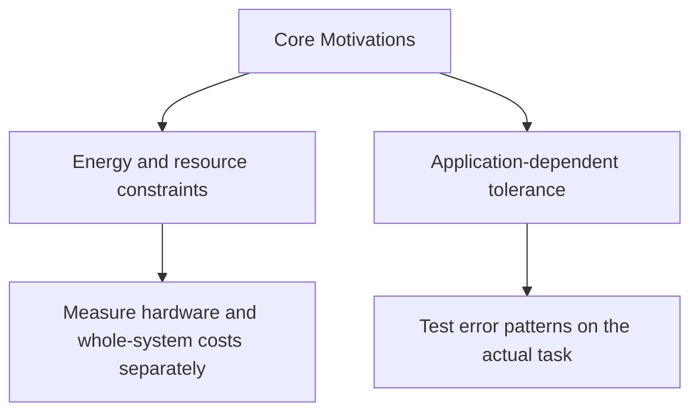
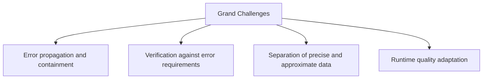

# Motivations, Problems & Grand Challenges

**You need:** addition, subtraction and the idea of a threshold (an `if` test). No probability, no circuits, no calculus. Every term is defined below.

**After this page you can:**

1. predict whether three small errors will add up or cancel, and say what "bias" means in one sentence;
2. explain why a biased small error is more dangerous than an unbiased one of the same size;
3. name the four grand challenges and say which one a given scenario belongs to.

**Route:** [History and evolution](history-and-evolution.md) → this page → [Error metrics made easy](error-metrics-made-easy.md).

## Start here: three small errors in a row

A program keeps a running total. The arithmetic is approximate, so each step may be off by a little. Let the *error* of a step be the approximate value minus the exact value, so `+1` means "one too high" and `−1` means "one too low". Three steps, three small errors, three completely different outcomes:

| Case | step 1 | step 2 | step 3 | accumulated error | What happened |
|---|---:|---:|---:|---:|---|
| **A** | +1 | +1 | +1 | **+3** | all three push the same way |
| **B** | +1 | −1 | +1 | **+1** | two push, one pulls back |
| **C** | +1 | −1 | −1 | **−1** | one pushes, two pull back |

Every step in all three cases had an error of *size* 1, so a metric that averages error sizes would call A, B and C identical. They are not: A's total drifted three units, C's drifted one unit the other way. **A single error's size does not tell you what a sequence of them does.** That is the first thing this page is about.

The average of the *signed* errors has a name: **bias**, or the mean error. A's bias is $+1$ per step; B's is $+1/3$ per step; and if the errors had been $+1,-1,+1,-1,\dots$ the bias would approach 0. Bias is what makes errors accumulate:

- **Biased** errors (say, always $+1$) accumulate linearly: after $n$ steps the total error is about $n$ times the bias. A running total that should reach 100 after 100 steps would instead reach 200.
- **Unbiased** errors can stay near zero — but only if the balance genuinely holds. "Unbiased on average" is a claim about a distribution of errors, and it has to be checked, not assumed.

Now add a threshold, because thresholds are where accumulated error turns into a wrong decision. Suppose a task accepts a result of 100 or more. The exact total is 100; case C's accumulated error is −1, so the approximate total is 99, and the task rejects it. Case A's total is 103 and passes. Same error *sizes*, opposite decisions — this is the same mechanism as the pixel example on [Why inexact computing?](why-approximate-computing.md), now applied to a running total.

### When does an error grow or die?

Some systems feed their own output back in. Write the error at step $t$ as $e_t$, and suppose the next error follows the rule

$$e_{t+1}=a\,e_t+\delta_t$$

where $\delta_t$ is the fresh error contributed by step $t$. The number $a$ decides the fate of everything already there:

| $a$ | What happens to an existing error | Example |
|---|---|---|
| $\lvert a\rvert<1$ | it **decays** — the system forgets | $a=0.5$: $8 \to 4 \to 2 \to 1 \to 0.5 \dots$ |
| $\lvert a\rvert>1$ | it **grows** — the system amplifies | $a=2$: $8 \to 16 \to 32 \dots$ |
| $a=1$ | it only **accumulates** (the case above) | a plain running sum |

Growth is not inevitable: with $\lvert a\rvert<1$, an existing error decays if no fresh error is added. A continuing constant error $\delta$ generally leaves a nonzero steady error $\delta/(1-a)$; stability does not erase persistent bias. But growth is also not impossible, which is why "we test the whole pipeline" is a different claim from "we tested one adder". Reaching `NaN` (the floating-point "not a number" value) also depends on how the arithmetic and the exceptional-value handling are written, not only on the size of the error.

## Why anyone bothers: two motivations

**Energy and resources.** Arithmetic, memory, communication and cooling all draw power. The International Energy Agency's *Energy and AI* report (2025) **estimates** that data centres used around 415 TWh in 2024, about 1.5% of world electricity, and **projects** around 945 TWh by 2030; it also states that a typical AI-focused data centre uses as much electricity as 100,000 households. Note the two labels: 2024 is an estimate, 2030 is a projection. Neither figure says how much of that electricity goes to *arithmetic*, so a multiplier-level saving cannot be scaled up into these totals. That is not a quibble — it is the difference between a circuit result and a system result.

**Tolerance depends on the application.** Sensors have shot noise, thermal noise and environmental disturbances; cameras have lens distortion; rooms have reverberation. These are different effects, not one universal "noise percentage". Crucially, a noisy sensor does not excuse an arithmetic error: numerical errors can accumulate, correlate with the input, or flip a threshold decision. Noise sets a floor, and the arithmetic error budget is still owed on top of it.

## Four challenges at a glance

1. **Error propagation and containment.** Bound how far an error can travel — the recurrence above. Note that **MED means Mean Error Distance**, not Maximum Error Distance; a mean says nothing about the worst input. A full-domain worst-case bound and an application-level propagation bound are separate requirements.
2. **Verification.** Bit-for-bit equivalence no longer applies once the function is intentionally changed. Instead you verify a stated relation, an error bound, or a distribution over a declared input domain.
3. **The hardware–software semantic gap.** Approximating a pointer (a value identifying a memory location) or a loop-control value can cause incorrect behaviour, including memory-safety failures — and it does not always crash an operating system first, which makes it *harder* to detect, not easier. Two different tools attack this from two different sides: **EnerJ** is a Java type-system approach, and **Axilog** is a Verilog annotation system for hardware designers. Neither is a general-purpose application programming language, and neither guarantees that every approximate platform is hardware-isolated.
4. **Runtime quality adaptability.** A circuit can expose several accuracy modes, but choosing a mode must respect measured application quality and failure requirements. A configurable circuit and a closed-loop policy are different components; having the first does not give you the second.

## Check your understanding

Answer on paper first, then open the check. Your answers are not saved or sent anywhere.

**WB7.** Four steps carry the errors $+2, +2, -2, +2$. (a) What is the accumulated error? (b) What is the bias per step? (c) Is this sequence more or less dangerous than $+1,+1,+1,+1$, and why?

Check WB7

(a) $+2+2-2+2 = +4$. (b) $+4/4 = +1$ per step. (c) Both sequences have the **same final accumulated error, +4**, and the same bias, +1 per step. Their intermediate errors differ: the first has cumulative errors 2, 4, 2, 4; the second has 1, 2, 3, 4. Which is more dangerous depends on which intermediate values the task uses and where its thresholds lie; larger individual errors alone do not establish a larger final error.

- If you subtracted the $-2$ from a running total and got $0$, you added the sizes instead of the signed values. Bias uses $\text{approx} - \text{exact}$, with its sign.
- "The $-2$ cancels" is only half true: it cancels one step's worth, not the average.

**WB8.** A running sum should reach 200 after 200 additions of $1$. In hardware A every addition is one too high; in hardware B the errors are $+1,0,-1,0,+1,0,-1,0,\dots$ repeating. (a) What are the two totals? (b) A task accepts results of 200 or more. What happens in each case? (c) Which hardware would you rather test further?

Check WB8

(a) A: $200+200 = 400$. B: the repeating pattern sums to 0 over every four steps, so the total stays at 200. (b) A passes the threshold, but with a 100% error — the final acceptance decision agrees with the exact result at this threshold, but it would disagree at a threshold such as 300. It does not disagree at every threshold. B's total is exact at every multiple of four steps. (c) Both still need testing, because "the pattern repeats" is an assumption about the errors; but A is the one whose error is *unbounded* as the number of steps grows, so it is the one with a structural problem rather than a lucky cancellation.

- If you said B is "always correct", note that starting from zero, the approximate totals at steps 1, 2 and 3 are $2$, $3$ and $3$ (the exact totals are $1$, $2$ and $3$) — B is off by $+1$ at steps 1 and 2 of each four-step cycle, and exact at steps 3 and 4. It is not exact at every step.

**WB9.** Match each scenario to one grand challenge: (a) a loop counter is stored approximately and the loop reads past the end of an array; (b) a manager asks "how bad can this multiplier be on *any* input?"; (c) a phone lowers arithmetic precision when the battery is low, and the camera must still be reliable; (d) a team claims "our approximate circuit is correct" and is asked for the check that was actually run.

Check WB9

(a) **Challenge 3**, the hardware–software semantic gap — pointer and loop control are precisely the values that must stay precise. (b) **Challenge 1**, error propagation and containment, because the question is a worst-case (full-domain) bound, not a mean. (c) **Challenge 4**, runtime quality adaptability — the mode change must be tied to measured quality and failure requirements. (d) **Challenge 2**, verification — "correct" has to be replaced by a stated relation, bound or distribution over a declared domain.

- The categories overlap: (b) concerns a worst-case error requirement, and establishing that requirement is also a verification task. The labels organize the discussion; they are not mutually exclusive.

---

## 🔬 Going deeper: motivations and challenges in the source terms

Approximate computing is investigated when a **specified application-quality target** can be met with a less costly implementation. It is not a promise that every AI task or sensor application tolerates arbitrary errors.

### 🚀 The Two Core Motivations

#### 1. Energy and Resource Constraints
Arithmetic, memory, communication and cooling can all contribute to system energy. A reduction in multiplier power cannot be extrapolated to a data center, battery lifetime, or cooling budget without the system-level breakdown. This page makes no unsourced claim about a universal GPU count, matrix-operation energy share, or fixed energy-saving percentage.

For scale, the International Energy Agency's *Energy and AI* report (2025) estimates that data centres used around 415 TWh of electricity in 2024, about 1.5% of world electricity consumption, and projects around 945 TWh by 2030. It also states that a typical AI-focused data centre consumes as much electricity as 100,000 households, while the largest ones under construction will consume 20 times as much. The 2024 value is an estimate and the 2030 value a projection. Neither says how much of that electricity goes to arithmetic, so circuit-level savings cannot be scaled up to these totals.

#### 2. Physical Sensor Noise Floor
Sensors can have shot noise, thermal noise and environmental disturbances. Lens distortion and room reverberation are different effects, not one universal random-noise percentage. Numerical errors may accumulate, correlate with inputs, or change threshold decisions even when a sensor is noisy. Noise does not remove the need for an arithmetic error budget.

### 🧗 The Four Grand Challenges

#### Challenge 1: Error Propagation
For a scalar recurrence with error dynamics $e_{t+1}=a e_t+\delta_t$, a disturbance can decay when $|a|<1$ or grow when $|a|>1$. Growth is not inevitable, and reaching `NaN` also depends on arithmetic and exceptional-value handling. **MED means Mean Error Distance**, not Maximum Error Distance; a mean cannot bound every input. Full-domain WCE and application-level propagation bounds are distinct requirements.

#### Challenge 2: Verification
Bit-for-bit equivalence checks an exact specification. For an approximate function, verify a stated relation, error bound, or distribution over a declared domain instead. This does not establish one universal probabilistic checker or require a fabricated diagnostic string. Unverified named-tool citations formerly attached to unrelated DOIs have been removed.

#### Challenge 3: The Hardware–Software Semantic Gap
Approximating a pointer or loop-control value can cause incorrect behavior, including memory-safety failures, but does not always crash an operating system. EnerJ uses Java type qualifiers and explicit endorsements to control approximate-to-precise information flow within its language model (Sections 2–3). Axilog is a **Verilog hardware-design annotation system**, not a general-purpose application programming language (Sections I–III). Neither paper guarantees that every possible approximate platform is isolated in hardware.

#### Challenge 4: Runtime Quality Adaptability
A design can expose selected accuracy modes, but mode selection must respect measured application quality and failure requirements. Bad weather does not by itself establish that changing arithmetic precision makes autonomous driving safe. A configurable circuit and a closed-loop system policy are different components; no unverified DVAS or GeAr measurement is asserted here.

### 📚 Verified Sources

- A. Sampson, W. Dietl, E. Fortuna, D. Gnanapragasam, L. Ceze, and D. Grossman, *EnerJ: Approximate Data Types for Safe and General Low-Power Computation*, PLDI, 2011, Sections 2–3 ([author manuscript](https://www.cs.cornell.edu/~asampson/media/papers/enerj-pldi2011.pdf), [DOI](https://doi.org/10.1145/1993498.1993518)).
- A. Yazdanbakhsh et al., *Axilog: Language Support for Approximate Hardware Design*, DATE, 2015, Sections I–III ([author manuscript](https://cseweb.ucsd.edu/~hadi/doc/paper/2015-date-axilog.pdf)). Author, title, year and venue are verified from the manuscript; the former 2014 DOI did not identify this work.
- International Energy Agency, *Energy and AI*, 2025, [Executive summary](https://www.iea.org/reports/energy-and-ai/executive-summary): 2024 data-centre electricity estimate, 2030 projection and household comparison.
- J. Han and M. Orshansky, *Approximate Computing: An Emerging Paradigm for Energy-Efficient Design*, ETS, 2013, Sections I–II and IV ([author manuscript](https://www.ece.ualberta.ca/~jhan8/publications/ApproCompReview_final.pdf), [DOI](https://doi.org/10.1109/ETS.2013.6569370)).
