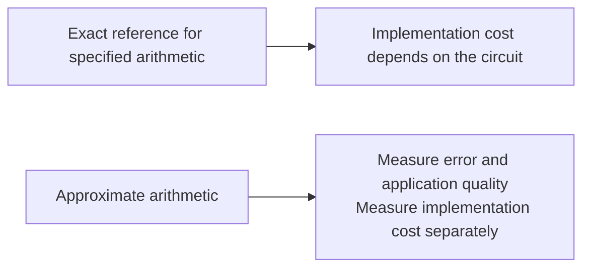

# Why Inexact Computing? (The Energy–Accuracy Trade-Off)

**You need:** whole-number arithmetic and simple percentages. You do *not* need circuits, probability, calculus, linear algebra or signal processing. Every term used below is defined on this page.

**After this page you can:**

1. say separately what **delay**, **power**, **energy** and **area** measure, and in which units;
2. follow one pixel (the value `214` instead of `215`) to see how a one-count error can change a decision;
3. keep three questions apart: how large is the error, does *this task* accept it, and what does the implementation cost.

**Route:** [Home](../index.md) → this page → [History and evolution](history-and-evolution.md) → [Motivations and challenges](motivations-and-challenges.md). On the five-stop first visit, go next to [Bits and carries](../start/bits-and-carry.md).

---

## Start here: one pixel, one count

Image processing does arithmetic on pixel values. How much arithmetic depends on the codec, the resolution, the frame rate and the processing algorithm; it is not determined by the screen alone.

**Question.** A background pixel in a photo is meant to carry the brightness code `215`, but the arithmetic returns `214`. Would your eye ever notice?

Sometimes nothing changes. Sometimes everything changes. The one-count error matters when a decision sits exactly on the boundary. Suppose a program applies the test `value >= 215`:

```
if pixel_value >= 215:
    keep the pixel
else:
    discard the pixel
```

With the exact value `215` the test is true. With the approximate value `214` it is false. **A one-count error changed the decision.** The same one-count error inside a smooth region, far away from 215, would have changed nothing.

So "the error is only 1" is not by itself reassuring, and "the error is large" is not by itself fatal. What decides is whether the *task* still does its job. Inexact computing therefore asks three separate questions and refuses to blur them:

| Question | What it is | Where it is answered |
|---|---|---|
| How large is the error? | a number, in the output's units | [Error metrics made easy](error-metrics-made-easy.md) → [Error metrics and mathematical bounds](error-metrics.md) |
| Does this task accept the error? | a decision about *one* application | [Motivations and challenges](motivations-and-challenges.md) |
| What does the implementation cost? | delay, power, energy, area | this page |

Here is the whole idea in one picture. Exact arithmetic has an implementation cost that depends on the circuit; approximate arithmetic can be cheaper, but then the error and the application quality have to be measured too, and the cost measured separately.



## Four cost words, and the units they come in

These four words are used loosely in news articles and mixed up constantly. Fix their units now and much of the rest of the site becomes readable.

| Word | What it measures | Typical unit |
|---|---|---|
| **area** | how much silicon the circuit occupies | mm² |
| **delay** | how long one operation takes | s, often ps or ns |
| **power** | how *fast* energy is being used | W = J/s |
| **energy** | how much is used *in total* | J = W × s |

Here **m** (milli) means $10^{-3}$, **n** (nano) means $10^{-9}$, and **p** (pico) means $10^{-12}$. Thus $1\,\text{mW} \times 1\,\text{ns} = 10^{-12}\,\text{J} = 1\,\text{pJ}$.

Two consequences follow immediately. First, **energy = power × time**: a circuit that is twice as fast is not automatically using half the energy. Second, a saving measured inside one multiplier is not a saving for a whole device. Memory, communication, cooling and the rest of the system are separate loads, so a percentage measured on one block cannot be scaled up to a data centre or a battery without the system-level breakdown. Comparisons need the same baseline, the same units and the same region — one cell, one block, one chip, one system.

## Exact arithmetic already has a finite contract

"Exact" here does not mean infinite mathematical precision. It means that the hardware implements the arithmetic **specified** for it, including its representation, rounding and overflow rules. Floating-point arithmetic rounds. Fixed-width arithmetic can overflow or wrap. A storage system may correct faults. The specification is what the rest of the system was written against, and that is exactly what makes it expensive to guarantee.

Some operations genuinely need their specified results — address calculations and exact cryptographic primitives are the standard examples. Other workloads may tolerate selected approximations, *provided* the application requirements are checked. AI and LLMs, computer vision, audio and speech, real-time rendering, and sensor streams are all plausible candidates, and each one has to be tested on its own terms: what a model tolerates is a fact about that model and that data, not a property of the word "AI". The reference section lists those categories with the test each one needs.

## What relaxing exactness can, and cannot, buy

Relaxing the exactness requirement opens three doors, and each one closes onto a catch. Circuits can be **simplified** — fewer or cheaper gates — but the control and correction logic added around them may eat the saving. Supply **voltage** can often be lowered, which shrinks the charging energy, but delay and leakage move in the wrong direction and have to be checked. A smaller **area** may follow, which is not the same thing as a smaller whole-chip area or a smaller whole-chip energy.

The important negative result is that there is no universal percentage rule. No fixed "accuracy → energy" exchange rate exists, because the exchange depends on the error metric, the input distribution, the bit width, the process, the voltage, the timing constraints, the exact baseline being compared against, and the workload itself. Every number in this site therefore travels with its conditions, and the rest of the page makes those conditions concrete: the power model in the reference section, and the 16-bit multiplier below it as the circuit the argument is usually held on.

## Check your understanding

Answer on paper first, then open the check. Your answers are not saved or sent anywhere.

<a id="read-f1"></a>

**WB1.** A block is active for $2$ ns and draws $30$ mW while active. What is its energy for one operation, in joules? Then state the same value in pJ.

<details markdown="1">
<summary>Check WB1</summary>

Energy $= \text{power}\times\text{time} = 30\times10^{-3}\,\text{W} \times 2\times10^{-9}\,\text{s} = 6\times10^{-11}\,\text{J}$, that is $60$ pJ.

- If you wrote $30$ mW, you gave a power, not an energy: power is a rate, energy is the total.
- If you multiplied by the clock *frequency* instead of the period, you divided by time rather than multiplying; check the units: W × Hz is J/s², whereas W ÷ Hz is J. Multiplying power by the period (or dividing by frequency, for one cycle) gives energy.

</details>

<a id="read-f2"></a>

**WB2.** A test accepts values of `100` or more. The exact result is `100`; the approximate hardware returns `99`. (a) What is the error size? (b) Does the decision change? (c) Would the answer to (b) be different if the exact result had been `140` instead?

<details markdown="1">
<summary>Check WB2</summary>

(a) $|99-100| = 1$. (b) Yes: `100 >= 100` is true but `99 >= 100` is false, so the decision flips on a one-count error. (c) No decision change: `140` and `139` are both accepted, because both are far from the boundary. The size of the error did not change; only its *position relative to the threshold* did.

- If you answered (b) with "no, the error is only 1", you were judging the error alone instead of the task.
- If you answered (c) with "yes, because 140 is bigger", note that the threshold is what matters, not the magnitude of the value.

</details>

<a id="read-f3"></a>

**WB3.** Two claims appear in a report. Claim 1: "our approximate multiplier uses 40% less **energy** than the exact 16×16 multiplier, measured with the same inputs, the same width and the same synthesis setup." Claim 2: "our multiplier saves 40% of global **power**." Which claim is stated well enough to check, and what is missing from the other?

<details markdown="1">
<summary>Check WB3</summary>

Claim 1 is checkable: it names the quantity (energy), the baseline (the exact 16×16 multiplier), the width, the inputs and the measurement setup. Claim 2 is ambiguous: it does not say whether "power" means dynamic power only or total power, whether the comparison is per operation or per unit of time, what frequency and voltage were used, or what region is included. It also silently changes a rate (power) into what sounds like a total (a saving).

- Do not "fix" Claim 2 by assuming the same conditions as Claim 1: the two words are not interchangeable, and the missing conditions are exactly what a reviewer would ask for.
- A percentage without its baseline, units and region is not a result.

</details>

---

## 🔬 Going deeper: the trade-off in detail

The answer depends on the image, viewing conditions, and error pattern. Even a one-count error can change a threshold decision: with the test `value >= 215`, values `214` and `215` give different results. A small numerical error does not by itself establish perceptual tolerance or task safety.

Everything below is reference material. It is not needed for WB1–WB3.

### 🛑 The "Exactness Tax" of Modern Silicon

Conventional digital hardware is required to implement its specified arithmetic semantics. This is different from infinite mathematical precision: floating-point arithmetic rounds, fixed-width arithmetic can overflow, and storage systems may correct faults.

Some operations, such as address calculations and exact cryptographic primitives, require their specified results. Other workloads may tolerate selected approximations, provided their application requirements are checked.

```
+-------------------------------------------------------------------------+
|                  THE "EXACTNESS TAX" IN REAL WORKLOADS                  |
+-------------------------------------------------------------------------+
| AI & LLMs             : Test model, data and task-specific sensitivity |
| Computer Vision       : Separate human viewing from machine decisions |
| Audio & Speech        : Evaluate signal distortion and task quality   |
| Real-Time Rendering   : Evaluate spatial and temporal error patterns  |
| Sensor Streams        : Compare sensor and arithmetic errors explicitly|
+-------------------------------------------------------------------------+
```

The workload categories above are candidates for evaluation, not blanket guarantees of tolerance. No common energy, area, or visibility ratio is asserted here; a result for one circuit does not automatically apply to another application or a whole device.

### ⚡ A Simplified CMOS Power Model

One simplified average-power model for CMOS is:

$$P_{\text{total}} \approx \alpha \cdot C_{\text{eff}} \cdot V_{DD}^2 \cdot f + I_{\text{leak}} \cdot V_{DD}$$

Here $\alpha$ counts effective charging activity per clock cycle, $C_{\text{eff}}$ is switched capacitance, and $f$ is clock frequency. This model omits effects such as short-circuit current; leakage and activity can change with operating conditions. Power is not energy per operation: energy is the time integral of power. See [MIT 6.012 Lecture 13, slide 13](https://ocw.mit.edu/courses/6-012-microelectronic-devices-and-circuits-spring-2009/de333d22ec4230412f4e7bdd4da3d6ce_MIT6_012S09_lec13.pdf) for the capacitive switching derivation.

When we relax the requirement of $100\%$ numerical exactness:

1. **Logic simplification** can reduce capacitance or activity, but added control and correction logic may offset savings.
2. **Voltage scaling** reduces the capacitive switching term if other conditions are fixed, while timing margins and leakage must be evaluated separately.
3. **Area reduction** may permit a smaller implementation; it does not establish an equal reduction in whole-chip area or energy.

There is no universal "1% rule" connecting an accuracy percentage to energy or delay savings. The error metric, input distribution, bit width, process, voltage, timing constraints, exact baseline, and workload must accompany a measured comparison.

For published examples with their full conditions, see the [ALWANN case study](../bridge/ai-and-approximate-math.md#alwann-case-study) (network accuracy versus modelled convolution-multiplier energy) and the [published divider comparison](../taxonomy/dividers.md#published-divider-comparison) (circuit error versus synthesized power). Their metrics differ and cannot be combined into one rule.

### The circuit this trade-off is usually discussed on

```
+-------------------------------------------------------------------------+
|                      TRADITIONAL EXACT MULTIPLIER                       |
|  [ 16-bit Multiply ] ---> 256 partial products + Full reduction tree   |
|  An unsigned schoolbook 16 x 16 product starts with 256 bit-products.  |
+-------------------------------------------------------------------------+
                                    VS
+-------------------------------------------------------------------------+
|                     APPROXIMATE COMPRESSOR MULTIPLIER                   |
|  [ 16-bit Multiply ] ---> Lower columns compressed with AC-4:2 cells   |
|  Error and PPA depend on the particular compressor and implementation.|
+-------------------------------------------------------------------------+
```

Read the two boxes as *counted structure*, not as measured savings. An unsigned schoolbook $16\times16$ product really does begin with $256$ bit-products, and a compressor multiplier really does rearrange how the low columns are reduced. What the error and the PPA (power, performance, area) become is a property of the particular compressor, the width and the implementation, so it must be measured or bounded rather than assumed. The adder page shows the same idea one level down: [Approximate adders](../taxonomy/adders.md).

### 🧩 Test Your Understanding

Test your intuition with this interactive quiz. It is an **optional advanced self-check**: it assumes you have met the bit-weight ideas on [Bits and carries](../start/bits-and-carry.md), the error metrics on [Error metrics made easy](error-metrics-made-easy.md), and the adder behaviour on [Approximate adders](../taxonomy/adders.md). It does not cover the material of this page, and passing it is not a substitute for WB1–WB3.

<iframe
  src="../../labs/quiz-inexact-mastery.html"
  title="Inexact Mastery Quiz"
  style="width: 100%; height: 820px; border: none; background: transparent; margin: 12px 0;"
  loading="lazy"
></iframe>
