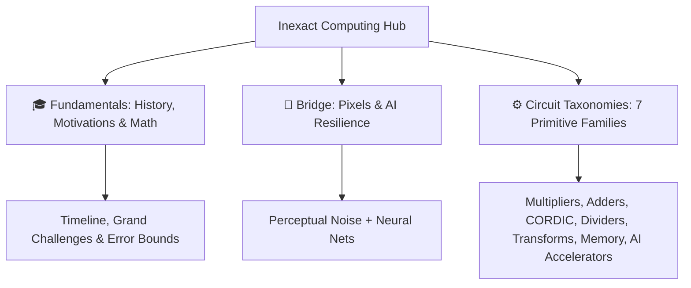

# Inexact Computing Learning & Research Portal

## Choose a first reading route

**You need:** whole-number addition, subtraction and percentages. You do not need a course in circuits, probability, calculus, linear algebra or signal processing to start. Each specialist page introduces the extra ideas needed for its opening example; its **Going deeper / Reference** section keeps the technical material available for later.

**Your first goals:** explain where an approximate answer differs from its reference; calculate a small error; and ask whether a claimed saving applies to one circuit or to the whole task. The exercises are for checking your understanding, not for grading or collecting your answers.

### First visit: five short stops

1. [Why use inexact computing?](fundamentals/why-approximate-computing.md) — distinguish energy, power, delay and area before comparing savings.
2. [Bits and carries](start/bits-and-carry.md) — build a number from bit weights, then see why an addition needs a carry.
3. [How do we grade mistakes?](fundamentals/error-metrics-made-easy.md) — use a small table to separate how often an answer is wrong from how far it is wrong.
4. [Approximate adders](taxonomy/adders.md#read-a01) — predict a small sum, use the existing lab, and explain a changed carry.
5. [Approximate multipliers](taxonomy/multipliers.md#mul-start) — follow 3 × 5 from partial products to a finished answer. Dropping work inside the circuit differs from clearing bits afterwards.

At each stop, try the prediction before opening its answer. If the numbers do not make sense, return to the named prerequisite or use the [glossary reading desk](glossary.md#reading-desk). You can stop after the opening lesson; the reference layer is not a prerequisite for the next beginner stop.

### Then follow a question that interests you

| Your question | Route | What to watch |
|---|---|---|
| Can an image hide a numerical mistake? | [Pixels and weighted averages](bridge/human-eyes-and-pixels.md) → [AI and quantization](bridge/ai-and-approximate-math.md) | Fix the reference, rounding rule and comparison region; a quality score is not a guarantee of what every viewer sees. |
| How do mistakes build up? | [Motivations and challenges](fundamentals/motivations-and-challenges.md) → [Mathematical error metrics](fundamentals/error-metrics.md) | Signed errors can reinforce or cancel; a sample maximum is not a bound on every input. |
| What can a system change? | [Approximation across the stack](fundamentals/approx-paradigms.md) → [Memory](taxonomy/memory.md#mem-start) → [AI accelerators](taxonomy/accelerators.md#acc-start) | Changing a representation, skipping work and changing a circuit are different choices. Count memory and control costs too. |
| How do other arithmetic families work? | [Dividers](taxonomy/dividers.md#div-start), [CORDIC rotations](taxonomy/cordic.md#cor-start), [Transforms](taxonomy/transforms.md#trf-start) | These are optional branches. Start with the small hand example; leave the technical derivations for a second visit. |
| Where did these ideas come from? | [History and evolution](fundamentals/history-and-evolution.md) | Distinguish an observation, a model projection, a measured experiment and a review statement. This branch is optional. |

**One comparison to keep in mind.** Suppose a task needs 10 units of energy and its multiplier uses 2 of them. Halving only the multiplier's energy saves 1 unit, so the task would use 9 units if everything else stayed the same: a 10% task saving, not 50%. Real systems also need the overheads and operating conditions measured. This is a bookkeeping example, not a result for any named device.

Check your route before continuing

**Home check 1.** You can add decimal numbers but do not know binary. Where should you go before the adder lab? **Bits and carries**, then the simple error table. You do not need to start with the advanced mathematical bounds.

**Home check 2.** A paper halves multiplier energy. Has it established that the whole computer uses half as much energy? **No.** The multiplier's share, all other work and any new overhead must be included. In the 10-unit example above, only 1 unit is saved.

The original subject overview and research links continue below. All eighteen reading pages are reachable through these routes and the navigation guide; the eight existing tools remain attached to their lessons. You do not have to complete every branch in order to try an application.

---

Welcome to the **Inexact Computing Learning and Research Portal**, an open-access living laboratory and interactive educational resource for **approximate and inexact arithmetic computing**.

---

## 🎯 Objectives & Scope

Approximate computing trades a specified loss of numerical accuracy or application quality for potential reductions in energy, silicon area, or delay. Errors are not inherently tiny or bounded: the chosen arithmetic model, input domain, and application must establish acceptable limits. Candidate applications include:

- **Artificial Intelligence & Deep Learning** (Conv2D, GEMM, Transformer attention, Systolic Arrays)
- **Computer Vision & Image Processing** (Filtering, Edge detection, JPEG/HEVC DCT compression)
- **Signal Processing & Audio** (FFT, FIR filters, CORDIC coordinate rotations)
- **Low-Power Memory Systems** (Voltage-scaled SRAM caches, Refresh-relaxed DRAM)

---

## 📚 Navigation Guide

**New to computer arithmetic? Start here:** [Bits and Carries](start/bits-and-carry.md) → [How Do We Grade Mistakes?](fundamentals/error-metrics-made-easy.md) → [Approximate Adders: start here](taxonomy/adders.md#read-a01). You only need whole-number addition, subtraction and percentages.

| Section | Description |
| :--- | :--- |
| [**Glossary**](glossary.md) | Plain-English definitions of core inexact computing concepts, acronyms, and terms. |
| [**Fundamentals**](fundamentals/why-approximate-computing.md) | Energy–accuracy trade-offs, [**History & Evolution**](fundamentals/history-and-evolution.md), [**Motivations & Grand Challenges**](fundamentals/motivations-and-challenges.md), and mathematical error bounds. |
| [**Bridge to Real World**](bridge/human-eyes-and-pixels.md) | Conditional tolerance to image errors (includes the **Image Filter Sandbox**) and application-dependent effects of inexact arithmetic on AI. |
| [**Circuit Taxonomies**](taxonomy/multipliers.md) | Architectural guides and IEEE citations across 7 core hardware families: **Multipliers**, **Adders**, **CORDIC**, **Dividers & Squarers**, **Transforms (DCT/FFT)**, **Memory & Storage**, and **AI Accelerators**. |

---

## 🔬 Repository & Source Code

- **GitHub Repository**: [Inexact-Computing/public](https://github.com/Inexact-Computing/public)
- **Parent Laboratory**: [Inexact-Computing/inexact-computing-lab](https://github.com/Inexact-Computing/inexact-computing-lab)
- **License**: CC BY 4.0 (Creative Commons Attribution 4.0 International)

Scientific context: J. Han and M. Orshansky, *Approximate Computing: An Emerging Paradigm for Energy-Efficient Design*, ETS, 2013, Sections I–II ([author manuscript](https://www.ece.ualberta.ca/~jhan8/publications/ApproCompReview_final.pdf), [DOI](https://doi.org/10.1109/ETS.2013.6569370)). The examples here are research directions, not universal efficiency or safety guarantees.
