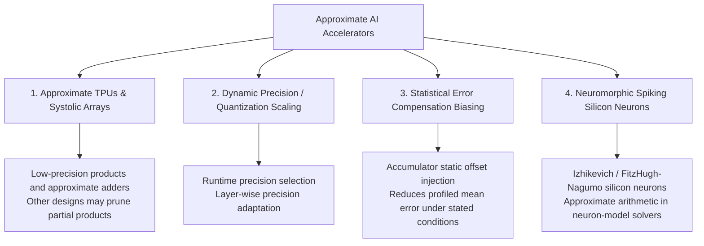

# Approximate AI Accelerators & Systolic Arrays

Modern Artificial Intelligence (Large Language Models, Vision Transformers, Autonomous Navigation, and Diffusion Models) often uses substantial **matrix multiplication ($\mathbf{C} = \mathbf{A} \times \mathbf{B}$)**.

A **multiply-accumulate (MAC)** contributes to a dot product; required throughput depends on the workload:

$$\text{MAC}: \quad \text{Accumulator} \leftarrow \text{Accumulator} + (A_{ik} \times B_{kj})$$

Approximate accelerators trade arithmetic fidelity for hardware cost. Error tolerance and weight statistics must be evaluated for the intended network.

**New here?** You need multiplication with negative numbers, averages and percentages. [Why AI Loves Inexact Math](../bridge/ai-and-approximate-math.md) gives background on neural networks but is not required. This first part goes from "multiply and add three pairs of numbers" to "how an AI accelerator organizes that work, where its energy goes, and what an approximate multiplier changes". Material marked *Going deeper* is the original technical part of this page and is optional on a first read.

**After this first part you can:**

1. compute a short dot product with a multiply-accumulate (MAC) unit step by step, and say what a processing element (PE) and an array add to it;
2. use a historical energy table to explain why moving data can cost more than arithmetic, and say what that table cannot tell you;
3. explain what a mean-error correction fixes and what it does not.

<a id="acc-start"></a>

## Start here: a dot product of three numbers

A neural network repeatedly does one small calculation. It takes **weights**, numbers fixed after training and stored with the network, and **activations**, the numbers flowing through the network for the current input, such as pixel values or the previous layer's outputs. It multiplies them in pairs and adds the products. That sum is a **dot product**:

| | Pair 1 | Pair 2 | Pair 3 |
|---|---:|---:|---:|
| Weight w | 2 | −1 | 3 |
| Activation a | 4 | 5 | 1 |
| Product w × a | 8 | −5 | 3 |

2 × 4 + (−1) × 5 + 3 × 1 = 8 − 5 + 3 = **6**.

### MAC, PE and array

A **MAC unit** has one multiplier, one adder and one register called the accumulator. Each step multiplies one pair and adds the product to the accumulator. Starting from 0, the accumulator holds 8, then 3, then 6.

A **processing element (PE)** is a MAC unit plus small registers that hold a weight and pass data on to its neighbours. An **array** is a grid of PEs working at the same time, each on a different output. Data moves from neighbour to neighbour instead of every PE fetching it from memory. The [systolic array section](#the-systolic-array-anatomy-of-modern-ai-hardware) shows the layout.

**Latency** is the time until one result is ready; **throughput** is how much work is finished per unit of time. As a simple count, assume one MAC per cycle per unit: one MAC unit needs 3 cycles for this dot product and 12 cycles for four such dot products. Four PEs side by side finish all four in 3 cycles. Throughput is four times higher, yet each result still takes 3 cycles. Real arrays also spend cycles loading data in and out.

<a id="acc-energy"></a>

### Moving data can cost more than arithmetic

**Predict first:** for this dot product with 32-bit integers, which costs more energy: the arithmetic, or fetching the six numbers from main memory (DRAM)?

<details markdown="1">
<summary>Check with the historical 45 nm table</summary>

The [published operation-energy table](#published-operation-energy) lists 45 nm values for **32-bit** operations: integer addition 0.1 pJ, integer multiplication 3.1 pJ, SRAM-cache access 5 pJ and DRAM access 640 pJ.

| Part of the work | Count | Energy (pJ) |
|---|---|---:|
| Arithmetic: 3 multiplications + 3 additions | 3 × 3.1 + 3 × 0.1 | 9.6 |
| Fetch the 6 numbers from SRAM cache | 6 × 5 | 30 |
| Fetch the 6 numbers from DRAM | 6 × 640 | 3,840 |

Fetching from DRAM costs about 400 times the arithmetic here. This is why arrays keep weights in place and reuse each fetched number many times.

The table's limits stay attached to it: it is a 45 nm table from 2015 that Han et al. credit to Horowitz (a secondary citation, not verified here from the original). It concerns 32-bit operations, not the 8-bit arithmetic common in current accelerators, and gives no supply voltage or memory size. It cannot predict a modern chip's energy or the saving from replacing only its multiplier.

</details>

<a id="acc-mean"></a>

### Approximate products and a mean correction

An approximate multiplier gives slightly wrong products. Suppose that, over the inputs it was profiled on, its error (approximate − exact) is −1 per product **on average**. Over K = 3 products the expected total error is −3, so adding +3 to the accumulator corrects the average:

| Output | Errors of its 3 products | Total | After adding +3 |
|---|---|---:|---:|
| Output A | −2, 0, −1 | −3 | 0 (corrected) |
| Output B | 0, 0, 0 | 0 | +3 (now wrong) |

A mean correction fixes the average over many outputs, not each output. Two more things matter when products are added up:

- **Errors that move together.** If the product errors tend to be large at the same time, they add up to a wider spread than independent errors would. The reference part writes this as a covariance term.
- **Overflow.** The accumulator needs enough bits for the largest possible sum. For example, products of two unsigned 4-bit numbers reach 15 × 15 = 225; three of them reach 675, which needs 10 bits. With fewer bits the sum wraps around and the error is huge.

### Check your understanding

Answer on paper first, then open the check. Your answers are not saved or sent anywhere.

<a id="acc-q1"></a>

**Question ACC-1.** With weights (1, 2, 3) and activations (4, 0, −2), what does the accumulator hold after each MAC step?

<a id="acc-q2"></a>

**Question ACC-2.** An approximate multiplier has a profiled mean error of −0.5 per product. Each output sums K = 8 products. What correction should be added to the accumulator, and does it make every output exact?

<a id="acc-q3"></a>

**Question ACC-3.** "The table says a DRAM access costs 640 pJ, so our new 8-bit accelerator chip spends 640 pJ per weight it reads." What is wrong with this?

<details markdown="1">
<summary>Check questions ACC-1 to ACC-3</summary>

**ACC-1.** 1 × 4 = 4, so 4; then 2 × 0 = 0, still 4; then 3 × (−2) = −6, so −2.

- Ignoring the sign of −2 gives 10.

**ACC-2.** The expected total error is 8 × (−0.5) = −4, so add **+4**. This corrects the expected value under the profiled inputs only; individual outputs keep their own errors, and other inputs, rounding or overflow can leave a bias.

- Subtracting 4 doubles the drift: the correction must have the opposite sign of the mean error.

**ACC-3.** The 640 pJ is a historical 45 nm figure for a 32-bit DRAM access, cited second-hand. A modern chip has a different process, voltage, memory and data width, and its energy must be measured for that chip and workload.

</details>

---

## Going deeper

Everything below is the original reference material for this page. It is not needed for the questions above.

- [The systolic array](#the-systolic-array-anatomy-of-modern-ai-hardware) and its [dataflow topologies](#dataflow-topologies)
- [Energy breakdown](#energy-breakdown-the-mac-cost-hierarchy) with the full [45 nm operation-energy table](#published-operation-energy)
- [Approximate accelerator taxonomy](#comprehensive-inexact-ai-accelerator-taxonomy), [APTPU and error accumulation](#1-approximate-tensor-processing-units-aptpu) (mean, variance and covariance), [statistical mean-error compensation](#2-statistical-mean-error-compensation-me-to-0) and [neuromorphic neurons with their spike-reset rule](#3-neuromorphic-biomimetic-neurons)
- [Silicon PPA comparison](#silicon-ppa-comparison) and [primary literature](#primary-literature)

---

## 🧩 The Systolic Array: Anatomy of Modern AI Hardware

In Google’s first-generation Tensor Processing Unit (TPU) and some AI ASICs, matrix arithmetic is executed on a 2D spatial grid of Processing Elements (PEs) known as a **Systolic Array**:

```
           Inputs Matrix B (Weights / Filters)
              v               v               v
  Inputs A -> [ PE 0,0 ] ---> [ PE 0,1 ] ---> [ PE 0,2 ]
              |               |               |
              v               v               v
  Inputs A -> [ PE 1,0 ] ---> [ PE 1,1 ] ---> [ PE 1,2 ]
              |               |               |
              v               v               v
              [ PE 2,0 ] ---> [ PE 2,1 ] ---> [ PE 2,2 ]
                      \               \               \
                       v               v               v
               Accumulated Output Matrix C (Activations)
```

### Dataflow Topologies
1. **Weight Stationary (WS)**: Neural network weights are loaded into PE local registers and remain stationary, while activation vectors stream horizontally and partial sums accumulate vertically. This reuses weights; energy depends on the complete dataflow.
2. **Output Stationary (OS)**: Partial sums accumulate within each PE's local accumulator register until the full dot product $\sum A_{ik} B_{kj}$ is computed, reducing partial-sum traffic; total memory traffic depends on tiling and storage.

---

## ⚡ Energy Breakdown: The MAC Cost Hierarchy

Arithmetic and data movement both consume energy. Operation costs depend on process, voltage, precision, memory size, and access pattern. Values from different implementations cannot form a universal 7nm/28nm energy table.

Replacing multiplier logic can reduce its area or energy, but buffers, interconnect, control, and memory remain. Array density, whole-chip power, and model accuracy therefore require implementation-specific measurements; no fixed doubling or accuracy-retention guarantee follows.

<a id="published-operation-energy"></a>

### A Published 32-Bit Operation-Energy Example

Han et al. (2015, [Figure 1](https://arxiv.org/pdf/1506.02626)) reproduce the following 45 nm CMOS operation-energy table, crediting Mark Horowitz's energy table in their reference [7]. This is a secondary attribution through Han et al.; the Horowitz original is not independently verified here. The entries concern 32-bit operations or accesses, not 64-bit data or an INT8 MAC.

| Operation or access | Energy (pJ per operation/access) |
| :--- | ---: |
| 32-bit integer addition | 0.1 |
| 32-bit floating-point addition | 0.9 |
| 32-bit register-file access | 1 |
| 32-bit integer multiplication | 3.1 |
| 32-bit floating-point multiplication | 3.7 |
| 32-bit SRAM-cache access | 5 |
| 32-bit DRAM-memory access | 640 |

Within this historical table, DRAM access costs $640/0.1=6400$ times integer addition and $640/5=128$ times SRAM-cache access. These ratios illustrate why data movement matters. Figure 1 does not specify supply voltage, memory capacity, or a modern accelerator workload; these entries must not predict current-chip energy, total accelerator savings, or savings from replacing only its multiplier.

---

## 🏛️ Comprehensive Inexact AI Accelerator Taxonomy



---

## 🔬 1. Approximate Tensor Processing Units (APTPU)

The **APTPU** of Elbtity et al. uses approximate processing elements with low-precision multiplication and approximate addition, together with shared pre-approximate units that preprocess operands. It is not defined by the Booth/4:2-compressor diagram formerly shown here.

For arithmetic error $e_k=\widehat{A_{ik}B_{kj}}-A_{ik}B_{kj}$ and an exact, non-overflowing accumulator:

$$\mathbb{E}\left[\sum_{k=1}^{K}e_k\right]=\sum_{k=1}^{K}\mathbb{E}[e_k]$$

$$\operatorname{Var}\left(\sum_{k=1}^{K}e_k\right)=\sum_{k=1}^{K}\operatorname{Var}(e_k)+2\sum_{k<l}\operatorname{Cov}(e_k,e_l)$$

Zero mean weights do not imply zero mean product errors. Even independent zero-mean errors have sum variance $K\sigma_e^2$ when their variances are equal; only the average has variance $\sigma_e^2/K$. Approximate addition introduces further errors.

---

## 🎯 2. Statistical Mean Error Compensation ($ME \to 0$)

With error defined as approximate minus exact, a negative mean $\mu_e$ produces expected dot-product error $K\mu_e$ if all terms share that mean. A compensation added to the accumulator must have the opposite sign:

$$C_{\text{comp}}=-K\mu_e$$

More generally, $C_{\text{comp}}=-\sum_k\mathbb{E}[e_k]$. For the illustrative $K=1024$, a mean error of $-1$ gives a $-1024$ expected drift and requires $+1024$ compensation. This corrects the expected value under the profiled distribution, not each output. Rounding, changing inputs, approximate accumulation, and overflow can leave residual bias. Offset storage or injection can have hardware cost.

---

## 🧠 3. Neuromorphic Biomimetic Neurons

Spiking Neural Networks (SNNs) mimic the human brain by transmitting information via sparse temporal action potentials (spikes). Silicon implementations of the **Izhikevich quadratic integrate-and-fire neuron** model:

$$\frac{dv}{dt} = 0.04 v^2 + 5v + 140 - u + I$$

$$\frac{du}{dt} = a(bv - u)$$

The model also needs the spike/reset rule: if $v\geq30\text{ mV}$, set $v\leftarrow c$ and $u\leftarrow u+d$. The variables, units, parameters, integration step, and reset handling are part of the model. Approximate squaring may change its dynamics; neuron count and power require a specified implementation, connectivity, and spike workload.

---

## 📊 Silicon PPA Comparison

No measured 16×16, 28nm, 1GHz comparison is established for the previously listed cores. Area, power, timing, and accuracy should be compared only with matched implementation constraints and workloads. The untraceable numeric table has been removed.

---

## 📚 Primary Literature

- S. Han, J. Pool, J. Tran, and W. J. Dally, *“Learning both Weights and Connections for Efficient Neural Networks”*, NIPS (2015), [arXiv author paper, Figure 1 and reference [7]](https://arxiv.org/pdf/1506.02626). Figure 1's 45 nm table is credited to Horowitz; it is a cited operation-energy example, not a measurement of the accelerator models on this page.
- N. P. Jouppi et al., *“In-Datacenter Performance Analysis of a Tensor Processing Unit”*, ISCA (2017), [architecture and systolic dataflow](https://arxiv.org/pdf/1704.04760), DOI: 10.1145/3079856.3080246.
- M. E. Elbtity, P. S. Chandarana, B. Reidy, J. K. Eshraghian, and R. Zand, *“APTPU: Approximate Computing Based Tensor Processing Unit”*, IEEE TCAS-I 69(12), 5135–5146 (2022), [DOI: 10.1109/TCSI.2022.3206262](https://doi.org/10.1109/TCSI.2022.3206262).
- K. Chen, W. Liu, J. Han, and F. Lombardi, *“Profile-Based Output Error Compensation for Approximate Arithmetic Circuits”*, IEEE TCAS-I 67(12), 4707–4718 (2020), [author manuscript](https://www.ece.ualberta.ca/~jhan8/publications/TCAS-I_Error_Compensation_Final.pdf), DOI: 10.1109/TCSI.2020.2996567.
- E. M. Izhikevich, *“Simple Model of Spiking Neurons”*, IEEE TNN 14(6), 1569–1572 (2003), [Eqs. (1)–(3)](https://www.izhikevich.org/publications/spikes.pdf), DOI: 10.1109/TNN.2003.820440.
