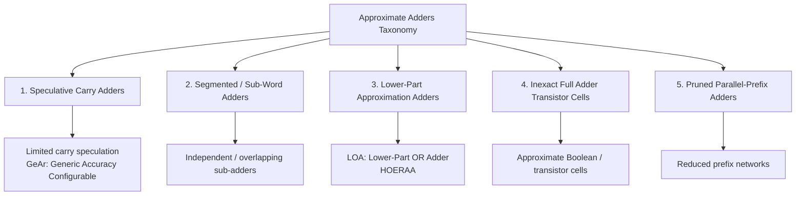

# Approximate Adders Taxonomy & Microarchitectures

Adders form the foundational arithmetic backbone of digital VLSI systems. Adders support direct addition and subtraction and also appear in multipliers, dividers, and address generation units (AGUs).

**New here?** This page starts with one small example of an approximate adder. Before it, read [Bits and carries](../start/bits-and-carry.md) and steps 1 and 2 of [How Do We Grade Mistakes?](../fundamentals/error-metrics-made-easy.md). Material marked *Going deeper* is the original reference part of this page and is optional on a first read.

**After this first part you can:**

1. apply OR to 7 and 1 column by column, and explain why the result differs from exact addition;
2. describe what an adder called LOA-8 does with its low bits, its boundary and its high bits;
3. decide whether a one-unit error changes an "accept 8 or more" decision.

<a id="read-a01"></a>

## Start here: OR versus exact addition for 7 + 1

The lab on this page works with 16-bit numbers, and this example happens in the lowest 8 bits. So write 7 and 1 with 8 bits, adding zeros on the left (leading zeros do not change a value):

| Number | Bits, high to low |
|---|---|
| 7 | `00000111` |
| 1 | `00000001` |

On the bits page, exact addition of 7 + 1 passed a carry through three columns and gave `00001000` = 8.

**Predict first:** apply OR to each column, that is, to each pair of bits in the same position. What pattern do you get, and what value is it?

<details markdown="1">
<summary>Check the OR columns</summary>

| Weight | 128 | 64 | 32 | 16 | 8 | 4 | 2 | 1 |
|---|---|---|---|---|---|---|---|---|
| 7 | 0 | 0 | 0 | 0 | 0 | 1 | 1 | 1 |
| 1 | 0 | 0 | 0 | 0 | 0 | 0 | 0 | 1 |
| OR | 0 | 0 | 0 | 0 | 0 | 1 | 1 | 1 |

OR gives `00000111` = 7, while exact addition gives 8. OR keeps every 1 that it sees, but it never sends a carry to the left. In the rightmost column, 1 + 1 should write 0 and carry 1; OR writes 1 and carries nothing, so the value that exact addition moves up into the column worth 8 never arrives.

</details>

### How LOA-8 uses OR

The **Lower-Part OR Adder** with 8 low bits, **LOA-8**, splits a 16-bit addition into two parts:

- **Low 8 bits** (bits 0 to 7, weights 1 to 128): each output bit is the OR of the two input bits in that position. No carries move between these bits.
- **Boundary:** a single carry goes into bit 8 (weight 256). It is the AND of the two input bits in bit 7 (weight 128), so it is 1 only when both of those bits are 1.
- **High 8 bits** (bits 8 to 15, weights 256 and up): added exactly, with ordinary carries, starting from that boundary carry.

For 7 + 1, both numbers fit in the low 8 bits and both bit-7 values are 0. The boundary carry is 0, the high part is 0 + 0 = 0, and the output is the OR result, 7. The signed error is 7 − 8 = −1.

LOA-8 is not OR applied to a whole number: its high bits are added exactly. Its errors are not always too low either: for other inputs the boundary carry can push the result too high (the [LOA Error Contract](#loa-error-contract) shows 2 + 2 giving 6 with 2 OR bits). This design changes the arithmetic. Whether a particular implementation saves energy must be checked separately.

**Next:** the formal carry section below is optional on a first read. [Skip to the lab task](#read-a02).

---

## 🛑 The Carry Propagation Physics & Bottleneck

*Going deeper (optional on a first read): the formal carry equations. New readers can [skip to the lab task](#read-a02).*

In exact binary addition, two $N$-bit operands $A = \sum_{i=0}^{N-1} A_i 2^i$ and $B = \sum_{i=0}^{N-1} B_i 2^i$ with an initial carry-in $C_0$ produce an $(N+1)$-bit sum using Full Adder (FA) stages:

$$S_i = A_i \oplus B_i \oplus C_i$$

$$C_{i+1} = (A_i \cdot B_i) + (C_i \cdot (A_i \oplus B_i)) = G_i \lor (P_i \land C_i)$$

Here multiplication denotes Boolean AND and the addition sign in the carry expression denotes Boolean OR. Operands are unsigned, $C_0\in\{0,1\}$, and the full result includes $C_N$; an $N$-bit output instead wraps modulo $2^N$.

where $G_i = A_i \cdot B_i$ represents **Carry Generate** and $P_i = A_i \oplus B_i$ represents **Carry Propagate**.

```
  Bit 0          Bit 1          Bit 2                   Bit N-1
+-------+      +-------+      +-------+               +---------+
| FA 0  |--C1->| FA 1  |--C2->| FA 2  |-- ... --C_N-1>| FA N-1  |--C_N-->
+-------+      +-------+      +-------+               +---------+
    |              |              |                        |
   S_0            S_1            S_2                      S_N-1
```

### 1. The Critical Path Dilemma
In a **Ripple Carry Adder (RCA)**, the worst-case propagation delay scales linearly with wordlength:

$$T_{\text{RCA}} = t_{\text{gen}} + (N - 1) \cdot t_{\text{carry}} + t_{\text{sum}} = \mathcal{O}(N)$$

Even high-speed exact architectures like **Carry Lookahead Adders (CLA)**, **Kogge-Stone Parallel-Prefix Adders (KSA)**, or **Brent-Kung Adders (BKA)** achieve logarithmic delay $\mathcal{O}(\log_2 N)$ with topology-dependent wiring, routing capacitance, and fan-out costs that affect dynamic switching power ($P_{\text{dyn}} = \alpha C_{\text{eff}} V_{DD}^2 f$).

### 2. Statistical Carry Length
For independent uniformly random operand bits, a run of carry-propagate bits has a geometric tail: $P$ consecutive propagate bits occur with probability $2^{-P}$. The maximum run over an $N$-bit word grows on the order of $\log_2 N$, but its exact expectation depends on the run definition and boundary conditions. This random-input observation does not establish negligible error rates in arbitrary workloads.

In §5.6 of their 1946 report, Burks, Goldstine and von Neumann analyze the longest carry sequence for independent uniform binary words. Their sequence starts at a generating pair 11 and continues through pairs 10 or 01; another 11 starts a new sequence. Under this definition, the mean $a_n$ is bounded by $\log_2 n$. They report $a_{40}=4.62$, below $\log_2 40\approx5.3$. Recomputing their recurrence gives:

| Word length $n$ | Mean longest sequence $a_n$ (recomputed) |
|---|---:|
| 16 | 3.24 |
| 32 | 4.29 |
| 64 | 5.31 |

These are random-input sequence lengths, not measured delay or average latency of every adder architecture. [Original report, §5.6](https://safari.ethz.ch/architecture/fall2023/lib/exe/fetch.php?media=logical_design_of_an_electronic_computing_instrument.pdf).

Approximate adders can limit carry lookahead or replace lower-bit arithmetic. Their error probability depends on the architecture, configuration, and input distribution.

---

## ⚡ Interactive Lab: Carry Propagation Race

<a id="read-a02"></a>

**Lab task: 7 + 1 in the lab.** The lab shows numbers in **hexadecimal** (base 16). You need only three facts: the digits 0–9 keep their usual values; leading zeros change nothing (`0007` is 7); and `0x` only marks a hexadecimal number (`0x8` is 8).

1. Predict: what will LOA-8 output for 0007 + 0001, and what will the error be?
2. The lab opens with FFFF and 0001 filled in. Replace them with A = 0007 and B = 0001, then choose **Lower-Part OR Adder (LOA-8)**.
3. Read *Exact A + B*, *Adder Output* and *Error (output − exact)*.
4. Switch to **Exact Ripple Carry (RCA)** and read the error again.
5. Explain the difference using the OR columns above.

For this first task, compare LOA-8 with RCA. The technical note below also describes the other menu options; their reference sections can wait until later.

The lab uses unsigned 16-bit inputs, retains 17 output bits, and defines error as approximate minus exact. RCA and CLA both return the exact sum; their animation is schematic, not a timing simulation. ACA-4 predicts the carry into each bit, including the final carry-out, from the preceding four bits (or all available preceding bits near bit zero), assuming zero carry at the start of each window. LOA-8 follows the OR-and-boundary-carry contract below. Fixed-seed sample statistics are observed rates, not full-domain guarantees:

<iframe
  src="../../labs/adder-carry-race.html"
  title="Adder Carry Propagation Race"
  style="width: 100%; height: 840px; border: none; background: transparent; margin: 12px 0;"
  loading="lazy"
></iframe>

There is no extra carry-in at bit 0 in this lab. The moving bars only illustrate carries travelling; neither they nor your browser's speed measure a chip's delay or energy. If the lab does not load, [open the Carry Propagation Race lab on its own page](../labs/adder-carry-race.html).

<details markdown="1">
<summary>Check the lab readings for 0007 + 0001</summary>

| Adder | Exact A + B | Adder output | Error (output − exact) |
|---|---|---|---:|
| Exact Ripple Carry (RCA) | `0x8` | `0x8` | 0 |
| Lower-Part OR Adder (LOA-8) | `0x8` | `0x7` | −1 |

The two exact adders (RCA and CLA) and ACA-4 also return `0x8` here; this task does not need ACA-4.

</details>

**The line under the lab** reports a separate random test of the selected adder: 100,000 random 16-bit pairs drawn with a fixed seed. Its *wrong sums* figure is the error rate (ER) of that sample, and its *max |error|* is the largest error observed in that sample, not a worst-case guarantee. The numbers you type do not change this sample.

**Optional: FFFF + 0001.** The hexadecimal digit F stands for 15, so `FFFF` is sixteen 1-bits (65535). With RCA, FFFF + 0001 gives `0x10000` = 65536. Like `1111` + `0001` on the bits page, the sum needs one more bit, here a 17th, and the lab keeps it.

<a id="read-a03"></a>

## Does a one-unit error matter? A decision task

Suppose a task accepts any result of 8 or more and rejects anything smaller.

**Predict first:** for 7 + 1, is the exact result accepted? Is the LOA-8 result accepted?

<details markdown="1">
<summary>Check the decision</summary>

| Adder | Result for 7 + 1 | Accepted (8 or more)? |
|---|---:|---|
| Exact addition | 8 | Yes |
| LOA-8 | 7 | No |

An error of size 1 changed the decision.

</details>

Whether an approximation is acceptable depends on the task, not only on how small an error looks. [Why Inexact Computing?](../fundamentals/why-approximate-computing.md) has a similar threshold example with pixel values 214 and 215.

One example shows that an error can happen. It cannot tell you how often errors happen over all inputs (the ER); that depends on which inputs occur and how often. Full-range figures for LOA-8 are in [A Reproducible LOA-8 Error Example](#loa-error-example), under its stated conditions: independent, uniformly random unsigned 16-bit inputs, no external carry-in and a 17-bit output. They are neither hand-made table statistics nor the lab's random sample.

### Check your understanding

Answer on paper first, then open the check. Your answers are not saved or sent anywhere.

<a id="read-q6"></a>

**Question 6.**

<a id="read-q6a"></a>

(a) Apply OR to each pair of bits in `00000111` and `00000001`. What value results? Compare it with exact 7 + 1 and explain why the results differ.

<a id="read-q6b"></a>

(b) A task accepts values of 8 or more. Would both results be accepted? Explain.

<details markdown="1">
<summary>Check question 6</summary>

(a) OR gives `00000111` = 7, while exact 7 + 1 = 8. OR does not pass the carry from the rightmost column on to the left, so the 8 is never formed.

(b) No. The exact result 8 is accepted and the OR result 7 is rejected. A difference of 1 is enough to cross the threshold.

- "Same decision, because the error is only 1" misses the threshold: 7 is below 8.
- This is LOA-8 on one small example. In general LOA-8 still has its boundary AND carry and adds its high bits exactly; it is not OR on the whole number.
- One wrong example does not measure the error rate over all inputs, and it says nothing about energy.

</details>

---

## Going deeper

Everything below is the original reference material for this page. It is not needed for the questions above.

- [Comprehensive approximate adder taxonomy](#comprehensive-approximate-adder-taxonomy) and [speculative carry adders](#1-speculative-carry-adders)
- [Lower-part approximation adders](#2-lower-part-approximation-adders-loa-hoeraa), including the [LOA Error Contract](#loa-error-contract) and the [full-range LOA-8 error example](#loa-error-example)
- [Inexact full adder cells](#3-inexact-full-adder-cells) and [published adder comparisons](#published-adder-comparison)
- [Primary literature](#primary-literature-ieee-citations)

The formal carry equations are [earlier on this page](#the-carry-propagation-physics-bottleneck).

---

## 🏛️ Comprehensive Approximate Adder Taxonomy



---

## 🔬 1. Speculative Carry Adders

Local speculative carry predictors estimate the carry input for position $i$ using a window of $k$ preceding bits. This limits the lookahead span; actual delay also depends on the sub-adder and predictor implementation.

```
               k-bit Carry Prediction Window
              +-------------------------------+
Input bits:   | A_{i-1} A_{i-2} ... A_{i-k}   |
              | B_{i-1} B_{i-2} ... B_{i-k}   |
              +-------------------------------+
                             |
                             v  Speculative Carry C_spec
              +-------------------------------+
              | FA_i ... FA_{i+p-1}          | ---> p-bit Local Sum Outputs
              +-------------------------------+
```

### Generic Accuracy Configurable Adder (GeAr)
GeAr uses overlapping sub-adders and offers configurable accuracy, including error correction for accurate operation. The [authors' library](https://ces.itec.kit.edu/846.php#GeAR) distinguishes GeAr, ACA-I, ACA-II, and ETAII; their names do not imply identical carry prediction.

For a simplified local carry predictor with $P$ preceding bits and assumed zero carry at the window's start, a boundary prediction error requires all $P$ bits to propagate and an actual incoming carry of one. Thus $2^{-P}$ is a bound for **one boundary** under independent uniform inputs, not the error rate of a full GeAr adder. Multiple boundaries and correction change the overall rate. Neither speedup $N/R$ nor confinement of the numerical error to one sub-word is a general guarantee.

---

## ✂️ 2. Lower-Part Approximation Adders (LOA & HOERAA)

Lower-bit approximation changes smaller positional weights, but the importance of those bits depends on the application; they need not represent sensor noise.

```
       Exact Upper Part (N - k bits)           Approximate Lower Part (k bits)
+------------------------------------------+ +----------------------------------+
| Exact RCA / CLA with True Carry Prop     | | Simple Bitwise OR Gates          |
| S_i = A_i ^ B_i ^ C_i                    | | S_j = A_j | B_j                  |
+------------------------------------------+ +----------------------------------+
                    ^
                    | Carry-in C_k = A_{k-1} & B_{k-1}
```

### Lower-Part OR Adder (LOA)
For an $N$-bit addition with $k$ approximate bits:

- **Upper $(N-k)$ Bits**: Exact Full Adders with carry propagation.
- **Lower $k$ Bits**: Exact logic is stripped; sum bits are calculated via bitwise OR:

    $$
    S_j = A_j \lor B_j \quad (0 \le j \le k-1)
    $$

- **Carry-In Injection**: The carry entering bit $k$ is approximated using the AND product of bit $k-1$:

    $$
    C_k = A_{k-1} \land B_{k-1}
    $$

### LOA Error Contract
Assume unsigned operands, $C_0=0$, $1\le k<N$, and an $(N+1)$-bit output. Let $a=A\bmod2^k$, $b=B\bmod2^k$. Then

$$S_{\mathrm{LOA}}=2^k\left((A\gg k)+(B\gg k)+(A_{k-1}\land B_{k-1})\right)+(a\lor b).$$

With $\Delta=S_{\mathrm{LOA}}-(A+B)$,

$$\Delta=2^k(A_{k-1}\land B_{k-1})-(a\land b).$$

This includes the injected carry. An isolated OR bit compared with a half adder has a missing-carry error of $-1$ for inputs 11, but that is not the whole LOA error. For example, at $k=2$, $A=B=2$ gives LOA output 6 rather than 4 ($\Delta=+2$). An $N$-bit output needs a separately specified overflow convention.

<a id="loa-error-example"></a>

### A Reproducible LOA-8 Error Example

For independent uniform unsigned 16-bit inputs, no external carry-in, and a 17-bit output, set $k=8$ in the contract above. Every low-part pair occurs equally often. Exhaustively enumerating the $256^2=65{,}536$ low-part pairs therefore yields the following exact whole-domain error statistics; the upper bits do not affect $\Delta$.

| Metric | Value | Definition or normalization |
|---|---:|---|
| ER | $1-(3/4)^8\approx89.99\%$ | Fraction of input pairs with nonzero error |
| MED | 47.875 | Mean absolute integer error |
| Maximum absolute error | 128 | Maximum over the full input domain |
| NMED | $47.875/131070\approx3.653\times10^{-4}$ | Maximum exact sum $131070=2(2^{16}-1)$ |

ER is high even though the error is confined in magnitude under this contract. These values describe arithmetic error, not application quality or PPA. MRED is omitted here because it depends on the full exact sum; enumerating only the low parts cannot compute it.

---

## ⚡ 3. Inexact Full Adder Cells
An exact full adder satisfies $A+B+C_{\mathrm{in}}=S+2C_{\mathrm{out}}$ for all eight input states. Approximate cells deliberately change selected entries. A named cell requires its own published truth table and electrical implementation; transistor count alone does not establish area or power savings, and simpler logic does not guarantee elimination of glitches.

### Published AXA Cell Comparison

Yang et al. compare single-bit AXA cells with a **10-transistor exact XOR/XNOR full adder**, using Cadence Spectre, TSMC 65 nm and 1.0 V. These are cell simulations, not a complete LOA adder or a 28-transistor mirror-adder baseline. TED sums $|S+2C_{\mathrm{out}}-(A+B+C_{\mathrm{in}})|$ over all eight inputs.

| Cell | Transistors | Correct Sum entries / 8 | Correct carry entries / 8 | TED | Dynamic power (µW) |
|---|---:|---:|---:|---:|---:|
| Exact reference | 10 | 8 | 8 | 0 | 4.657 |
| AXA1 | 8 | 4 | 4 | 4 | 3.872 |
| AXA2 | 6 | 4 | 8 | 4 | 3.448 |
| AXA3 | 8 | 6 | 8 | 2 | 3.234 |

Their Table 3 also lists the LOA single-bit cell as 8 transistors and TED 4; this does not specify a whole-word LOA error rate. The dynamic-power reductions recomputed from Table 2's raw values are 16.86%, 25.96% and 30.56%. They are not the printed improvement column, which is inconsistent with those raw values. The simulations include energy supplied by input sources and exclude the four-inverter load's energy; pass-transistor output swing and possible driver overhead matter. [Yang et al., §III–IV, Tables 1–3](https://www.ece.ualberta.ca/~jhan8/publications/AXA_25.pdf).

---

## 📊 Comparing Implementations
<a id="published-adder-comparison"></a>

Jiang, Han and Lombardi's Table 1 compares the following **16-bit** designs synthesized with Synopsys Design Compiler, **STM 65 nm, 1.35 V**, with CLA-based sub-adders. The three rows share the paper's evaluation setup; PDP below is recomputed from its reported power and delay.

| Design | Delay (ps) | Area (µm²) | Power (µW) | PDP (fJ, recomputed) |
|---|---:|---:|---:|---:|
| ETAII-4 | 560 | 254 | 68.4 | 38.3 |
| SCSA-4 | 370 | 394 | 117.6 | 43.5 |
| ACAA-4 | 700 | 272 | 73.6 | 51.5 |

Here $\mathrm{ps}\cdot\mu\mathrm{W}=10^{-3}\,\mathrm{fJ}$. These are synthesis results for the named configurations, not universal delays for the architecture families. No complete exact-CLA baseline is reconstructed from the figures. [Jiang et al., §3.2 and Table 1](https://www.ece.ualberta.ca/~jhan8/publications/AdderComparison4.27.pdf).

The previous 16-bit “28nm” PPA table had no traceable synthesis report, library, voltage, switching workload, or source table and has been withdrawn. Power savings cannot be labeled energy savings without the operation duration or throughput. Compare error rates only with the same input distribution, output width, and overflow convention.

---

## 📚 Primary Literature & IEEE Citations

- Ajay K. Verma, Philip Brisk, Paolo Ienne, *"Variable latency speculative addition"*, Proceedings of the conference on Design, automation and test in Europe, 2008. [Publisher record](https://doi.org/10.1145/1403375.1403679).

- H R Mahdiani, A Ahmadi, S M Fakhraie, C Lucas, *"Bio-Inspired Imprecise Computational Blocks for Efficient VLSI Implementation of Soft-Computing Applications"*, IEEE Transactions on Circuits and Systems I: Regular Papers, 2010. [Publisher record](https://doi.org/10.1109/TCSI.2009.2027626).

- Muhammad Shafique, Waqas Ahmad, Rehan Hafiz, Jörg Henkel, *"A low latency generic accuracy configurable adder"*, Proceedings of the 52nd Annual Design Automation Conference, 2015. [Publisher record](https://doi.org/10.1145/2744769.2744778).

- Vaibhav Gupta, Debabrata Mohapatra, Sang Phill Park, Anand Raghunathan, Kaushik Roy, *"IMPACT: IMPrecise adders for low-power approximate computing"*, IEEE/ACM International Symposium on Low Power Electronics and Design, 2011. [Publisher record](https://doi.org/10.1109/ISLPED.2011.5993675).
