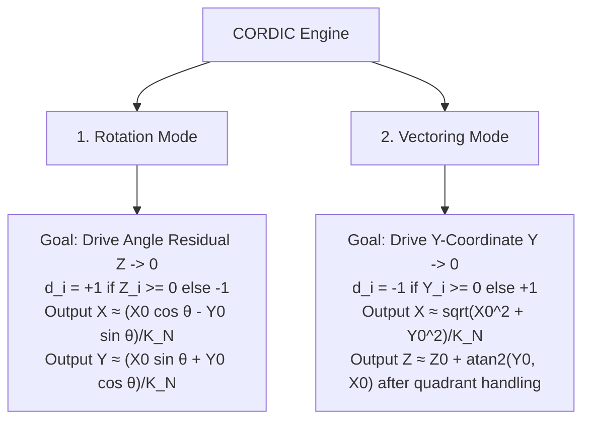

# Approximate CORDIC Architectures & Vector Computations

The **Coordinate Rotation Digital Computer (CORDIC)**, originally introduced by Jack Volder in 1959 and generalized by J. S. Walther in 1971, is an iterative algorithm designed to calculate **trigonometric functions ($\sin, \cos, \tan, \arctan$), hyperbolic functions ($\sinh, \cosh, \tanh$), square roots ($\sqrt{x}$), coordinate conversions (Cartesian $\leftrightarrow$ Polar), and plane rotations** using shift/add recurrences and stored constants. Three-dimensional rotations can be composed from plane rotations; range reduction, scaling and function-specific initialization are additional operations.

The circular recurrence below performs a plane rotation; the unified algorithm also has linear and hyperbolic modes. These modes have different convergence domains and scaling factors [Walther, 1971].

**New here?** You need coordinates (x, y) on a grid, angles in degrees, and the idea that a binary shift multiplies by a power of two (from [Bits and carries](../start/bits-and-carry.md)). Sine, cosine and tangent are introduced below as far as this page needs them. This first part goes from "a point on a grid" to "how a circuit turns an arrow using only shifts and additions". Material marked *Reference* or *Going deeper*, including the matrix form and hyperbolic CORDIC, is optional on a first read.

**After this first part you can:**

1. give the coordinates of a length-1 arrow turned by 30°, and say why CORDIC turns it in several small steps instead;
2. carry out CORDIC steps by hand with the angle table and shifts, computing the new x and y from the *old* x and y together;
3. explain why the result must be scaled by about 0.6073, why 0.625 is only close to that, and why an angle budget is not an accuracy.

<a id="cor-start"></a>

## Start here: turning an arrow by 30°

Draw an arrow from the origin (0, 0) to the point (1, 0). It has length 1 and points along the x axis, at angle 0°. Angles are measured anticlockwise from the x axis. Turn the arrow by 30°: its tip moves to

\[(\cos 30^\circ,\ \sin 30^\circ) = (0.8660,\ 0.5000).\]

For a length-1 arrow, that is what cosine and sine *are*: the x and y of its tip. Computing them directly needs multiplications or large tables. CORDIC instead reaches 30° through a series of small turns that each need only shifts and additions.

### Small turns that need only shifts

Turning an arrow (x, y) by an angle whose tangent (its "slope", rise over run) is t gives a new arrow

\[(x - t\,y,\ \ y + t\,x),\]

which points in the turned direction but is longer by the factor \(\sqrt{1+t^2}\). CORDIC chooses angles with t = 1, ½, ¼, ⅛, …, that is \(t = 2^{-i}\). Multiplying by \(2^{-i}\) is a shift by i binary places: 1.5 × ¼ = 0.375, and in binary `1.1` becomes `0.011`.

| Step i | t = \(2^{-i}\) | Turn angle | Length grows by |
|---:|---:|---:|---:|
| 0 | 1 | 45.0000° | 1.4142 |
| 1 | 0.5 | 26.5651° | 1.1180 |
| 2 | 0.25 | 14.0362° | 1.0308 |
| 3 | 0.125 | 7.1250° | 1.0078 |
| 4 | 0.0625 | 3.5763° | 1.0020 |

At every step the arrow turns either anticlockwise (direction d = +1) or clockwise (d = −1), never "not at all". The remaining angle z decides: if z ≥ 0 turn anticlockwise, otherwise clockwise, and subtract the turn from z.

<a id="cor-hand"></a>

### A hand run towards 30°

**Predict first:** after the first step (45°) the arrow has gone too far. What will the second step do?

<details markdown="1">
<summary>Check the five steps</summary>

Start: (x, y) = (1, 0), remaining angle z = 30°.

| Step i | d | New x = x − d·y·2⁻ⁱ | New y = y + d·x·2⁻ⁱ | Remaining z |
|---:|---:|---:|---:|---:|
| 0 | +1 | 1 − 0 = 1 | 0 + 1 = 1 | 30 − 45 = −15 |
| 1 | −1 | 1 + 1 × 0.5 = 1.5 | 1 − 1 × 0.5 = 0.5 | −15 + 26.5651 = 11.5651 |
| 2 | +1 | 1.5 − 0.5 × 0.25 = 1.375 | 0.5 + 1.5 × 0.25 = 0.875 | 11.5651 − 14.0362 = −2.4712 |
| 3 | −1 | 1.375 + 0.875 × 0.125 = 1.484375 | 0.875 − 1.375 × 0.125 = 0.703125 | −2.4712 + 7.1250 = 4.6538 |
| 4 | +1 | 1.484375 − 0.703125 × 0.0625 = 1.440430 | 0.703125 + 1.484375 × 0.0625 = 0.795898 | 4.6538 − 3.5763 = 1.0775 |

In each row, **both** new values use the x and y from the row above. Updating x first and then using the new x for y gives a different, wrong arrow. Remaining z values are rounded to four decimals.

The arrow has turned 30 − 1.0775 = 28.92°, which is 1.08° short of the target.

</details>

### Scaling the arrow back to length 1

Every step made the arrow longer: (1.4404, 0.7959) has length 1.6457, not 1. Multiplying all five growth factors and taking the reciprocal gives the scale \(K_5 = 0.6076\). Then (1.4404, 0.7959) × 0.6076 = (0.8753, 0.4836), close to (0.8660, 0.5000). With 8 steps the angle becomes 30.26° and the scale \(K_8 = 0.6073\); with many steps the scale approaches 0.607253.

A circuit can scale by 0.625 = ½ + ⅛ with two shifts and an addition. That is close, but not equal: after 5 steps the arrow ends up with length 1.6457 × 0.625 = 1.0286, about 2.9% too long. Scaling changes the length only; the angle stays 28.92°.

**The angle budget is not an accuracy.** Four steps can turn at most 45 + 26.5651 + 14.0362 + 7.1250 = 92.73°, about 92.83% of what infinitely many steps could reach (99.88°). A target of 95° is out of reach with four steps, but a target inside the budget still ends with some leftover angle, as the 30° run shows. The [finite micro-angle budget example](#finite-micro-angle-budget-example) gives the full table and its limits.

**Next:** the matrix form below is reference material. [Skip to the lab task](#cor-lab).

---

## 🧭 Mathematical Foundations: Givens Rotation to Shift-Add

*Reference (optional on a first read): the matrix form behind the small-turn rule above, and the full angle table. [Skip to the lab task](#cor-lab).*

A 2D plane coordinate rotation of vector $\mathbf{v} = \begin{bmatrix} X \\ Y \end{bmatrix}$ through angle $\theta$ is defined by the orthogonal rotation matrix (the tangent factorization requires $\cos\theta\ne0$):

$$\begin{bmatrix} X' \\ Y' \end{bmatrix} = \begin{bmatrix} \cos\theta & -\sin\theta \\ \sin\theta & \cos\theta \end{bmatrix} \begin{bmatrix} X \\ Y \end{bmatrix} = \cos\theta \begin{bmatrix} 1 & -\tan\theta \\ \tan\theta & 1 \end{bmatrix} \begin{bmatrix} X \\ Y \end{bmatrix}$$

```
                Y ^
                  |           v' = (X', Y')
                  |          /
                  |         /  Angle θ
                  |        / _-~
                  |       / ~
                  |      v = (X, Y)
                  |     /
                  +--------------------> X
```

### Eliminating the Multipliers
To eliminate the continuous multiplications of $\tan\theta$, Volder and Walther restricted each elementary micro-rotation step $i$ to predefined angles $\theta_i$ whose tangents are exact negative powers of two:

$$\tan(\theta_i) = 2^{-i} \implies \theta_i = \arctan(2^{-i})$$

Factoring out the cosine scaling term, the iterative coordinate transformation becomes pure bitwise shifts and additions:

$$X_{i+1} = X_i - d_i \cdot (Y_i \cdot 2^{-i}) $$

$$Y_{i+1} = Y_i + d_i \cdot (X_i \cdot 2^{-i}) $$

$$Z_{i+1} = Z_i - d_i \cdot \theta_i$$

where $d_i \in \{+1, -1\}$ is the direction and $Z_i$ is the residual angle. Both coordinate updates use the old $X_i,Y_i$. In fixed-point hardware, multiplication by $2^{-i}$ is implemented by a signed arithmetic shift with a specified rounding/truncation rule; it is not generally an exact equality to real division. Guard bits and overflow handling are needed.

---

## 📐 Predefined Micro-Angle Lookup Table

| Step $i$ | Shift $2^{-i}$ | Elementary Angle $\theta_i = \arctan(2^{-i})$ (Deg) | Elementary Angle $\theta_i$ (Radians) | Scaling Term $\frac{1}{\sqrt{1 + 2^{-2i}}}$ |
| :---: | :---: | :---: | :---: | :---: |
| 0 | $2^0 = 1.0$ | $45.0000^\circ$ | $0.785398$ | $0.707107$ |
| 1 | $2^{-1} = 0.5$ | $26.5651^\circ$ | $0.463648$ | $0.894427$ |
| 2 | $2^{-2} = 0.25$ | $14.0362^\circ$ | $0.244979$ | $0.970143$ |
| 3 | $2^{-3} = 0.125$ | $7.1250^\circ$ | $0.124355$ | $0.992278$ |
| 4 | $2^{-4} = 0.0625$ | $3.5763^\circ$ | $0.062419$ | $0.998053$ |
| 5 | $2^{-5} = 0.03125$ | $1.7899^\circ$ | $0.031240$ | $0.999512$ |
| 6 | $2^{-6} = 0.015625$ | $0.8952^\circ$ | $0.015624$ | $0.999878$ |
| 7 | $2^{-7} = 0.0078125$ | $0.4476^\circ$ | $0.007812$ | $0.999969$ |

At each stage, rotating by $\theta_i$ inflates the vector magnitude by a factor of $\sqrt{1 + 2^{-2i}}$. For $N$ iterations using steps $i=0,\ldots,N-1$, the compensation factor is $K_N$; the uncompensated recurrence increases the magnitude by $1/K_N$. The compensation factor approaches a limiting constant as $N$ grows:

$$K_N = \prod_{i=0}^{N-1} \frac{1}{\sqrt{1 + 2^{-2i}}} \xrightarrow{N \to \infty} 0.607252935008881...$$

### Finite Micro-Angle Budget Example

In real-valued circular rotation, define $B_n=\sum_{i=0}^{n-1}\arctan(2^{-i})$ and $B_\infty\approx99.8829658^\circ$. Direct summation gives:

| Executed initial stages $n$ | Micro-angle budget $B_n$ (degrees) | $100B_n/B_\infty$ |
| :---: | ---: | ---: |
| 4 | 92.7263110 | 92.83% |
| 5 | 96.3026454 | 96.42% |
| 8 | 99.4353439 | 99.55% |

These are sums of available micro-angles, not output accuracy, success rates or phase-error bounds. Signed stage choices produce particular rotations; finite stages and fixed-point quantization still require separate residual and coordinate-error checks. No bound on the residual over the entire convergence domain is inferred from these percentages.

---

## 🧭 Interactive Lab: CORDIC Rotation Wheel

Experiment with rotating a 2D vector using shift-add iterations below. Finite-step accuracy depends on the target angle and the executed stages; a relative percentage of the target angle is undefined at zero. The laboratory illustrates finite-step angular error, rather than a universal percentage or a measured energy saving:

<iframe
  src="../../labs/cordic-rotation-visualizer.html"
  title="CORDIC Angle Rotation Visualizer"
  style="width: 100%; height: 780px; border: none; background: transparent; margin: 12px 0;"
  loading="lazy"
></iframe>

The lab emulates real-valued recurrences in JavaScript floating point, not a fixed-point hardware word format. Fixed-count mode uses the finite-step gain; early termination checks the residual after a stage with index at least 3 and stops below one degree, compensating for the stages actually executed. Approximate-scale mode substitutes 0.625 and shows the resulting magnitude error.

If the lab does not load, [open the CORDIC Rotation Visualizer on its own page](../labs/cordic-rotation-visualizer.html).

<a id="cor-lab"></a>

**Lab task: 30° in five and eight steps.** The lab opens with θ = 45°, 5 iterations and the *Early termination* mode. Set a slider by dragging it, or click it and use the arrow keys (the angle slider moves in steps of 0.5°).

1. **Predict:** using [the hand run](#cor-hand), what vector angle and angle error will 5 fixed steps give for 30°?
2. Set **Target Angle (θ)** to 30.0°, **Number of CORDIC Iterations** to 5 and **Approximation Mode** to *Fixed count*. Read **Vector Angle**, **Angle Error**, **Magnitude**, **Scale Used** and **Residual z**.
3. Change the iterations to 8 and read again.
4. Go back to 5 iterations and choose *Approximate scale factor 0.625*. Which reading changes, and which does not?
5. **Explain:** why does the 0.625 mode leave the angle alone?

<details markdown="1">
<summary>Check the lab readings</summary>

| Reading (θ = 30°) | Fixed count, 5 | Fixed count, 8 | Scale 0.625, 5 |
|---|---:|---:|---:|
| Vector Angle | 28.92° | 30.26° | 28.92° |
| Angle Error | −1.08° | +0.26° | −1.08° |
| Magnitude | 1.0000 | 1.0000 | 1.0286 |
| Iterations Run | 5 of 5 | 8 of 8 | 5 of 5 |
| Scale Used | 0.6076 | 0.6073 | 0.6250 |
| Residual z | 1.08° | −0.26° | 1.08° |

The lab prints negative readings with a plain hyphen, for example -1.08°.

The scale multiplies x and y by the same number, so it changes the arrow's length but not its direction. The sentence under the readings also shows the reachable range for the chosen number of iterations: ±96.3° for 5 and ±99.4° for 8.

Optional: with *Early termination* and 8 iterations the lab stops after 6 steps (*6 of 8*), because the leftover angle drops below 1° after step 5. The angle is then 30.71° (+0.71°). Stopping early saves steps but leaves a larger error here than running all 8.

</details>

### Check your understanding

Answer on paper first, then open the check. Your answers are not saved or sent anywhere.

<a id="cor-q1"></a>

**Question COR-1.** The arrow is at (1, 1) and step i = 1 turns clockwise (d = −1, shift by one place). What are the new x and y?

<a id="cor-q2"></a>

**Question COR-2.** After five unscaled steps an arrow has length 1.6457. What should you multiply by to bring it back to length 1, and what length do you get with 0.625 instead?

<a id="cor-q3"></a>

**Question COR-3.** Four steps cover 92.83% of the infinite angle budget. Does that mean a four-step CORDIC is 92.83% accurate?

<details markdown="1">
<summary>Check questions COR-1 to COR-3</summary>

**COR-1.** x = 1 − (−1) × 1 × 0.5 = 1.5 and y = 1 + (−1) × 1 × 0.5 = 0.5, so (1.5, 0.5).

- Computing x first and then using the new x = 1.5 for y gives y = 1 − 1.5 × 0.5 = 0.25. Both updates must use the old (1, 1).

**COR-2.** Multiply by the scale \(K_5 \approx 0.6076\), the reciprocal of 1.6457. With 0.625 the length becomes 1.6457 × 0.625 ≈ 1.0286, about 2.9% too long; the lab shows this as *Magnitude 1.0286*.

**COR-3.** No. The percentage only compares how far four steps *could* turn (92.73°) with how far infinitely many could (99.88°). It is not an accuracy, a success rate or a bound on the angle error: a 30° target inside the budget still missed by 1.08° after five steps.

</details>

---

## Going deeper

Everything below is the original reference material for this page. It is not needed for the questions above.

- [Rotation and vectoring modes](#dual-operating-modes-of-cordic), including the finite-step relation and the infinite angle budget
- [Approximate levers in CORDIC hardware](#approximate-levers-in-cordic-hardware), with [scale-factor approximations](#1-scale-factor-k-approximation-schemes) and [hyperbolic CORDIC](#2-hyperbolic-cordic) and its repeated indices
- [Hardware comparison conditions](#hardware-comparison-conditions) and [primary literature](#primary-literature-ieee-citations)

The matrix form, the [full micro-angle table](#predefined-micro-angle-lookup-table) and the [finite micro-angle budget example](#finite-micro-angle-budget-example) are earlier on this page.

---

## 🔄 Dual Operating Modes of CORDIC

CORDIC hardware operates in two distinct mathematical modes depending on which signal is driven to zero:



The diagram shows uncompensated outputs. Multiplying the final coordinates by $K_N$ restores their magnitude in real arithmetic. With $Z_0=\theta$, the exact finite-step relation is $K_N\mathbf{v}_N=R(\theta-Z_N)\mathbf{v}_0$, not $R(\theta)\mathbf{v}_0$. The standard infinite circular angle budget is $\sum_{i\ge0}\arctan(2^{-i})\approx1.743287$ rad; finite stages and quantization impose tighter accuracy limits. Vectoring uses $X_0>0$ after quadrant preprocessing; the zero vector has no defined phase. Select a consistent nonzero direction at ties, or treat a zero direction as a skipped stage and change the gain accordingly.

1. **Rotation Mode ($Z \to 0$)**: Evaluates trigonometric sine and cosine functions, polar-to-Cartesian conversion, and DSP matrix rotations (e.g. Givens rotations for QR decomposition).
2. **Vectoring Mode ($Y \to 0$)**: Computes vector magnitudes ($\sqrt{X^2 + Y^2}$), phase angles (with quadrant-aware $\operatorname{atan2}(Y,X)$), and Cartesian-to-polar transformations.

---

## ⚡ Approximate Levers in CORDIC Hardware

A reused iterative datapath may execute one stage per cycle, while an unrolled or pipelined design has different register and latency costs. Finite CORDIC is already numerically approximate. Constant scaling can be folded into initialization or implemented with shifts and adds; a dedicated multiplier is not mandatory. Additional approximations include:

```
+-------------------------------------------------------------------------+
|                  APPROXIMATE CORDIC HARDWARE LEVERS                     |
+-------------------------------------------------------------------------+
| 1. Adaptive Early Termination (AET):                                    |
|    Halt when |Z_i| < ε; energy saving depends on the implementation.     |
| 2. Multiplier-Free Scale-Factor (K) Folding:                            |
|    Approximate K ≈ 5/8 (0.625) or Canonical Signed Digit (CSD) constants|
| 3. Angle Quantization (AQ) & Micro-Rotation Skipping:                   |
|    Skip selected stages (d_i = 0 is an extension of the recurrence)             |
| 4. Truncated Bitwidth & Inexact Adders in Accumulator Datapaths:        |
|    Truncate word lengths or use inexact arithmetic with error checks.   |
+-------------------------------------------------------------------------+
```

### 1. Scale-Factor ($K$) Approximation Schemes
For $N$ circular CORDIC iterations, restoring the final magnitude requires multiplying $X_N$ and $Y_N$ by $K_N$. The limiting value $K_\infty \approx 0.607253$ is often used as an approximation for sufficiently many iterations. Approximate designs replace this costly hardware multiplier with hardwired shift-and-add Canonical Signed Digit (CSD) trees:

- **Two-Term Shift-Add Approximation**: $K \approx \frac{5}{8} = 0.625 = 2^{-1} + 2^{-3}$ (Error: $+2.92\%$, Zero multipliers).
- **Four-Term Shift-Add Approximation**: $K \approx 2^{-1} + 2^{-3} - 2^{-6} - 2^{-9} = 0.607421875$ (Error: $<0.028\%$, 3 additions).
These percentage errors are relative to $K_\infty$, not every finite-step $K_N$. Early termination or skipped stages require a compensation factor matched to the stages actually used.

- **Scaling-free variants** modify the recurrence and approximate elementary rotations. The standard recurrence above does not have unit gain; the accuracy and domain of a scaling-free variant must be evaluated for its particular approximation.

For an executed circular stage multiset $S$, including repeated indices but excluding skipped stages, use $K_S=\prod_{i\in S}(1+2^{-2i})^{-1/2}$. Reusing $K_N$ after skipping a stage introduces a magnitude error.

### 2. Hyperbolic CORDIC
The hyperbolic metric $m=-1$ gives the following recurrences for $\sinh$ and $\cosh$; $\exp$ and $\ln$ require function-specific combinations/initialization and range reduction:

$$X_{i+1} = X_i + d_i \cdot Y_i \cdot 2^{-i}$$

$$Y_{i+1} = Y_i + d_i \cdot X_i \cdot 2^{-i}$$

$$Z_{i+1} = Z_i - d_i \cdot \operatorname{arctanh}(2^{-i})$$

Start at $i=1$: $\operatorname{arctanh}(1)$ is not finite. The standard binary hyperbolic schedule repeats indices $4,13,40,121,\ldots$ ($r_{j+1}=3r_j+1$), because an unrepeated schedule does not meet the standard convergence criterion [Walther, Table II, p. 381]. For an executed multiset $S$, the coordinate gain is $G_{h,S}=\prod_{i\in S}\sqrt{1-2^{-2i}}$ and compensation is $1/G_{h,S}$, including each repetition. Its standard infinite angle budget is about $1.118173$ rad; finite-step residuals, input domain and range reduction still matter. This algorithm alone establishes no neuron-count or chip-power result.

---

## 📊 Hardware Comparison Conditions

Early termination, stage selection and word-length reduction must be compared at a stated input distribution and accuracy target. Power, energy per result and latency are different quantities. A comparison needs the process/library, supply voltage, word format, clock, pipeline and switching workload; no measured PPA table is asserted here.

---

## 📚 Primary Literature & IEEE Citations

- J. E. Volder, *"The CORDIC Trigonometric Computing Technique"*, IRE Transactions on Electronic Computers, EC-8(3), 330–334, 1959. [DOI: 10.1109/TEC.1959.5222693](https://doi.org/10.1109/TEC.1959.5222693); [original paper scan](https://www.ece.ucdavis.edu/~vojin/CLASSES/EPFL/Papers/3-Volder_CORDIC.pdf).
- J. S. Walther, *"A Unified Algorithm for Elementary Functions"*, AFIPS Spring Joint Computer Conference, 379–385, 1971. [DOI: 10.1145/1478786.1478840](https://doi.org/10.1145/1478786.1478840); [original paper scan](https://www.ece.ucdavis.edu/~vojin/CLASSES/EPFL/Papers/21-Welther-El_funct.pdf). Table II and the convergence discussion specify the hyperbolic shift schedule.
- L. Chen, J. Han, W. Liu, and F. Lombardi, *"Algorithm and Design of a Fully Parallel Approximate Coordinate Rotation Digital Computer (CORDIC)"*, IEEE Transactions on Multi-Scale Computing Systems, 3(3), 139–151, 2017. [DOI: 10.1109/TMSCS.2017.2696003](https://doi.org/10.1109/TMSCS.2017.2696003); [author manuscript](https://www.ece.ualberta.ca/~jhan8/publications/CORDIC_TNanoAdvance.pdf). This is a particular FPAX-CORDIC architecture, not evidence for universal energy savings.
