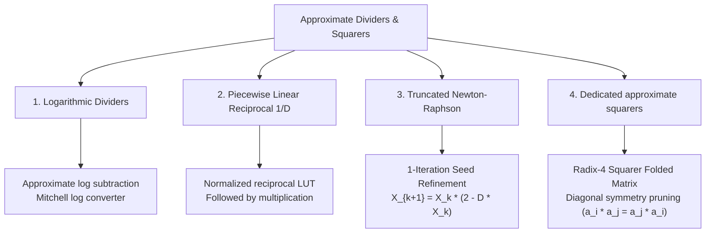

# Approximate Dividers & Squarers

Division ($Q=N/D$) can be implemented using digit recurrence, reciprocal approximation, or other architectures. Latency depends on wordlength, radix, and pipeline configuration; exact arithmetic has no universal cycle count. Squaring ($X^2$), covered below, is different from square rooting ($\sqrt X$).

**New here?** You need fractions, percentages and powers of two (2, 4, 8, … and ½, ¼, …). [Bits and carries](../start/bits-and-carry.md) helps with binary, and [How Do We Grade Mistakes?](../fundamentals/error-metrics-made-easy.md) explains relative error. This first part goes from "division is sharing out" to "where a cheap divider puts its approximation". Material marked *Reference* or *Going deeper* is the original technical part of this page and is optional on a first read.

**After this first part you can:**

1. compute 12 ÷ 3 in three ways: by grouping, by multiplying by the reciprocal, and with the divisor scaled by a power of two;
2. read a small table to see where a straight-line approximation of the reciprocal is exact and where it is worst;
3. keep three pairs apart: a logarithm error versus a quotient error, squaring versus square root, and hardware tables versus task quality.

<a id="div-start"></a>

## Start here: 12 ÷ 3 three ways

**1. Grouping.** 12 ÷ 3 asks how many groups of 3 fit in 12. Take 3 away until nothing is left: 12 → 9 → 6 → 3 → 0. Four subtractions, so the quotient is 4. Exact hardware dividers refine this idea: each step produces one or more quotient digits from what remains (the [digit-recurrence section](#digit-recurrence-division) shows how). The steps depend on each other, so division often has greater latency than addition or multiplication; the actual comparison depends on architecture and implementation.

**2. Multiply by the reciprocal.** Dividing by 3 is the same as multiplying by \(1/3\): 12 × 0.333… = 4. If a circuit can produce \(1/D\) quickly, one multiplication finishes the job.

**3. Scale the divisor by a power of two.** \(1/D\) for every possible D is too much to store. But any positive D can be written as a power of two times a number d between 1 and 2:

\[3 = 2^1 \times 1.5, \qquad \frac{1}{3} = 2^{-1} \times \frac{1}{1.5}.\]

Multiplying by \(2^{-1}\) rescales a binary value by a shift. It is exact in this illustrative arithmetic; a finite-width implementation must specify discarded bits and rounding. So the circuit only needs \(1/d\) for d in the range from 1 up to (not including) 2. Here d = 1.5 and \(1/1.5 = 2/3 \approx 0.6667\); then \(12 \times 2^{-1} \times (2/3) = 4\). The displayed decimal is rounded, not an exact substitute for the fraction.

<a id="div-line"></a>

## A straight line instead of a curve

The graph of \(1/d\) for d from 1 to 2 is a curve, going from 1 down to 0.5. A cheap circuit replaces it by a straight line, \(a\,d + b\), which needs only one multiplication and one addition. The simplest line joins the two ends of the curve: \(1.5 - 0.5\,d\). Splitting the range at 1.5 and joining the curve's values with two shorter lines gives a better fit.

**Predict first:** where is one straight line exact, and where is it furthest from the curve?

<details markdown="1">
<summary>Check the table</summary>

Relative error here is (line − true) ÷ true, for the reciprocal alone:

| d | True \(1/d\) | One line \(1.5-0.5d\) | Relative error | Two lines (break at 1.5) | Relative error |
|---:|---:|---:|---:|---:|---:|
| 1.00 | 1.0000 | 1.0000 | 0% | 1.0000 | 0% |
| 1.25 | 0.8000 | 0.8750 | +9.38% | 0.8333 | +4.17% |
| 1.50 | 0.6667 | 0.7500 | +12.5% | 0.6667 | 0% |
| 1.75 | 0.5714 | 0.6250 | +9.38% | 0.5833 | +2.08% |

The approximation sits in **one place only**: the reciprocal of d. The power-of-two shift and the multiplication by 12 are exact in this model. A line is exact where it touches the curve (the ends, and the break point for two lines) and is worst between them. Here the lines lie above the curve, so the quotient comes out too large.

</details>

With one line, 12 ÷ 3 becomes \(12 \times 2^{-1} \times 0.75 = 4.5\) instead of 4, a relative error of +12.5%. With two lines, d = 1.5 sits on a break point, so the result is exactly 4. More pieces mean smaller errors and a bigger table of line coefficients. The [piecewise-linear reciprocal section](#2-piecewise-linear-reciprocal-1d-multiplier-fusion) gives the general form.

**The logarithm shortcut gives the same line.** [Mitchell's method](#mitchells-base-2-logarithmic-approximation) replaces \(\log_2(1+x)\) by \(x\). For 8 ÷ 3 (N = 8 = \(2^3 \times 1\), D = 3 = \(2^1 \times 1.5\)) it gives \(2^{3-1} \times 0.75 = 3\), while the exact quotient is 2.667: +12.5%, the worst case in the [Mitchell error table](#mitchell-relative-error). For 12 ÷ 3, both N and D have the same mantissa 1.5, and Mitchell's result is exactly 4.

<a id="div-pairs"></a>

### Three pairs not to mix up

- **Logarithm error versus quotient error.** Mitchell's largest error in the *logarithm* is about 0.086, an absolute difference of log values. The largest error in the *quotient* is 12.5%, a relative error of the answer. They are different quantities, and neither carries over unchanged to corrected or rounded dividers.
- **Squaring versus square root.** A squarer computes \(X^2\) (3 → 9); a square root computes \(\sqrt X\) (9 → 3). [Approximate squarers](#3-dedicated-approximate-squarers-x2) save work because the square's middle terms repeat, not because they have anything to do with division.
- **Hardware tables versus task quality.** The [published divider comparison](#published-divider-comparison), including designs called AAXD-6 and AAXD-10, reports delay, area and power from synthesis at stated conditions, and error statistics (MRED) over a stated input domain. An image-quality result (PSNR on a foreground-extraction task, which separates foreground objects from the background) comes from a separate application experiment. One does not predict the other.

### Check your understanding

Answer on paper first, then open the check. Your answers are not saved or sent anywhere.

<a id="div-q1"></a>

**Question DIV-1.** Write 5 as \(2^e \times d\) with d from 1 up to 2. Using the one-line reciprocal \(1.5 - 0.5d\), what does 20 ÷ 5 become, and what is its relative error?

<a id="div-q2"></a>

**Question DIV-2.** A classmate says: "Mitchell's maximum error is 0.086, so a Mitchell divider is never more than 8.6% wrong." What is wrong with this?

<a id="div-q3"></a>

**Question DIV-3.** In the published table, AAXD-6 has lower power than AAXD-10. Does that tell you which one gives the better foreground-extraction image?

<details markdown="1">
<summary>Check questions DIV-1 to DIV-3</summary>

**DIV-1.** 5 = \(2^2 \times 1.25\). The line gives \(1.5 - 0.625 = 0.875\), so \(1/5 \approx 0.875 / 4 = 0.21875\) and 20 ÷ 5 ≈ 20 × 0.21875 = 4.375. The exact answer is 4, so the relative error is +9.375% (the d = 1.25 row of the table).

- Forgetting the \(2^{-2}\) shift gives 17.5: the line only covers d, not the power of two.

**DIV-2.** 0.086 is the largest *absolute error of the logarithm*, not a percentage of the quotient. For the uncorrected Mitchell divider the largest relative quotient error is 12.5% (for example 8 ÷ 3 gives 3).

**DIV-3.** No. Power comes from synthesis and power estimation at 28 nm, 1 V, 25 °C and 200 MHz with random inputs. The page's MRED values come from a separate exhaustive error analysis, and the reported PSNR of 26.42 dB is only for AAXD-10 in a separate application experiment. Lower power with a higher MRED (6.61% versus 1.52%) is a trade-off, not a quality result.

</details>

---

## Going deeper

Everything below is the original reference material for this page. It is not needed for the questions above.

- [Digit-recurrence division](#digit-recurrence-division) and the [approximate divider taxonomy](#comprehensive-approximate-divider-taxonomy)
- [Logarithmic dividers](#1-logarithmic-dividers), including [Mitchell's approximation](#mitchells-base-2-logarithmic-approximation) and the [Mitchell relative-error table](#mitchell-relative-error)
- [Piecewise-linear reciprocal and Newton–Raphson refinement](#2-piecewise-linear-reciprocal-1d-multiplier-fusion)
- [Dedicated approximate squarers](#3-dedicated-approximate-squarers-x2)
- [Published divider comparison (AAXD)](#published-divider-comparison) and [primary literature](#primary-literature-ieee-citations)

---

## 🔬 Digit-Recurrence Division
For a normalized radix-$r$ digit recurrence,

$$R_{j+1}=rR_j-q_{j+1}D.$$

Radix 2 generates one quotient digit per step; higher radix produces more quotient bits per step. Digit selection uses the current partial remainder and divisor, rather than requiring a yet-unknown next remainder. Stages have a dependency, but can be unrolled and pipelined in spatial hardware. Latency and the interval between successive results are different measures; see AMD PG151, Chapter 2, p. 10, for exact pipelined divider configurations.

---

## 🏛️ Comprehensive Approximate Divider Taxonomy



---

## 📈 1. Logarithmic Dividers

For $N>0$ and $D>0$, division can be expressed using logarithmic subtraction:

$$\frac{N}{D} = 2^{\log_2(N) - \log_2(D)}$$

```
Operand N ---> [ Leading-One Detector ] ---> Log2(N) ---\
                                                         (-) ---> Diff ---> [ Antilog Converter ] ---> Quotient Q*
Operand D ---> [ Leading-One Detector ] ---> Log2(D) ---/
```

### Mitchell's Base-2 Logarithmic Approximation
Any positive binary integer $X$ can be expressed by its most significant non-zero bit (Leading One position $k$) and a fractional fraction $x \in [0, 1)$:

$$X = 2^k (1 + x)$$

$$\log_2(X) = k + \log_2(1 + x) \approx k + x \quad (\text{using the linear approximation } \log_2(1+x) \approx x)$$

### Error Curve & Correction
The log-domain error $E(x)=\log_2(1+x)-x$ has its maximum at $x=1/\ln2-1\approx0.442695$, with $E_{\max}\approx0.0860713$. This is an absolute logarithm error, not a quotient relative error. A divider's relative error also depends on both operands, its approximate inverse-log conversion, correction, and output quantization. A named divider such as LEAD cannot be defined merely by applying a generic two-segment log correction.

<a id="mitchell-relative-error"></a>

For the **uncorrected** Mitchell model with positive operands, real mantissas $x_1,x_2\in[0,1)$, the piecewise-linear inverse log and no output quantization, the error bounds are different:

| Operation | Largest relative error | Direction | Attaining mantissas |
|---|---:|---|---|
| Multiplication | $1/9\approx11.11\%$ | Underestimate | $x_1=x_2=1/2$ |
| Division | $1/8=12.5\%$ | Overestimate | $x_1=0,\ x_2=1/2$ |

For multiplication the approximate mantissa product is $1+x_1+x_2$ when $x_1+x_2<1$, and $2(x_1+x_2)$ otherwise. For division it is $1+x_1-x_2$ when $x_1\ge x_2$, and $(2+x_1-x_2)/2$ otherwise. Comparing these with $(1+x_1)(1+x_2)$ and $(1+x_1)/(1+x_2)$ gives the bounds above; powers of two cancel in relative error. These arithmetic bounds are not the logarithm-error value 0.0860713 and do not carry over unchanged to corrected or quantized dividers.

Handle $N=0$ separately and reject $D=0$ before log conversion. For integer division the output rule (for example, flooring a nonnegative approximate real quotient) and output width must be stated; signed division and floating-point exceptional values require additional contracts.

---

## ⚡ 2. Piecewise Linear Reciprocal ($1/D$) & Multiplier Fusion

Instead of computing $N/D$ sequentially, the architecture decomposes division into reciprocal generation followed by a single multiplication:

$$\frac{N}{D} = N \times \left(\frac{1}{D}\right)$$

```
Divisor D ---> [ Range Normalizer ] ---> [ Piecewise Linear LUT (a_k, b_k) ] ---> Reciprocal (1/D)
                                                                                       |
Dividend N --------------------------------------------------------------------> [ Multiplier ] ---> Quotient Q*
```

Normalize $D=2^e d$ with $d\in[1,2)$. Partition this normalized interval and approximate $1/d$ in each interval:

$$1/D\approx2^{-e}(a_j d+b_j).$$

A Taylor approximation about $c_j>0$ uses $a_j=-1/c_j^2$ and $b_j=2/c_j$. Interpolation is another choice and has different coefficients. LUT size depends on the interval count, coefficient precision, and implementation.

For Newton–Raphson reciprocal refinement, $x_{j+1}=x_j(2-Dx_j)$ and $e_j=1-Dx_j$ imply $e_{j+1}=e_j^2$ in exact arithmetic. Convergence needs $|e_0|<1$; truncation and finite precision alter this recurrence and can prevent further improvement.

---

## 🎯 3. Dedicated Approximate Squarers ($X^2$)

For an unsigned $N$-bit number $A = \sum_{i=0}^{N-1} A_i 2^i$, a dedicated squarer can exploit identical symmetric off-diagonal partial products. The exact result requires up to $2N$ bits:

$$A^2 = \left(\sum_{i=0}^{N-1} A_i 2^i\right)^2 = \sum_{i=0}^{N-1} A_i 2^{2i} + 2 \sum_{i=0}^{N-2} \sum_{j=i+1}^{N-1} A_i A_j 2^{i+j}$$

```
              Exact Multiplier Grid               Pruned Approximate Squarer
           A3   A2   A1   A0                        A3   A2   A1   A0
        x  A3   A2   A1   A0                     -----------------------------
        --------------------                     [ A3 ] [ A2 ] [ A1 ] [ A0 ]  (Diagonal Terms)
        a0a3 a0a2 a0a1 a0a0                       + Folded Symmetric Off-Diagonals
        a1a3 a1a2 a1a1 a1a0                       + Low-Order LSBs Pruned / Truncated!
        a2a3 a2a2 a2a1 a2a0                      -----------------------------
        a3a3 a3a2 a3a1 a3a0                      -> Folded products; implementation-dependent savings
```

- **Diagonal Terms**: Since $A_i^2 = A_i$ for any binary digit $A_i \in \{0, 1\}$, diagonal products require zero AND gates.
- **Off-Diagonal Symmetries**: Terms $A_i A_j$ and $A_j A_i$ are identical; combining them into $(A_i A_j) \cdot 2^{i+j+1}$ requires $N(N-1)/2$ distinct off-diagonal AND products instead of $N^2$ array products, with diagonal terms supplied as wires; this count is not total circuit area.
- **Pruning**: Approximate squarers can discard low-weight terms or replace them by compensation. The cutoff is a design choice; discarding unsigned positive terms alone underestimates the result, while compensation can change the error sign.

---

## 📊 Comparing Divider Implementations
<a id="published-divider-comparison"></a>

Jiang et al. evaluate unsigned **16/8-bit** adaptive approximate dividers (AAXD) against the exact restoring array divider EXDr. Their Table III uses **ST 28 nm, 1 V, 25 °C**: delay and area come from Synopsys Design Compiler, while PrimeTime-PX estimates power at **200 MHz with five million random input combinations**. This is synthesis and power estimation, not fabricated-chip measurement.

| Divider | Delay (ns) | Area (µm²) | Power (µW) | PDP (fJ, reported) |
|---|---:|---:|---:|---:|
| EXDr | 4.71 | 285.8 | 128.00 | 602.88 |
| AAXD-6 | 1.86 | 175.4 | 43.67 | 81.23 |
| AAXD-8 | 2.59 | 231.4 | 61.82 | 160.11 |
| AAXD-10 | 3.46 | 294.9 | 84.31 | 291.71 |

The suffix is the pruned dividend width. Table II separately reports MRED 6.61%, 3.12% and 1.52% for AAXD-6/8/10, using all valid dividend/divisor pairs in $[0,65535]\times[1,255]$ satisfying the exact divider's no-overflow condition $\lfloor N/256\rfloor<D$. Those error statistics are not based on the power-estimation samples. PDP uses $\mathrm{ns}\cdot\mu\mathrm{W}=\mathrm{fJ}$; it is a power–critical-delay product, not measured energy per output at 200 MHz. [Jiang et al., §III, Tables II–III](https://www.ece.ualberta.ca/~jhan8/publications/517_OutputPaper_CameraReady.pdf).

In a separate foreground-extraction application simulation, AAXD-10 achieves PSNR 26.42 dB (§IV-B). That image-quality result uses a different protocol and is not a hardware-table measurement. The table's raw power values take precedence over the abstract's inconsistent percentage.

The previous 32-bit “28nm, 800 MHz” PPA table lacked a traceable implementation report and is withdrawn. A clock period of 1.25 ns cannot directly clock an unconstrained stage with 8.2 ns or 14.8 ns critical delay. Compare cycles, stage delays, initiation intervals, power, and energy per result under compatible timing constraints and workloads.

---

## 📚 Primary Literature & IEEE Citations

- Omkar G. Ratnaparkhi, Madhav Rao, *"LEAD: Logarithmic Exponent Approximate Divider For Image Quantization Application"*, Proceedings of the Great Lakes Symposium on VLSI 2022, 2022. [Publisher record](https://doi.org/10.1145/3526241.3530323).

- K J N S Bhargav, Sairam Palisetti, Madhav Rao, *"A newton raphson method based approximate divider design for color quantization application"*, 2021 18th International SoC Design Conference (ISOCC), 2021. [Publisher record](https://doi.org/10.1109/isocc53507.2021.9613961).

- Honglan Jiang, Leibo Liu, Fabrizio Lombardi, Jie Han, *"Adaptive approximation in arithmetic circuits: A low-power unsigned divider design"*, 2018 Design, Automation &amp; Test in Europe Conference &amp; Exhibition (DATE), 2018. [Publisher record](https://doi.org/10.23919/date.2018.8342233).

- Satyendra R. Datla, Mitchell A. Thornton, David W. Matula, *"A Low Power High Performance Radix-4 Approximate Squaring Circuit"*, 2009 20th IEEE International Conference on Application-specific Systems, Architectures and Processors, 2009. [Publisher record](https://doi.org/10.1109/asap.2009.35).

- Ke Chen, Chenyu Xu, Haroon Waris, Weiqiang Liu, Paolo Montuschi, Fabrizio Lombardi, *"Exact and Approximate Squarers for Error-Tolerant Applications"*, IEEE Transactions on Computers, 2022. [Publisher record](https://doi.org/10.1109/tc.2022.3228592).

- John N. Mitchell, *"Computer Multiplication and Division Using Binary Logarithms"*, IEEE Transactions on Electronic Computers, 1962. [Publisher record](https://doi.org/10.1109/TEC.1962.5219391).

- AMD, *Divider Generator v5.1 Product Guide (PG151)*, February 4, 2021, Chapter 2, p. 10. [Official guide](https://docs.amd.com/v/u/en-US/pg151-div-gen).
