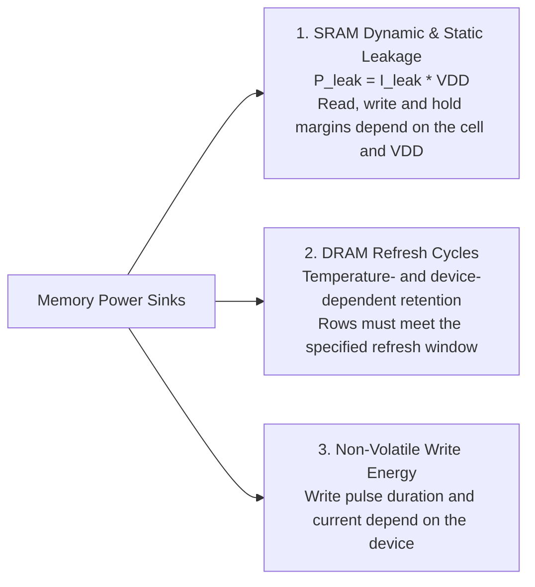

# Approximate Memory & Storage Architectures

Memory accesses and refresh contribute to system energy. Their share depends on the architecture, workload and measurement boundary; there is no universal memory-energy percentage for GPUs, SoCs or AI processors.

Approximate memory challenges the traditional assumption of universal, $100\%$ bit-level retention by allowing application-qualified errors in selected data in exchange for potential energy or performance benefits. Hardware fault rates and application quality must both be characterized.

**New here?** You need binary place values from [Bits and carries](../start/bits-and-carry.md) and percentages. No electronics is assumed; the few terms needed are defined below. This first part goes from "memory stores bits" to "which data could live in memory that occasionally flips a bit, and what the published refresh studies really measured". Material marked *Going deeper* is the original technical part of this page and is optional on a first read.

**After this first part you can:**

1. explain what a memory does with bits, and why DRAM, unlike SRAM, needs refresh;
2. decide, using bit weights, whether a flipped bit matters more in a pixel value or in a pointer;
3. read refresh results with their conditions: a refresh window is not a command interval, fewer refreshes are not the same saving in total energy, and an error rate is not a quality guarantee.

<a id="mem-start"></a>

## Start here: one video frame, two kinds of data

A video player keeps the current frame in memory. Take a small greyscale frame of 640 × 480 pixels, one byte (8 bits, brightness 0–255) per pixel: 307,200 bytes, or 2,457,600 bits. The player also keeps **pointers**: numbers that say *where* in memory something is stored, for example "this frame starts at address 4096", written `0x1000` in hexadecimal.

Now suppose one stored bit flips from 0 to 1 or from 1 to 0.

**Predict first:** which hurts more, a flipped bit in a pixel or in a pointer?

<details markdown="1">
<summary>Check the three flips</summary>

| Stored value | Bit flipped (its weight) | New value | Effect |
|---|---|---|---|
| Pixel 200 = `11001000` | lowest bit (1) | 201 | One pixel 1 step brighter out of 255; hard to see |
| Pixel 200 = `11001000` | highest bit (128) | 72 | One clearly dark dot in this frame |
| Pointer `0x1000` (4096) | bit of weight 16 | `0x1010` (4112) | The program reads from the wrong place: wrong data or a crash, and every later use goes wrong |

A pixel is one value among 307,200 and is overwritten by the next frame; a pointer decides where everything else is read from. Even within a pixel, the bit's weight matters. So "which data tolerate errors" depends on the data's role *and* on which bits flip, and the result still has to be checked against the application.

</details>

### Bits, reading and writing, SRAM and DRAM

A memory is a large array of **cells**, each holding one bit. *Writing* sets a cell; *reading* senses what it holds. Two kinds matter here:

- **SRAM** keeps each bit in a small loop of transistors (often six) that holds its value as long as power is on. It is fast and is used for caches. Lowering its supply voltage saves energy but can make some reads or writes fail.
- **DRAM** keeps each bit as charge on a tiny capacitor. The charge leaks away, so every row of cells must be read and written back, or **refreshed**, before too much is lost. DRAM is used for main memory.

### Refresh: window, commands and what a saving means

The **refresh window** is the time within which every row must have been refreshed. For the DDR3 devices in the study cited below, it is 64 ms below 85 °C. The memory controller does not refresh all rows at once: it sends many refresh **commands** spread over the window, each covering some rows. As a made-up small example, a chip with 8 row groups and a 64 ms window could receive one command every 8 ms. The window (64 ms) and the interval between commands (8 ms here) are different numbers.

Making the window 4 times longer, from 64 ms to 256 ms, reduces complete refresh passes from 15.6 to 3.9 per second: **75% fewer refresh operations** in an ideal model. That is not 75% less memory energy, because reading, writing and background power remain. In the RAIDR simulation below, refresh operations fell by 74.6%, while DRAM energy per access fell by 8.3% at normal temperature.

A longer window lets weak cells lose data. Flikker's model input (Table 1, 48 °C, taken from an earlier study) is a per-bit error rate of \(4.0\times10^{-8}\) at a 1 s refresh cycle and \(1.3\times10^{-4}\) at 20 s. *If* every bit of our frame failed independently at that rate, about 0.1 and about 320 bits would flip on average. That "if" is strong: real failures cluster in weak cells, depend on temperature and data pattern, and change over time. And an average count does not say *which* bits flip: 320 lowest bits are hardly visible, 320 highest bits are visible specks, and one pointer bit can crash the program.

**Protection has limits.** A common error-correcting code, **SEC–DED**, corrects one flipped bit and detects two within each protected block of bits (a codeword). Three or more flips in one block can go unnoticed or be "corrected" wrongly. It reduces risk under its assumptions; it does not make memory error-free.

### Check your understanding

Answer on paper first, then open the check. Your answers are not saved or sent anywhere.

<a id="mem-q1"></a>

**Question MEM-1.** The pixel value 200 = `11001000` has its bit of weight 64 flipped. What is the new value, and is this change larger or smaller than flipping the lowest bit?

<a id="mem-q2"></a>

**Question MEM-2.** A design doubles the refresh window from 64 ms to 128 ms. By how much does the number of refresh operations fall in the ideal model? Does DRAM energy fall by the same percentage?

<a id="mem-q3"></a>

**Question MEM-3.** "The pointer table is protected by SEC–DED, so it is safe to put it in the low-refresh region." What is wrong with this?

<details markdown="1">
<summary>Check questions MEM-1 to MEM-3</summary>

**MEM-1.** The bit of weight 64 is 1, so it becomes 0: 200 − 64 = 136. That is a change of 64, far larger than the change of 1 from flipping the lowest bit.

- Adding 64 instead (264) is impossible here: a flip of a 1 removes its weight, and 8 bits cannot exceed 255.

**MEM-2.** Refresh passes per second halve (15.6 → 7.8), so refresh operations fall by 50% in the ideal model. DRAM energy falls by less, because refresh is only one part of it; RAIDR's 74.6% fewer refreshes gave 8.3% less energy per access in its normal-temperature simulation.

**MEM-3.** SEC–DED corrects only one flip per codeword and detects two; more flips can be missed or miscorrected, and low refresh makes flips more likely. Pointers need correct values, so they belong in normally refreshed memory. Flikker's design keeps critical data at the normal refresh rate for this reason.

</details>

---

## Going deeper

Everything below is the original reference material for this page. It is not needed for the questions above.

- [The physical drivers of memory power](#the-physical-drivers-of-memory-power)
- [Approximate SRAM and voltage-scaled caches](#1-approximate-sram-voltage-scaled-caches), with the 6T cell and [static noise margin](#static-noise-margin-snm-near-threshold-operation)
- [Refresh-relaxed DRAM](#2-refresh-relaxed-dram-video-buffers), [energy savings via relaxed refresh](#energy-savings-via-relaxed-refresh) and the [published RAIDR and Flikker studies with their conditions](#published-refresh-studies)
- [Quality-aware virtual memory paging](#3-quality-aware-virtual-memory-paging), [measurement conditions](#measurement-conditions) and [primary literature](#primary-literature-ieee-citations)

---

## 🔋 The Physical Drivers of Memory Power



---

## 🔬 1. Approximate SRAM & Voltage-Scaled Caches

A conventional cache may use a **6-Transistor (6T) SRAM cell** consisting of two cross-coupled CMOS inverters and two access pass-transistors:

```
        VDD                 VDD
         |                   |
       [PMOS]              [PMOS]
         |                   |
BL ----[NMOS]-- Q <-----> ~Q --[NMOS]---- ~BL
 (WL)    |                   |     (WL)
       [NMOS]              [NMOS]
         |                   |
        GND                 GND
```

### Static Noise Margin (SNM) & Near-Threshold Operation
SRAM hold stability, read stability and write ability depend on the cell design, supply voltage, process variation, timing and temperature. SNM describes static stability; it is not by itself a model of all read, write, retention or transient failures. Lower supply voltage can increase access failures, and the faulty locations need not be independent random flips.

For a fixed switched capacitance and activity, dynamic switching energy scales as $E_{\mathrm{dyn}}\propto CV_{DD}^2$. This relation alone predicts neither total cache energy nor leakage: leakage current depends on transistor biases, process and temperature, while lower voltage can also change delay. A voltage-to-BER model requires measured or calibrated device statistics rather than a universal exponential law.

Approximate SRAM must qualify voltage, error locations and modes, stored-bit significance, workload and end-to-end quality. No device-independent voltage threshold or classification-accuracy guarantee is asserted here.

---

## ⏳ 2. Refresh-Relaxed DRAM & Video Buffers

Conventional DRAM stores data in a 1T–1C cell. Retention is affected by leakage, temperature, stored data patterns and variable retention time. A constant-$R$ equivalent circuit gives the illustrative relation

$$Q(t)=Q_0\exp[-t/(R_{\mathrm{leak}}C_{\mathrm{cell}})],$$

but this is not a calibrated DRAM retention distribution or BER model. Sensing fails when the charge-dependent signal no longer meets the read margin, not only when charge reaches zero.

For the DDR3 devices discussed by Liu et al. (2013, Section 2.2), the refresh window is 64 ms below 85°C. A window is the period within which all relevant rows are refreshed, not the interval between individual refresh commands. Temperature ranges and refresh requirements must be checked in the particular device specification; this value must not be generalized to every DRAM generation or refresh mode. The same study finds data-pattern dependence and time-varying retention, so a one-time weak-cell profile cannot establish a universal safe relaxed interval.

### Energy Savings via Relaxed Refresh
In an ideal fixed-cost refresh model, changing a refresh window from $T$ to $4T$ reduces the refresh-command rate, and its refresh-only average power component, by 75%. This is a calculated rate ratio, not a measurement of total standby power, total DRAM energy or application speedup. Background and read/write power remain, and any extra mitigation costs must be included.

Relaxing refresh outside the specified conditions can corrupt data. The resulting BER depends on the device, temperature, interval, data pattern and elapsed time; whether a given pattern of errors is tolerable depends on the workload and bit significance. A small average BER does not guarantee imperceptible video or unchanged neural-network accuracy.

<a id="published-refresh-studies"></a>

### Published Refresh Studies: Different Models and Boundaries

**RAIDR** groups rows by retention time. Liu et al. (2012, [Sections 5–6, Table 1 and Figures 6–8](https://users.ece.cmu.edu/~omutlu/pub/raidr-dram-refresh_isca12.pdf)) simulate an 8-core, 4 GHz system with 32 GB DDR3-1333, using SPEC CPU2006 and TPC-C/H workloads. The cycle-level DRAM model is checked against DRAMsim2. Results below compare the two-bin RAIDR configuration with auto-refresh at the same temperature; they are simulation results, not chip measurements.

| RAIDR metric | Normal temperature | Extended temperature |
| :--- | ---: | ---: |
| Refresh operations reduced (Figure 6) | 74.6% | 74.6% |
| DRAM energy per serviced access reduced (Section 6.3, Figure 8) | 8.3% | 16.1% |
| System weighted-speedup improvement (Section 6.2, Figure 7) | 4.1% | 8.6% |

The normal-temperature baseline uses a 64 ms window; the extended-temperature case halves retention times and refresh intervals. Section 5 reports DRAM power through energy per access. Neither the refresh-count reduction nor the per-access energy reduction is a whole-system energy saving.

**Flikker** partitions application data by criticality; Figure 2 illustrates one-quarter of the array at regular refresh and three-quarters at reduced refresh. Its overall DRAM power estimates combine analytical self-refresh power with simulated active-mode power. Section 6.2's 20–25% saving applies to the evaluated applications in the paper's “crazy” configuration, which also exposes stack and critical heap data to low refresh; it is not a guarantee for the illustrated protected partition ([Liu et al., 2011, Sections 3.4 and 5–6](https://blogs.ubc.ca/dependablesystemslab/files/2011/01/dram-power-paper.pdf)). Table 1's error rates at 48°C derive from reference [3], not new Flikker-chip measurements:

| Reduced-refresh cycle (s) | Per-bit error rate (Table 1) |
| ---: | ---: |
| 1 | $4.0\times10^{-8}$ |
| 2 | $2.6\times10^{-7}$ |
| 5 | $3.8\times10^{-6}$ |
| 10 | $2.0\times10^{-5}$ |
| 20 | $1.3\times10^{-4}$ |

These are model inputs, not a universal retention curve; the conventional cycle is 64 ms. Flikker's estimated DRAM power and RAIDR's simulated energy per access have different baselines and boundaries and cannot rank the designs by a shared percentage.

---

## 🏛️ 3. Quality-Aware Virtual Memory Paging

A proposed approximate-memory design can partition critical and application-qualified data. The following is a policy sketch, not a standard MMU guarantee or a measured operating point:

```
+-------------------------------------------------------------------------+
|                  QUALITY-AWARE SYSTEM MEMORY SPACES                     |
+-------------------------------------------------------------------------+
| [ CRITICAL / EXACT REGION ]                                             |
| - Memory Contents: OS Kernel, CPU Stack, Pointer Tables, Program Code   |
| - Hardware Policy: Specified voltage/refresh; protection matched to the device       |
| - Correctness Goal: Correctness required; residual failures must be handled           |
+-------------------------------------------------------------------------+
| [ APPROXIMATE / RESILIENT REGION ]                                      |
| - Memory Contents: Neural Network Activations, Image/Audio Buffers      |
| - Hardware Policy: Qualified voltage/refresh; selective protection if needed   |
| - Correctness Goal: Characterized faults and validated application quality            |
+-------------------------------------------------------------------------+
```

---

SEC–DED corrects a single-bit error and detects a double-bit error within its codeword assumptions; it does not guarantee fault-free storage. Data annotations, allocation policy and suitable hardware isolation are needed to keep errors away from control data. Protection cannot be omitted solely because a buffer is labeled approximate.

---

## 📊 Measurement Conditions

SRAM, DRAM and nonvolatile-memory measurements are not interchangeable. Report the cell/array technology, voltage, temperature, access or retention protocol, sample size, data pattern, fault metric and workload, together with the power/energy measurement boundary. The published cases above distinguish simulation and analytical estimates from physical-chip measurements.

---

## 📚 Primary Literature & IEEE Citations

- J. Liu, B. Jaiyen, R. Veras, and O. Mutlu, *"RAIDR: Retention-Aware Intelligent DRAM Refresh"*, ISCA, 2012. [DOI: 10.1109/ISCA.2012.6237001](https://doi.org/10.1109/ISCA.2012.6237001); [author paper](https://users.ece.cmu.edu/~omutlu/pub/raidr-dram-refresh_isca12.pdf), Sections 5–6 and Figures 6–8.
- S. Liu, K. Pattabiraman, T. Moscibroda, and B. G. Zorn, *"Flikker: Saving DRAM Refresh-power through Critical Data Partitioning"*, ASPLOS, 2011, 213–224. [DOI: 10.1145/1950365.1950391](https://doi.org/10.1145/1950365.1950391); [author-hosted paper](https://blogs.ubc.ca/dependablesystemslab/files/2011/01/dram-power-paper.pdf), Table 1 and Sections 3.4, 5–6.
- J. Liu, B. Jaiyen, Y. Kim, C. Wilkerson, and O. Mutlu, *"An Experimental Study of Data Retention Behavior in Modern DRAM Devices: Implications for Retention Time Profiling Mechanisms"*, ISCA, 2013, 60–71. [DOI: 10.1145/2485922.2485928](https://doi.org/10.1145/2485922.2485928); [author paper](https://users.ece.cmu.edu/~yoonguk/papers/liu-isca13.pdf). Section 2 explains refresh; Sections 4–6 describe temperature, pattern dependence and variable retention time in the tested DDR3 devices.
- E. Seevinck, F. J. List, and J. Lohstroh, *"Static-Noise Margin Analysis of MOS SRAM Cells"*, IEEE Journal of Solid-State Circuits, 22(5), 748–754, 1987. [DOI: 10.1109/JSSC.1987.1052809](https://doi.org/10.1109/JSSC.1987.1052809). The publisher metadata establishes the scope of SNM analysis; it is not a source for the removed voltage-to-BER formula or chip savings.
