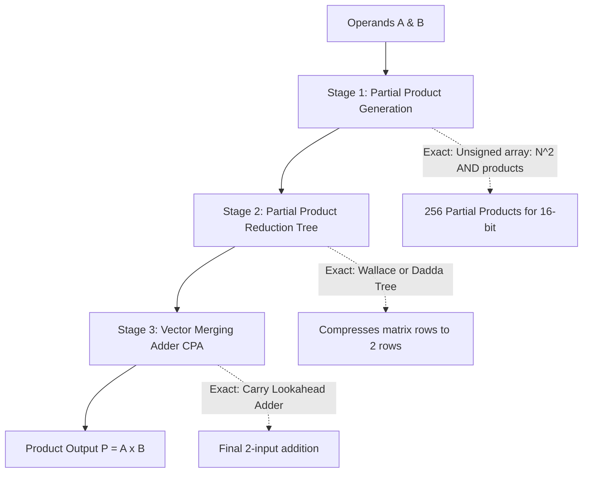
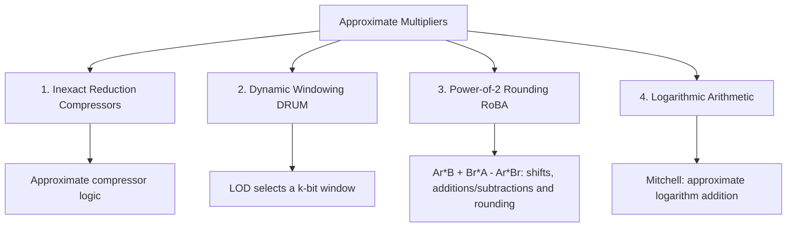

# Approximate Multipliers Taxonomy

Multipliers can be substantial power and area consumers in digital processors; their share depends on the datapath and workload.

This guide describes exact multiplier structures and approximation techniques that trade numerical accuracy for implementation cost.

**New here?** You need binary place values and carries from [Bits and carries](../start/bits-and-carry.md). The [OR-versus-addition example on the adders page](adders.md#read-a01) helps but is optional. This first part goes from "I can add binary numbers" to "I can follow how hardware multiplies and where cheaper multipliers cut corners". Material marked *Reference* or *Going deeper* is the original technical part of this page and is optional on a first read.

**After this first part you can:**

1. multiply 3 × 5 in 4-bit binary in the four hardware steps: generate rows, arrange them by weight, compress the columns, add the last two rows;
2. explain how a full adder turns three bits of one column into two bits, and why a 4:2 compressor's outputs have weights 1, 2 and 2;
3. work out column truncation, RoBA and DRUM on small numbers, and tell column truncation apart from clearing the low bits of a finished product.

## Start here: multiplying 3 × 5 in binary

Both numbers are **unsigned 4-bit** values: A = 3 = `0011` and B = 5 = `0101`. Two facts do all the work:

- Multiplying by a single bit gives either 0 or the whole number. In hardware this is an AND gate per bit.
- **Shifting** left by one place doubles a binary number: `0011` (3) becomes `0110` (6), and shifting by two places gives `1100` (12).

### Step 1: generate one row per bit of B

| Bit of B | Weight of that bit | Row (A AND the bit, shifted by its position) | Row value |
|---|---:|---|---:|
| b0 = 1 | 1 | `0011` | 3 |
| b1 = 0 | 2 | `0000`, shifted 1 place | 0 |
| b2 = 1 | 4 | `0011` shifted 2 places = `1100` | 12 |
| b3 = 0 | 8 | `0000`, shifted 3 places | 0 |

Each bit in these rows is a **partial-product bit** \(a_i b_j\): bit \(i\) of A AND bit \(j\) of B.

### Step 2: arrange the bits by weight

The bit \(a_i b_j\) belongs in the column of weight \(2^{i+j}\). With 4-bit operands, the columns of weight 1, 2, 4, 8, 16, 32 and 64 hold 1, 2, 3, 4, 3, 2 and 1 bits. The middle column is the tallest, and hardware has to reduce every column to at most two bits before one final addition.

**Predict first:** for 3 × 5, how many 1s land in each column?

Check the columns for 3 × 5

| Column weight | Bits in the column | Number of 1s |
|---:|---|---:|
| 64 | 0 | 0 |
| 32 | 0 0 | 0 |
| 16 | 0 0 0 | 0 |
| 8 | 0 1 0 0 | 1 |
| 4 | 1 0 0 | 1 |
| 2 | 0 1 | 1 |
| 1 | 1 | 1 |

Each column of weight 1, 2, 4 and 8 holds exactly one 1, so the product is `1111` = 15. Most of the bits are 0 because B has two 0 bits; hardware still has a place for every bit.

### Step 3: compress three rows into two

A **full adder** takes three bits from the *same* column and counts them. It writes the count as a **sum** bit, which stays in that column, and a **carry** bit, which goes to the next column (double the weight):

\[x+y+z = S + 2C.\]

For example, 1 + 1 + 1 = 3 = 1 + 2 × 1, so S = 1 and C = 1. In the weight-4 column of 3 × 5, the bits are 0, 0 and 1: S = 1 stays at weight 4 and C = 0 goes to weight 8. Because a full adder turns 3 bits into 2, it is also called a **3:2 compressor**. Using enough of them, every column shrinks to at most two bits, that is, two rows.

A **4:2 compressor** does the same job for four bits of one column plus a carry-in \(C_{in}\) from its neighbour. It outputs a sum S of weight 1 and two bits, C and \(C_{out}\), that each have weight 2:

\[x_1+x_2+x_3+x_4+C_{in} = S + 2C + 2C_{out}.\]

With four 1s and \(C_{in}=0\), the count is 4 = 0 + 2 × 1 + 2 × 1.

### Step 4: one final addition

The last two rows are added by one ordinary carry adder, the kind on the [adders page](adders.md). For 3 × 5 the result is `1111` = 15.

Approximate multipliers save work by changing one of these steps: they generate fewer bits (truncation), change the operands before generating (RoBA, DRUM), or count a column inexactly (approximate compressors).

## Three cheaper rules on small numbers

The lab below uses the same three rules on **unsigned 8-bit operands from 1 to 255**. Its **RED** (relative error distance) is |approximate − exact| ÷ exact for one operand pair; exact is never 0 there because 0 is not an allowed operand.

**Column truncation (no correction).** Do not generate the bits in the four lowest columns (weights 1, 2, 4 and 8, that is, \(i+j<4\)). For 3 × 5, all four 1s are in those columns, so the output is 0 and RED is 100%. This is **not** the same as computing the exact product and then clearing its low 4 bits:

| 7 × 7 (exact 49 = `110001`) | Result | Why |
|---|---:|---|
| Column truncation (columns of weight 1–8 never generated) | 16 | The eight 1s in the low columns (worth 33 together) are thrown away before their carries can reach weights 16 and 32 |
| Exact product, then low 4 bits of the result cleared | 48 | Only the final bit of weight 1 is lost |

**RoBA.** Round each operand to the nearest power of two *by distance*: 5 → 4, and 3, which is exactly halfway between 2 and 4, goes to 2 under the paper's rule. Then compute \(A_r B + B_r A - A_r B_r\), which needs only shifts and additions because \(A_r\) and \(B_r\) are powers of two: 2 × 5 + 4 × 3 − 2 × 4 = 14. The error is \(-(A_r-A)(B_r-B) = -(2-3)(4-5) = -1\).

**DRUM-4.** Keep a 4-bit window starting at each operand's leading 1. If any lower bits were dropped, force the window's lowest bit to 1, then shift the product back. 3 and 5 fit in 4 bits, so DRUM-4 gives exactly 15. With A = 25 = `11001` (5 bits), the window is `1100`; forcing the lowest bit gives `1101` = 13, which stands for 13 × 2 = 26. So 25 × 3 becomes 26 × 3 = 78, while the exact product is 75. Without the forced 1 the window would stand for 24 and give 72. Forcing the bit to 1 lets errors go up as well as down; this is DRUM's design aim, not a guarantee for every workload.

| Rule | 3 × 5 (exact 15) | 25 × 3 (exact 75) | Which step it changes |
|---|---:|---:|---|
| Column truncation | 0 (RED 100%) | 64 (RED 14.67%) | Step 1: fewer bits generated |
| RoBA | 14 (RED 6.67%) | 82 (RED 9.33%) | Before step 1: rounded operands |
| DRUM-4 | 15 (RED 0%) | 78 (RED 4.00%) | Before step 1: short operand windows |

One operand pair shows that an error happens; it does not tell you how often. The lab's line of exhaustive statistics covers all 65,025 pairs. None of these numbers says anything about area or energy.

**Next:** the general N-bit structure below is reference material. [Skip to the lab task](#mul-lab).

---

## 🔬 Anatomy of a Hardware Multiplier

*Reference (optional on a first read): the four steps above in general N-bit form. Steps 1 and 2 together are "partial product generation"; Booth encoding, Wallace and Dadda trees are advanced ways to do steps 1 and 3. [Skip to the lab task](#mul-lab).*

Multiplying two $N$-bit unsigned binary numbers ($A = \sum_{i=0}^{N-1} a_i 2^i$ and $B = \sum_{j=0}^{N-1} b_j 2^j$) in hardware consists of three logical phases (which need not be separately pipelined):

### Stage 1: Partial Product Generation (PPG)
- **Standard Array**: An $N \times N$ matrix of bits ($16 \times 16 = 256$ bits) is generated using simple `AND` gates ($p_{i,j} = a_i \cdot b_j$).
- **Radix-4 Modified Booth Encoding (MBE)**: Groups multiplier bits in triplets $(b_{2i+1}, b_{2i}, b_{2i-1})$ to encode multiples $\{0, \pm 1A, \pm 2A\}$, reducing the main partial-product rows to about $\lceil N/2\rceil$ for signed operands; unsigned operands need zero extension and may require an extra row. Sign-extension and correction bits are also required.

### Stage 2: Partial Product Reduction (PPR)
The tall partial product matrix is compressed down to just two rows using layers of **Full Adders (3:2 compressors)** and **4:2 Compressors**:

- **Wallace Tree**: Compresses as aggressively as possible at every stage to minimize total layer count ($\mathcal{O}(\log_{1.5} N)$).
- **Dadda Tree**: Postpones compression to minimize the total number of full adders required, saving silicon area.

### Stage 3: Vector Merging (Final CPA)
The final two compressed rows are added together using a fast **Carry-Propagate Adder (CPA)** (e.g. Kogge-Stone or Carry-Lookahead) to produce the final $2N$-bit product.

---

## 🎛️ Interactive Lab: Multiplier Playground

Try the operand sliders to compare **Exact**, **column-truncated (no correction)**, **RoBA**, and **DRUM** multiplication. Column truncation discards partial-product bits below weight $2^4$; the image lab instead clears low bits of each completed product. These are different models:

<iframe
  src="../../labs/multiplier-explorer.html"
  title="Interactive Multiplier Explorer"
  style="width: 100%; height: 960px; border: none; background: transparent; margin: 12px 0;"
  loading="lazy"
></iframe>

If the lab does not load, [open the Multiplier Explorer on its own page](../labs/multiplier-explorer.html).

**Lab task: 3 × 5 and 25 × 3.** The lab opens with A = 125, B = 89 and RoBA selected. Set a slider by dragging it, or click it and use the arrow keys (each press changes the value by 1).

1. **Predict:** using [the table above](#mul-cheap), what will each of the four menu choices output for A = 3, B = 5?
2. Set **Operand A** to 3 and **Operand B** to 5. Choose each option in **Approximation Architecture** in turn and read **Exact Answer (A × B)**, **Approximate Output** and **Relative Error Distance (RED)**. With RoBA, the grey box under the menu shows the rounded operands Ar and Br.
3. Set A = 25 and B = 3, choose **DRUM-4** and read the grey box: it shows the window kept from each operand and its shift.
4. **Explain:** why does column truncation lose everything for 3 × 5, while DRUM-4 loses nothing?

Check the lab readings

| Operands | Approximation Architecture | Approximate Output | RED | Grey box shows |
|---|---|---:|---:|---|
| 3 × 5 | Exact | 15 | 0.00% | Reference: exact product |
| 3 × 5 | Column-truncated | 0 | 100.00% | Bits with i + j < 4 dropped |
| 3 × 5 | Unsigned RoBA | 14 | 6.67% | Ar = 2, Br = 4 |
| 3 × 5 | DRUM-4 | 15 | 0.00% | A segment = 11 (shift 0), B segment = 101 (shift 0) |
| 25 × 3 | DRUM-4 | 78 | 4.00% | A segment = 1101 (shift 1), B segment = 11 (shift 0) |

Column truncation removes the four lowest columns, and every 1 of 3 × 5 lies in them. DRUM-4 only changes operands wider than 4 bits; 3 and 5 are narrower, so nothing is dropped.

**Hardware Cost** always reads *Not modelled*: the lab computes numbers, not area or energy. The bottom box gives exhaustive statistics over all 255 × 255 = 65,025 operand pairs for the chosen rule; they do not change when you move the sliders. Its *Wrong results* is the error rate (ER) and *Mean RED* is the MRED over that whole domain.

### Check your understanding

Answer on paper first, then open the check. Your answers are not saved or sent anywhere.

**Question MUL-1.** Write the partial-product rows for 6 × 5, that is, `0110` × `0101`, and add them.

**Question MUL-2.** A full adder in the weight-4 column receives the bits 1, 1 and 0. What are its sum and carry, and in which columns do they go?

**Question MUL-3.** For 7 × 7, column truncation of the four lowest columns gives 16, while clearing the low 4 bits of the exact product 49 gives 48. Explain in one sentence why the two "drop the low bits" ideas differ so much.

Check questions MUL-1 to MUL-3

**MUL-1.** B = `0101` has 1s at weights 1 and 4. Rows: `0110` = 6 (for b0), 0 (for b1), `0110` shifted 2 places = `11000` = 24 (for b2), 0 (for b3). Sum: 6 + 24 = 30 = 6 × 5.

- Shifting the row the wrong way, or not at all, gives 6 + 6 = 12: each row must move left by the position of its B bit.

**MUL-2.** 1 + 1 + 0 = 2 = 0 + 2 × 1, so S = 0 stays in the weight-4 column and C = 1 goes to the weight-8 column. Check: 2 × 4 = 8, the value the carry carries.

- Writing the carry in the same column would count it at weight 4 instead of 8.

**MUL-3.** Column truncation throws away partial-product bits *before* they are added, so it also loses the carries they would have produced into higher columns (here 33 in total), whereas clearing bits of the finished product only removes what was left in those bit positions (here 1).

- The lab models column truncation. Image experiments elsewhere on this site clear low bits of completed products; their numbers are not interchangeable.

---

## Going deeper

Everything below is the original reference material for this page. It is not needed for the questions above.

- [The four core approximate multiplier architectures](#the-four-core-approximate-multiplier-architectures)
- [Inexact compressors](#1-inexact-compressors) (Momeni et al. Designs 1 and 2) and the [4:2 compressor lab with its task](#mul-lab-compressor)
- [DRUM](#2-dynamic-range-unbiased-multiplier-drum), [RoBA](#3-rounding-based-multiplier-roba), [TOSAM](#4-truncation-rounding-based-scalable-multipliers-tosam) and [Mitchell's logarithmic multiplication](#logarithmic-multiplication)
- [Primary literature](#primary-literature-ieee-citations)

The general N-bit structure, with Booth encoding and Wallace and Dadda trees, is [earlier on this page](#anatomy-of-a-hardware-multiplier).

---

## 🏛️ The Four Core Approximate Multiplier Architectures

---

### 1. Inexact Compressors
An exact conventional 4:2 compressor has four data inputs and a carry input. Its weighted contract is

$$x_1+x_2+x_3+x_4+C_{\mathrm{in}}=S+2C+2C_{\mathrm{out}}.$$

Its sum is the XOR of all five inputs; the carry outputs are needed to preserve the count. Transistor counts depend on the cell implementation.

The lab implements Momeni et al.'s two published approximate designs ([author manuscript](https://www.ece.ualberta.ca/~jhan8/publications/ApproximateCompressor_FinalforReview.pdf), equations 5–9 and Tables II–III). Define $u=\overline{x_1\oplus x_2}$, $v=\overline{x_3\oplus x_4}$ and $g=(x_1\lor x_2)\land(x_3\lor x_4)$.

- **Design 1** keeps five inputs: $C'=C_{\mathrm{in}}$, $C'_{\mathrm{out}}=g$, $S'=\overline{C_{\mathrm{in}}}\land(u\lor v)$. Compare $S'+2C'+2C'_{\mathrm{out}}$ with the sum of all five inputs: 20 of 32 cases are exact.
- **Design 2** has four inputs, no carry-in and no carry-out: $C'=g$, $S'=u\lor v$. Compare $S'+2C'$ with the sum of the four inputs: 12 of 16 cases are exact.

Every wrong row has signed error (approximate minus exact) of $+1$ or $-1$. These exhaustive truth-table counts are not silicon measurements. The former four-input OR/XOR teaching counter is a different circuit and is no longer the model in this lab.

---

## 🗜️ Interactive Lab: 4:2 Compressor Playground

Compare the exact five-input compressor with Design 1 or the four-input Design 2. The carry-in toggle is ignored in Design 2:

<iframe
  src="../../labs/compressor-4to2-playground.html"
  title="4:2 Approximate Compressor Playground"
  style="width: 100%; height: 790px; border: none; background: transparent; margin: 12px 0;"
  loading="lazy"
></iframe>

If the lab does not load, [open the 4:2 Compressor Playground on its own page](../labs/compressor-4to2-playground.html).

**Lab task: four 1s in one column.** You need only [Step 3 of the start section](#step-3-compress-three-rows-into-two). The lab opens with X₂ = 1, X₄ = 1, the others 0, and Design 1 selected. Click a circle to switch that bit between 0 and 1.

1. **Predict:** with X₁ = X₂ = X₃ = X₄ = 1 and Carry In = 0, what count must an exact compressor represent? Does Design 1 get it right?
2. Set those inputs. Read the **Exact 4:2 Compressor** card, the **Approximate Design** card and **This input**.
3. Switch Carry In to 1 and read again. Then choose **Approximate Design 2** in the menu at the top, with Carry In still 1.
4. **Explain:** why does the *expected* value in the Design 2 card stay at 4 when Carry In is 1?

Check the compressor readings

| Inputs | Design | Exact card value | Approximate value (expected) | This input |
|---|---|---:|---:|---|
| X₁–X₄ = 1, Carry In = 0 | Design 1 | 4 | 3 (4) | Wrong (−1) |
| X₁–X₄ = 1, Carry In = 1 | Design 1 | 5 | 4 (5) | Wrong (−1) |
| X₁–X₄ = 1, Carry In = 1 | Design 2 | 5 | 3 (4) | Wrong (−1) |

The lab prints the difference with a plain hyphen, as *Wrong (-1)*. Design 2 has no carry-in input at all, so it is compared with X₁ + X₂ + X₃ + X₄ only; the Carry In circle is ignored. The wrong-row counters read 12/32 for Design 1 and 4/16 for Design 2: exhaustive truth-table counts, not silicon measurements.

---

### 2. Dynamic Range Unbiased Multiplier (DRUM)
For unsigned $N$-bit inputs and a design-time window width $k$, let $\ell_X=\lfloor\log_2 X\rfloor$ for $X>0$ and $s_X=\max(\ell_X-k+1,0)$. In the [authors' DRUM RTL](https://github.com/scale-lab/DRUM/blob/master/DRUM4_16_u.v), the selected operand is

$$m_X=\begin{cases}X,&s_X=0,\\ (X\gg s_X)\mathbin{\mathrm{OR}}1,&s_X>0.\end{cases}$$

The result is $P'=m_A m_B\,2^{s_A+s_B}$; a zero operand gives zero. Setting the selected window's least significant bit to one distinguishes DRUM from simple window truncation. The small multiplier core is accompanied by selection and shifting logic, so its gate count alone does not determine total area. “Unbiased” describes the design's error-distribution objective, not a guarantee for arbitrary workloads. Signed variants require their own sign handling.

---

### 3. Rounding-Based Multiplier (RoBA)
For unsigned magnitudes, round to the nearest power of two **by numerical distance**, not by rounding $\log_2 X$. The original paper (Section III-A, accepted-manuscript pp. 2–3) rounds the tie $3$ to $2$ and other midpoint ties upward. Define $r(0)=0$ explicitly for the teaching model.

$$P'=A_r B+B_r A-A_r B_r,\qquad P'-AB=-(A_r-A)(B_r-B).$$

The omitted residual makes the error positive or negative depending on the rounding directions. Variable shifts still require hardware. The paper uses three shifts and an addition/subtraction combination, plus rounding logic. Signed RoBA first processes magnitudes and then restores the sign; its exact and approximate sign-restoration variants are different models. An unsigned $N$-bit magnitude can round to $2^N$, requiring an $N+1$-bit rounded value and sufficiently wide intermediate arithmetic. The unsigned teaching output is retained in $2N$ bits without intermediate wraparound.

---

### 4. Truncation & Rounding-Based Scalable Multipliers (TOSAM)
TOSAM combines truncation and rounding to offer design tradeoffs. It should not be interpreted as a promise of runtime switching to fully exact multiplication.

### Logarithmic multiplication
For $A,B>0$, write $A=2^{a}(1+x)$ and $B=2^{b}(1+y)$ with $x,y\in[0,1)$. Mitchell's uncorrected model adds the approximate logarithms $a+x$ and $b+y$ and applies the piecewise linear inverse:

$$P_M=\begin{cases}2^{a+b}(1+x+y),&x+y<1,\\2^{a+b+1}(x+y),&x+y\ge1.\end{cases}$$

It underestimates or equals the exact unsigned product before output quantization. Zero needs a separate zero-result path; signed operands require magnitude and sign handling. This model is distinct from DRUM and RoBA.

---

## 📚 Primary Literature & IEEE Citations

- A. Momeni, J. Han, P. Montuschi, F. Lombardi, *"Design and Analysis of Approximate Compressors for Multiplication"*, IEEE Transactions on Computers 64(4):984–994, 2015. [Publisher record](https://doi.org/10.1109/TC.2014.2308214).

- Soheil Hashemi, R. Iris Bahar, Sherief Reda, *"DRUM: A Dynamic Range Unbiased Multiplier for approximate applications"*, 2015 IEEE/ACM International Conference on Computer-Aided Design (ICCAD), 2015. [Publisher record](https://doi.org/10.1109/ICCAD.2015.7372600).

- Reza Zendegani, Mehdi Kamal, Milad Bahadori, Ali Afzali-Kusha, Massoud Pedram, *"RoBA Multiplier: A Rounding-Based Approximate Multiplier for High-Speed yet Energy-Efficient Digital Signal Processing"*, IEEE Transactions on Very Large Scale Integration (VLSI) Systems, 2017. [Publisher record](https://doi.org/10.1109/TVLSI.2016.2587696).

- Naman Maheshwari, Zhixi Yang, Jie Han, Fabrizio Lombardi, *"A Design Approach for Compressor Based Approximate Multipliers"*, 2015 28th International Conference on VLSI Design, 2015. [Publisher record](https://doi.org/10.1109/vlsid.2015.41).

- Shaghayegh Vahdat, Mehdi Kamal, Ali Afzali-Kusha, Massoud Pedram, *"TOSAM: An Energy-Efficient Truncation- and Rounding-Based Scalable Approximate Multiplier"*, IEEE Transactions on Very Large Scale Integration (VLSI) Systems, 2019. [Publisher record](https://doi.org/10.1109/TVLSI.2018.2890712).

- John N. Mitchell, *"Computer Multiplication and Division Using Binary Logarithms"*, IEEE Transactions on Electronic Computers, 1962. [Publisher record](https://doi.org/10.1109/TEC.1962.5219391).
