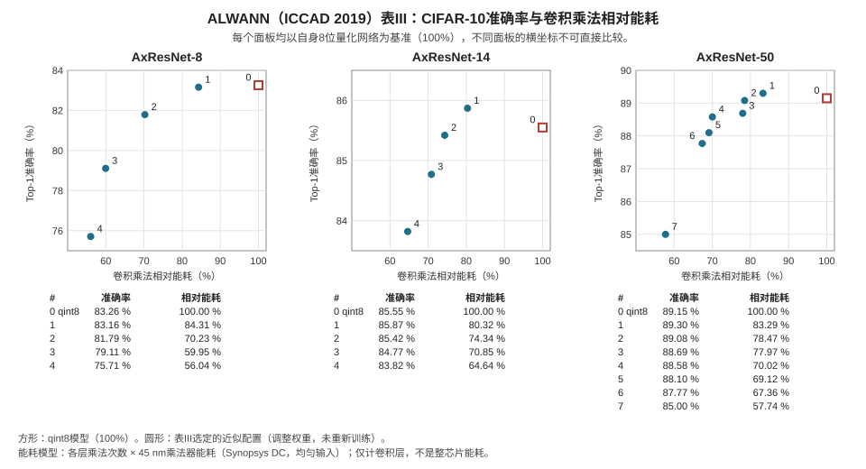

# 为什么人工智能适合使用非精确算术

<strong>你需要：</strong> 乘法、加法，以及把小数舍入到最近0.5倍数的概念。不要求神经网络、概率或线性代数背景；下文会定义每个术语。

<strong>读完本页，你将能够：</strong>

1. 手算一个微型神经网络层的单个输出，观察量化输入使它变化多少；
2. 区分<strong>训练</strong>与<strong>推理</strong>，以及<strong>量化</strong>与<strong>近似硬件</strong>；
3. 分四步解读ALWANN的能耗／准确率图，说明哪些结论不能从图中数值得到。

<strong>路线：</strong> [人眼与像素](human-eyes-and-pixels.md) → 本页 → [近似乘法器](../taxonomy/multipliers.md)。

## 从这里开始：手算一层中的一个加权和

从<strong>大语言模型（Large Language Model，LLM）</strong>到自动驾驶视觉系统（YOLO、ResNet、Vision Transformer），大型<strong>人工智能（Artificial Intelligence，AI）</strong>模型都把<strong>矩阵乘法（matrix multiplication）</strong>作为重要的计算核心，通常写为：

$$\mathbf{Y} = \mathbf{W} \cdot \mathbf{X} + \mathbf{b}$$

可以这样读：每个输出数，都是输入数的加权和再加上一个常数。在当前层次上，只需理解这一点。取一个有两个输入的输出：

| 输入$x$ | 权重$w$ | 乘积 |
|---:|---:|---:|
| 2.3 | 4 | 9.2 |
| 3.2 | 5 | 16.0 |

若偏置$b=-1$，输出就是$9.2 + 16.0 - 1 = 24.2$。

现在假设输入改用<strong>8比特整数</strong>存储，替代32比特浮点数。整数存储需要尺度$S$和零点$Z$；为简单起见，取$S=0.5$、$Z=0$。每个值舍入到最近的可表示步长，因此：

$$q = \operatorname{clip}_{[q_{\min},q_{\max}]}\left(\operatorname{round}\left(\frac{x}{S}\right)+Z\right), \qquad \hat{x}=S(q-Z)$$

这里$\operatorname{round}$按明确规定的中点取舍规则舍入到最近整数。$\operatorname{clip}$把超出范围的值替换为最近边界，使整数保持在存储范围$[q_{\min},q_{\max}]$内；$\hat{x}$是重建的实数。本例没有数值被裁剪。公式给出$2.3 \to \operatorname{round}(4.6)=5 \to 2.5$和$3.2 \to \operatorname{round}(6.4)=6 \to 3.0$。此时这一层计算$4(2.5)+5(3.0)-1 = 24$，精确结果则为$24.2$。<strong>运算本身精确；误差来自用更少比特记录输入。</strong>这是本页最需要分清的机制，称为<strong>量化（quantization）</strong>。

这一层之后还要经过非线性步骤，此处使用<strong>修正线性单元（Rectified Linear Unit，ReLU）</strong>：$\text{ReLU}(z)=\max(0,z)$，正值原样通过，其余归零。观察激活前值（ReLU之前的加权和$z$）接近零时会怎样。如果精确值为$-0.2$、近似值为$+0.2$，那么ReLU输出分别为$0$和$0.2$：大小为$0.4$的激活前误差变成$0.2$的输出误差。只有当精确和受扰动的激活前值<strong>都</strong>保持非正时，ReLU才会抑制扰动；误差一旦跨过阈值，就可能传递到输出，或使原本为零的输出变成非零。ReLU及其他激活函数都不能消除算术误差。

## 四个不能混用的词

| 术语 | 改变什么 | 运算仍然精确吗？ |
|---|---|---|
| <strong>推理（inference）</strong> | 对训练好的模型求值 | 取决于选定的运算实现 |
| <strong>训练（training）</strong> | 利用梯度指导小幅调整，改变权重 | 取决于选定的运算实现 |
| <strong>量化</strong> | 每个值由多少比特表示 | 是——对存储值执行精确运算 |
| <strong>近似硬件（approximate hardware）</strong> | 运算单元计算的函数 | 否——其目的就在于改变它 |

训练阶段计算梯度并改变权重。梯度描述训练误差如何随权重变化，用来指导权重调整。本页示例无需计算梯度。推理阶段则只进行求值。近似对两者的影响不同：推理中的误差扰动一次回答，训练中的误差可能扰动权重本身，继而传播到以后每次回答。模型能成功训练，也不能单凭这一点推断替换乘法器之后会怎样，必须在目标工作负载上测量。

后两行的区别是本页后文的基础。量化降低数的表示精度，但8比特整数上的运算仍可精确。近似硬件替换运算单元本身，使乘积与和不再符合原本规定的结果。在合适实现条件下，两者都可能降低成本，但改变的环节不同，误差特性也不同：量化误差依赖尺度、舍入、范围和数值；电路误差依赖电路和操作数模式。

## 分四步读懂ALWANN图

本页主要案例（[下方图及图注](#alwann-case-study)）展示分类准确率与模型估算的乘法器能耗之间的关系。解读时要看四项信息。

<strong>第1步——找到基准。</strong> 每个子图的横轴都按该网络自己的量化8比特（qint8）模型归一化，基准位于100%。因此70.02%的点表示“同一网络中精确乘法器模型能耗的70.02%”，而非某个通用参考的70%。

<strong>第2步——读取数据点。</strong> 数据点对应论文报告的配置。点之间没有连线，因为表中没有它们之间的测量结果。

<strong>第3步——核对两个坐标轴。</strong> 纵轴是在CIFAR-10图像数据集上的top-1准确率：模型首选标签正确的测试图像比例。横轴是<strong>卷积层乘法</strong>能耗，即在图像处理层中反复计算局部加权和时乘法所消耗的能量。两者都有明确范围；一个轴改善，不能推出另一个轴也改善。

<strong>第4步——列出不能推断的结论。</strong> 各子图分别按自身基准归一化，因此横向位置<strong>无法给不同网络的绝对能耗排序</strong>，且各子图纵轴刻度也不同。能耗只统计<strong>卷积层中的乘法</strong>，不包含累加、存储器流量、其他层或整个芯片。这些还是CIFAR-10结果，不能说明ImageNet或其他任务的表现。尤其要记住：<strong>一个模块的节能量不能当作全系统节能量。</strong>把局部节省比例乘以模块数或设备功耗，正是无效的外推。

比较准确率时，应区分<strong>百分点</strong>和相对百分比：从89.15%降到88.58%，是下降0.57个百分点。相对降幅则需要把这一差值除以原准确率。

## 检查你的理解

先在纸上作答，再展开核对。答案不会被保存或发送到任何地方。

<strong>WB19。</strong> 某层输入为$x_1 = 1.2$、$x_2 = 5.2$，权重为$w_1 = 3$、$w_2 = 2$，偏置为$b = -0.5$。(a) 精确计算输出。(b) 用$S = 0.5$、$Z = 0$量化两个输入（舍入到最近整数），重新计算并给出输出误差。(c) (b)中的运算是否为近似运算？

核对WB19

(a) $3(1.2) + 2(5.2) - 0.5 = 3.6 + 10.4 - 0.5 = 13.5$。(b) $1.2 \to \operatorname{round}(2.4) = 2 \to 1.0$；$5.2 \to \operatorname{round}(10.4) = 10 \to 5.0$。因此$3(1.0) + 2(5.0) - 0.5 = 3 + 10 - 0.5 = 12.5$，误差为$12.5 - 13.5 = -1.0$。(c) 否，加法和乘法都精确执行；输入按$0.5$步长存储时引入了误差。这是量化，不是近似硬件。

- 如果(b)得到$+1.0$，请检查符号约定：误差为近似值减精确值。
- 注意误差如何依赖步长：若$S = 0.1$，这些输入得到$q_1=12$、$q_2=52$，都能用8比特表示，重建后也完全精确。整数范围固定时，更小的尺度会缩小可表示实数范围，本身不会要求更多有效载荷比特。

<strong>WB20。</strong> 某团队报告：“把模型量化到8比特使准确率变化0.3%，因此我们的近似乘法器设计也会损失0.3%。”指出两个独立错误。

核对WB20

第一，把量化结果套用到近似硬件：它们改变的环节不同，误差形态不同，后者扰动乘积，而非存储值。第二，只给出准确率变化，没有说明模型、数据集、配置，以及0.3%指相对百分比还是百分点。解释第一项测量本身也需要这些条件。即使确实测量了一层，也无法预测另一层。可成立的主张只能限于明确模型、数据集和配置下实际测得的结果。

- 一个检验方法：两种设计各层的误差特征可能不同吗？可能，因为两者依赖不同的表示和电路选择，也依赖各自输入。

<strong>WB21。</strong> ALWANN图中，一种AxResNet-50配置报告top-1准确率为88.58%，其qint8基准为89.15%，相对乘法能耗为70.02%。(a) 70.02%究竟相对于什么？(b) 为什么不能把它的横向位置与AxResNet-8子图中的点比较？(c) 这一结果说明整个芯片更节能吗？

核对WB21

(a) 相对于<strong>同一个网络</strong>的qint8模型，即该子图横轴100%处、采用精确乘法器的8比特基准。(b) 因为每个子图都按<strong>自己的</strong>基准归一化，两个子图采用不同网络的参考能耗，百分比位置无法给绝对能耗排序。(c) 不能。统计的是<strong>卷积层内部乘法的能耗</strong>，来自45 nm、均匀分布输入的综合模型。不包含累加、存储器流量、其他层及芯片其余部分。这是部件结果，不是整芯片或整个系统的测量。

- 把70.02%理解成“芯片能耗下降30%”，就是本页指出的从局部到全系统的外推。

---

## 🔬 深入阅读：机制、案例与数据

从大语言模型到自动驾驶视觉系统（YOLO、ResNet、Vision Transformer），大型AI模型都把矩阵乘法作为重要计算核心：<strong>通用矩阵乘法（General Matrix Multiplication，GEMM）</strong>。

运算次数取决于模型、输入大小和批大小。近似算术必须针对具体应用验证准确率。

### 🧠 神经网络的误差容忍有条件

训练可以使用随机小批量、随机失活（dropout）和数据增强。这不能使硬件错误等同于训练噪声：算术误差可能带有偏差，依赖输入，或相互相关。使用预期运算模型重新训练可能有帮助，但准确率必须在目标工作负载上测量。

训练后的权重未必服从零均值高斯分布。其范围随层和通道变化，离群值也可能重要。较小的权重和参数冗余，都不能保证模型容忍截断或对数乘法。

#### 非线性激活函数（ReLU与GELU）

$$\text{ReLU}(z)=\max(0,z),\qquad \text{GELU}(z)=z\Phi(z)$$

这里$\Phi$是标准正态分布的累积分布函数。只有精确与受扰动的激活前值都保持非正时，ReLU才会抑制扰动；误差可能跨过阈值。<strong>高斯误差线性单元（Gaussian Error Linear Unit，GELU）</strong>对负输入通常输出负值。两种激活函数都不保证消除算术误差。

### 🔬 量化与近似硬件

现代AI优化使用两种可互补的方法：

FP32运算会舍入，并非数学意义上的精确运算。把每个值从32比特改为8比特存储，可使有效载荷变为四分之一；尺度、零点、偏置和累加器还会增加存储开销。

1. <strong>量化</strong>将数据位宽从32比特浮点数缩减为8比特或4比特整数：

    $$
    q = \operatorname{clip}_{[q_{\min},q_{\max}]}\left(\operatorname{round}\left(\frac{x}{S}\right)+Z\right)
    $$

    这里$S>0$，$Z$为整数零点，必须明确整数范围和舍入规则。反量化使用$\hat{x}=S(q-Z)$。

2. <strong>近似硬件</strong>改变运算电路本身。压缩器设计和晶体管数量各不相同；评估节省量需要明确实现和基准。

### ⚡ 能耗与准确率案例

近似卷积神经网络（Convolutional Neural Network，CNN）算术可以在能耗和分类准确率之间取舍，Mrázek、Sekanina和Vašíček在CIFAR-10与CIFAR-100上对此进行了研究。结果取决于电路、层、网络和数据。运算单元的节省量不能直接决定芯片能耗或电池续航；存储器、控制、传感器及其他系统负载也会消耗能量。

#### 案例：ResNet逐层近似乘法器（ALWANN）

Mrázek等人（ALWANN，ICCAD 2019）从在<strong>CIFAR-10</strong>上训练并量化为8比特（qint8）的ResNet-8、ResNet-14、ResNet-50网络出发，为每个卷积层从EvoApproxLib中选择36种近似8比特乘法器之一。该方法避免通过反向传播重新训练，但权重仍会改变：<strong>权重调节（weight-tuning）</strong>步骤使用针对每个近似乘法器预计算的映射，逐层替换权重值（§III-B）。

表III中，一种AxResNet-50配置在CIFAR-10验证集上的top-1准确率达到88.58%，qint8 ResNet-50为89.15%（下降0.57个百分点）。该配置的卷积层乘法能耗为该qint8网络的70.02%。

这一能耗数字的统计范围如下：

- 每层能耗等于乘法次数乘以该层所选乘法器的单次能量。乘法器能量来自45 nm工艺、均匀分布输入下的Synopsys DC综合（§IV）。这是模型估计，不是芯片测量。
- 只统计卷积层乘法，不包含累加、存储器流量、其他层或整芯片能耗。
- 作为规模参考，表I列出：ResNet-50处理一幅32 × 32 RGB图像时，卷积层需要120.3 M次乘法。
- 这些是CIFAR-10结果，不能证明ImageNet或其他任务中的表现。

*图：ALWANN表III全部18行数据，包括每个网络位于100%处的qint8模型。各子图横轴分别按自身qint8模型归一化，因此横向位置不能给不同网络的绝对能耗排序，且各子图纵轴刻度不同。数据点为论文报告的配置；表中未给出点间结果，因此不连线。数据：[alwann-points.csv](../assets/restored/alwann-points.csv)。*

#### 案例：仅用8比特整数的目标检测

量化改变的是另一个环节：量化值上的整数运算精确，误差来自用较少比特表示数值。Jacob等人（CVPR 2018，表4.4）在COCO数据集上比较了浮点MobileNet SSD（深度乘数为100%）与仅用8比特整数的版本：

| MobileNet SSD，DM 100% | COCO mAP | Snapdragon 835 LITTLE核（ms） | Snapdragon 835大核（ms） |
| :--- | ---: | ---: | ---: |
| 浮点 | 22.1 | 778 | 370 |
| 仅8比特整数 | 21.7 | 687 | 272 |

延迟在每类核心上用单线程测得。这些是量化推理的检测准确率与延迟结果，不是能耗测量，也不能说明近似乘法器的表现。

### 📚 原始文献

- D. Hendrycks and K. Gimpel, *“Gaussian Error Linear Units (GELUs)”*, arXiv:1606.08415 (2016; 2023年修订), [§2](https://arxiv.org/html/1606.08415v5).
- B. Jacob et al., *“Quantization and Training of Neural Networks for Efficient Integer-Arithmetic-Only Inference”*, CVPR (2018), [§2–3及表4.4](https://arxiv.org/pdf/1712.05877).
- V. Mrazek, Z. Vasicek, L. Sekanina, M. A. Hanif, and M. Shafique, *“ALWANN: Automatic Layer-Wise Approximation of Deep Neural Network Accelerators without Retraining”*, ICCAD (2019), [作者版本，§III-B和§IV，表I和表III](https://arxiv.org/abs/1907.07229), [DOI: 10.1109/ICCAD45719.2019.8942068](https://doi.org/10.1109/ICCAD45719.2019.8942068).
- V. Mrázek, L. Sekanina, and Z. Vašíček, *“Libraries of Approximate Circuits: Automated Design and Application in CNN Accelerators”*, IEEE JETCAS 10(4), 406–418 (2020), [DOI: 10.1109/JETCAS.2020.3032495](https://doi.org/10.1109/JETCAS.2020.3032495).
