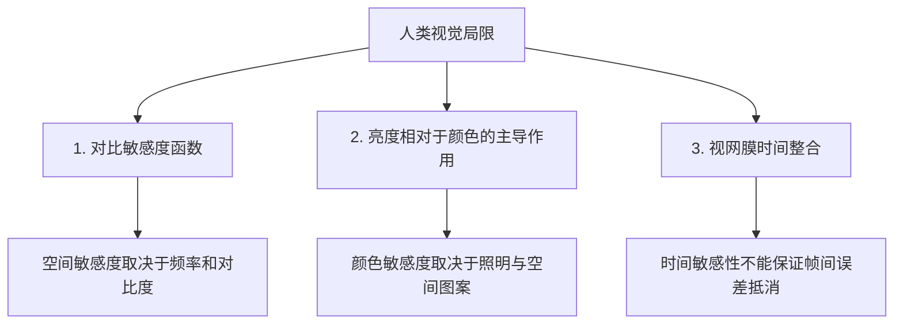

<a id="why-human-eyes-and-ears-forgive-inexact-math"></a>

# 人眼为何能容忍像素误差

JPEG和MP3根据感知模型丢弃信息，减小文件体积。压缩比和感知质量取决于编码器、设置、内容以及观看或聆听条件。

其机制来自人类生理特性和<strong>感知噪声掩蔽（perceptual noise masking）</strong>。

<strong>你需要：</strong> 计数、乘法和平均数概念。不要求图像、听觉或电路知识；下文会定义每个术语。

<strong>读完本页，你将能够：</strong>

1. 说明什么是像素和8比特数值，以及什么是<strong>固定比较区域</strong>、为什么需要它；
2. 手算一个$3\times 3$加权平均，明确看到一个近似乘法器改变了什么；
3. 说明比较两个分数之前，<strong>参考图像</strong>、<strong>MSE</strong>和<strong>PSNR</strong>各需要明确什么。

<strong>路线：</strong> [近似计算范式](../fundamentals/approx-paradigms.md) → 本页 → [为什么AI适合使用非精确算术](ai-and-approximate-math.md)。

<a id="start-here-pixels-8-bits-and-a-fixed-comparison-region"></a>

## 从这里开始：像素、8比特与固定比较区域

数字照片是由<strong>像素（pixel）</strong>构成的网格。每个像素保存一个亮度数值。常见的<strong>8比特（8-bit）</strong>灰度图中，这个数是`0`（黑）到`255`（白）之间的整数，因此单个像素只能取256种值。也就是说，添加任何近似之前，照片就已经是经过舍入的有限精度对象。

滤波器对这些数执行运算。一种常见滤波器把每个像素替换为它自身及八个邻近像素的<strong>加权平均</strong>：每个邻近像素乘以固定权重，将九个乘积相加，再除以权重总和。这组权重称为<strong>模板（stencil）</strong>或<strong>核（kernel）</strong>。

对两幅图像作数值比较之前，必须固定一件事：<strong>比较哪些像素</strong>。这就是<strong>比较区域（comparison region）</strong>。原因有两个。首先，边缘很特殊：边框上的像素在图像外没有邻居。实现可以排除边框，也可以规定填充规则；本例只使用邻域完整的位置。其次，如果两幅图像经过不同处理路径，其边框处理可能不同。所有像素上的分数和仅内部像素上的分数，是不同的量；不说明使用哪个区域，就无法与另一分数比较。

<a id="one-weighted-average-computed-by-hand"></a>

## 手算一次加权平均

取一块$3\times 3$的8比特图像区域，使用下列平滑核。表中整数系数之和为16；每个系数除以16，便得到非负且总和为$1$的归一化权重，因此该滤波确实是加权平均，输出始终位于这块区域的最小和最大输入值之间。

| | 第1列 | 第2列 | 第3列 | | 核 |
|---|---:|---:|---:|---|---|
| <strong>第1行</strong> | 120 | 122 | 118 | | 1 2 1 |
| <strong>第2行</strong> | 121 | 120 | 119 | | 2 4 2 |
| <strong>第3行</strong> | 125 | 123 | 121 | | 1 2 1 |

每个像素乘以其权重，求和后除以$16$（权重之和为$1+2+1+2+4+2+1+2+1 = 16$）：

$$120\cdot 1 + 122\cdot 2 + 118\cdot 1 + 121\cdot 2 + 120\cdot 4 + 119\cdot 2 + 125\cdot 1 + 123\cdot 2 + 121\cdot 1 = 1934$$

$$\frac{1934}{16} = 120.875 \quad\longrightarrow\quad \text{round to the nearest integer} = 121$$

因此滤波后8比特图像中的这个像素变为`121`。精确中间值$120.875$带有小数部分，8比特像素无法存储它，处理流程必须舍入（或者截断，但那是另一条规则）。注意这里九次乘法的系数只有$1$、$2$和$4$，都是2的幂，因此这个滤波器只需要移位，无需通用乘法器阵列。这是这个核的性质，不能推广到所有滤波器。

<a id="now-replace-one-multiplier-with-an-approximate-one"></a>

## 换成一个近似乘法器

假设计算各个像素与权重乘积的运算单元不再精确。使用无符号[<strong>动态范围无偏乘法器（Dynamic Range Unbiased Multiplier，DRUM）</strong>](../taxonomy/multipliers.md#mul-cheap)，窗口宽度为$k=4$：丢弃比特时，将保留窗口的<strong>最低有效位（Least Significant Bit，LSB）</strong>，即最右位，设为1。这块区域的每个像素都在$64$到$127$之间，因此最高的1位于第6位，低三位被丢弃。下例中，`>> 3`表示向右移三个二进制位，丢弃最右三位；`| 1`表示与1按位或运算，强制保留窗口的最右位为1，其他位不变；`*`表示乘法，`2^3`表示2的三次方。以$118 = 1110110_2$为例：

```
118          = 1110110
118 >> 3     = 1110        （保留最高4位）
(118>>3)|1   = 1111 = 15   （保留窗口的LSB强制设为1）
15 * 2^3     = 120         （恢复尺度）
```

这块区域中的九个像素都以相同方式映射到$120$，因此和变为$120 \cdot 16 = 1920$，平均值为：

$$\frac{120\cdot(1+2+1+2+4+2+1+2+1)}{16}=\frac{1920}{16}=120$$

因此，精确流程存储`121`的位置，近似流程存储`120`。相对于未舍入参考值$120.875$，差为$0.875$；相对于舍入后的8比特输出，差为$1$；在这块特定区域内，加权和的分子变化了$1934-1920=14$个计数单位。经过除法与舍入，存储输出变化一个计数单位。（若使用[<strong>基于舍入的近似乘法器（Rounding-Based Approximate Multiplier，RoBA）</strong>](../taxonomy/multipliers.md#mul-cheap)，这里的乘积精确，因为每个权重已是2的幂：当$B_r=B$时，其近似式$A_rB+AB_r-A_rB_r$等于$AB$。）

一个像素不是整幅图像。<strong>不能从这个单一输出值读出整幅图像的PSNR，也不能读出节能量。</strong>下一节说明如何评分。

<a id="how-an-image-is-scored-reference-region-mse-psnr"></a>

## 如何给图像评分：参考、区域、MSE与PSNR

为了说明滤波图像“偏差有多大”，通常把它与<strong>参考图像（reference image）</strong>比较，即按规定运算和已知舍入规则生成的输出。还必须明确三项信息，否则分数无法复现：

1. <strong>参考</strong>：哪幅图像，由哪种精确运算生成；
2. <strong>区域</strong>：所有像素，还是仅内部像素（本例只使用有完整$3\times3$邻域的位置；其他实现也可以按明确的填充规则生成边框输出）；
3. <strong>位深</strong>：8比特，因此峰值为$255$。

给定这些条件，<strong>均方误差（Mean Squared Error，MSE）</strong>对区域内像素差的平方取平均，<strong>峰值信噪比（Peak Signal-to-Noise Ratio，PSNR）</strong>再将其换算为分贝分数。第一次阅读不必计算对数，只需理解这三项比较条件及其后果；以下公式给出完整算法，供查阅：

$$MSE = \frac{1}{M \times N} \sum_{x=0}^{M-1} \sum_{y=0}^{N-1} \Big(I_{\text{exact}}(x, y) - I_{\text{approx}}(x, y)\Big)^2, \qquad PSNR = 10 \cdot \log_{10}\left( \frac{255^2}{MSE} \right)$$

由公式可以直接看到：比较图像完全相同时，$MSE = 0$，PSNR为无穷大。PSNR很高，仍不足以证明观感可接受。由于先平方再平均，单个很大的像素差就可能占去大部分MSE预算。而且<strong>固定PSNR水平从不保证感知等价</strong>：MSE相同、PSNR相同的图像，仍可能看起来完全不同；参考部分提到的结构相似性指标（Structural Similarity Index Measure，SSIM）正讨论这一问题。

<a id="a-tempting-but-wrong-shortcut"></a>

### 一个容易误信的捷径

人们容易认为改变<strong>最低有效位</strong>（像素值最后一个二进制位）一定安全，因为它只让数值变化$1$。这有时成立，有时不成立，必须明确原因：

> <strong>比特位置描述幅度，不描述空间频率。</strong> 改变像素的LSB，只是小幅改变该像素亮度。<strong>空间频率（spatial frequency）</strong>是另一个概念，描述图案如何在<strong>相邻像素之间</strong>变化。同样的小变化重复于整幅图像，会改变整体亮度；逐像素交替施加，则形成精细纹理。哪种变化可见，取决于图案、对比度和观看条件，因此LSB误差并非自动不可见，“只是最后一位”不能构成论据。

<a id="check-your-understanding"></a>

## 检查你的理解

先在纸上作答，再展开核对。答案不会被保存或发送到任何地方。

<a id="read-f16"></a>

<strong>WB16。</strong> 使用相同$3\times3$核，计算九个值均为`100`的区域输出，再计算中心值为`100`、其余八个值均为`0`的区域输出。（两者权重相同。）

<details markdown="1">
<summary>核对WB16</summary>

全`100`区域：权重之和为$16$，输出为$100\cdot16/16 = 100$。中心`100`区域：只有中心权重$4$乘到非零值，因此分子为$100\cdot4 = 400$，输出为$400/16 = 25$。滤波是平均操作，输出始终在区域最小值与最大值之间；$25$位于$0$与$100$之间，符合这一性质。

- 第二块区域若算出$100$，可能只用了中心像素，漏掉归一化权重$4/16$。把加权分子除以$9$会得到约$44.44$，同样错误。分母是<strong>权重</strong>之和。
- 如果结果低于区域最小值或高于最大值，请检查权重：该保证只在所有权重非负时成立。

</details>

<a id="read-f17"></a>

<strong>WB17。</strong> 某报告称：“近似滤波器的PSNR达到38.2 dB。”要核对这个数，报告还需提供哪三项信息？38.2 dB的PSNR能证明图像看起来可接受吗？

<details markdown="1">
<summary>核对WB17</summary>

必须提供：(i) <strong>参考图像</strong>及生成它的精确运算；(ii) 比较的<strong>区域</strong>（全部像素、内部像素或其他掩码）；(iii) <strong>位深</strong>，以确定公式中的峰值。该分数不能证明可接受：PSNR是平方误差分数，Wang等人表明MSE相同、因而PSNR相同的图像，可具有完全不同的可见结构。

- 如果讨论图像<strong>看起来</strong>如何，PSNR本身不足以回答；参见参考部分对SSIM的讨论。

</details>

<a id="read-f18"></a>

<strong>WB18。</strong> 同事声称：“我们的近似只动最低有效位，所以任何观看者都永远看不出来。”结合上面的像素区域，给出一个理由，说明不能只凭“最低有效位”这几个字下结论。

<details markdown="1">
<summary>核对WB18</summary>

因为“最低有效位”描述<strong>幅度</strong>，不描述<strong>空间频率</strong>。单个像素的LSB变化$1$确实很小；但在明亮平坦区域每个像素上施加相同$+1$，会改变区域亮度，隔一个像素施加一次则形成精细空间图案，其可见性必须验证。是否可见取决于图案和观看条件，不能仅凭变化量判定。上例中DRUM模型把九个像素操作数映射到$120$：低于$120$的上升，高于它的下降，$120$不变。这些误差依赖输入，不是独立随机噪声。

- 第二个原因：这里的误差来自<strong>丢弃操作数比特</strong>，保留比特的规则会使不同数值向不同方向移动。误差抵消还是累积，取决于输入和后续运算；参见[动机与挑战](../fundamentals/motivations-and-challenges.md)。

</details>

---

<a id="going-deeper-the-biology-the-derivations-and-the-lab"></a>

## 🔬 深入阅读：生理机制、推导与实验

<a id="biology-101-the-human-visual-system-hvs"></a>

### 👁️ 视觉生理入门：人类视觉系统（HVS）

人眼是生物传感器，不能当作完美的数字照片分析器。可见性取决于空间对比度、颜色、时间变化和观看条件。<strong>人类视觉系统（Human Visual System，HVS）</strong>具有以下限制：



<a id="1-the-contrast-sensitivity-function-csf"></a>

#### 1. 对比敏感度函数（Contrast Sensitivity Function，CSF）
对比敏感度随空间频率和观看条件变化，并非在所有低频处都最高，也不服从通用指数衰减规律。Campbell和Robson通过光栅研究可见性。某一条拟合出的对比敏感度函数（CSF）曲线，并不能保证任意图像误差不可见。

改变最低有效位（LSB）只会小幅改变像素强度。<strong>比特位置描述幅度，不描述空间频率</strong>：空间频率描述图案在相邻像素之间如何变化。同样的小变化重复于整幅图像，会改变整体亮度；交替变化则产生另一种图案。可见性取决于图案、对比度和观看条件，因此LSB误差并非自动不可见。

<a id="interactive-lab-image-filter-noise-sandbox"></a>

### 🖼️ 交互实验：图像滤波与噪声

亲自观察感知噪声掩蔽：选择下方测试图案与滤波核，测试不同近似乘法器如何影响图像质量和实时<strong>PSNR（dB）</strong>。实验内部给出了静态任务及各个控件的说明。

<iframe
  src="../../labs/image-filter-sandbox.html"
  title="交互式图像滤波实验"
  style="width: 100%; height: 640px; border: none; background: transparent; margin: 12px 0;"
  loading="lazy"
></iframe>

<a id="the-mathematics-of-2d-image-convolution"></a>

### 🔬 二维图像卷积的数学形式

许多图像滤波器采用<strong>二维加权模板</strong>。下式实际是互相关；卷积需要反转核索引。对于下方的对称平滑核，两者结果相同：

$$\text{Pixel}_{\text{out}}(x, y) = \sum_{i=-1}^{1} \sum_{j=-1}^{1} \text{Pixel}_{\text{in}}(x+i, y+j) \times \text{Kernel}(i, j)$$

<a id="step-by-step-numerical-example-3-times-3-gaussian-smoothing"></a>

#### 分步数值示例（$3 \times 3$高斯平滑）

假设一块图像区域的像素强度在$120$附近，使用一个$3 \times 3$平滑滤波器：

$$\text{Image Patch} = \begin{bmatrix} 120 & 122 & 118 \\ 121 & 120 & 119 \\ 125 & 123 & 121 \end{bmatrix}, \quad \text{Kernel} = \frac{1}{16} \begin{bmatrix} 1 & 2 & 1 \\ 2 & 4 & 2 \\ 1 & 2 & 1 \end{bmatrix}$$

1. <strong>计算加权和</strong>：

    $$
    \text{Pixel}_{\text{out}} = \frac{120\cdot 1 + 122\cdot 2 + 118\cdot 1 + 121\cdot 2 + 120\cdot 4 + 119\cdot 2 + 125\cdot 1 + 123\cdot 2 + 121\cdot 1}{16} = \frac{1934}{16} = 120.875
    $$

    舍入到最近整数后，8比特输出像素为$121$。

2. <strong>把核理解为加权平均</strong>：
   权重非负且总和为$16/16 = 1$，因此这个平滑核对九个输入像素求加权平均，结果在其最小值和最大值之间。带负权重的边缘检测核没有这一保证。

3. <strong>区分这次计算与硬件近似</strong>：
   整数系数$1$、$2$和$4$可分别通过原值保留、左移一位和左移两位实现，但位宽必须足以避免溢出。整数和除以$16$需要明确舍入规则；单纯右移会丢弃小数部分。本例不要求通用乘法器阵列。近似结果需要规定运算模型，节能量需要测量。不能从这一个输出像素推断节能量或整幅图像的PSNR。

4. <strong>应用明确规定的近似乘法器模型</strong>：
   假设各像素与权重乘积改由无符号DRUM乘法器计算，窗口宽度$k=4$，其定义见根据作者RTL编写的[乘法器页](../taxonomy/multipliers.md)：丢弃比特时，将保留窗口的LSB设为1。这块区域中的每个像素都在$64$到$127$之间，因此最高的1位于第6位，低三位被丢弃。例如$118=1110110_2$得到$(118\gg3)\,\mathrm{OR}\,1=15$，恢复尺度后为$15\cdot2^3=120$。九个像素都映射到$120$，权重$1$、$2$和$4$能放进窗口，保持精确：

    $$
    \frac{120\cdot(1+2+1+2+4+2+1+2+1)}{16}=\frac{1920}{16}=120
    $$

   它低了$0.875$，对应未量化参考值$120.875$；低了$1$，对应舍入后的8比特输出$121$。RoBA乘法器在这里给出精确乘积，因为所有权重都是2的幂：当$B_r=B$时，其近似式$A_rB+AB_r-A_rB_r$等于$AB$。一个输出像素仍无法说明整幅图像的PSNR或能耗。

<a id="psychoacoustics-why-ears-forgive-inexact-audio"></a>

### 🎧 心理声学：人耳为何能容忍非精确音频

人耳与人眼类似，也存在<strong>频率掩蔽（frequency masking）</strong>：

- 掩蔽声可以提高另一个声音的检测阈值。阈值取决于信号频率、声级、时长和聆听者；不能仅凭两个频率相近就认定听不见。
- 算术噪声需要与适当掩蔽模型比较，并进行聆听测试。低于规定条件下测得的阈值，不能普遍保证对所有聆听者和信号都不可听。

<a id="primary-literature"></a>

### 📚 原始文献

- F. W. Campbell and J. G. Robson, *“Application of Fourier Analysis to the Visibility of Gratings”*, The Journal of Physiology 197(3), 551–566 (1968), [DOI: 10.1113/jphysiol.1968.sp008574](https://doi.org/10.1113/jphysiol.1968.sp008574).
- H. Fastl and M. Bechly, *“Suppression in Simultaneous Masking”*, JASA 74(3), 754–757 (1983), [作者摘要](https://pubmed.ncbi.nlm.nih.gov/6630732/), DOI: 10.1121/1.389862.
