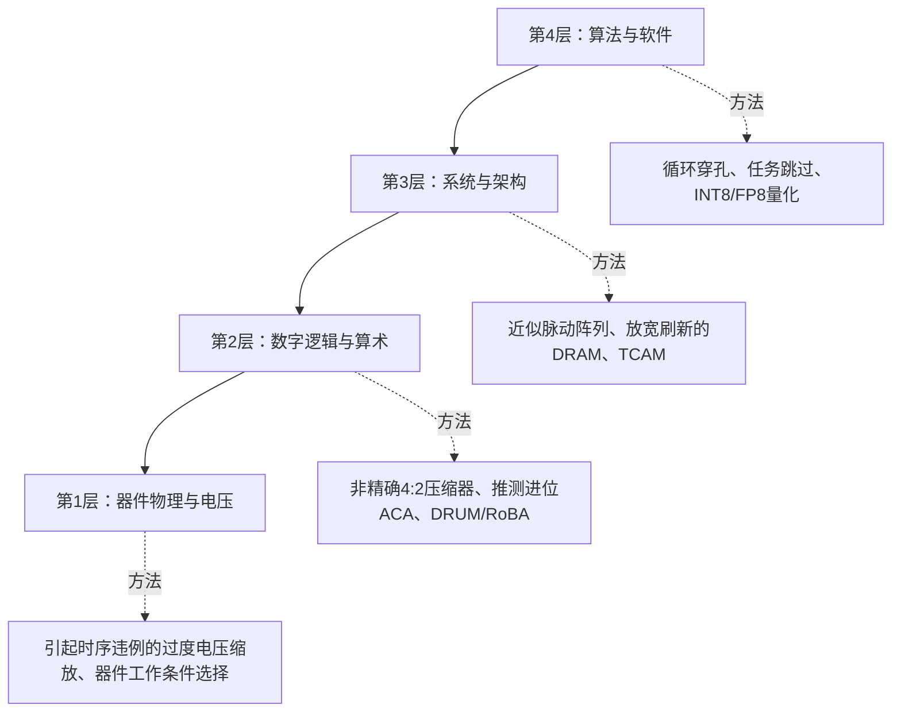

<a id="approximation-paradigms-across-the-stack"></a>

# 跨层次的近似方法

<strong>所需基础：</strong>[为什么使用非精确计算？](why-approximate-computing.md)中的延迟、功率、能量、面积，以及[人眼与像素](../bridge/human-eyes-and-pixels.md)或学校算术中的加权平均概念。不需要概率、线性代数或信号处理基础。

<strong>读完本页，你将能够：</strong>

1. 说出系统可采用近似的四个层次，并说明各层允许改变什么；
2. 区分经常被混淆的三种手段：<strong>量化、减少计算工作、电路近似</strong>；
3. 针对一个具体图像任务，说明舍弃了什么，以及绝不能牺牲什么。

<strong>路线：</strong>[误差指标与数学误差界](error-metrics.md) → 本页 → [人眼与像素](../bridge/human-eyes-and-pixels.md)。

<a id="one-image-task-four-layers"></a>

## 一个图像任务，四个层次

考虑一个普通任务：<strong>手机对一张1200万像素照片去噪，再将缩小的版本发给朋友。</strong>去噪时，手机用滤波器把每个像素替换为自身及邻居的加权平均——每个像素计算一次加权和，重复1200万次。接着缩小图像并编码。

任务包含算术运算、存储器访问、通信及质量要求（“朋友应当看不出压缩造成的差异”）。近似可以在四层引入。每层都有一个前提：明确质量要求。在此前提下，需要追问<strong>什么不能牺牲</strong>。

| 层次 | 涉及对象 | 可采用的近似 | 不能牺牲的内容 |
|---|---|---|---|
| <strong>4. 算法与软件</strong> | 帧、循环、数值精度 | 跳过工作（隔帧处理），用8比特而非32比特存储数值 | 任务自身的成功标准（仍能辨认、仍可阅读） |
| <strong>3. 系统与存储器</strong> | 帧缓冲区、DRAM（依靠定期刷新维持所存电荷的存储器）、数据搬移 | 降低非关键缓冲区的刷新频率、压缩有效载荷 | 不能丢弃那些必须保持正确的比特 |
| <strong>2. 逻辑与算术</strong> | 计算加权和的加法器、乘法器 | 算术电路本身 | 明确的运算规格约定（位宽、舍入、溢出）及误差界 |
| <strong>1. 器件与电压</strong> | 晶体管、供电电压、时钟 | 降低供电电压 | 时序：时序违例不能在无提示的情况下破坏结果 |

从上向下阅读，注意各层的失败类型不同。第4层失败体现在视觉上（照片失真）。第2层失败体现在数值上（若验证充分，偏差处于已保证的界内）。第1层首先影响答案何时到达；若计算中发生时序违例，比特便可能出错，而且未必只有低位出错，关键结果需要明确保护。

同一思想也可以用分类图表示：



四层图是一种组织知识的分类；采用近似不保证节能。没有必要同时改变四层，改变四层也不能将节省简单相乘。

<a id="one-number-from-the-bottom-layer"></a>

### 最底层的一个数值例子

最容易说明的是底层的电压手段。数字电路的动态开关功率遵循：

$$P_{\text{dynamic}} = \alpha \cdot C_L \cdot V_{DD}^2 \cdot f_{\text{clk}}$$

将供电电压从$1.0\,\text{V}$降至$0.7\,\text{V}$，保持活动（$\alpha$）、负载电容（$C_L$）和时钟频率（$f_{\text{clk}}$）不变，该项变为原来的$0.7^2/1.0^2 = 0.49$，即<strong>仅这一项减少51%</strong>。电压缩放本身还容易使“频率固定”这一假设无法成立；电压相关延迟、延长工作时间带来的漏电及实际运行时间都须另行计入。

<a id="three-levers-that-are-not-the-same-lever"></a>

## 三种不同的近似手段

“近似”这个词可能指三种不同操作。区分它们是本页的主要学习目标。

| 手段 | 改变什么 | 哪些仍然精确 | 所在层次 |
|---|---|---|---|
| <strong>量化（quantization）</strong> | 表示每个数值所用的比特数 | 对这些数值执行的算术运算 | 第4、3层（数据），第2层（累加位宽） |
| <strong>减少计算工作</strong> | 实际执行的工作量 | 对仍然计算的部分执行的算术运算 | 第4、3层（跳过、裁剪滤波抽头） |
| <strong>电路近似</strong> | 算术单元计算的函数 | 明确的数据表示及受保护的精确操作仍遵守规格 | 第2层（非精确压缩器、推测进位、DRUM/RoBA） |

对同一照片，用8比特整数而非32比特浮点数保存像素缓冲区是<strong>量化</strong>；把例子扩展至视频，隔帧去噪、其余帧插值是<strong>减少计算工作</strong>；将滤波器内的精确加法器换成低位或运算加法器是<strong>电路近似</strong>。量化数值的乘法仍可精确，误差来自数值表示而非电路。穿孔循环只是减少同样算术运算的执行次数，误差来自缺失的输出。电路近似改变的是算术单元规定的函数。三种手段都须相对于明确参考评估误差或质量；只要能比较数值输出，就能使用[误差指标](error-metrics.md)。

有效载荷的边界属于第一类，需要明确说明：把一个标量从32比特打包成8比特，有效载荷缩为四分之一；打包成4比特则缩为八分之一。<strong>总带宽与能耗未必同比缩小</strong>，因为缩放元数据、对齐、压缩和数据搬移仍有开销。有效载荷“缩小4倍”不能推广为系统缩小4倍。

<a id="check-your-understanding"></a>

## 检查理解情况

先在纸上作答，再展开核对。答案不会保存或发送到任何地方。

<a id="read-f13"></a>

<strong>WB13。</strong>为照片任务中的以下操作分类：（a）去噪器用8比特整数而非32比特浮点数保存中间像素值；（b）隔帧去噪，其余帧插值；（c）将滤波器内的精确加法器换成低位或运算加法器；（d）保存帧缓冲区的DRAM以低于厂商默认的频率刷新。

<details markdown="1">
<summary>核对WB13</summary>

（a）<strong>量化</strong>（第4/3层的数据）。（b）<strong>减少计算工作</strong>（第4层）。（c）<strong>电路近似</strong>（第2层）。（d）第3层存储器侧的决策，不是量化：数值保留原有比特，但之后可能因数据保持失败而损坏。（d）还需要数据分类，其依据正是只对非关键数据降低刷新频率。

- 若将（a）称为“电路近似”，请记住8比特整数的算术运算仍然精确，误差来自表示。
- 若将（c）称为“量化”，请留意数值表示没有改变，改变的是函数。

</details>

<a id="read-f14"></a>

<strong>WB14。</strong>团队将滤波模块供电电压从$1.0\,\text{V}$降至$0.7\,\text{V}$，声称“节能51%”。请准确说明他们测量了什么，并指出尚未证明的两件事。

<details markdown="1">
<summary>核对WB14</summary>

在活动、电容和频率固定时，他们测得或算得模型$P_{\text{dynamic}} = \alpha C_L V_{DD}^2 f_{\text{clk}}$中的<strong>电容开关功率项</strong>减少51%。尚未证明：（i）计入漏电、延迟与相应运行时间后，整个模块能耗仍下降51%；（ii）模块在$0.7\,\text{V}$仍满足时序——时序违例可能破坏比特，且未必只影响低位。

- “能量”与“开关功率”是不同的量。0.49是开关功率项剩余的比例，不能据此确定漏电、短路电流等其他贡献。

</details>

<a id="read-f15"></a>

<strong>WB15。</strong>流水线通过将循环减半减少50%的滤波计算工作，同时把有效载荷从32比特打包成8比特。哪项可支持时间方面的论断，哪项支持数据量方面的论断？仅凭它们分别不能推断什么？

<details markdown="1">
<summary>核对WB15</summary>

循环改动直接证明<strong>计算调用次数</strong>减少；只有测量包括插值、控制和存储器操作的替代路径后，才可能支持执行时间方面的论断。比特打包说明<strong>有效载荷大小</strong>缩为四分之一。没有测量，两项都不能证明<strong>能耗</strong>如何变化：计算调用减半不等于运行时间或能耗减半；有效载荷缩为四分之一，也不等于带宽或能耗同比缩小，因为元数据、对齐和数据搬移仍存在。

- 本页参考部分的循环穿孔研究正是如此：在七个PARSEC应用中，五个找到了准确性损失低于10%且速度更快的穿孔方案，通常至少快一倍。论文报告的是运行时间，不是能耗。

</details>

---

<a id="going-deeper-the-four-layers-in-detail"></a>

## 🔬 深入阅读：四个层次的细节

<a id="the-4-layer-approximation-stack"></a>

### 🏗️ 四层近似计算体系

近似可用于器件、电路、架构或软件。上图是一种组织知识的分类；采用近似不保证节能。

<a id="layer-1-device-physics-voltage-scaling"></a>

### ⚡ 第1层：器件物理与电压缩放

<a id="1-voltage-over-scaling-vos"></a>

#### 1. 过度电压缩放（VOS）
CMOS数字电路的动态开关功率遵循：

$$P_{\text{dynamic}} = \alpha \cdot C_L \cdot V_{DD}^2 \cdot f_{\text{clk}}$$

保持活动、电容与频率固定，从$1.0\text{V}$降至$0.7\text{V}$时，模型中的开关功率比为$0.7^2/1.0^2=0.49$：<strong>该项减少51%</strong>。电压相关延迟、漏电与运行时间须另行计入。

- <strong>限制：</strong>电压降低可能增加延迟，必须针对实际工艺和工作条件验证时序预算。
- <strong>近似手段：</strong>低电压工作若满足时序，仍是精确计算。过度电压缩放（Voltage Over-Scaling，VOS）可能违反时序；受影响比特未必是最低有效位（least significant bit，LSB），关键输出需要明确保护并评估误差。

<a id="2-gate-level-logic-pruning"></a>

#### 2. 门级逻辑裁剪
近似综合可以在误差目标约束下简化逻辑或行为描述。移除逻辑门对时序、动态活动和漏电的影响可能不同。不能普遍断言最不重要的逻辑门消耗最多漏电功率。

<a id="layer-2-logic-arithmetic-microarchitecture"></a>

### 🎛️ 第2层：逻辑与算术微架构

这是硅硬件设计者主要关注的层次：

1. <strong>推测加法：</strong>利用有限窗口预测进位，可用精度换取较短逻辑路径。窗口大小、拓扑和恢复机制共同决定结果与延迟。
2. <strong>非精确压缩器：</strong>修改压缩器（compressor）的真值表，可简化部分积归约网络。算法名称本身不能保证固定的晶体管削减比例。
3. <strong>前导一检测与窗口截取（DRUM）：</strong>保留$k$比特操作数窗口可以减小乘法器核心位宽，但前导一检测、补偿与移位仍有实现代价，见具体[乘法器规格约定](../taxonomy/multipliers.md)。
4. <strong>对数算术：</strong>对正实数操作数，$\log_2(AB)=\log_2(A)+\log_2(B)$。近似对数和反对数会改变数值结果；转换、零值/有符号处理以及舍入都不是免费的，延迟取决于实现。

<a id="layer-3-system-memory-architecture"></a>

### 🖥️ 第3层：系统与存储器架构

1. <strong>放宽刷新的DRAM：</strong>延长刷新间隔可减少刷新活动，也会增加数据保持失败。必须说明器件、温度和数据分类，不能由此推断固定的功率节省。仿真实例RAIDR（ISCA 2012）根据测得的数据保持时间刷新各行。在一个8核、32 GB DDR3-1333系统的周期精确仿真中，相对标准自动刷新，刷新次数减少74.6%，每次存储器访问的能耗在正常温度范围下降8.3%，在扩展温度范围下降16.1%。74.6%统计的是刷新次数，不是能量。见[已发表的刷新研究](../taxonomy/memory.md#published-refresh-studies)。
2. <strong>电压缩放SRAM：</strong>降低供电电压会削弱读、保持或写裕量并可能引起失败。静态噪声容限（Static Noise Margin，SNM）衡量噪声裕量，本身不是供电电压阈值。
3. <strong>近似非易失性存储器：</strong>改变写入强度，可能在写入能耗或延迟与写入成功率、后续数据正确性之间取舍。失败率及数据保持效应需要具体器件模型。

<a id="layer-4-algorithm-software-level"></a>

### 🧠 第4层：算法与软件

1. <strong>循环穿孔（loop perforation）：</strong>编译器自动变换长迭代循环：
   ```c
   // 精确循环：1000次迭代
   for (int i = 0; i < 1000; i++) { compute_frame(i); }
   
   // 穿孔循环：500次compute_frame调用，加500次插值调用
   for (int i = 0; i < 1000; i += 2) { compute_frame(i); interpolate(i+1); }
   ```
   计算调用减半不能证明运行时间或能耗减半：插值、控制、存储器操作和输出质量同样重要。这是循环示意，不是实测结果。

   <a id="loop-perforation-study"></a><strong>已发表的测量。</strong>Sidiroglou-Douskos、Misailovic、Hoffmann和Rinard（ESEC/FSE 2011）在Intel Xeon X5460服务器上，对PARSEC 1.0套件的七个应用采用循环穿孔。七个应用中的五个找到了准确性损失低于10%且运行更快的方案：在训练输入上通常至少快一倍，bodytrack最高快七倍。加速比是执行时间之比，每个应用的准确性损失使用各自输出指标衡量。论文报告运行时间，不是能耗。
2. <strong>跳过任务与计算：</strong>省略部分工作需要任务专用标准，并验证得到的质量。
3. <strong>模型量化：</strong>打包标量有效载荷从32比特降至8或4比特，分别缩为四分之一或八分之一。但缩放元数据、对齐、压缩和数据搬移使总带宽和能耗未必同比下降。

<a id="verified-sources-and-scope"></a>

### 📚 已核对的来源与适用范围

- Han和Orshansky，*Approximate Computing: An Emerging Paradigm for Energy-Efficient Design*，ETS，2013，第II、III-D、V节（[作者稿](https://www.ece.ualberta.ca/~jhan8/publications/ApproCompReview_final.pdf)，[DOI](https://doi.org/10.1109/ETS.2013.6569370)）：电路与算法层面的研究分类。
- MIT 6.012，2009年春，第13讲，第13页幻灯片（[官方讲义](https://ocw.mit.edu/courses/6-012-microelectronic-devices-and-circuits-spring-2009/de333d22ec4230412f4e7bdd4da3d6ce_MIT6_012S09_lec13.pdf)）：电容开关功率推导。上文51%的计算假定其他参数固定。
- S. Sidiroglou-Douskos、S. Misailovic、H. Hoffmann、M. Rinard，*Managing Performance vs. Accuracy Trade-offs with Loop Perforation*，ESEC/FSE，2011，第124–134页，第1.2、5、6.2节（[作者版本](https://people.csail.mit.edu/stelios/papers/fse11.pdf)，[DOI](https://doi.org/10.1145/2025113.2025133)）：循环穿孔加速与准确性损失。
- J. Liu、B. Jaiyen、R. Veras、O. Mutlu，*RAIDR: Retention-Aware Intelligent DRAM Refresh*，ISCA，2012，第5及6.1–6.3节（[作者版本](https://users.ece.cmu.edu/~omutlu/pub/raidr-dram-refresh_isca12.pdf)，[DOI](https://doi.org/10.1109/ISCA.2012.6237001)）：仿真的刷新和单次访问能耗结果。


