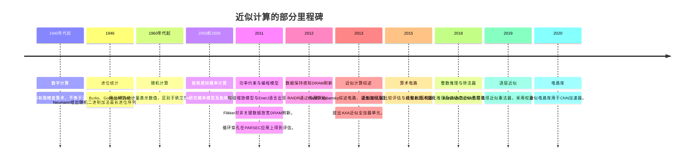

<a id="history-evolution-of-inexact-computing"></a>

# 非精确计算的历史与演进

<strong>所需基础：</strong>普通阅读能力。主线不涉及概率、电路理论或代数，术语会就地解释。

<strong>读完本页，你将能够：</strong>

1. 区分带日期论述中的四种信息：<strong>发表年份、模型预测、理论界限、测量结果</strong>；
2. 说明1946年的进位统计结果主张什么，以及不主张的三件事；
3. 浏览时间线，知道初读时可以跳过哪些条目。

<strong>路线：</strong>[为什么使用非精确计算？](why-approximate-computing.md) → 本页 → [研究动机与挑战](motivations-and-challenges.md)。

<strong>阅读方式（选读路线图）。</strong>本页提供研究路标，不训练计算技能，因此可以略读。

| 路线 | 阅读内容 | 跳过内容 | 时间 |
|---|---|---|---|
| <strong>最短</strong> | 下方四个简短主线部分（标签、1946年、预测、语言模型），再做WB4–WB6 | 全部“深入阅读”参考部分 | 约5分钟 |
| <strong>标准</strong> | 最短路线，加上“深入阅读”的时间线 | 原始文献列表 | 约10分钟 |
| <strong>完整</strong> | 全部内容，包括完整时间线与原始文献 | — | 约20分钟 |

本站后续内容不依赖这条时间线，只读最短路线也能完成本页学习。

<a id="four-labels-for-a-dated-claim"></a>

## 带日期论述的四种标签

近似计算（approximate computing）的历史常按年份叙述，容易使人误把日期当成研究结果。本站使用四种标签，下方时间线也会按它们标注。

| 标签 | 含义 | 不表示什么 |
|---|---|---|
| <strong>年份</strong> | 该工作在这一年发表 | 不表示思想首次在这一年出现 |
| <strong>预测</strong> | 根据明确的器件与工作负载模型推算 | 不是芯片实测 |
| <strong>理论／界</strong> | 在明确假设下证明 | 不是对真实输入的观察 |
| <strong>测量</strong> | 在实验、仿真或数据集中观察到 | 不会自动适用于设置之外 |

这种区分有实际意义。年份可以直接引用；预测可能失准，而背后的模型仍然合理；一个界可能完全正确，却因假设不适用于你的工作负载而没有用；测量结果也必须附带测量条件。

<a id="the-1946-example-in-full-without-probability"></a>

## 不用概率讲清1946年的例子

从普通加法开始：二进制`0111 + 0001`就是`7 + 1`。从右往左：

```
第0位：1 + 1      -> 写0，进1
第1位：1 + 0 + 1  -> 写0，进1
第2位：1 + 0 + 1  -> 写0，进1
第3位：0 + 0 + 1  -> 写1，不进位    =>  1000 = 8
```

第0位生成进位，进位随后穿过第1、2位，在第3位终止。我们说进位经过三个位置。长进位链使行波进位加法器（ripple-carry adder，RCA）变慢，因此在算术被称为“近似”之前很久，人们就已研究它的长度。

1946年，Burks、Goldstine和von Neumann研究$n$比特字长下的这段进位序列。他们没有测量真实程序，而是将各位视为随机——这是建模选择，不是观察结果——并证明最长进位序列的平均长度至多为$\log_2 n$。当$n=40$，该上界为$\log_2 40\approx5.3$；他们给出的实际平均值$a_{40}$为$4.62$。

这里，$\log_2 n$表示2的多少次方等于$n$。由于$2^5=32$、$2^6=64$，所以$\log_2 40$介于5与6之间，约为5.3。

该结果<strong>不主张</strong>以下三点：

- 它描述的是进位序列长度，不是每一种加法器设计的平均延迟。
- 它不是实际操作数的测量结果，实际操作数未必随机。
- 它不能解释成“概率保证加法器没有问题”：随机位模型是假设，需要为具体工作负载提供依据。

“明确假设下有简洁的界，而适用性取决于假设”这一模式，贯穿本领域。

<a id="a-prediction-is-not-a-measurement"></a>

## 预测不等于测量

*Dark Silicon and the End of Multicore Scaling*（2011）是<strong>基于明确器件与工作负载模型的推算</strong>。它结合器件缩放预测、用实测处理器拟合的核心模型，以及面向PARSEC工作负载的多核模型，在摘要中预测：固定面积芯片在22 nm下必须关闭21%的区域，在8 nm下必须关闭超过50%。这些数值来自模型，不是生产线观察。合理解释是：在这些模型下，功率密度而非晶体管数量成为约束。不能据此断定某颗芯片在某一天必须有固定比例的区域无法通电。

<a id="theory-and-a-language-model"></a>

## 理论与编程语言模型

Palem在2003年和2005年的论文研究概率算法、器件<strong>模型</strong>及概率开关的极限，属于理论。文中的节省在模型内部成立，不能推出“所有近似乘法器都节省功率”。

EnerJ（2011）则是另一类成果：一种<strong>Java类型系统</strong>，通过显式认可（endorsement）将近似数据与精确数据分离。其保证限于该语言模型，不是对任意软件提供普遍硬件隔离。把它当成硬件结果，或把理论论文当成实测节省，正是前述四种标签要避免的混淆。

<a id="check-your-understanding"></a>

## 检查理解情况

先在纸上作答，再展开核对。答案不会保存或发送到任何地方。

<a id="read-f4"></a>

<strong>WB4。</strong>为以下说法标注类型：（a）“RAIDR发表于2012年。”（b）“到了8 nm，固定面积芯片的一半以上必须保持暗区状态。”（c）“40个随机比特的最长进位序列平均长度至多约5.3。”（d）“清除每个乘积的低4位，使这张图像的PSNR从48.1 dB变为31.7 dB。”

<details markdown="1">
<summary>核对WB4</summary>

（a）<strong>年份</strong>。（b）<strong>预测</strong>，来自论文模型。（c）<strong>理论／界</strong>，注意“随机”：假设是论断的一部分。（d）<strong>测量</strong>，只适用于那张图像、那个卷积核及那种算术模型。

- 若把（b）标为测量，请重读“摘要预测”：推算是模型的结果。
- 若把（c）标为测量，请注意“随机比特”描述输入模型，不是一组实际输入。

</details>

<a id="read-f5"></a>

<strong>WB5。</strong>逐列计算`0101 + 0011`（即`5 + 3`），说明进位经过多少个位置。它能告诉你四比特加法的平均进位序列长度吗？

<details markdown="1">
<summary>核对WB5</summary>

`第0位：1+1 -> 0，进1`；`第1位：0+1+1 -> 0，进1`；`第2位：1+0+1 -> 0，进1`；`第3位：0+0+1 -> 1，不进位`。结果为`1000` = 8，进位经过三个位置。

它<strong>不能</strong>给出平均值。一对操作数只是一个样本；平均值需要一整组操作数对，还需要说明各对如何计入。这里`5 + 3 = 8`的进位模式恰好与`7 + 1`相同，尽管操作数不同。

</details>

<a id="read-f6"></a>

<strong>WB6。</strong>博客写道：“EnerJ证明近似硬件安全，Palem的定理说明近似算术节能。”指出两处错误。

<details markdown="1">
<summary>核对WB6</summary>

第一，EnerJ为使用它的程序提供<strong>Java类型系统模型内部</strong>的保证，不能推广到任意软件与任意近似硬件。第二，Palem的工作是概率计算的<strong>模型层面</strong>研究，模型中的定理不是芯片实测节能。两句话都把有条件结果变成了无条件结论。

- 读到“证明……节省”时，可以追问：在哪个模型内？在哪个对象上测得？

</details>

---

<a id="going-deeper-the-timeline-and-the-primary-sources"></a>

## 🔬 深入阅读：时间线与原始来源

近似计算有多条前身脉络，包括有限精度数值运算、随机计算和能耗感知硬件。

<a id="timeline-selected-research-milestones"></a>

### ⏳ 时间线：部分研究里程碑



按四种标签阅读时间线：各行日期为<strong>发表年份</strong>；1946年的进位界是随机位模型下的<strong>理论</strong>；2011年的暗硅条目是<strong>预测</strong>；RAIDR（2012）是<strong>仿真测量</strong>；量化推理和ALWANN则是在明确数据集与网络上的<strong>测量</strong>。

随机计算背景见Han和Orshansky第II节；下方文献对应其他里程碑。日期指本教程所引工作的发表年份，列表并不完整。

<a id="correctness-and-numerical-precision"></a>

### 🏛️ 正确性与数值精度

传统电路必须实现指定函数，包括舍入与溢出规则。浮点计算本身已是有限精度。容错与有意近似不同：纠错码保护规定值，近似算术设计则主动改变函数。银行业务和科学仿真都不能套用一个统一的可接受数值误差。

<a id="carry-statistics-in-1946"></a>

#### 1946年的进位统计

Burks、Goldstine和von Neumann的1946年IAS计算机设计报告（第5.6节）证明，两组长度为$n$的二进制字相加，最长进位序列的平均长度至多为$\log_2 n$。分析将各位视为随机。当$n=40$，上界为$\log_2 40\approx5.3$，报告给出的实际平均值$a_{40}$为$4.62$。

<a id="voltage-scaling-and-power-constraints"></a>

### 💥 电压缩放与功率约束

理想晶体管缩放与实际电压缩放不同。漏电和功率密度约束限制了给定功率预算下可同时工作的电路规模。*Dark Silicon and the End of Multicore Scaling*是<strong>2011年基于明确器件及工作负载模型的预测</strong>。它结合器件缩放预测（ITRS及更保守的一组参数）、用实测处理器拟合的核心模型，以及面向PARSEC工作负载的多核模型，在摘要中预测：固定面积芯片在22 nm下必须关闭21%的区域，8 nm下超过50%。

<a id="energy-aware-probabilistic-and-approximate-computing"></a>

### 💡 能耗感知概率计算与近似计算

Palem的2003年CASES论文研究概率算法／器件模型，2005年IEEE Transactions on Computers论文研究概率开关极限。这些理想化模型不能解释为所有后续近似加法器、乘法器的实测功率节省。

EnerJ（2011）通过Java类型系统与显式认可区分近似数据和精确数据。其保证限于语言模型，不是对任意软件的普遍硬件隔离。Han和Orshansky（2013）区分了确定性近似算术、随机计算与概率计算。工作负载容忍度及实现效率仍须逐项评估。

<a id="primary-literature-historical-citations"></a>

### 📚 原始文献与历史引文

- K. V. Palem, *Energy Aware Algorithm Design via Probabilistic Computing: From Algorithms and Models to Moore's Law and Novel (Semiconductor)Devices*, CASES, 2003, 第1–4页，见 [作者稿](https://www.cs.rice.edu/~kvp1/pubs/palem-ea.pdf).
- K. V. Palem, *Energy Aware Computing Through Probabilistic Switching: A Study of Limits*, IEEE Transactions on Computers, 54(9), 1123–1137, 2005 ([作者稿](https://www.cs.rice.edu/~kvp1/pubs/palemIEEE.pdf), 首页及摘要).

  [作者的发表列表](https://www.cs.rice.edu/~kvp1/pubs/fullpubs.htm), 第12和17项也列出这两篇工作。较早作者稿链接的可访问性可能变化。
- A. W. Burks, H. H. Goldstine, and J. von Neumann, *Preliminary Discussion of the Logical Design of an Electronic Computing Instrument*, Institute for Advanced Study, 28 June 1946, 第5.6节 ([转录本](https://safari.ethz.ch/architecture/fall2023/lib/exe/fetch.php?media=logical_design_of_an_electronic_computing_instrument.pdf), [IAS扫描本](https://www.ias.edu/sites/default/files/library/Prelim_Disc_Logical_Design.pdf)).
- H. Esmaeilzadeh, E. Blem, R. St. Amant, K. Sankaralingam, and D. Burger, *Dark Silicon and the End of Multicore Scaling*, ISCA, 2011 ([论文](https://www.cs.cmu.edu/~18742/papers/Esmaeilzadeh2011.pdf), 摘要及第2–4节).
- A. Sampson, W. Dietl, E. Fortuna, D. Gnanapragasam, L. Ceze, and D. Grossman, *EnerJ: Approximate Data Types for Safe and General Low-Power Computation*, PLDI, 2011 ([作者稿](https://www.cs.cornell.edu/~asampson/media/papers/enerj-pldi2011.pdf), 第2–3节; [DOI](https://doi.org/10.1145/1993498.1993518)).
- J. Han and M. Orshansky, *Approximate Computing: An Emerging Paradigm for Energy-Efficient Design*, ETS, 2013 ([作者稿](https://www.ece.ualberta.ca/~jhan8/publications/ApproCompReview_final.pdf), 第I–II节; [DOI](https://doi.org/10.1109/ETS.2013.6569370)).

时间线中的其他工作（日期仅指发表年份，结果见链接页面）：

- 2011: S. Liu, K. Pattabiraman, T. Moscibroda, and B. G. Zorn, *Flikker: Saving DRAM Refresh-power through Critical Data Partitioning*, ASPLOS ([DOI](https://doi.org/10.1145/1950365.1950391)); S. Sidiroglou-Douskos, S. Misailovic, H. Hoffmann, and M. Rinard, *Managing Performance vs. Accuracy Trade-offs with Loop Perforation*, ESEC/FSE ([DOI](https://doi.org/10.1145/2025113.2025133); 见[跨层次的近似方法](approx-paradigms.md#loop-perforation-study)).
- 2012: J. Liu, B. Jaiyen, R. Veras, and O. Mutlu, *RAIDR: Retention-Aware Intelligent DRAM Refresh*, ISCA ([DOI](https://doi.org/10.1109/ISCA.2012.6237001); 见[存储器](../taxonomy/memory.md#published-refresh-studies)).
- 2013: Z. Yang, A. Jain, J. Liang, J. Han, and F. Lombardi, *Approximate XOR/XNOR-based Adders for Inexact Computing*, IEEE-NANO ([DOI](https://doi.org/10.1109/NANO.2013.6720793)).
- 2015: H. Jiang, J. Han, and F. Lombardi, *A Comparative Review and Evaluation of Approximate Adders*, GLSVLSI ([DOI](https://doi.org/10.1145/2742060.2743760)); A. Momeni, J. Han, P. Montuschi, and F. Lombardi, *Design and Analysis of Approximate Compressors for Multiplication*, IEEE Transactions on Computers 64(4) ([DOI](https://doi.org/10.1109/TC.2014.2308214)).
- 2018: B. Jacob et al., *Quantization and Training of Neural Networks for Efficient Integer-Arithmetic-Only Inference*, CVPR ([arXiv](https://arxiv.org/abs/1712.05877); 见[AI页面](../bridge/ai-and-approximate-math.md#quantized-detection-case-study)); H. Jiang, L. Liu, F. Lombardi, and J. Han, *Adaptive Approximation in Arithmetic Circuits: A Low-Power Unsigned Divider Design*, DATE ([DOI](https://doi.org/10.23919/DATE.2018.8342233)).
- 2019: V. Mrazek, Z. Vasicek, L. Sekanina, M. A. Hanif, and M. Shafique, *ALWANN: Automatic Layer-Wise Approximation of Deep Neural Network Accelerators without Retraining*, ICCAD ([DOI](https://doi.org/10.1109/ICCAD45719.2019.8942068); 见[AI页面](../bridge/ai-and-approximate-math.md#alwann-case-study)).
- 2020: V. Mrázek, L. Sekanina, and Z. Vašíček, *Libraries of Approximate Circuits: Automated Design and Application in CNN Accelerators*, IEEE JETCAS 10(4) ([DOI](https://doi.org/10.1109/JETCAS.2020.3032495)).
