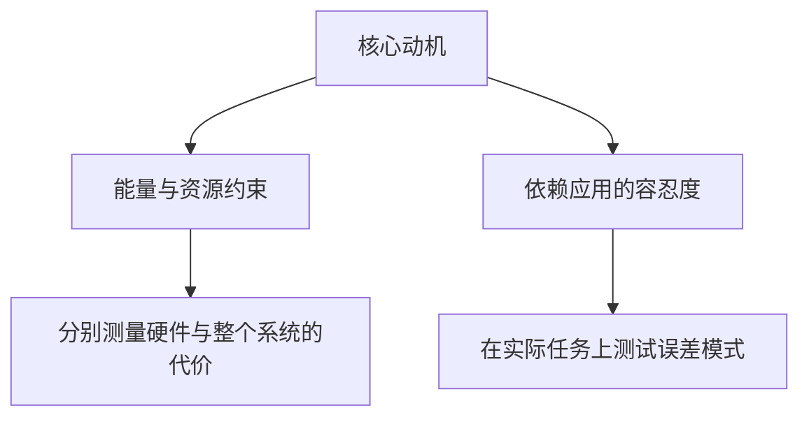
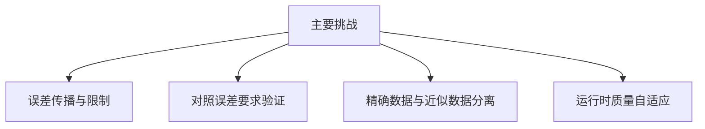

# 研究动机、问题与主要挑战

<strong>所需基础：</strong>加减法和阈值（`if`判断）的概念，不需要概率、电路或微积分。本页会解释全部术语。

<strong>读完本页，你将能够：</strong>

1. 预测三个小误差会叠加还是抵消，并用一句话说明“偏差”的含义；
2. 解释为何同样大小的误差中，有偏误差比无偏误差更值得警惕；
3. 说出四项主要挑战，并为具体情境分类。

<strong>路线：</strong>[历史与演进](history-and-evolution.md) → 本页 → [如何衡量计算误差？](error-metrics-made-easy.md)。

## 从连续三个小误差开始

程序维护一个累计和。由于使用近似算术，每一步都可能略有偏差。定义每步的误差为近似值减去精确值，`+1`表示“偏大1”，`−1`表示“偏小1”。三步中的三个小误差，可以产生三种完全不同的结果：

| 情况 | 第1步 | 第2步 | 第3步 | 累积误差 | 发生了什么 |
|---|---:|---:|---:|---:|---|
| <strong>A</strong> | +1 | +1 | +1 | <strong>+3</strong> | 三次都推向同一方向 |
| <strong>B</strong> | +1 | −1 | +1 | <strong>+1</strong> | 两次推高，一次拉回 |
| <strong>C</strong> | +1 | −1 | −1 | <strong>−1</strong> | 一次推高，两次拉回 |

三种情况的每步误差大小都为1，因此只对误差大小取平均的指标会认为A、B、C相同。但A的总值漂移3个单位，C却向反方向漂移1个单位。<strong>单次误差的大小不能告诉我们误差序列的效果。</strong>这是本页首先要讨论的问题。

有符号误差（signed error）的均值称为<strong>偏差（bias）</strong>，也称平均误差。A每步偏差为$+1$，B为$+1/3$；若误差为$+1,-1,+1,-1,\dots$，偏差会趋近0。偏差决定误差如何累积：

- <strong>有偏</strong>误差（例如始终为$+1$）会线性累积：$n$步后，总误差约为偏差的$n$倍。100步后本应达到100的累计和，会达到200。
- <strong>无偏</strong>误差可能保持在零附近，但前提是平衡确实成立。“平均无偏”是关于误差分布的论断，必须验证，不能假定。

再加入阈值，累积误差就可能变成错误决策。假设任务接受100及以上的结果，精确总值为100。C的累积误差为−1，近似总值为99，任务拒绝它；A的总值为103，可以通过。同样的单次误差大小，却有相反决策。这与[为什么使用非精确计算？](why-approximate-computing.md)中的像素例子机制相同，只是应用到累计和。

### 误差何时增长，何时衰减？

一些系统会把自身输出反馈为输入。将第$t$步误差写为$e_t$，假设下一步误差遵循：

$$e_{t+1}=a\,e_t+\delta_t$$

其中，$\delta_t$为第$t$步新引入的误差。参数$a$决定已有误差的变化：

| $a$ | 已有误差如何变化 | 例子 |
|---|---|---|
| $\lvert a\rvert<1$ | <strong>衰减</strong>，系统逐渐遗忘 | $a=0.5$：$8 \to 4 \to 2 \to 1 \to 0.5 \dots$ |
| $\lvert a\rvert>1$ | <strong>增长</strong>，系统放大误差 | $a=2$：$8 \to 16 \to 32 \dots$ |
| $a=1$ | 只做<strong>累积</strong>（上述情况） | 普通累计和 |

当$\lvert a\rvert<1$且没有新误差时，已有误差衰减；持续的常量误差$\delta$通常会留下非零稳态误差$\delta/(1-a)$。因此“测试整个流水线”与“测试一个加法器”是不同论断。出现`NaN`（浮点“非数”值）还取决于算术与异常值处理的写法，不能只看误差大小。

## 为什么研究它：两个动机

<strong>能量与资源。</strong>算术、存储、通信和冷却都消耗功率。国际能源署的*Energy and AI*报告（2025）<strong>估计</strong>2024年数据中心用电约415 TWh，占全球用电量约1.5%，并<strong>预测</strong>2030年约为945 TWh；报告还说，典型AI数据中心用电相当于100,000户家庭。注意两个标签：2024年是估计，2030年是预测。两个数值都没有说明算术运算占多少电量，不能把乘法器层面的节省放大到这些总量；电路结果和系统结果必须区分。

<strong>容忍度取决于应用。</strong>传感器有散粒噪声、热噪声和环境扰动，相机有镜头畸变，房间有混响。这些是不同现象，不是一个通用的“噪声百分比”。有噪声的传感器也不能为算术误差提供理由：数值误差可能累积、与输入相关或改变阈值判断。噪声形成底限，但仍须在其上单独分配算术误差预算。

## 四项挑战一览

1. <strong>误差传播与限制。</strong>约束误差能够传播多远，上面的递推式就是例子。<strong>MED是平均误差距离（Mean Error Distance），不是最大误差距离</strong>；均值不能描述最坏输入。全输入域最坏情况界与应用层误差传播界是不同要求。
2. <strong>验证。</strong>有意改变函数后，逐比特等价不再适用；要验证明确的关系、误差界，或声明输入域上的分布。
3. <strong>软硬件语义鸿沟。</strong>对指针（标识存储位置的值）或循环控制值做近似，可能导致错误行为，包括内存安全失败；它不一定先使操作系统崩溃，这会使问题更难发现。两种工具从不同方向处理：<strong>EnerJ</strong>采用Java类型系统，<strong>Axilog</strong>是面向硬件设计者的Verilog注解系统。两者都不是通用应用编程语言，也不保证所有近似平台都有硬件隔离。
4. <strong>运行时质量自适应。</strong>电路可以提供多个精度模式，但选择模式必须满足实测应用质量和失败要求。可配置电路与闭环策略是两个部件，前者不能自动带来后者。

## 检查理解情况

先在纸上作答，再展开核对。答案不会保存或发送到任何地方。

<strong>WB7。</strong>四步误差为$+2, +2, -2, +2$。（a）累积误差是多少？（b）每步偏差是多少？（c）它比$+1,+1,+1,+1$更危险还是更安全？为什么？

核对WB7

（a）$+2+2-2+2 = +4$。（b）每步$+4/4 = +1$。（c）两序列具有<strong>相同的最终累积误差+4</strong>，每步偏差同为+1。但中间误差不同：第一序列累计误差为2、4、2、4；第二序列为1、2、3、4。危险程度取决于任务使用哪些中间值及阈值位置；单次误差更大不能证明最终误差更大。

- 若从累计和中减去$-2$后得到$0$，说明你混淆了误差大小与有符号值。偏差使用保留符号的$\text{approx} - \text{exact}$。
- “$-2$抵消了误差”只说对一半：它抵消一步的贡献，没有消除平均偏差。

<strong>WB8。</strong>从零开始的累计和经过200次加$1$应达到200。硬件A每次加法都偏大1；硬件B的误差循环为$+1,0,-1,0,+1,0,-1,0,\dots$。（a）各自总值是多少？（b）任务接受200及以上时，分别会怎样？（c）你更想进一步测试哪种硬件？

核对WB8

（a）A：$200+200 = 400$。B每四步误差和为0，总值仍为200。（b）A通过阈值，但误差达100%；该决策在此阈值上与精确结果一致，在300等阈值上就会不同。B在步数为四的倍数时总值精确。（c）两者仍需测试，因为“模式重复”本身是误差假设。但A的误差随步数增长而<strong>无界</strong>，具有结构问题，不能寄望偶然抵消。

- 若认为B“始终正确”，请注意：从零开始，第1、2、3步的近似总值为$2$、$3$、$3$，精确总值为$1$、$2$、$3$。每四步周期的第1、2步偏大$+1$，第3、4步精确，并非每步都精确。

<strong>WB9。</strong>将各情境对应到一项挑战：（a）循环计数器近似存储，导致循环越过数组末尾读取；（b）负责人问“这个乘法器在任意输入下最坏会怎样”；（c）手机电量低时降低算术精度，但相机仍须可靠；（d）团队声称“近似电路正确”，被要求说明实际做了什么检查。

核对WB9

（a）<strong>挑战3</strong>，软硬件语义鸿沟：指针和循环控制正是必须保持精确的值。（b）<strong>挑战1</strong>，误差传播与限制：问的是最坏情况（全输入域）界，不是均值。（c）<strong>挑战4</strong>，运行时质量自适应：模式改变须联系实测质量和失败要求。（d）<strong>挑战2</strong>，验证：“正确”必须明确为已声明输入域上的关系、界或分布。

- 类别会重叠：（b）涉及最坏情况误差要求，而证明满足要求也属于验证。标签用于组织讨论，并不互斥。

---

## 🔬 深入阅读：原始语境中的动机与挑战

近似计算研究在<strong>满足指定应用质量目标</strong>时，能否采用代价更低的实现。

### 🚀 两个核心动机

#### 1. 能量与资源约束
算术、存储、通信和冷却都可能贡献系统能耗。没有系统能耗分解，不能将乘法器功率下降推算成数据中心、电池续航或冷却预算的变化。

作为量级参考，国际能源署*Energy and AI*（2025）估计2024年数据中心用电约415 TWh，约占全球用电量1.5%，预测2030年约为945 TWh。典型AI数据中心用电相当于100,000户家庭，在建最大数据中心将达其20倍。

#### 2. 物理传感器的噪声底限
传感器可能有散粒噪声、热噪声和环境扰动，镜头畸变、房间混响则是其他现象，不能合并成一个通用随机噪声百分比。即使传感器有噪声，数值误差仍可能累积、与输入相关或改变阈值决策。噪声不能免除算术误差预算。

### 🧗 四项主要挑战

#### 挑战1：误差传播
对于具有误差动态$e_{t+1}=a e_t+\delta_t$的标量递推，扰动在$|a|<1$时可能衰减，在$|a|>1$时可能增长。增长并非必然，是否出现`NaN`也取决于算术和异常值处理。<strong>MED是平均误差距离，不是最大误差距离</strong>；均值不能约束每个输入。全输入域最坏情况误差（Worst-Case Error，WCE）与应用层传播界是不同要求。

#### 挑战2：验证
逐比特等价用于检查精确规格。对近似函数，应验证明确的关系、误差界或已声明输入域上的分布。

#### 挑战3：软硬件语义鸿沟
近似指针或循环控制值可能导致错误行为和内存安全失败，但不一定使操作系统崩溃。EnerJ在其语言模型内使用Java类型限定符和显式认可，控制近似数据向精确数据的信息流（第2–3节）。Axilog是<strong>Verilog硬件设计注解系统</strong>，不是通用应用编程语言（第I–III节）。两篇论文都不保证所有可能的近似平台都有硬件隔离。

#### 挑战4：运行时质量自适应
设计可提供若干精度模式，但模式选择须满足实测应用质量和失败要求。恶劣天气本身不能证明改变算术精度就能使自动驾驶安全；可配置电路和闭环系统策略是不同部件。

### 📚 已核对的来源

- A. Sampson, W. Dietl, E. Fortuna, D. Gnanapragasam, L. Ceze, and D. Grossman, *EnerJ: Approximate Data Types for Safe and General Low-Power Computation*, PLDI, 2011, 第2–3节 ([作者稿](https://www.cs.cornell.edu/~asampson/media/papers/enerj-pldi2011.pdf), [DOI](https://doi.org/10.1145/1993498.1993518)).
- A. Yazdanbakhsh et al., *Axilog: Language Support for Approximate Hardware Design*, DATE, 2015, 第I–III节 ([作者稿](https://cseweb.ucsd.edu/~hadi/doc/paper/2015-date-axilog.pdf)). 作者、题名、年份和会议已依据作者稿核对；旧版2014年DOI并不对应这篇工作。
- International Energy Agency, *Energy and AI*, 2025, [执行摘要](https://www.iea.org/reports/energy-and-ai/executive-summary): 2024年数据中心用电估计、2030年预测及家庭用电比较。
- J. Han and M. Orshansky, *Approximate Computing: An Emerging Paradigm for Energy-Efficient Design*, ETS, 2013, 第I–II及IV节 ([作者稿](https://www.ece.ualberta.ca/~jhan8/publications/ApproCompReview_final.pdf), [DOI](https://doi.org/10.1109/ETS.2013.6569370)).
