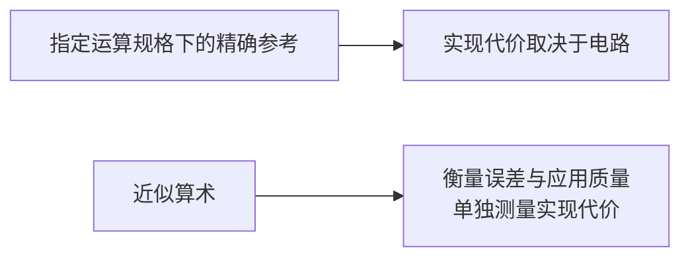

<a id="why-inexact-computing-the-energyaccuracy-trade-off"></a>

# 为什么使用非精确计算？能耗与精度的权衡

<strong>所需基础：</strong>整数运算和简单百分比。不需要电路、概率、微积分、线性代数或信号处理基础；本页会解释下文的全部术语。

<strong>读完本页，你将能够：</strong>

1. 分别说明<strong>延迟、功率、能量和面积</strong>衡量什么，以及各自的单位；
2. 以一个像素（`214`而非`215`）为例，解释1个单位的误差如何改变决策；
3. 区分三个问题：误差多大、当前任务是否接受误差、实现代价是多少。

<strong>路线：</strong>[首页](../index.md) → 本页 → [历史与演进](history-and-evolution.md) → [研究动机与挑战](motivations-and-challenges.md)。五站入门路线的下一站是[比特与进位](../start/bits-and-carry.md)。

---

<a id="start-here-one-pixel-one-count"></a>

## 从一个像素、一个单位开始

图像处理对像素值进行算术运算。运算量取决于编解码器、分辨率、帧率和处理算法，不能仅凭屏幕确定。

<strong>问题。</strong>照片中的一个背景像素本应具有亮度编码`215`，但算术运算返回`214`。眼睛会察觉吗？

有时没有变化，有时决策完全反转。当决策恰好位于边界，1个单位的误差就会起作用。假设程序进行判断`value >= 215`：

```
if pixel_value >= 215:
    保留像素
else:
    丢弃像素
```

精确值`215`使条件成立，近似值`214`使条件不成立。<strong>1个单位的误差改变了决策。</strong>同样的误差若出现在远离215的平滑区域，就不会改变这一决策。

“误差只有1”本身不能让人放心，“误差很大”本身也不意味着任务必然失败。决定因素是任务能否完成目标。非精确计算（inexact computing）因此分别追问三个问题：

| 问题 | 含义 | 在哪里讨论 |
|---|---|---|
| 误差有多大？ | 一个数值，单位与输出相同 | [如何衡量计算误差？](error-metrics-made-easy.md) → [误差指标与数学误差界](error-metrics.md) |
| 当前任务能否接受误差？ | 针对一个具体应用的判断 | [研究动机与挑战](motivations-and-challenges.md) |
| 实现代价是多少？ | 延迟、功率、能耗、面积 | 本页 |

下图概括了这些关系。精确算术（exact arithmetic）的实现代价取决于电路；近似算术（approximate arithmetic）可能降低代价，但必须评估误差与应用质量，并单独测量实现代价。



<a id="four-cost-words-and-the-units-they-come-in"></a>

## 四种代价及其单位

新闻报道常宽泛使用、混淆这四个词。先明确单位，就能理解本站后续的大部分讨论。

| 名称 | 衡量内容 | 常用单位 |
|---|---|---|
| <strong>面积（area）</strong> | 电路占用多少硅面积 | mm² |
| <strong>延迟（delay）</strong> | 一次运算需要多长时间 | s，常用ps或ns |
| <strong>功率（power）</strong> | 消耗能量的速率 | W = J/s |
| <strong>能量（energy）</strong> | 总共消耗多少能量，即能耗 | J = W × s |

其中，<strong>m（毫）</strong>表示$10^{-3}$，<strong>n（纳）</strong>表示$10^{-9}$，<strong>p（皮）</strong>表示$10^{-12}$。因此，$1\,\text{mW} \times 1\,\text{ns} = 10^{-12}\,\text{J} = 1\,\text{pJ}$。

由此得到两点。第一，<strong>能量 = 功率 × 时间</strong>：电路快一倍，能耗不一定减半。第二，一个乘法器内部的节省不能当成整个设备的节省。存储、通信、冷却和系统其他部分各有负载，没有系统能耗分解，就不能把一个模块的百分比推广到数据中心或电池。比较必须采用相同的基准（baseline）、单位与统计范围——单个单元、模块、芯片或系统。

<a id="exact-arithmetic-already-has-a-finite-contract"></a>

## 精确算术也遵循有限的规格约定

“精确”不表示数学上的无限精度，而是硬件实现了<strong>指定的运算规格（arithmetic specification）</strong>，包括数据表示、舍入（rounding）和溢出（overflow）规则。浮点运算会舍入，固定位宽运算可能溢出或回绕（wraparound），存储系统可能纠正故障。系统其他部分依照这些规格编写，保证遵守规格也因此需要代价。

地址计算和要求精确的密码原语等运算必须给出规定结果。其他工作负载（workload）可能容忍部分近似，前提是检查应用需求。人工智能（Artificial Intelligence，AI）与大语言模型（LLM）、计算机视觉、音频与语音、实时渲染和传感器数据流都是候选，但必须按各自条件测试。模型容忍什么取决于该模型和数据，不能凭“AI”这个名称断定。参考部分列出了这些类别及各自所需测试。

<a id="what-relaxing-exactness-can-and-cannot-buy"></a>

## 放宽精确性要求能换来什么

放宽精确性要求有三条途径，各有条件。电路可以<strong>简化</strong>，使用更少或代价更低的逻辑门，但新增控制和纠错逻辑可能抵消节省。通常也可以降低<strong>供电电压</strong>以减小充电能耗，但延迟和漏电相关影响可能不利，必须检查。<strong>面积</strong>可能缩小，但不等于整片芯片的面积或能耗同比缩小。

不存在通用的百分比规则或固定的“精度 → 能耗”兑换率。权衡取决于误差指标、输入分布（input distribution）、位宽、工艺、电压、时序约束、精确基准与工作负载。因此本站的数值都附有适用条件，下文以参考部分的功率模型及常用的16比特乘法器将条件具体化。

<a id="check-your-understanding"></a>

## 检查理解情况

先在纸上作答，再展开核对。答案不会保存或发送到任何地方。

<a id="read-f1"></a>

<strong>WB1。</strong>模块工作$2$ ns，工作期间消耗$30$ mW功率。一次运算的能耗是多少焦耳？再写成pJ。

<details markdown="1">
<summary>核对WB1</summary>

能量$= \text{power}\times\text{time} = 30\times10^{-3}\,\text{W} \times 2\times10^{-9}\,\text{s} = 6\times10^{-11}\,\text{J}$，即$60$ pJ。

- 若写成$30$ mW，你给出的是功率而非能量：功率是速率，能量是总量。
- 若乘以时钟频率而非周期，相当于除以时间。检查单位：W × Hz为J/s²，W ÷ Hz才为J。功率乘以周期（或对单周期运算除以频率）得到能量。

</details>

<a id="read-f2"></a>

<strong>WB2。</strong>测试接受`100`及以上的数值。精确结果为`100`，近似硬件返回`99`。（a）误差大小是多少？（b）决策是否改变？（c）若精确结果为`140`，（b）的答案是否不同？

<details markdown="1">
<summary>核对WB2</summary>

（a）$|99-100| = 1$。（b）会：`100 >= 100`成立，`99 >= 100`不成立，1个单位的误差使决策反转。（c）决策不变：`140`和`139`均被接受，都远离边界。误差大小未变，改变的是它相对阈值的位置。

- 若（b）回答“不会，误差只有1”，你只判断了误差，没有判断任务。
- 若（c）回答“会，因为140更大”，请留意决定因素是阈值，不是数值本身的大小。

</details>

<a id="read-f3"></a>

<strong>WB3。</strong>报告有两项说法。说法1：“在相同输入、位宽和综合设置下，我们的近似乘法器比精确16×16乘法器少消耗40%的<strong>能量</strong>。”说法2：“我们的乘法器节省全球<strong>功率</strong>的40%。”哪项信息足够供核查？另一项缺少什么？

<details markdown="1">
<summary>核对WB3</summary>

说法1可核查：它说明了量（能量）、基准（精确16×16乘法器）、位宽、输入和测量设置。说法2没有说明“功率”仅指动态功率还是总功率，比较按每次运算还是单位时间进行，频率和电压是多少，统计范围包含什么。它还把速率（功率）说成了听起来像总量的“节省”。

- 不要假定说法2与说法1条件相同来补全：两个术语不能互换，缺失条件正是审稿人要追问的内容。
- 缺少基准、单位和统计范围的百分比不能构成研究结果。

</details>

---

<a id="going-deeper-the-trade-off-in-detail"></a>

## 🔬 深入阅读：细看这项权衡

答案取决于图像、观看条件和误差模式。即便1个单位的误差也会改变阈值判断：在`value >= 215`下，`214`与`215`给出不同结果。数值误差小，不能单独证明感知可容忍或任务安全。

以下均为参考材料，完成WB1–WB3不需要先掌握。

<a id="the-exactness-tax-of-modern-silicon"></a>

### 🛑 现代硅电路的“精确性代价”

传统数字硬件必须实现指定的算术语义。这不同于数学无限精度：浮点运算会舍入，固定位宽运算可能溢出，存储系统可能纠正故障。

地址计算和要求精确的密码原语等运算需要规定结果。其他工作负载可能容忍部分近似，但必须检查应用需求。

```
+-------------------------------------------------------------------------+
|                       真实工作负载中的“精确性代价”                        |
+-------------------------------------------------------------------------+
| AI与LLM        ：测试模型、数据及具体任务的敏感度                        |
| 计算机视觉     ：区分人眼观看与机器决策                                  |
| 音频与语音     ：评估信号失真与任务质量                                  |
| 实时渲染       ：评估空间与时间上的误差模式                              |
| 传感器数据流   ：明确比较传感器误差与算术误差                            |
+-------------------------------------------------------------------------+
```

这些类别是待评估的候选；一个电路的结果不能自动适用于其他应用或整个设备。

<a id="a-simplified-cmos-power-model"></a>

### ⚡ 简化的CMOS功率模型

CMOS的一种简化平均功率模型为：

$$P_{\text{total}} \approx \alpha \cdot C_{\text{eff}} \cdot V_{DD}^2 \cdot f + I_{\text{leak}} \cdot V_{DD}$$

其中，$\alpha$表示每个时钟周期的有效充电活动，$C_{\text{eff}}$为开关电容，$f$为时钟频率。模型省略短路电流等影响；漏电和活动会随工作条件变化。功率不是每次运算的能耗：能量是功率对时间的积分。电容开关项推导见[MIT 6.012第13讲，第13页幻灯片](https://ocw.mit.edu/courses/6-012-microelectronic-devices-and-circuits-spring-2009/de333d22ec4230412f4e7bdd4da3d6ce_MIT6_012S09_lec13.pdf)。

放宽$100\%$数值精确性的要求后：

1. <strong>逻辑简化</strong>可减小电容或活动，但新增控制和纠错逻辑可能抵消节省。
2. <strong>电压缩放</strong>在其他条件固定时减小电容开关项，时序裕量与漏电须另行评估。
3. <strong>面积缩小</strong>可能得到更小的实现，但不能证明整片芯片的面积或能耗等比例下降。

不存在将精度百分比直接换成能耗或延迟节省的通用“1%规则”。测量比较必须附上误差指标、输入分布、位宽、工艺、电压、时序约束、精确基准和工作负载。

附有完整条件的已发表实例见[ALWANN案例研究](../bridge/ai-and-approximate-math.md#alwann-case-study)（网络准确率与模型估算的卷积乘法器能耗）及[已发表的除法器比较](../taxonomy/dividers.md#published-divider-comparison)（电路误差与综合后的功率）。两者指标不同，不能合成一条统一规则。

<a id="the-circuit-this-trade-off-is-usually-discussed-on"></a>

### 常用来讨论这项权衡的电路

```
+-------------------------------------------------------------------------+
|                             传统精确乘法器                              |
| [ 16比特乘法 ] ---> 256个部分积 + 完整归约树                             |
| 无符号竖式16 x 16乘法从256个比特积开始。                                |
+-------------------------------------------------------------------------+
                                    对比
+-------------------------------------------------------------------------+
|                             近似压缩器乘法器                            |
| [ 16比特乘法 ] ---> 低位列使用AC-4:2单元压缩                            |
| 误差与PPA取决于具体压缩器及其实现。                                    |
+-------------------------------------------------------------------------+
```

无符号竖式$16\times16$乘法确实以$256$个比特积开始，压缩器乘法器也确实改变低位列的归约方式。但误差与功耗、性能和面积（power-performance-area，PPA）取决于具体压缩器、位宽及实现，必须测量或推导误差界，不能直接假设。加法器页从更低一层说明同一思想：[近似加法器](../taxonomy/adders.md)。

<a id="test-your-understanding"></a>

### 🧩 检查理解情况

用交互测验检验直觉。这是<strong>选做的进阶自查</strong>，假定你已了解[比特与进位](../start/bits-and-carry.md)中的位权、[如何衡量计算误差？](error-metrics-made-easy.md)中的误差指标及[近似加法器](../taxonomy/adders.md)中的加法器行为。它考查的是前置页的内容，不能替代WB1–WB3。

<iframe
  src="../../labs/quiz-inexact-mastery.html"
  title="非精确计算进阶自测"
  style="width: 100%; height: 820px; border: none; background: transparent; margin: 12px 0;"
  loading="lazy"
></iframe>
