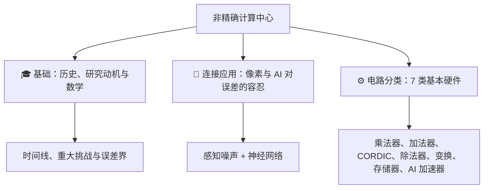

# 非精确计算（Inexact Computing） 学习与研究平台

## 选择第一条阅读路线

<strong>所需基础：</strong>整数加减法和百分比。入门不需要先学过电路、概率、微积分、线性代数或信号处理。各专题页会在开篇示例中介绍所需的新概念；后面的<strong>深入阅读／参考资料</strong>部分则保留技术内容，供日后查阅。

<strong>最初的学习目标：</strong>说明近似结果与参考结果有哪些差异，计算一个简单的误差，并判断某项节省是针对单个电路还是整个任务。练习用于自查理解情况，不计分，也不收集你的答案。

### 五站入门路线

1. [为什么使用非精确计算？](fundamentals/why-approximate-computing.md)——先区分能量（energy）、功率（power）、延迟（delay）与面积（area），再比较节省了多少。
2. [比特与进位](start/bits-and-carry.md)——从比特（bit）的位权（bit weight）理解数值的组成，再看加法为什么需要进位（carry）。
3. [如何衡量计算误差？](fundamentals/error-metrics-made-easy.md)——用一张小表，区分结果出错的频率与误差的大小。
4. [近似加法器](taxonomy/adders.md#read-a01)——先预测一个简单加法的结果，再使用已有实验工具，解释进位发生了什么变化。
5. [近似乘法器](taxonomy/multipliers.md#mul-start)——沿着 3 × 5 的计算过程，从部分积（partial product）走到最终结果。在电路内部省去部分计算，与计算完成后清除比特，是两种不同的做法。

每到一站，先尝试预测，再打开答案。如果看不懂其中的数值，请回到该页列出的预备知识，或使用[术语速查区](glossary.md#reading-desk)。读完开篇课程就可以停下；后面的参考部分不是进入下一站入门课程的先修要求。

### 再沿着感兴趣的问题深入

| 你想了解的问题 | 阅读路线 | 需要留意的要点 |
|---|---|---|
| 图像能掩盖数值计算中的错误吗？ | [像素与加权平均](bridge/human-eyes-and-pixels.md) → [人工智能（Artificial Intelligence，AI）与量化（quantization）](bridge/ai-and-approximate-math.md) | 先固定参考结果、舍入（rounding）规则和比较区域；质量评分不能保证每位观看者看到的效果。 |
| 误差会怎样累积？ | [研究动机与挑战](fundamentals/motivations-and-challenges.md) → [数学误差指标](fundamentals/error-metrics.md) | 有符号误差（signed error）可能相互增强，也可能相互抵消；样本中的最大误差不是覆盖所有输入的误差界（error bound）。 |
| 系统可以在哪些方面作出改变？ | [跨层次的近似方法](fundamentals/approx-paradigms.md) → [存储器](taxonomy/memory.md#mem-start) → [AI 加速器](taxonomy/accelerators.md#acc-start) | 改变数据表示、跳过部分计算、改变电路，是不同的选择。也要计入存储器与控制部分的开销。 |
| 其他算术运算类别是怎样工作的？ | [除法器](taxonomy/dividers.md#div-start)、[坐标旋转数字计算算法（CORDIC）](taxonomy/cordic.md#cor-start)、[变换](taxonomy/transforms.md#trf-start) | 这些都是选读分支。先从可以手算的简单示例入手，技术推导可以留到第二次阅读。 |
| 这些思想从何而来？ | [历史与演进](fundamentals/history-and-evolution.md) | 区分观察结果、模型预测、实验测量与综述中的论述。这个分支可以选读。 |

<strong>记住这样一个比较。</strong>假设某任务需要 10 个单位的能量，其中乘法器消耗 2 个单位。仅将乘法器的能耗减半，可节省 1 个单位；其他部分都不变时，整个任务便消耗 9 个单位，任务能耗降低 10%，而不是 50%。对于真实系统，还需要实测额外开销与运行条件。

继续之前，检查你选择的路线

<strong>首页自查 1。</strong>你会做十进制加法，但不了解二进制。进入加法器实验前应该先读什么？先读<strong>比特与进位</strong>，再看简单的误差表。不需要从高阶的数学误差界入手。

<strong>首页自查 2。</strong>一篇论文将乘法器的能耗减半，是否就证明整台计算机的能耗也减半了？<strong>没有。</strong>必须计入乘法器所占的能耗份额、其他全部计算工作，以及任何新增开销。在上面 10 个单位的例子中，只节省了 1 个单位。

下文保留原有的学科概览与研究链接。通过这些路线和导航指南，可以访问全部十八个阅读页面；已有的八个工具仍放在各自的课程中。尝试应用前，不必读完每一条分支。

---

欢迎来到<strong>非精确计算学习与研究平台</strong>。这里是一个开放访问、持续更新的实验园地，也是一套面向<strong>近似算术（approximate arithmetic）与非精确算术（inexact arithmetic）计算</strong>的交互式教学资源。

---

## 🎯 目标与范围

近似计算（approximate computing）以规定程度的数值精度或应用质量损失，换取降低能耗、硅面积或延迟的可能性。误差并不天然微小，也不天然有界：需要结合选用的算术模型、输入域（input domain）与具体应用，确定可接受的限度。潜在应用包括：

- <strong>人工智能与深度学习</strong>（Conv2D、通用矩阵乘法（General Matrix Multiplication，GEMM）、Transformer 注意力机制、脉动阵列（systolic array））
- <strong>计算机视觉与图像处理</strong>（滤波、边缘检测、JPEG/HEVC 离散余弦变换（Discrete Cosine Transform，DCT）压缩）
- <strong>信号处理与音频</strong>（快速傅里叶变换（Fast Fourier Transform，FFT）、FIR 滤波器、CORDIC 坐标旋转）
- <strong>低功耗存储系统</strong>（采用电压缩放的静态随机存取存储器（Static Random-Access Memory，SRAM）缓存、放宽刷新要求的动态随机存取存储器（Dynamic Random-Access Memory，DRAM））

---

## 📚 导航指南

<strong>初次接触计算机算术？从这里开始：</strong>[比特与进位](start/bits-and-carry.md) → [如何衡量计算误差？](fundamentals/error-metrics-made-easy.md) → [近似加法器：从这里开始](taxonomy/adders.md#read-a01)。只需掌握整数加减法和百分比。

| 栏目 | 内容 |
| :--- | :--- |
| [<strong>术语表</strong>](glossary.md) | 用浅显的语言解释非精确计算的核心概念、缩写与术语。 |
| [<strong>基础知识</strong>](fundamentals/why-approximate-computing.md) | 能耗与精度的权衡、[<strong>历史与演进</strong>](fundamentals/history-and-evolution.md)、[<strong>研究动机与重大挑战</strong>](fundamentals/motivations-and-challenges.md)，以及数学误差界。 |
| [<strong>连接实际应用</strong>](bridge/human-eyes-and-pixels.md) | 图像对误差的容忍所需满足的条件（包含<strong>图像滤波沙盒</strong>），以及非精确算术对 AI 的影响如何随应用而变化。 |
| [<strong>电路分类</strong>](taxonomy/multipliers.md) | 介绍 7 类核心硬件的架构，并附 IEEE 文献引用：<strong>乘法器</strong>、<strong>加法器</strong>、<strong>CORDIC</strong>、<strong>除法器与平方器</strong>、<strong>变换（DCT/FFT）</strong>、<strong>存储器与存储系统</strong>、<strong>AI 加速器</strong>。 |

---

## 🔬 代码仓库与源代码

- <strong>GitHub 仓库</strong>：[Inexact-Computing/public](https://github.com/Inexact-Computing/public)
- <strong>所属实验室</strong>：[Inexact-Computing/inexact-computing-lab](https://github.com/Inexact-Computing/inexact-computing-lab)
- <strong>许可协议</strong>：CC BY 4.0（Creative Commons Attribution 4.0 International，知识共享署名 4.0 国际许可协议）

科学背景：J. Han 和 M. Orshansky，*Approximate Computing: An Emerging Paradigm for Energy-Efficient Design*，ETS，2013 年，第 I–II 节（[作者稿](https://www.ece.ualberta.ca/~jhan8/publications/ApproCompReview_final.pdf)、[DOI](https://doi.org/10.1109/ETS.2013.6569370)）。本页示例展示的是研究方向。
