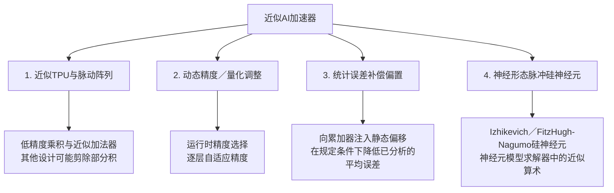

<a id="approximate-ai-accelerators-systolic-arrays"></a>

# 近似AI加速器与脉动阵列

现代人工智能（Artificial Intelligence，AI），包括大语言模型、视觉Transformer、自主导航和扩散模型，常常需要大量<strong>矩阵乘法（$\mathbf{C} = \mathbf{A} \times \mathbf{B}$）</strong>。

一次<strong>乘累加（Multiply-Accumulate，MAC）</strong>运算为点积贡献一项；所需吞吐量取决于工作负载：

$$\text{MAC}: \quad \text{Accumulator} \leftarrow \text{Accumulator} + (A_{ik} \times B_{kj})$$

近似加速器通过放宽算术准确性来降低硬件成本。必须针对目标网络评估误差容忍度和权重统计特性。

<strong>初次阅读？</strong> 你需要含负数的乘法、平均数和百分比知识。[为什么AI适合使用非精确算术](../bridge/ai-and-approximate-math.md)提供神经网络背景，但不是必读前置页。入门部分从“三对数相乘再求和”讲到“AI加速器如何组织这些工作、能量花在哪里，以及近似乘法器改变了什么”。标为“深入阅读”的部分是本页原有技术参考内容，第一次阅读时可以跳过。

<strong>读完入门部分，你将能够：</strong>

1. 用乘累加单元逐步计算短点积，说明处理单元（Processing Element，PE）和阵列在此基础上增加了什么；
2. 用一份历史能耗表解释为什么搬移数据可能比运算更耗能，并说明该表不能回答什么；
3. 解释平均误差校正能修正什么、不能修正什么。

<a id="acc-start"></a>

<a id="start-here-a-dot-product-of-three-numbers"></a>

## 从这里开始：三个数的点积

神经网络反复执行一种小计算。它取出<strong>权重（weight）</strong>，即训练后固定并随网络存储的数，以及<strong>激活值（activation）</strong>，即当前输入在网络中流动的数，例如像素值或上一层的输出。把两类数配对相乘，再将乘积相加。这个和叫<strong>点积（dot product）</strong>：

| | 第1对 | 第2对 | 第3对 |
|---|---:|---:|---:|
| 权重w | 2 | −1 | 3 |
| 激活值a | 4 | 5 | 1 |
| 乘积w × a | 8 | −5 | 3 |

2 × 4 + (−1) × 5 + 3 × 1 = 8 − 5 + 3 = <strong>6</strong>。

<a id="mac-pe-and-array"></a>

### MAC、PE和阵列

<strong>MAC单元</strong>包含一个乘法器、一个加法器和一个称为累加器的寄存器。每一步将一对数相乘，再把乘积加到累加器中。从0开始，累加器依次保存8、3、6。

<strong>处理单元（PE）</strong>在MAC单元之外，还带有保存权重、向相邻单元传递数据的小寄存器。<strong>阵列</strong>是由PE组成的网格，多个PE同时工作，分别计算不同输出。数据在相邻单元之间流动，无需每个PE都从存储器中取数。[脉动阵列一节](#the-systolic-array-anatomy-of-modern-ai-hardware)给出了布局。

<strong>延迟（latency）</strong>是得到一个结果所需的时间；<strong>吞吐量（throughput）</strong>是单位时间完成的工作量。作一个简单计数，假设每个单元每周期完成一次MAC：一个MAC单元计算这个点积需要3个周期，计算四个这样的点积需要12个周期。四个并排工作的PE用3个周期即可完成全部四个点积。吞吐量提高到四倍，但每个结果仍需3个周期。真实阵列还需要周期来装载和输出数据。

<a id="acc-energy"></a>

<a id="moving-data-can-cost-more-than-arithmetic"></a>

### 搬移数据可能比运算更耗能

<strong>先预测：</strong> 用32比特整数计算这个点积时，运算和从主存（动态随机存取存储器，Dynamic Random-Access Memory，DRAM）取出六个数，哪一个更耗能？

<details markdown="1">
<summary>用历史45 nm数据表核对</summary>

[文献中的运算能耗表](#published-operation-energy)列出了45 nm条件下<strong>32比特</strong>操作的数值：整数加法0.1 pJ、整数乘法3.1 pJ、静态随机存取存储器（Static Random-Access Memory，SRAM）缓存访问5 pJ、DRAM访问640 pJ。

| 工作部分 | 计数 | 能量（pJ） |
|---|---|---:|
| 运算：3次乘法 + 3次加法 | 3 × 3.1 + 3 × 0.1 | 9.6 |
| 从SRAM缓存取6个数 | 6 × 5 | 30 |
| 从DRAM取6个数 | 6 × 640 | 3,840 |

这里从DRAM取数的能耗约为运算的400倍。因此阵列会让权重留在原处，并多次复用每次取出的数。

这张表的适用条件必须一并保留：它是2015年的45 nm数据表，Han等人将其归于Horowitz（二次引用，此处未核验原始来源）。表中是32比特操作，不是当前加速器常见的8比特运算，也没有给出供电电压或存储器容量。它无法预测现代芯片能耗，也无法预测仅替换乘法器的节能量。

</details>

<a id="acc-mean"></a>

<a id="approximate-products-and-a-mean-correction"></a>

### 近似乘积与均值校正

近似乘法器给出的乘积会有一些误差。假设在已分析的输入上，每个乘积的误差（近似值 − 精确值）<strong>平均</strong>为−1。K = 3个乘积的总误差期望为−3，因此向累加器加上+3就能校正平均值：

| 输出 | 3个乘积的误差 | 合计 | 加上+3后 |
|---|---|---:|---:|
| 输出A | −2, 0, −1 | −3 | 0（已校正） |
| 输出B | 0, 0, 0 | 0 | +3（反而出错） |

均值校正修正的是许多输出的平均误差，不能逐个修正输出。乘积相加时，还要考虑两件事：

- <strong>误差一起变化。</strong> 如果各乘积误差常常同时变大，那么总误差的分散程度会比独立误差相加更大。参考部分用协方差项描述这一点。
- <strong>溢出。</strong> 累加器必须有足够位数容纳最大可能和。例如，两个无符号4比特数的乘积最大为15 × 15 = 225；三个这样的乘积之和可达675，需要10比特。位数不足时，和会回绕，产生很大的误差。

<a id="check-your-understanding"></a>

### 检查你的理解

先在纸上作答，再展开核对。答案不会被保存或发送到任何地方。

<a id="acc-q1"></a>

<strong>问题ACC-1。</strong> 权重为(1, 2, 3)，激活值为(4, 0, −2)。每一步MAC之后，累加器保存什么？

<a id="acc-q2"></a>

<strong>问题ACC-2。</strong> 某近似乘法器经分析，每个乘积的平均误差为−0.5。每个输出累加K = 8个乘积。应向累加器加多少补偿？这会让每个输出都精确吗？

<a id="acc-q3"></a>

<strong>问题ACC-3。</strong> “表中说一次DRAM访问消耗640 pJ，因此我们的新8比特加速器芯片每读取一个权重就消耗640 pJ。”这句话哪里有问题？

<details markdown="1">
<summary>核对问题ACC-1至ACC-3</summary>

<strong>ACC-1。</strong> 1 × 4 = 4，因此为4；接着2 × 0 = 0，仍为4；最后3 × (−2) = −6，因此为−2。

- 忽略−2的负号会得到10。

<strong>ACC-2。</strong> 总误差期望为8 × (−0.5) = −4，因此加<strong>+4</strong>。这只校正已分析输入条件下的期望值；每个输出仍有各自误差，其他输入、舍入或溢出都可能留下偏差。

- 减4会使漂移加倍：补偿的符号必须与平均误差相反。

<strong>ACC-3。</strong> 640 pJ是历史45 nm条件下32比特DRAM访问的数据，而且来自二次引用。现代芯片的工艺、电压、存储器和数据位宽不同，必须针对该芯片和工作负载测量能耗。

</details>

---

<a id="going-deeper"></a>

## 深入阅读

以下是本页原有的参考内容，回答前面的题目不需要用到它们。

- [脉动阵列](#the-systolic-array-anatomy-of-modern-ai-hardware)及其[数据流拓扑](#dataflow-topologies)
- [能耗构成](#energy-breakdown-the-mac-cost-hierarchy)，包括完整的[45 nm运算能耗表](#published-operation-energy)
- [近似加速器分类](#comprehensive-inexact-ai-accelerator-taxonomy)、[APTPU与误差累积](#1-approximate-tensor-processing-units-aptpu)（均值、方差和协方差）、[统计平均误差补偿](#2-statistical-mean-error-compensation-me-to-0)，以及[神经形态神经元及其脉冲复位规则](#3-neuromorphic-biomimetic-neurons)
- [芯片PPA比较](#silicon-ppa-comparison)和[原始文献](#primary-literature)

---

<a id="the-systolic-array-anatomy-of-modern-ai-hardware"></a>

## 🧩 脉动阵列：现代AI硬件的内部结构

Google第一代张量处理单元（Tensor Processing Unit，TPU）及部分AI专用集成电路（Application-Specific Integrated Circuit，ASIC），在称为<strong>脉动阵列（systolic array）</strong>的PE二维空间网格上执行矩阵运算：

```
           输入矩阵B（权重／滤波器）
              v               v               v
  输入A -> [ PE 0,0 ] ---> [ PE 0,1 ] ---> [ PE 0,2 ]
              |               |               |
              v               v               v
  输入A -> [ PE 1,0 ] ---> [ PE 1,1 ] ---> [ PE 1,2 ]
              |               |               |
              v               v               v
              [ PE 2,0 ] ---> [ PE 2,1 ] ---> [ PE 2,2 ]
                      \               \               \
                       v               v               v
               累加后的输出矩阵C（激活值）
```

<a id="dataflow-topologies"></a>

### 数据流拓扑
1. <strong>权重驻留（Weight Stationary，WS）</strong>：神经网络权重装入PE的局部寄存器并保持不动，激活向量水平流动，部分和沿垂直方向累积。这样能够复用权重；能耗取决于完整数据流。
2. <strong>输出驻留（Output Stationary，OS）</strong>：部分和在每个PE的局部累加寄存器中累积，直到完整点积$\sum A_{ik} B_{kj}$计算完毕，从而减少部分和传输；总存储器流量取决于分块方式和存储配置。

---

<a id="energy-breakdown-the-mac-cost-hierarchy"></a>

## ⚡ 能耗构成：MAC的成本层次

运算和数据搬移都消耗能量。每次操作的开销取决于工艺、电压、精度、存储器容量和访问模式。不同实现的数据无法拼成一张通用的7nm／28nm能耗表。

替换乘法器逻辑可能降低其面积或能耗，但缓冲区、互连、控制和存储器仍然存在。因此阵列密度、整芯片功耗和模型准确率都需要针对具体实现测量。

<a id="published-operation-energy"></a>

<a id="a-published-32-bit-operation-energy-example"></a>

### 文献中的32比特运算能耗示例

Han等人（2015年，[图1](https://arxiv.org/pdf/1506.02626)）转载了下列45 nm CMOS运算能耗表，在参考文献[7]中将其归于Mark Horowitz的能耗表。这里是经由Han等人的二次引用，尚未独立核验Horowitz原始来源。各项对应32比特操作或访问，不是64比特数据或INT8 MAC。

| 操作或访问 | 能量（每次操作／访问，pJ） |
| :--- | ---: |
| 32比特整数加法 | 0.1 |
| 32比特浮点加法 | 0.9 |
| 32比特寄存器文件访问 | 1 |
| 32比特整数乘法 | 3.1 |
| 32比特浮点乘法 | 3.7 |
| 32比特SRAM缓存访问 | 5 |
| 32比特DRAM主存访问 | 640 |

在这张历史表格中，DRAM访问能耗为整数加法的$640/0.1=6400$倍、SRAM缓存访问的$640/5=128$倍。这些比值说明了数据搬移的重要性。图1未给出供电电压、存储容量或现代加速器工作负载，不能用这些数据预测当前芯片能耗、整个加速器的节能量或仅替换乘法器的节能量。

---

<a id="comprehensive-inexact-ai-accelerator-taxonomy"></a>

## 🏛️ 非精确AI加速器分类总览



---

<a id="1-approximate-tensor-processing-units-aptpu"></a>

## 🔬 1. 近似张量处理单元（APTPU）

Elbtity等人的<strong>近似张量处理单元（Approximate Tensor Processing Unit，APTPU）</strong>使用低精度乘法与近似加法组成近似PE，并通过共享的预近似单元预处理操作数。

对于算术误差$e_k=\widehat{A_{ik}B_{kj}}-A_{ik}B_{kj}$，若累加器精确且不溢出，则有：

$$\mathbb{E}\left[\sum_{k=1}^{K}e_k\right]=\sum_{k=1}^{K}\mathbb{E}[e_k]$$

$$\operatorname{Var}\left(\sum_{k=1}^{K}e_k\right)=\sum_{k=1}^{K}\operatorname{Var}(e_k)+2\sum_{k<l}\operatorname{Cov}(e_k,e_l)$$

权重均值为零，不能推出乘积误差均值为零。即使误差独立且均值为零，当各项方差相等时，其和的方差仍为$K\sigma_e^2$；只有平均值的方差才是$\sigma_e^2/K$。近似加法还会引入额外误差。

---

<a id="2-statistical-mean-error-compensation-me-to-0"></a>

## 🎯 2. 统计平均误差补偿（$ME \to 0$）

将误差定义为近似值减精确值时，如果各项平均误差都为负值$\mu_e$，那么点积误差的期望为$K\mu_e$。向累加器加入的补偿必须取相反符号：

$$C_{\text{comp}}=-K\mu_e$$

更一般地，$C_{\text{comp}}=-\sum_k\mathbb{E}[e_k]$。以$K=1024$为例，平均误差$-1$产生$-1024$的期望漂移，需要$+1024$补偿。这校正的是已分析分布下的期望值，不是每个输出。舍入、输入变化、近似累加和溢出都可能留下残余偏差。存储或注入偏移量也可能带来硬件成本。

---

<a id="3-neuromorphic-biomimetic-neurons"></a>

## 🧠 3. 神经形态仿生神经元

<strong>脉冲神经网络（Spiking Neural Network，SNN）</strong>通过稀疏、带有时间信息的动作电位（脉冲）传递信息，以模拟人脑。<strong>Izhikevich二次积分发放神经元</strong>模型的硅实现使用以下方程：

$$\frac{dv}{dt} = 0.04 v^2 + 5v + 140 - u + I$$

$$\frac{du}{dt} = a(bv - u)$$

模型还需要脉冲／复位规则：若$v\geq30\text{ mV}$，则令$v\leftarrow c$、$u\leftarrow u+d$。变量、单位、参数、积分步长和复位处理都是模型的一部分。近似平方运算可能改变其动力学；神经元数量与功耗需要结合具体实现、连接结构和脉冲工作负载确定。

---

<a id="silicon-ppa-comparison"></a>

## 📊 芯片PPA比较

PPA指功耗、性能与面积（Power-Performance-Area）。面积、功耗、时序和准确率应只在实现约束与工作负载匹配时比较。

---

<a id="primary-literature"></a>

## 📚 原始文献

- S. Han, J. Pool, J. Tran, and W. J. Dally, *“Learning both Weights and Connections for Efficient Neural Networks”*, NIPS (2015), [arXiv作者论文，图1及参考文献[7]](https://arxiv.org/pdf/1506.02626). 图1的45 nm表归于Horowitz；它是引用的运算能耗示例，不是本页各加速器模型的测量结果。
- N. P. Jouppi et al., *“In-Datacenter Performance Analysis of a Tensor Processing Unit”*, ISCA (2017), [架构与脉动数据流](https://arxiv.org/pdf/1704.04760), DOI: 10.1145/3079856.3080246.
- M. E. Elbtity, P. S. Chandarana, B. Reidy, J. K. Eshraghian, and R. Zand, *“APTPU: Approximate Computing Based Tensor Processing Unit”*, IEEE TCAS-I 69(12), 5135–5146 (2022), [DOI: 10.1109/TCSI.2022.3206262](https://doi.org/10.1109/TCSI.2022.3206262).
- K. Chen, W. Liu, J. Han, and F. Lombardi, *“Profile-Based Output Error Compensation for Approximate Arithmetic Circuits”*, IEEE TCAS-I 67(12), 4707–4718 (2020), [作者稿](https://www.ece.ualberta.ca/~jhan8/publications/TCAS-I_Error_Compensation_Final.pdf), DOI: 10.1109/TCSI.2020.2996567.
- E. M. Izhikevich, *“Simple Model of Spiking Neurons”*, IEEE TNN 14(6), 1569–1572 (2003), [式(1)–(3)](https://www.izhikevich.org/publications/spikes.pdf), DOI: 10.1109/TNN.2003.820440.
