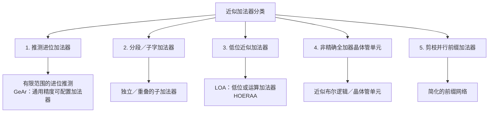

<a id="approximate-adders-taxonomy-microarchitectures"></a>

# 近似加法器分类与微架构

加法器是数字超大规模集成电路（Very Large Scale Integration，VLSI）系统的基础算术部件。它既支持直接的加法和减法，也用于乘法器、除法器和地址生成单元（Address Generation Unit，AGU）。

<strong>初次阅读？</strong> 本页先用一个小例子介绍近似加法器。建议先读[比特与进位](../start/bits-and-carry.md)以及[如何衡量计算误差？](../fundamentals/error-metrics-made-easy.md)的第1、2步。标有“深入阅读”的内容是本页原有的参考部分，初读时可以跳过。

<strong>读完入门部分，你将能够：</strong>

1. 对7和1逐列做或运算（OR），解释它为何与精确加法得到不同结果；
2. 说明LOA-8加法器如何处理低位、分界处的进位和高位；
3. 判断1个单位的误差是否会改变“接受8及以上结果”的决策。

<a id="read-a01"></a>

<a id="start-here-or-versus-exact-addition-for-7-1"></a>

## 从7 + 1开始：或运算与精确加法

本页实验使用16比特的数，这个例子只涉及最低8位。先把7和1写成8比特形式，在左侧补零（前导零不改变数值）：

| 数值 | 比特，从高位到低位 |
|---|---|
| 7 | `00000111` |
| 1 | `00000001` |

在“比特与进位”页面中，精确计算7 + 1时，进位穿过了三列，得到`00001000` = 8。

<strong>先预测：</strong> 对每一列，即相同位置上的两个比特，分别做或运算。你会得到什么比特模式？它表示多少？

<details markdown="1">
<summary>查看逐列或运算的结果</summary>

| 位权 | 128 | 64 | 32 | 16 | 8 | 4 | 2 | 1 |
|---|---|---|---|---|---|---|---|---|
| 7 | 0 | 0 | 0 | 0 | 0 | 1 | 1 | 1 |
| 1 | 0 | 0 | 0 | 0 | 0 | 0 | 0 | 1 |
| 或运算 | 0 | 0 | 0 | 0 | 0 | 1 | 1 | 1 |

或运算得到`00000111` = 7，精确加法则得到8。或运算会保留遇到的每一个1，却不会向左进位。最右列的1 + 1本应写0、进1；或运算却写1、不进位，因此精确加法中最终到达位权为8那一列的进位没有形成。

</details>

<a id="how-loa-8-uses-or"></a>

### LOA-8如何使用或运算

<strong>低位或运算加法器（Lower-Part OR Adder，LOA）</strong>的低8位版本称为<strong>LOA-8</strong>，它把16比特加法分为两部分：

- <strong>低8位</strong>（第0至7位，位权为1至128）：每个输出位都是同一位置上两个输入位的或运算结果。这些位之间不传递进位。
- <strong>分界处：</strong> 向第8位（位权为256）送入一个进位。它由两个输入的第7位（位权为128）做与运算（AND）得到，只有这两个比特都为1时才为1。
- <strong>高8位</strong>（第8至15位，位权从256起）：从分界处的进位开始，按照普通进位规则做精确加法。

对于7 + 1，两个数都落在低8位内，第7位都为0。分界处的进位为0，高位部分为0 + 0 = 0，输出就是低位或运算的结果7。有符号误差（signed error）为7 − 8 = −1。

LOA-8的高位做精确加法，因此不能把它当作对整个数做或运算。它的结果也可能偏大：对于其他输入，分界处的进位可能把结果推高（[LOA误差规格](#loa-error-contract)给出了低2位做或运算时，2 + 2得到6的例子）。这种设计改变了运算规则；具体实现是否节能，还需要单独验证。

<strong>下一步：</strong> 初读时可跳过下方的进位公式，[直接进入实验任务](#read-a02)。

---

<a id="the-carry-propagation-physics-bottleneck"></a>

## 🛑 进位传播的物理过程与瓶颈

*深入阅读（初读可跳过）：进位的形式化方程。新读者可[直接进入实验任务](#read-a02)。*

在精确二进制加法中，两个$N$比特操作数（operand）$A = \sum_{i=0}^{N-1} A_i 2^i$和$B = \sum_{i=0}^{N-1} B_i 2^i$，加上初始输入进位$C_0$，通过各级全加器（Full Adder，FA）生成一个$(N+1)$比特的和：

$$S_i = A_i \oplus B_i \oplus C_i$$

$$C_{i+1} = (A_i \cdot B_i) + (C_i \cdot (A_i \oplus B_i)) = G_i \lor (P_i \land C_i)$$

这里的乘法表示布尔与运算，进位表达式中的加号表示布尔或运算。操作数为无符号数，$C_0\in\{0,1\}$，完整结果包含$C_N$；若只输出$N$比特，结果则按模$2^N$回绕。

其中，$G_i = A_i \cdot B_i$表示<strong>进位生成（carry generate）</strong>信号，$P_i = A_i \oplus B_i$表示<strong>进位传播条件（carry propagate）</strong>信号。

```
  第0位          第1位          第2位                   第N-1位
+-------+      +-------+      +-------+               +---------+
| FA 0  |--C1->| FA 1  |--C2->| FA 2  |-- ... --C_N-1>| FA N-1  |--C_N-->
+-------+      +-------+      +-------+               +---------+
    |              |              |                        |
   S_0            S_1            S_2                      S_N-1
```

<a id="1-the-critical-path-dilemma"></a>

### 1. 关键路径的难题

在<strong>行波进位加法器（Ripple-Carry Adder，RCA）</strong>中，最坏情况下的传播延迟随字长线性增长：

$$T_{\text{RCA}} = t_{\text{gen}} + (N - 1) \cdot t_{\text{carry}} + t_{\text{sum}} = \mathcal{O}(N)$$

即使是<strong>超前进位加法器（Carry-Lookahead Adder，CLA）</strong>、<strong>Kogge-Stone并行前缀加法器（Kogge-Stone Parallel-Prefix Adder，KSA）</strong>和<strong>Brent-Kung加法器（Brent-Kung Adder，BKA）</strong>等高速精确架构，在实现对数级延迟$\mathcal{O}(\log_2 N)$时，也需要承担随拓扑而异的连线、布线电容和扇出成本；这些因素会影响动态开关功耗（$P_{\text{dyn}} = \alpha C_{\text{eff}} V_{DD}^2 f$）。

<a id="2-statistical-carry-length"></a>

### 2. 进位链长度的统计特性

当操作数的各比特相互独立且均匀随机时，连续满足进位传播条件的比特数具有几何尾部：连续$P$位都满足传播条件的概率为$2^{-P}$。在一个$N$比特字中，最长连续段的长度按$\log_2 N$的量级增长，但其精确期望取决于连续段的定义和边界条件。对随机输入的这一观察，不能用来认定任意工作负载下的错误率都可以忽略。

Burks、Goldstine和von Neumann在1946年报告的§5.6中，分析了独立、均匀随机二进制字的最长进位序列。他们定义的序列从生成进位的比特对11开始，经过比特对10或01继续延伸；再次遇到11则开始一个新序列。在这一定义下，均值$a_n$以$\log_2 n$为上界。报告给出的$a_{40}=4.62$，小于$\log_2 40\approx5.3$。重新计算其递推式可得：

| 字长$n$ | 最长序列长度的均值$a_n$（重新计算） |
|---|---:|
| 16 | 3.24 |
| 32 | 4.29 |
| 64 | 5.31 |

这些数值是随机输入的序列长度，不是实测延迟，也不是每种加法器架构的平均延迟。[原始报告，§5.6](https://safari.ethz.ch/architecture/fall2023/lib/exe/fetch.php?media=logical_design_of_an_electronic_computing_instrument.pdf)。

近似加法器可以限制进位前瞻范围，也可以替换低位的运算规则。其出错概率取决于架构、配置和输入分布。

---

<a id="interactive-lab-carry-propagation-race"></a>

## ⚡ 交互实验：进位传播竞赛

<a id="read-a02"></a>

<strong>实验任务：计算7 + 1。</strong> 实验中的数以<strong>十六进制</strong>（以16为基数）显示。只需记住三点：数字0–9的值不变；前导零不改变数值（`0007`就是7）；`0x`只是十六进制标记（`0x8`就是8）。

1. 先预测：LOA-8计算0007 + 0001会输出多少？误差是多少？
2. 实验默认填入FFFF和0001。把它们改为A = 0007、B = 0001，然后选择<strong>低位或运算加法器（LOA-8）</strong>。
3. 读取“精确A + B”“加法器输出”和“误差（输出 − 精确结果）”。
4. 切换到<strong>精确行波进位加法器（RCA）</strong>，再次读取误差。
5. 用上面的逐列或运算解释两者的差别。

第一个任务只需比较LOA-8和RCA。下方技术说明也介绍了菜单中的其他选项，对应的参考章节可以稍后再读。

实验使用无符号16比特输入，保留17比特输出，误差定义为近似结果减去精确结果。RCA和CLA都返回精确的和；动画只是示意，不是时序仿真。近乎正确加法器（Almost-Correct Adder，ACA）的ACA-4版本，使用前四位预测进入每一位的进位，包括最终输出进位；靠近第0位时，使用所有已有的前序位，并假定每个窗口起点的输入进位为零。LOA-8遵循下方的或运算与分界进位规格。固定随机种子的样本统计结果只反映观测到的比例，不提供全输入域保证：

<iframe
  src="../../labs/adder-carry-race.html"
  title="加法器进位传播竞赛"
  style="width: 100%; height: 840px; border: none; background: transparent; margin: 12px 0;"
  loading="lazy"
></iframe>

本实验在第0位没有额外的输入进位。移动条只用于示意进位传播；它和浏览器运行速度都不能衡量芯片的延迟或能耗。若实验未加载，可[单独打开进位传播竞赛实验](../labs/adder-carry-race.html)。

<details markdown="1">
<summary>核对0007 + 0001的实验读数</summary>

| 加法器 | 精确A + B | 加法器输出 | 误差（输出 − 精确结果） |
|---|---|---|---:|
| 精确行波进位加法器（RCA） | `0x8` | `0x8` | 0 |
| 低位或运算加法器（LOA-8） | `0x8` | `0x7` | −1 |

两个精确加法器（RCA和CLA）以及ACA-4在这里都返回`0x8`；本任务不需要使用ACA-4。

</details>

<strong>实验下方的文字</strong>报告所选加法器的一次独立随机测试：用固定随机种子抽取100,000对随机16比特数。其中“错误结果数”对应这个样本的错误率（Error Rate，ER），即结果出错的比例；“最大|误差|”是样本中观测到的最大误差，不是最坏情况保证。你在输入框中填入的数不会改变这个样本。

<strong>选做：FFFF + 0001。</strong> 十六进制数字F代表15，因此`FFFF`就是十六个1比特（65535）。用RCA计算FFFF + 0001，得到`0x10000` = 65536。与“比特与进位”页中的`1111` + `0001`一样，和需要多一位；这里需要第17位，实验会保留它。

<a id="read-a03"></a>

<a id="does-a-one-unit-error-matter-a-decision-task"></a>

## 1个单位的误差会影响决策吗？

假设一项任务接受8及以上的结果，拒绝小于8的结果。

<strong>先预测：</strong> 对于7 + 1，精确结果会被接受吗？LOA-8的结果会被接受吗？

<details markdown="1">
<summary>核对决策结果</summary>

| 加法器 | 7 + 1的结果 | 是否接受（8及以上）？ |
|---|---:|---|
| 精确加法 | 8 | 是 |
| LOA-8 | 7 | 否 |

大小为1的误差改变了决策。

</details>

判断一种近似是否可接受，需要看任务要求，不能只看误差数值有多小。[为什么需要非精确计算？](../fundamentals/why-approximate-computing.md)用像素值214和215给出了类似的阈值例子。

一个例子可以说明计算会出错，却不能说明在所有输入上出错的频率（即ER）；该频率取决于哪些输入会出现，以及各自出现的频率。[可复现的LOA-8误差示例](#loa-error-example)给出了全输入域统计结果，其条件是：独立、均匀随机的无符号16比特输入，无外部输入进位，输出为17比特。这些数值既不是手工示例表的统计，也不是实验中的随机样本统计。

<a id="check-your-understanding"></a>

### 检查你的理解

先在纸上作答，再展开核对。答案不会被保存或发送到任何地方。

<a id="read-q6"></a>

<strong>问题6。</strong>

<a id="read-q6a"></a>

(a) 对`00000111`和`00000001`的每一对对应比特做或运算。结果是多少？与精确的7 + 1比较，并解释结果为何不同。

<a id="read-q6b"></a>

(b) 一项任务接受8及以上的数。这两个结果都会被接受吗？请解释。

<details markdown="1">
<summary>核对问题6</summary>

(a) 或运算得到`00000111` = 7，精确的7 + 1 = 8。或运算不会把最右列的进位继续向左传递，因此没有形成8。

(b) 不会。精确结果8被接受，或运算结果7被拒绝。差1就足以跨过阈值。

- “误差只有1，所以决策相同”忽略了阈值：7小于8。
- 这里只是LOA-8的一个较小整数例子。一般情况下，LOA-8仍会通过与运算产生分界处的进位，高位仍做精确加法，不能把整个数都当作或运算处理。
- 一个出错例子无法衡量所有输入上的错误率，也无法说明能耗。

</details>

---

<a id="going-deeper"></a>

## 深入阅读

以下是本页原有的参考内容，回答前面的题目不需要用到它们。

- [近似加法器分类总览](#comprehensive-approximate-adder-taxonomy)与[推测进位加法器](#1-speculative-carry-adders)
- [低位近似加法器](#2-lower-part-approximation-adders-loa-hoeraa)，包括[LOA误差规格](#loa-error-contract)和[LOA-8全输入域误差示例](#loa-error-example)
- [非精确全加器单元](#3-inexact-full-adder-cells)与[文献中的加法器实现比较](#published-adder-comparison)
- [原始文献](#primary-literature-ieee-citations)

形式化的进位方程见[本页前文](#the-carry-propagation-physics-bottleneck)。

---

<a id="comprehensive-approximate-adder-taxonomy"></a>

## 🏛️ 近似加法器分类总览



---

<a id="1-speculative-carry-adders"></a>

## 🔬 1. 推测进位加法器

局部推测进位预测器估计进入第$i$位的进位，所用窗口由前面$k$位构成。这限制了前瞻范围；实际延迟还取决于子加法器和预测器的实现。

```
                  k比特进位预测窗口
              +-------------------------------+
输入比特：    | A_{i-1} A_{i-2} ... A_{i-k}   |
              | B_{i-1} B_{i-2} ... B_{i-k}   |
              +-------------------------------+
                             |
                             v  推测进位 C_spec
              +-------------------------------+
              | FA_i ... FA_{i+p-1}          | ---> p比特局部和输出
              +-------------------------------+
```

<a id="generic-accuracy-configurable-adder-gear"></a>

### 通用精度可配置加法器（GeAr）

通用精度可配置加法器（Generic Accuracy Configurable Adder，GeAr）使用重叠的子加法器，支持精度配置，并可通过纠错实现精确运算。[作者提供的库](https://ces.itec.kit.edu/846.php#GeAR)区分了GeAr、ACA-I、ACA-II和ETAII；这些名称不表示它们采用相同的进位预测方法。

考虑一个简化的局部进位预测器：它使用前面$P$位，并假定窗口起点的输入进位为零。要在分界处预测错误，必须同时满足全部$P$位都传播进位，且实际输入进位为一。因此，在独立均匀输入下，$2^{-P}$是<strong>单个分界处</strong>出错概率的上界，而不是整个GeAr加法器的错误率。多个分界以及纠错机制都会改变整体错误率。加速比$N/R$和数值误差只限于一个子字这两点，都不构成一般保证。

---

<a id="2-lower-part-approximation-adders-loa-hoeraa"></a>

## ✂️ 2. 低位近似加法器（LOA与HOERAA）

低位近似改变的是较小的位权，但这些位的重要性取决于应用；它们未必代表传感器噪声。

```
           精确高位部分（N - k比特）                 近似低位部分（k比特）
+------------------------------------------+ +----------------------------------+
| 按正常进位传播的精确RCA／CLA              | | 简单的按位或门                   |
| S_i = A_i ^ B_i ^ C_i                    | | S_j = A_j | B_j                  |
+------------------------------------------+ +----------------------------------+
                    ^
                    | 输入进位 C_k = A_{k-1} & B_{k-1}
```

<a id="lower-part-or-adder-loa"></a>

### 低位或运算加法器（LOA）

对于$N$比特加法，若其中有$k$个近似位：

- <strong>高$(N-k)$位</strong>：使用带进位传播的精确全加器。
- <strong>低$k$位</strong>：去掉精确加法逻辑，通过按位或运算计算和位：

    $$
    S_j = A_j \lor B_j \quad (0 \le j \le k-1)
    $$

- <strong>注入输入进位</strong>：进入第$k$位的进位，通过对第$k-1$位的两个输入做与运算近似得到：

    $$
    C_k = A_{k-1} \land B_{k-1}
    $$

<a id="loa-error-contract"></a>

### LOA误差规格

假定操作数为无符号数，$C_0=0$，$1\le k<N$，输出为$(N+1)$比特。令$a=A\bmod2^k$、$b=B\bmod2^k$，则

$$S_{\mathrm{LOA}}=2^k\left((A\gg k)+(B\gg k)+(A_{k-1}\land B_{k-1})\right)+(a\lor b).$$

定义$\Delta=S_{\mathrm{LOA}}-(A+B)$，有

$$\Delta=2^k(A_{k-1}\land B_{k-1})-(a\land b).$$

该式包含了注入的进位。若把孤立的一个或运算位与半加器（Half Adder，HA）比较，输入11会因缺失进位而产生$-1$的误差，但这不是整个LOA的误差。例如，当$k=2$、$A=B=2$时，LOA输出6而不是4（$\Delta=+2$）。若输出仅为$N$比特，则需要另行规定溢出规则。

<a id="loa-error-example"></a>

<a id="a-reproducible-loa-8-error-example"></a>

### 可复现的LOA-8误差示例

对于独立、均匀随机的无符号16比特输入，无外部输入进位，输出为17比特，在上述规格中取$k=8$。每一对低位部分出现的频率相同。因此，穷举全部$256^2=65{,}536$对低位部分，就能得到下面精确的全输入域误差统计结果；高位不影响$\Delta$。

| 指标 | 数值 | 定义或归一化方式 |
|---|---:|---|
| ER | $1-(3/4)^8\approx89.99\%$ | 误差非零的输入对所占比例 |
| 平均误差距离（Mean Error Distance，MED） | 47.875 | 整数误差绝对值的均值 |
| 最大绝对误差 | 128 | 全输入域上的最大值 |
| 归一化平均误差距离（Normalized Mean Error Distance，NMED） | $47.875/131070\approx3.653\times10^{-4}$ | 最大精确和$131070=2(2^{16}-1)$ |

在这组规格约束下，误差幅度有界，但ER仍然很高。这些数值描述的是算术误差，不是应用质量或功耗、性能与面积（Power-Performance-Area，PPA）。这里未列平均相对误差距离（Mean Relative Error Distance，MRED），因为它取决于完整的精确和，仅穷举低位部分无法计算。

---

<a id="3-inexact-full-adder-cells"></a>

## ⚡ 3. 非精确全加器单元

精确全加器对全部八种输入状态都满足$A+B+C_{\mathrm{in}}=S+2C_{\mathrm{out}}$。近似单元则有意改变其中一些条目。每种具名单元都需要有对应的已发表真值表和电路实现；仅凭晶体管数量，不能认定面积或功耗一定减少，更简单的逻辑也不保证消除毛刺。

<a id="published-axa-cell-comparison"></a>

### 文献中的AXA单元比较

Yang等人使用Cadence Spectre、TSMC 65 nm工艺和1.0 V电压，将单比特AXA单元与一个<strong>10晶体管精确异或（Exclusive OR，XOR）／同或（Exclusive NOR，XNOR）全加器</strong>比较。这些结果来自单元仿真，既不是完整LOA加法器的结果，也没有使用28晶体管镜像加法器作为基准。总误差距离（Total Error Distance，TED）是对全部八种输入的$|S+2C_{\mathrm{out}}-(A+B+C_{\mathrm{in}})|$求和。

| 单元 | 晶体管数 | 和位正确的条目数 / 8 | 进位正确的条目数 / 8 | TED | 动态功耗（µW） |
|---|---:|---:|---:|---:|---:|
| 精确参考单元 | 10 | 8 | 8 | 0 | 4.657 |
| AXA1 | 8 | 4 | 4 | 4 | 3.872 |
| AXA2 | 6 | 4 | 8 | 4 | 3.448 |
| AXA3 | 8 | 6 | 8 | 2 | 3.234 |

论文表3还列出LOA单比特单元的晶体管数为8、TED为4；这不能用来确定整个字长的LOA错误率。根据表2原始值重新计算，动态功耗分别下降16.86%、25.96%和30.56%。这些数值与论文列出的改进百分比不同，后者与原始值不一致。仿真计入了输入源提供的能量，未计入四反相器负载的能量；传输晶体管的输出摆幅以及可能增加的驱动器开销都需要考虑。[Yang等人，§III–IV，表1–3](https://www.ece.ualberta.ca/~jhan8/publications/AXA_25.pdf)。

---

<a id="comparing-implementations"></a>

## 📊 实现方案比较

<a id="published-adder-comparison"></a>

Jiang、Han和Lombardi的表1比较了下列<strong>16比特</strong>设计：使用Synopsys Design Compiler综合，工艺与电压为<strong>STM 65 nm、1.35 V</strong>，子加法器基于CLA。三行数据采用论文中同一套评估条件；下表的功率延迟积（Power-Delay Product，PDP）根据论文报告的功耗和延迟重新计算。

| 设计 | 延迟（ps） | 面积（µm²） | 功耗（µW） | PDP（fJ，重新计算） |
|---|---:|---:|---:|---:|
| ETAII-4 | 560 | 254 | 68.4 | 38.3 |
| SCSA-4 | 370 | 394 | 117.6 | 43.5 |
| ACAA-4 | 700 | 272 | 73.6 | 51.5 |

这里$\mathrm{ps}\cdot\mu\mathrm{W}=10^{-3}\,\mathrm{fJ}$。这些数值是所列配置的综合结果，不能作为整个架构类别的通用延迟。此处没有根据图中数据重建完整的精确CLA基准。[Jiang等人，§3.2和表1](https://www.ece.ualberta.ca/~jhan8/publications/AdderComparison4.27.pdf)。

若没有运算持续时间或吞吐量，不能把功耗下降称为能耗下降。比较错误率时，必须使用相同的输入分布、输出位宽和溢出规则。

---

<a id="primary-literature-ieee-citations"></a>

## 📚 原始文献与IEEE引文

- Ajay K. Verma, Philip Brisk, Paolo Ienne, *"Variable latency speculative addition"*, Proceedings of the conference on Design, automation and test in Europe, 2008. [出版记录](https://doi.org/10.1145/1403375.1403679)。

- H R Mahdiani, A Ahmadi, S M Fakhraie, C Lucas, *"Bio-Inspired Imprecise Computational Blocks for Efficient VLSI Implementation of Soft-Computing Applications"*, IEEE Transactions on Circuits and Systems I: Regular Papers, 2010. [出版记录](https://doi.org/10.1109/TCSI.2009.2027626)。

- Muhammad Shafique, Waqas Ahmad, Rehan Hafiz, Jörg Henkel, *"A low latency generic accuracy configurable adder"*, Proceedings of the 52nd Annual Design Automation Conference, 2015. [出版记录](https://doi.org/10.1145/2744769.2744778)。

- Vaibhav Gupta, Debabrata Mohapatra, Sang Phill Park, Anand Raghunathan, Kaushik Roy, *"IMPACT: IMPrecise adders for low-power approximate computing"*, IEEE/ACM International Symposium on Low Power Electronics and Design, 2011. [出版记录](https://doi.org/10.1109/ISLPED.2011.5993675)。
