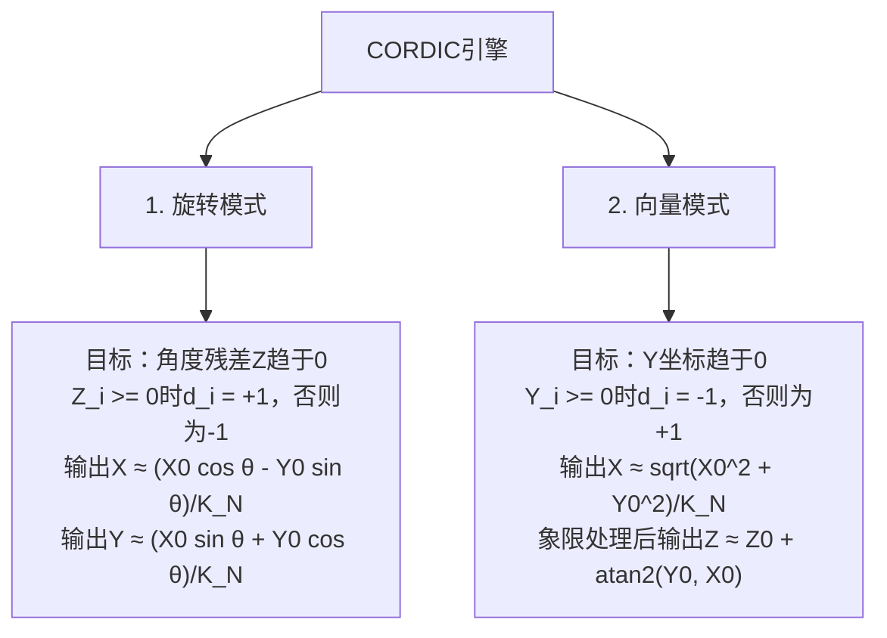

<a id="approximate-cordic-architectures-vector-computations"></a>

# 近似CORDIC架构与向量计算

<strong>坐标旋转数字计算算法（Coordinate Rotation Digital Computer，CORDIC）</strong>由Jack Volder于1959年提出，J. S. Walther于1971年推广。它使用移位／加法递推和预存常数，迭代计算<strong>三角函数（$\sin, \cos, \tan, \arctan$）、双曲函数（$\sinh, \cosh, \tanh$）、平方根（$\sqrt{x}$）、坐标转换（笛卡尔坐标$\leftrightarrow$极坐标）和平面旋转</strong>。三维旋转可由平面旋转组合而成；此外还需做范围约减、缩放以及针对具体函数的初始化。

下方的圆周递推执行平面旋转；统一算法还包含线性模式和双曲模式。各模式的收敛域与缩放因子不同［Walther，1971］。

<strong>初次阅读？</strong> 你需要理解网格上的坐标(x, y)、以度为单位的角，以及二进制移位相当于乘以2的幂这一概念（见[比特与进位](../start/bits-and-carry.md)）。下文会介绍本页所需的正弦、余弦和正切。入门部分从“网格上的一个点”讲到“电路如何只用移位和加法转动箭头”。标有“参考”或“深入阅读”的内容，包括矩阵形式和双曲CORDIC，初读时可以跳过。

<strong>读完入门部分，你将能够：</strong>

1. 给出长度为1的箭头旋转30°后的坐标，并说明CORDIC为何将旋转拆成多个小步骤；
2. 用角度表和移位手算CORDIC步骤，每次都用<strong>旧的</strong>x和y同时计算新的x和y；
3. 解释为何需要用约0.6073缩放结果，0.625为何只是接近这个值，以及角度预算为何不是精度。

<a id="cor-start"></a>

<a id="start-here-turning-an-arrow-by-30"></a>

## 从将箭头转动30°开始

从原点(0, 0)向点(1, 0)画一个箭头。它长1，沿x轴指向0°方向。角度从x轴起沿逆时针方向测量。将箭头转动30°，端点移到

\[(\cos 30^\circ,\ \sin 30^\circ) = (0.8660,\ 0.5000).\]

对于长度为1的箭头，余弦和正弦<strong>就是</strong>端点的x、y坐标。直接计算它们需要乘法或大查找表。CORDIC改为通过一系列小转角接近30°，每次只需移位和加法。

<a id="small-turns-that-need-only-shifts"></a>

### 只需移位的小转角

将箭头(x, y)旋转一个正切值为t的角度（正切即“斜率”，竖直增量除以水平增量），得到新箭头

\[(x - t\,y,\ \ y + t\,x),\]

它指向旋转后的方向，但长度扩大\(\sqrt{1+t^2}\)倍。CORDIC选择t = 1、½、¼、⅛、…的角，即\(t = 2^{-i}\)。乘以\(2^{-i}\)相当于二进制移位i位：1.5 × ¼ = 0.375，二进制`1.1`变为`0.011`。

| 步骤i | t = \(2^{-i}\) | 转角 | 长度扩大倍数 |
|---:|---:|---:|---:|
| 0 | 1 | 45.0000° | 1.4142 |
| 1 | 0.5 | 26.5651° | 1.1180 |
| 2 | 0.25 | 14.0362° | 1.0308 |
| 3 | 0.125 | 7.1250° | 1.0078 |
| 4 | 0.0625 | 3.5763° | 1.0020 |

每步箭头要么逆时针转（方向d = +1），要么顺时针转（d = −1），不会原地不动。剩余角度z决定方向：z ≥ 0时逆时针，否则顺时针，并从z中减去本次转角。

<a id="cor-hand"></a>

<a id="a-hand-run-towards-30"></a>

### 手算接近30°的过程

<strong>先预测：</strong> 第一步转动45°后已经转过头。第二步会怎样？

<details markdown="1">
<summary>核对五个步骤</summary>

初始：(x, y) = (1, 0)，剩余角度z = 30°。

| 步骤i | d | 新x = x − d·y·2⁻ⁱ | 新y = y + d·x·2⁻ⁱ | 剩余z |
|---:|---:|---:|---:|---:|
| 0 | +1 | 1 − 0 = 1 | 0 + 1 = 1 | 30 − 45 = −15 |
| 1 | −1 | 1 + 1 × 0.5 = 1.5 | 1 − 1 × 0.5 = 0.5 | −15 + 26.5651 = 11.5651 |
| 2 | +1 | 1.5 − 0.5 × 0.25 = 1.375 | 0.5 + 1.5 × 0.25 = 0.875 | 11.5651 − 14.0362 = −2.4712 |
| 3 | −1 | 1.375 + 0.875 × 0.125 = 1.484375 | 0.875 − 1.375 × 0.125 = 0.703125 | −2.4712 + 7.1250 = 4.6538 |
| 4 | +1 | 1.484375 − 0.703125 × 0.0625 = 1.440430 | 0.703125 + 1.484375 × 0.0625 = 0.795898 | 4.6538 − 3.5763 = 1.0775 |

每行的<strong>两个</strong>新值都使用上一行的x和y。先更新x，再用新x更新y，会得到不同且错误的箭头。表中的剩余z保留四位小数。

箭头已转动30 − 1.0775 = 28.92°，距目标还差1.08°。

</details>

<a id="scaling-the-arrow-back-to-length-1"></a>

### 将箭头缩放回长度1

每步都使箭头变长：(1.4404, 0.7959)的长度是1.6457，而不是1。将五个增长因子相乘后取倒数，得到缩放因子\(K_5 = 0.6076\)。于是(1.4404, 0.7959) × 0.6076 = (0.8753, 0.4836)，接近(0.8660, 0.5000)。8步后角度为30.26°，缩放因子\(K_8 = 0.6073\)；步数足够多时，缩放因子趋近0.607253。

电路可以用两次移位和一次加法实现0.625 = ½ + ⅛的缩放。它接近但不等于所需因子：5步后，箭头长度为1.6457 × 0.625 = 1.0286，约长了2.9%。缩放只改变长度，角度仍是28.92°。

<strong>角度预算不是精度。</strong> 四步最多能转45 + 26.5651 + 14.0362 + 7.1250 = 92.73°，约为无限多步所能达到角度（99.88°）的92.83%。四步无法达到95°，但预算以内的目标也仍可能留下残余角度，30°的例子就展示了这一点。[有限微角预算示例](#finite-micro-angle-budget-example)给出完整表格与限制。

<strong>下一步：</strong> 下方矩阵形式是参考内容，可[直接进入实验任务](#cor-lab)。

---

<a id="mathematical-foundations-givens-rotation-to-shift-add"></a>

## 🧭 数学基础：从Givens旋转到移位加法

*参考（初读可跳过）：上述小转角规则背后的矩阵形式，以及完整角度表。可[直接进入实验任务](#cor-lab)。*

二维平面中，将向量$\mathbf{v} = \begin{bmatrix} X \\ Y \end{bmatrix}$旋转角度$\theta$，由正交旋转矩阵定义（提取正切因子要求$\cos\theta\ne0$）：

$$\begin{bmatrix} X' \\ Y' \end{bmatrix} = \begin{bmatrix} \cos\theta & -\sin\theta \\ \sin\theta & \cos\theta \end{bmatrix} \begin{bmatrix} X \\ Y \end{bmatrix} = \cos\theta \begin{bmatrix} 1 & -\tan\theta \\ \tan\theta & 1 \end{bmatrix} \begin{bmatrix} X \\ Y \end{bmatrix}$$

```
                Y ^
                  |           v' = (X', Y')
                  |          /
                  |         /  角度θ
                  |        / _-~
                  |       / ~
                  |      v = (X, Y)
                  |     /
                  +--------------------> X
```

<a id="eliminating-the-multipliers"></a>

### 消去乘法器
为避免反复乘以$\tan\theta$，Volder与Walther将每个基本微旋转步骤$i$限制在预定角度$\theta_i$，其正切恰为2的负整数次幂：

$$\tan(\theta_i) = 2^{-i} \implies \theta_i = \arctan(2^{-i})$$

提出余弦缩放因子后，迭代坐标变换只剩比特移位和加法：

$$X_{i+1} = X_i - d_i \cdot (Y_i \cdot 2^{-i}) $$

$$Y_{i+1} = Y_i + d_i \cdot (X_i \cdot 2^{-i}) $$

$$Z_{i+1} = Z_i - d_i \cdot \theta_i$$

其中$d_i \in \{+1, -1\}$表示方向，$Z_i$表示残余角度。两项坐标更新都使用旧的$X_i,Y_i$。定点硬件将乘以$2^{-i}$实现为有符号算术移位，并规定舍入／截断规则；一般不能视为与实数除法精确相等。还需要保护位和溢出处理。

---

<a id="predefined-micro-angle-lookup-table"></a>

## 📐 预定义微角查找表

| 步骤$i$ | 移位$2^{-i}$ | 基本角$\theta_i = \arctan(2^{-i})$（度） | 基本角$\theta_i$（弧度） | 缩放项$\frac{1}{\sqrt{1 + 2^{-2i}}}$ |
| :---: | :---: | :---: | :---: | :---: |
| 0 | $2^0 = 1.0$ | $45.0000^\circ$ | $0.785398$ | $0.707107$ |
| 1 | $2^{-1} = 0.5$ | $26.5651^\circ$ | $0.463648$ | $0.894427$ |
| 2 | $2^{-2} = 0.25$ | $14.0362^\circ$ | $0.244979$ | $0.970143$ |
| 3 | $2^{-3} = 0.125$ | $7.1250^\circ$ | $0.124355$ | $0.992278$ |
| 4 | $2^{-4} = 0.0625$ | $3.5763^\circ$ | $0.062419$ | $0.998053$ |
| 5 | $2^{-5} = 0.03125$ | $1.7899^\circ$ | $0.031240$ | $0.999512$ |
| 6 | $2^{-6} = 0.015625$ | $0.8952^\circ$ | $0.015624$ | $0.999878$ |
| 7 | $2^{-7} = 0.0078125$ | $0.4476^\circ$ | $0.007812$ | $0.999969$ |

每级旋转$\theta_i$都会使向量幅值扩大$\sqrt{1 + 2^{-2i}}$倍。执行$N$次迭代、使用步骤$i=0,\ldots,N-1$时，补偿因子为$K_N$；未补偿的递推使幅值扩大$1/K_N$倍。随着$N$增大，补偿因子趋近一个极限常数：

$$K_N = \prod_{i=0}^{N-1} \frac{1}{\sqrt{1 + 2^{-2i}}} \xrightarrow{N \to \infty} 0.607252935008881...$$

<a id="finite-micro-angle-budget-example"></a>

### 有限微角预算示例

在实数圆周旋转中，定义$B_n=\sum_{i=0}^{n-1}\arctan(2^{-i})$和$B_\infty\approx99.8829658^\circ$。直接求和得到：

| 已执行的起始迭代级的数量$n$ | 微角预算$B_n$（度） | $100B_n/B_\infty$ |
| :---: | ---: | ---: |
| 4 | 92.7263110 | 92.83% |
| 5 | 96.3026454 | 96.42% |
| 8 | 99.4353439 | 99.55% |

这些数值是可用微角之和，不是输出精度、成功率或相位误差界。每级方向的选择产生特定旋转；有限的迭代级数量和定点量化仍需分别检查残差及坐标误差。不能由这些百分比推断整个收敛域上的残差界。

---

<a id="interactive-lab-cordic-rotation-wheel"></a>

## 🧭 交互实验：CORDIC旋转轮

在下方用移位加法迭代旋转二维向量。有限步精度取决于目标角及实际执行的级；目标角为零时，相对目标角的百分比没有定义。实验展示有限步角度误差，不提供通用百分比或实测节能量：

<iframe
  src="../../labs/cordic-rotation-visualizer.html"
  title="CORDIC角度旋转可视化"
  style="width: 100%; height: 780px; border: none; background: transparent; margin: 12px 0;"
  loading="lazy"
></iframe>

实验用JavaScript浮点数模拟实数递推，不模拟定点硬件字格式。固定次数模式使用有限步增益；提前终止模式在索引至少为3的级完成后检查残差，低于1度就停止，并按实际执行的迭代级数量补偿。近似缩放模式用0.625替代补偿因子，显示由此产生的幅值误差。

若实验未加载，可[单独打开CORDIC旋转可视化实验](../labs/cordic-rotation-visualizer.html)。

<a id="cor-lab"></a>

<strong>实验任务：用五步和八步接近30°。</strong> 实验默认θ = 45°、5次迭代和“提前终止”模式。拖动滑块，或单击后按方向键设置（角度滑块每次改变0.5°）。

1. <strong>预测：</strong> 根据[手算过程](#cor-hand)，以5次固定迭代接近30°时，向量角度和角度误差分别是多少？
2. 将<strong>目标角度（θ）</strong>设为30.0°，<strong>CORDIC迭代次数</strong>设为5，<strong>近似模式</strong>设为“固定次数”。读取<strong>向量角度</strong>、<strong>角度误差</strong>、<strong>幅值</strong>、<strong>所用缩放因子</strong>和<strong>残余z</strong>。
3. 将迭代次数改为8，再次读取。
4. 回到5次迭代，选择“近似缩放因子0.625”。哪些读数改变，哪些不变？
5. <strong>解释：</strong> 为什么0.625模式不改变角度？

<details markdown="1">
<summary>核对实验读数</summary>

| 读数（θ = 30°） | 固定次数，5次 | 固定次数，8次 | 缩放0.625，5次 |
|---|---:|---:|---:|
| 向量角度 | 28.92° | 30.26° | 28.92° |
| 角度误差 | −1.08° | +0.26° | −1.08° |
| 幅值 | 1.0000 | 1.0000 | 1.0286 |
| 已执行迭代 | 5／5 | 8／8 | 5／5 |
| 所用缩放因子 | 0.6076 | 0.6073 | 0.6250 |
| 残余z | 1.08° | −0.26° | 1.08° |

实验用普通连字符显示负数，例如-1.08°。

缩放将x、y同时乘以相同的数，因此改变箭头长度而不改变方向。读数下方还显示所选迭代次数的可达范围：5次为±96.3°，8次为±99.4°。

选做：选择“提前终止”和8次迭代，实验会在6步后停止（“6／8”），因为第5步完成后残余角度低于1°。此时角度为30.71°（+0.71°）。提前停止减少了步数，但本例误差大于完成全部8步的误差。

</details>

<a id="check-your-understanding"></a>

### 检查你的理解

先在纸上作答，再展开核对。答案不会被保存或发送到任何地方。

<a id="cor-q1"></a>

<strong>问题COR-1。</strong> 箭头位于(1, 1)，步骤i = 1顺时针转动（d = −1，移位一位）。新的x、y是多少？

<a id="cor-q2"></a>

<strong>问题COR-2。</strong> 五步未缩放迭代后，箭头长1.6457。应乘以什么数才能恢复长度1？改乘0.625会得到多长？

<a id="cor-q3"></a>

<strong>问题COR-3。</strong> 四步覆盖无限角度预算的92.83%。这是否意味着四步CORDIC的精度为92.83%？

<details markdown="1">
<summary>核对问题COR-1至COR-3</summary>

<strong>COR-1。</strong> x = 1 − (−1) × 1 × 0.5 = 1.5，y = 1 + (−1) × 1 × 0.5 = 0.5，因此坐标为(1.5, 0.5)。

- 先算x、再用新x = 1.5算y会得到y = 1 − 1.5 × 0.5 = 0.25。两项更新都必须使用旧坐标(1, 1)。

<strong>COR-2。</strong> 乘以缩放因子\(K_5 \approx 0.6076\)，即1.6457的倒数。用0.625则长度为1.6457 × 0.625 ≈ 1.0286，约长了2.9%；实验显示“幅值1.0286”。

<strong>COR-3。</strong> 不是。该百分比只比较四步<strong>最多能</strong>转多少（92.73°）与无限多步能转多少（99.88°）。它不是精度、成功率或角度误差界：预算以内的30°目标在五步后仍差1.08°。

</details>

---

<a id="going-deeper"></a>

## 深入阅读

以下是本页原有的参考内容，回答前面的题目不需要用到它们。

- [旋转与向量模式](#dual-operating-modes-of-cordic)，包括有限步关系和无限角度预算
- [CORDIC硬件的近似方法](#approximate-levers-in-cordic-hardware)，包括[缩放因子近似](#1-scale-factor-k-approximation-schemes)、[双曲CORDIC](#2-hyperbolic-cordic)及其重复索引
- [硬件比较条件](#hardware-comparison-conditions)与[原始文献](#primary-literature-ieee-citations)

矩阵形式、[完整微角表](#predefined-micro-angle-lookup-table)和[有限微角预算示例](#finite-micro-angle-budget-example)见本页前文。

---

<a id="dual-operating-modes-of-cordic"></a>

## 🔄 CORDIC的两种工作模式

根据驱动哪个信号趋零，CORDIC硬件有两种不同的数学工作模式：



图中输出均未经补偿。实数运算中，将最终坐标乘以$K_N$可恢复幅值。令$Z_0=\theta$时，精确的有限步关系是$K_N\mathbf{v}_N=R(\theta-Z_N)\mathbf{v}_0$，而不是$R(\theta)\mathbf{v}_0$。标准无限圆周角度预算为$\sum_{i\ge0}\arctan(2^{-i})\approx1.743287$弧度；有限的迭代级数量和量化使精度受到更严格的限制。向量模式在象限预处理后使用$X_0>0$；零向量没有定义相位。判定值恰为零时，应采用一致的非零方向；或者将零方向视为跳过该级，并相应改变增益。

1. <strong>旋转模式（Rotation Mode，$Z \to 0$）</strong>：计算正弦、余弦、极坐标到笛卡尔坐标转换，以及数字信号处理（DSP）中的矩阵旋转，例如QR分解中的Givens旋转。
2. <strong>向量模式（Vectoring Mode，$Y \to 0$）</strong>：计算向量幅值（$\sqrt{X^2 + Y^2}$）、相位角（使用考虑象限的$\operatorname{atan2}(Y,X)$）以及笛卡尔坐标到极坐标转换。

---

<a id="approximate-levers-in-cordic-hardware"></a>

## ⚡ CORDIC硬件的近似方法

复用的迭代数据通路可每周期执行一级；展开或流水线设计的寄存器成本与延迟不同。有限步CORDIC本身已是数值近似。常数缩放可并入初始化，也可用移位加法实现，并非必须使用专用乘法器。还可采用以下近似：

下图中的CSD指规范有符号数表示（Canonical Signed Digit，CSD）。

```
+-------------------------------------------------------------------------+
|                       CORDIC硬件的近似方法                            |
+-------------------------------------------------------------------------+
| 1. 自适应提前终止（Adaptive Early Termination，AET）：                |
|    当|Z_i| < ε时停止；节能量取决于实现。                            |
| 2. 无乘法器的缩放因子K合并：                                       |
|    近似K ≈ 5/8（0.625），或使用规范有符号数表示（CSD）常数          |
| 3. 角度量化（Angle Quantization，AQ）与微旋转跳过：                 |
|    跳过选定的级（d_i = 0是对原递推的扩展）                          |
| 4. 累加器数据通路中的位宽截断与非精确加法器：                       |
|    截短字长，或在检查误差的条件下使用非精确算术。                   |
+-------------------------------------------------------------------------+
```

<a id="1-scale-factor-k-approximation-schemes"></a>

### 1. 缩放因子（$K$）近似方案
对$N$次圆周CORDIC迭代，恢复最终幅值需将$X_N$、$Y_N$乘以$K_N$。迭代足够多时，常用极限值$K_\infty \approx 0.607253$作近似。近似设计以硬连线的移位加法规范有符号数表示（CSD）树代替这种成本较高的硬件乘法器：

- <strong>两项移位加法近似</strong>：$K \approx \frac{5}{8} = 0.625 = 2^{-1} + 2^{-3}$（误差：$+2.92\%$，无需乘法器）。
- <strong>四项移位加法近似</strong>：$K \approx 2^{-1} + 2^{-3} - 2^{-6} - 2^{-9} = 0.607421875$（误差：$<0.028\%$，3次加法）。
这些百分比误差相对的是$K_\infty$，并非每个有限步$K_N$。提前终止或跳过级时，补偿因子必须与实际执行的级匹配。

- <strong>免缩放变体</strong>修改递推并近似基本旋转。上面的标准递推增益不为1；免缩放变体的精度及适用域必须针对其具体近似评估。

对于实际执行的圆周级索引<strong>多重集合（multiset）</strong>$S$，包含重复索引而不含跳过的级，应使用$K_S=\prod_{i\in S}(1+2^{-2i})^{-1/2}$。跳过某级后仍沿用$K_N$会引入幅值误差。

<a id="2-hyperbolic-cordic"></a>

### 2. 双曲CORDIC
双曲度量参数$m=-1$给出以下计算$\sinh$和$\cosh$的递推；$\exp$和$\ln$则需要针对具体函数组合／初始化，并做范围约减：

$$X_{i+1} = X_i + d_i \cdot Y_i \cdot 2^{-i}$$

$$Y_{i+1} = Y_i + d_i \cdot X_i \cdot 2^{-i}$$

$$Z_{i+1} = Z_i - d_i \cdot \operatorname{arctanh}(2^{-i})$$

从$i=1$开始：$\operatorname{arctanh}(1)$不是有限值。标准二进制双曲调度重复索引$4,13,40,121,\ldots$（$r_{j+1}=3r_j+1$），因为不重复的调度不满足标准收敛条件［Walther，表II，第381页］。对实际执行的多重集合$S$，坐标增益为$G_{h,S}=\prod_{i\in S}\sqrt{1-2^{-2i}}$，补偿为$1/G_{h,S}$，每次重复都须计入。标准无限角度预算约为$1.118173$弧度；有限步残差、输入域及范围约减仍影响结果。

---

<a id="hardware-comparison-conditions"></a>

## 📊 硬件比较条件

提前终止、级选择和字长缩减必须在明确输入分布及精度目标的条件下比较。功率、每个结果的能耗和延迟是不同量。比较需说明工艺／单元库、供电电压、字格式、时钟、流水线和开关活动工作负载。

---

<a id="primary-literature-ieee-citations"></a>

## 📚 原始文献与IEEE引用

- J. E. Volder, *"The CORDIC Trigonometric Computing Technique"*, IRE Transactions on Electronic Computers, EC-8(3), 330–334, 1959. [DOI: 10.1109/TEC.1959.5222693](https://doi.org/10.1109/TEC.1959.5222693); [原论文扫描件](https://www.ece.ucdavis.edu/~vojin/CLASSES/EPFL/Papers/3-Volder_CORDIC.pdf).
- J. S. Walther, *"A Unified Algorithm for Elementary Functions"*, AFIPS Spring Joint Computer Conference, 379–385, 1971. [DOI: 10.1145/1478786.1478840](https://doi.org/10.1145/1478786.1478840); [原论文扫描件](https://www.ece.ucdavis.edu/~vojin/CLASSES/EPFL/Papers/21-Welther-El_funct.pdf). 表II及收敛性讨论规定了双曲移位调度。
- L. Chen, J. Han, W. Liu, and F. Lombardi, *"Algorithm and Design of a Fully Parallel Approximate Coordinate Rotation Digital Computer (CORDIC)"*, IEEE Transactions on Multi-Scale Computing Systems, 3(3), 139–151, 2017. [DOI: 10.1109/TMSCS.2017.2696003](https://doi.org/10.1109/TMSCS.2017.2696003); [作者稿](https://www.ece.ualberta.ca/~jhan8/publications/CORDIC_TNanoAdvance.pdf). 该研究针对特定FPAX-CORDIC架构，不能作为普遍节能的证据。
