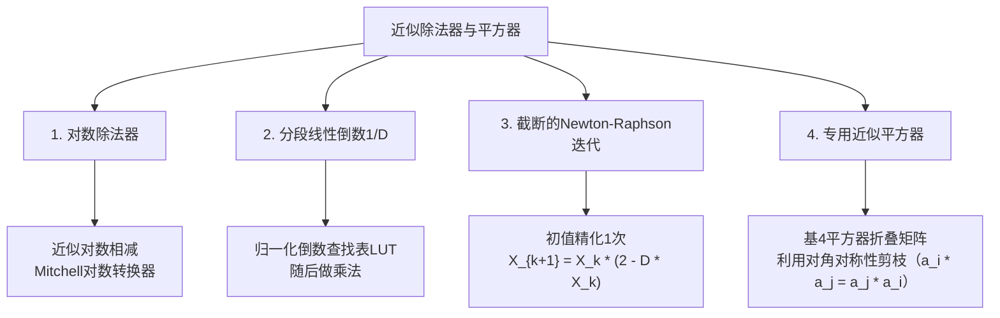

<a id="approximate-dividers-squarers"></a>

# 近似除法器与平方器

除法（$Q=N/D$）可用数位递推、倒数近似或其他架构实现。延迟取决于字长、基数和流水线配置；精确算术没有统一的周期数。下文的平方（$X^2$）与开平方（$\sqrt X$）是不同运算。

<strong>初次阅读？</strong> 你需要掌握分数、百分比和2的幂（2、4、8、…以及½、¼、…）。[比特与进位](../start/bits-and-carry.md)可帮助理解二进制，[如何衡量计算误差？](../fundamentals/error-metrics-made-easy.md)介绍相对误差。入门部分从“除法就是分组”讲到“低成本除法器在哪个环节引入近似”。标有“参考”或“深入阅读”的内容是本页原有的技术参考部分，初读时可以跳过。

<strong>读完入门部分，你将能够：</strong>

1. 用分组、乘以倒数、以2的幂缩放除数三种方式计算12 ÷ 3；
2. 读表判断倒数的直线近似在哪些位置精确，在哪些位置误差最大；
3. 区分三对概念：对数误差与商的误差、平方与开平方、硬件表格与任务质量。

<a id="div-start"></a>

<a id="start-here-12-3-three-ways"></a>

## 从三种方法计算12 ÷ 3开始

<strong>1. 分组。</strong> 12 ÷ 3问的是12中有几组3。不断减去3：12 → 9 → 6 → 3 → 0。减了四次，因此商为4。精确硬件除法器细化了这一思路：每步根据剩余量产生一个或多个商数位（见[数位递推部分](#digit-recurrence-division)）。各步相互依赖，所以除法延迟常大于加法或乘法；实际比较仍取决于架构和实现。

<strong>2. 乘以倒数。</strong> 除以3等于乘以\(1/3\)：12 × 0.333… = 4。如果电路能快速产生\(1/D\)，再做一次乘法即可完成除法。

<strong>3. 用2的幂缩放除数。</strong> 存储所有可能D的\(1/D\)所需容量过大。但任意正数D都可写成2的幂乘以1到2之间的数d：

\[3 = 2^1 \times 1.5, \qquad \frac{1}{3} = 2^{-1} \times \frac{1}{1.5}.\]

乘以\(2^{-1}\)可通过移位缩放二进制数。在本例的算术模型中它是精确的；有限位宽实现必须规定丢弃位和舍入规则。因此电路只需处理d从1到2（不含2）的\(1/d\)。这里d = 1.5，且\(1/1.5 = 2/3 \approx 0.6667\)；于是\(12 \times 2^{-1} \times (2/3) = 4\)。显示的小数经过舍入，不能作为分数的精确替代。

<a id="div-line"></a>

<a id="a-straight-line-instead-of-a-curve"></a>

## 用直线代替曲线

d从1到2时，\(1/d\)的图像是一条从1降至0.5的曲线。低成本电路用直线\(a\,d + b\)替代它，只需一次乘法和一次加法。最简单的直线连接曲线两端：\(1.5 - 0.5\,d\)。若在1.5处分段，用两条较短的直线连接曲线上对应点，就能更贴近原曲线。

<strong>先预测：</strong> 单条直线在哪些位置精确，在哪个位置距曲线最远？

<details markdown="1">
<summary>核对表格</summary>

这里的相对误差为（直线值 − 真值）÷ 真值，只针对倒数本身：

| d | 真值\(1/d\) | 单条直线\(1.5-0.5d\) | 相对误差 | 两条直线（在1.5处分段） | 相对误差 |
|---:|---:|---:|---:|---:|---:|
| 1.00 | 1.0000 | 1.0000 | 0% | 1.0000 | 0% |
| 1.25 | 0.8000 | 0.8750 | +9.38% | 0.8333 | +4.17% |
| 1.50 | 0.6667 | 0.7500 | +12.5% | 0.6667 | 0% |
| 1.75 | 0.5714 | 0.6250 | +9.38% | 0.5833 | +2.08% |

近似<strong>只出现在一个位置</strong>：d的倒数。在此模型中，2的幂移位以及乘以12均精确。直线接触曲线处精确（端点，以及两段情形的分界点），二者之间误差最大。这里直线在曲线上方，所以所得商偏大。

</details>

用单条直线时，12 ÷ 3得到\(12 \times 2^{-1} \times 0.75 = 4.5\)，而不是4，相对误差为+12.5%。用两条直线时，d = 1.5恰为分界点，因此精确得到4。分段越多，误差越小，直线系数表也越大。[分段线性倒数部分](#2-piecewise-linear-reciprocal-1d-multiplier-fusion)给出一般形式。

<strong>对数捷径也得到同一条直线。</strong> [Mitchell方法](#mitchells-base-2-logarithmic-approximation)将\(\log_2(1+x)\)替换为\(x\)。对8 ÷ 3（N = 8 = \(2^3 \times 1\)，D = 3 = \(2^1 \times 1.5\)），得到\(2^{3-1} \times 0.75 = 3\)，精确商则为2.667：误差+12.5%，是[Mitchell误差表](#mitchell-relative-error)中的最坏情况。对12 ÷ 3，N、D具有相同的尾数1.5，Mitchell结果恰为4。

<a id="div-pairs"></a>

<a id="three-pairs-not-to-mix-up"></a>

### 三对不能混淆的概念

- <strong>对数误差与商的误差。</strong> Mitchell方法的最大<strong>对数</strong>误差约为0.086，是对数值的绝对差；最大<strong>商</strong>误差为12.5%，是结果的相对误差。这是不同的量，也都不能原样套用到经过校正或舍入的除法器。
- <strong>平方与开平方。</strong> 平方器计算\(X^2\)（3 → 9）；开平方计算\(\sqrt X\)（9 → 3）。[近似平方器](#3-dedicated-approximate-squarers-x2)利用平方展开中重复的交叉项减少计算，与除法无关。
- <strong>硬件表格与任务质量。</strong> [文献中的除法器比较](#published-divider-comparison)包含AAXD-6、AAXD-10等设计，报告特定条件下的综合延迟、面积、功率，以及指定输入域上的平均相对误差距离（Mean Relative Error Distance，MRED）。图像质量结果来自另一项应用实验：在将前景对象与背景分开的前景提取任务中测量峰值信噪比（Peak Signal-to-Noise Ratio，PSNR）。两者不能相互预测。

<a id="check-your-understanding"></a>

### 检查你的理解

先在纸上作答，再展开核对。答案不会被保存或发送到任何地方。

<a id="div-q1"></a>

<strong>问题DIV-1。</strong> 将5写成\(2^e \times d\)，其中d从1到2。用单段倒数近似\(1.5 - 0.5d\)计算20 ÷ 5，会得到多少，相对误差是多少？

<a id="div-q2"></a>

<strong>问题DIV-2。</strong> 一位同学说：“Mitchell的最大误差是0.086，所以Mitchell除法器的误差绝不超过8.6%。”这句话错在哪里？

<a id="div-q3"></a>

<strong>问题DIV-3。</strong> 文献表中AAXD-6的功率低于AAXD-10。由此能判断哪个设计的前景提取图像质量更好吗？

<details markdown="1">
<summary>核对问题DIV-1至DIV-3</summary>

<strong>DIV-1。</strong> 5 = \(2^2 \times 1.25\)。直线给出\(1.5 - 0.625 = 0.875\)，因此\(1/5 \approx 0.875 / 4 = 0.21875\)，20 ÷ 5 ≈ 20 × 0.21875 = 4.375。精确结果为4，相对误差为+9.375%（对应表中d = 1.25的一行）。

- 忘记\(2^{-2}\)移位会得到17.5：直线只近似d的倒数，不包含2的幂缩放。

<strong>DIV-2。</strong> 0.086是最大的<strong>对数绝对误差</strong>，不是商的百分比误差。未校正Mitchell除法器的最大商相对误差为12.5%（例如8 ÷ 3得到3）。

<strong>DIV-3。</strong> 不能。功率来自28 nm、1 V、25 °C、200 MHz和随机输入条件下的综合及功率估计。MRED来自独立的穷举误差分析；26.42 dB的PSNR仅针对另一项应用实验中的AAXD-10。功率更低而MRED更高（6.61%与1.52%）说明存在取舍，不能作为图像质量结论。

</details>

---

<a id="going-deeper"></a>

## 深入阅读

以下是本页原有的参考内容，回答前面的题目不需要用到它们。

- [数位递推除法](#digit-recurrence-division)与[近似除法器分类](#comprehensive-approximate-divider-taxonomy)
- [对数除法器](#1-logarithmic-dividers)，包括[Mitchell近似](#mitchells-base-2-logarithmic-approximation)和[Mitchell相对误差表](#mitchell-relative-error)
- [分段线性倒数与Newton–Raphson精化](#2-piecewise-linear-reciprocal-1d-multiplier-fusion)
- [专用近似平方器](#3-dedicated-approximate-squarers-x2)
- [文献中的除法器比较（AAXD）](#published-divider-comparison)与[原始文献](#primary-literature-ieee-citations)

---

<a id="digit-recurrence-division"></a>

## 🔬 数位递推除法
对于归一化的基$r$数位递推（digit recurrence），

$$R_{j+1}=rR_j-q_{j+1}D.$$

基2每步产生一个商数位；更高基数每步产生更多商比特。数位选择使用当前部分余数和除数，不要求预先知道下一步余数。各级存在依赖，但可在空间展开硬件中展开并流水化。延迟与相邻结果之间的间隔是不同指标；精确流水线除法器配置见AMD PG151第2章第10页。

---

<a id="comprehensive-approximate-divider-taxonomy"></a>

## 🏛️ 近似除法器分类总览



---

<a id="1-logarithmic-dividers"></a>

## 📈 1. 对数除法器

对于$N>0$和$D>0$，可用对数相减表示除法：

$$\frac{N}{D} = 2^{\log_2(N) - \log_2(D)}$$

```
操作数N ---> [ 前导1检测器 ] ---> Log2(N) ---\
                                                  (-) ---> 差值 ---> [ 反对数转换器 ] ---> 商Q*
操作数D ---> [ 前导1检测器 ] ---> Log2(D) ---/
```

<a id="mitchells-base-2-logarithmic-approximation"></a>

### Mitchell以2为底的对数近似
任意正二进制整数$X$可由最高非零位（前导1位置$k$）及小数部分$x \in [0, 1)$表示：

$$X = 2^k (1 + x)$$

$$\log_2(X) = k + \log_2(1 + x) \approx k + x \quad (\text{using the linear approximation } \log_2(1+x) \approx x)$$

<a id="error-curve-correction"></a>

### 误差曲线与校正
对数域误差$E(x)=\log_2(1+x)-x$在$x=1/\ln2-1\approx0.442695$处取得最大值$E_{\max}\approx0.0860713$。这是对数的绝对误差，不是商的相对误差。除法器的相对误差还取决于两个操作数、近似反对数转换、校正及输出量化。不能仅凭通用的两段对数校正，就定义LEAD这样的具名除法器。

<a id="mitchell-relative-error"></a>

对于正操作数、实数尾数$x_1,x_2\in[0,1)$、分段线性反对数且无输出量化的<strong>未校正</strong>Mitchell模型，误差界不同：

| 运算 | 最大相对误差 | 方向 | 达到该值的尾数 |
|---|---:|---|---|
| 乘法 | $1/9\approx11.11\%$ | 偏小 | $x_1=x_2=1/2$ |
| 除法 | $1/8=12.5\%$ | 偏大 | $x_1=0,\ x_2=1/2$ |

乘法的近似尾数乘积为$1+x_1+x_2$（当$x_1+x_2<1$），否则为$2(x_1+x_2)$。除法中为$1+x_1-x_2$（当$x_1\ge x_2$），否则为$(2+x_1-x_2)/2$。分别与$(1+x_1)(1+x_2)$及$(1+x_1)/(1+x_2)$比较可得上面的界；2的幂因子在相对误差中约去。这些算术误差界不同于对数误差值0.0860713，也不能原样套用到校正或量化的除法器。

单独处理$N=0$，并在对数转换前拒绝$D=0$。整数除法必须规定输出规则（例如对非负近似实数商向下取整）及输出位宽；有符号除法和浮点特殊值还需要额外规格约定。

---

<a id="2-piecewise-linear-reciprocal-1d-multiplier-fusion"></a>

## ⚡ 2. 分段线性倒数（$1/D$）与乘法器融合

该架构将除法拆成先产生倒数、再做一次乘法，而不是逐步计算$N/D$：

$$\frac{N}{D} = N \times \left(\frac{1}{D}\right)$$

```
除数D ---> [ 范围归一化器 ] ---> [ 分段线性查找表LUT（a_k, b_k） ] ---> 倒数（1/D）
                                                                                       |
被除数N ------------------------------------------------------------------> [ 乘法器 ] ---> 商Q*
```

将除数归一化为$D=2^e d$，其中$d\in[1,2)$。划分这一归一化区间，在各子区间近似$1/d$：

$$1/D\approx2^{-e}(a_j d+b_j).$$

在$c_j>0$附近的Taylor近似使用$a_j=-1/c_j^2$及$b_j=2/c_j$。也可选择插值，其系数不同。查找表（Look-Up Table，LUT）大小取决于区间数、系数精度和实现。

对Newton–Raphson倒数精化，在精确算术中由$x_{j+1}=x_j(2-Dx_j)$及$e_j=1-Dx_j$可得$e_{j+1}=e_j^2$。收敛要求$|e_0|<1$；截断和有限精度会改变该递推，也可能使精度无法继续改善。

---

<a id="3-dedicated-approximate-squarers-x2"></a>

## 🎯 3. 专用近似平方器（$X^2$）

对于无符号$N$比特数$A = \sum_{i=0}^{N-1} A_i 2^i$，专用平方器可利用对角线外对称部分积相同这一性质。精确结果最多需要$2N$比特：

$$A^2 = \left(\sum_{i=0}^{N-1} A_i 2^i\right)^2 = \sum_{i=0}^{N-1} A_i 2^{2i} + 2 \sum_{i=0}^{N-2} \sum_{j=i+1}^{N-1} A_i A_j 2^{i+j}$$

```
              精确乘法器阵列                       剪枝后的近似平方器
           A3   A2   A1   A0                        A3   A2   A1   A0
        x  A3   A2   A1   A0                     -----------------------------
        --------------------                     [ A3 ] [ A2 ] [ A1 ] [ A0 ]（对角项）
        a0a3 a0a2 a0a1 a0a0                       + 合并对称的非对角项
        a1a3 a1a2 a1a1 a1a0                       + 剪枝／截断低有效位！
        a2a3 a2a2 a2a1 a2a0                      -----------------------------
        a3a3 a3a2 a3a1 a3a0                      -> 合并部分积；节省量取决于实现
```

- <strong>对角项</strong>：任意二进制位均满足$A_i^2 = A_i$，其中$A_i \in \{0, 1\}$，因此对角乘积不需要与门。
- <strong>非对角项对称性</strong>：$A_i A_j$与$A_j A_i$相同；将它们合并为$(A_i A_j) \cdot 2^{i+j+1}$后，仅需$N(N-1)/2$个不同的非对角与运算乘积，取代$N^2$个阵列乘积，对角项则直接用连线提供；这一计数不是总电路面积。
- <strong>剪枝</strong>：近似平方器可丢弃低位权项或用补偿替代。截断位置是设计选择；仅丢弃无符号正项会使结果偏小，补偿则可能改变误差符号。

---

<a id="comparing-divider-implementations"></a>

## 📊 除法器实现比较
<a id="published-divider-comparison"></a>

Jiang等人将无符号<strong>16/8比特</strong>自适应近似除法器（Adaptive Approximate Divider，AAXD）与精确恢复余数阵列除法器EXDr比较。表III采用<strong>ST 28 nm、1 V、25 °C</strong>条件：延迟和面积来自Synopsys Design Compiler，PrimeTime-PX在<strong>200 MHz、五百万组随机输入</strong>下估计功率。这些是综合与功率估计结果，不是已制造芯片的测量值。

| 除法器 | 延迟（ns） | 面积（µm²） | 功率（µW） | 功率延迟积PDP（fJ，文献值） |
|---|---:|---:|---:|---:|
| EXDr | 4.71 | 285.8 | 128.00 | 602.88 |
| AAXD-6 | 1.86 | 175.4 | 43.67 | 81.23 |
| AAXD-8 | 2.59 | 231.4 | 61.82 | 160.11 |
| AAXD-10 | 3.46 | 294.9 | 84.31 | 291.71 |

后缀表示剪枝后的被除数位宽。表II另给出AAXD-6/8/10的MRED为6.61%、3.12%、1.52%，使用$[0,65535]\times[1,255]$中满足精确除法器无溢出条件$\lfloor N/256\rfloor<D$的全部有效被除数／除数对。这些误差统计不基于功率估计样本。PDP的单位换算为$\mathrm{ns}\cdot\mu\mathrm{W}=\mathrm{fJ}$；它是功率与关键路径延迟的乘积，不是200 MHz下每个输出的实测能耗。[Jiang等人，第III节，表II–III](https://www.ece.ualberta.ca/~jhan8/publications/517_OutputPaper_CameraReady.pdf)。

在另一项前景提取应用仿真中，AAXD-10的PSNR为26.42 dB（第IV-B节）。该图像质量结果使用不同实验方案，并非硬件表中的测量值。表中的原始功率数值优先于摘要中不一致的百分比。比较周期数、级延迟、启动间隔、功率及每个结果的能耗，应在兼容的时序约束和工作负载下进行。

---

<a id="primary-literature-ieee-citations"></a>

## 📚 原始文献与IEEE引用

- Omkar G. Ratnaparkhi, Madhav Rao, *"LEAD: Logarithmic Exponent Approximate Divider For Image Quantization Application"*, Proceedings of the Great Lakes Symposium on VLSI 2022, 2022. [出版方记录](https://doi.org/10.1145/3526241.3530323).

- K J N S Bhargav, Sairam Palisetti, Madhav Rao, *"A newton raphson method based approximate divider design for color quantization application"*, 2021 18th International SoC Design Conference (ISOCC), 2021. [出版方记录](https://doi.org/10.1109/isocc53507.2021.9613961).

- Honglan Jiang, Leibo Liu, Fabrizio Lombardi, Jie Han, *"Adaptive approximation in arithmetic circuits: A low-power unsigned divider design"*, 2018 Design, Automation &amp; Test in Europe Conference &amp; Exhibition (DATE), 2018. [出版方记录](https://doi.org/10.23919/date.2018.8342233).

- Satyendra R. Datla, Mitchell A. Thornton, David W. Matula, *"A Low Power High Performance Radix-4 Approximate Squaring Circuit"*, 2009 20th IEEE International Conference on Application-specific Systems, Architectures and Processors, 2009. [出版方记录](https://doi.org/10.1109/asap.2009.35).

- Ke Chen, Chenyu Xu, Haroon Waris, Weiqiang Liu, Paolo Montuschi, Fabrizio Lombardi, *"Exact and Approximate Squarers for Error-Tolerant Applications"*, IEEE Transactions on Computers, 2022. [出版方记录](https://doi.org/10.1109/tc.2022.3228592).

- John N. Mitchell, *"Computer Multiplication and Division Using Binary Logarithms"*, IEEE Transactions on Electronic Computers, 1962. [出版方记录](https://doi.org/10.1109/TEC.1962.5219391).

- AMD, *Divider Generator v5.1 Product Guide (PG151)*, 2021年2月4日，第2章，第10页。 [官方指南](https://docs.amd.com/v/u/en-US/pg151-div-gen).
