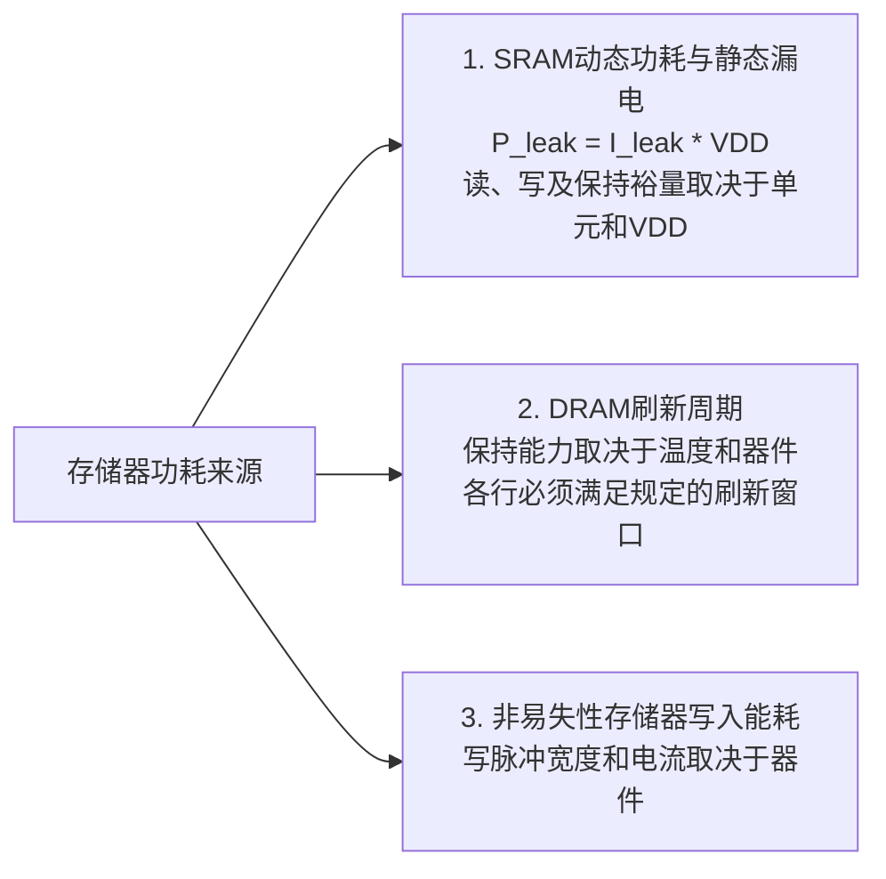

<a id="approximate-memory-storage-architectures"></a>

# 近似存储器与存储架构

存储器访问和刷新都会消耗系统能量。两者所占比例取决于架构、工作负载和测量边界；GPU、片上系统（System on Chip，SoC）或人工智能（Artificial Intelligence，AI）处理器不存在通用的存储器能耗占比。

近似存储器（approximate memory）允许选定数据出现经过应用验证的错误，以换取可能的能耗或性能收益，从而放宽传统上所有比特都要达到$100\%$保持正确的要求。硬件故障率和应用质量都必须评估。

<strong>初次阅读？</strong> 你需要[比特与进位](../start/bits-and-carry.md)中的二进制位权知识，以及百分比。不要求电子学基础；下文会解释所需术语。入门部分从“存储器保存比特”讲到“哪些数据可以放进偶尔发生比特翻转的存储器，以及已发表的刷新研究实际测量了什么”。标为“深入阅读”的部分是本页原有技术参考内容，第一次阅读时可以跳过。

<strong>读完入门部分，你将能够：</strong>

1. 解释存储器如何保存比特，以及为什么动态随机存取存储器（Dynamic Random-Access Memory，DRAM）需要刷新，而静态随机存取存储器（Static Random-Access Memory，SRAM）不需要；
2. 根据位权判断：像素值和指针中的比特翻转，哪一种影响更大；
3. 带着条件解读刷新结果：刷新窗口不同于命令间隔，刷新次数减少的百分比不同于总能耗下降的百分比，错误率也不是质量保证。

<a id="mem-start"></a>

<a id="start-here-one-video-frame-two-kinds-of-data"></a>

## 从这里开始：一帧视频，两类数据

视频播放器把当前帧保存在存储器中。以一帧640 × 480像素的小幅灰度图像为例，每个像素占一个字节（8比特，亮度0–255）：共307,200字节，即2,457,600比特。播放器还保存<strong>指针（pointer）</strong>：说明某项内容存放在存储器中哪个位置的数，例如“这一帧从地址4096开始”，用十六进制写为`0x1000`。

现在假设一个已存储的比特从0翻转为1，或从1翻转为0。

<strong>先预测：</strong> 像素和指针中的比特翻转，哪一种危害更大？

<details markdown="1">
<summary>核对三种翻转</summary>

| 存储值 | 翻转的比特（位权） | 新值 | 影响 |
|---|---|---|---|
| 像素200 = `11001000` | 最低位（1） | 201 | 一个像素在255级范围内变亮1级；不易看出 |
| 像素200 = `11001000` | 最高位（128） | 72 | 这一帧中出现一个明显的暗点 |
| 指针`0x1000`（4096） | 位权为16的比特 | `0x1010`（4112） | 程序从错误位置读取：读到错误数据或崩溃，之后每次使用该指针都会出错 |

一个像素只是307,200个像素中的一个，下一帧还会覆盖它；指针则决定其他内容从哪里读取。即使在同一个像素中，比特的位权也很重要。因此，“哪些数据能容忍错误”同时取决于数据的用途和翻转的是哪些比特，仍需在应用中验证结果。

</details>

<a id="bits-reading-and-writing-sram-and-dram"></a>

### 比特、读写，以及SRAM和DRAM

存储器是由大量<strong>存储单元（cell）</strong>构成的阵列，每个单元保存一个比特。写入设置单元的值；读取感知它保存的值。这里涉及两类存储器：

- <strong>SRAM</strong>用一个由少量晶体管（通常六个）构成的反馈环保存每个比特，只要持续供电，就能保持数值。它速度快，常用于高速缓存。降低供电电压可以节能，但也可能使部分读写失败。
- <strong>DRAM</strong>用微小电容上的电荷保存每个比特。电荷会泄漏，因此必须在丢失过多之前读出并写回每一行单元，这就是<strong>刷新（refresh）</strong>。DRAM用于主存。

<a id="refresh-window-commands-and-what-a-saving-means"></a>

### 刷新：窗口、命令，以及节省量的含义

<strong>刷新窗口（refresh window）</strong>是所有行都必须完成一次刷新的时间范围。下文研究中的DDR3器件，在低于85 °C时采用64 ms。存储控制器不会同时刷新全部行，而是在窗口内分散发送许多刷新<strong>命令</strong>，每条命令覆盖部分行。举一个虚构的小例子：芯片有8组行、窗口为64 ms，那么可以每8 ms接收一条命令。窗口（64 ms）和命令间隔（此处为8 ms）是两个不同的数。

把窗口从64 ms延长到256 ms，即变为原来的4倍，每秒完整刷新轮数就从15.6降到3.9：理想模型中的<strong>刷新操作减少75%</strong>。存储器能耗不会因此下降75%，因为读写和背景功耗仍然存在。下文RAIDR仿真中，刷新操作减少74.6%，而正常温度范围下每次DRAM访问的能耗下降8.3%。

窗口延长会让保持能力较弱的单元丢失数据。Flikker模型的输入数据（表1，48 °C，引自更早的研究）给出：刷新周期为1 s时，每比特错误率为\(4.0\times10^{-8}\)；20 s时为\(1.3\times10^{-4}\)。如果这一帧的每个比特都以该概率独立出错，那么平均约有0.1和320个比特翻转。这一“如果”是很强的假设：真实故障集中在弱单元，依赖温度和数据模式，还随时间变化。平均数量也没有说明翻转的是哪些位：320个最低位几乎不可见，320个最高位会形成可见斑点，而一个指针比特就可能使程序崩溃。

<strong>保护也有边界。</strong> 常见的<strong>单错纠正、双错检测（Single-Error Correction, Double-Error Detection，SEC–DED）</strong>纠错码，能够在每个受保护的比特块（码字）内纠正一个翻转、检测两个翻转。同一码字中出现三个或更多翻转时，可能漏检或误纠正。它在自身假设成立时降低风险，不能使存储器完全无错。

<a id="check-your-understanding"></a>

### 检查你的理解

先在纸上作答，再展开核对。答案不会被保存或发送到任何地方。

<a id="mem-q1"></a>

<strong>问题MEM-1。</strong> 像素值200 = `11001000`中，位权为64的比特发生翻转。新值是多少？这种变化比最低位翻转更大还是更小？

<a id="mem-q2"></a>

<strong>问题MEM-2。</strong> 某设计把刷新窗口从64 ms加倍到128 ms。在理想模型中，刷新操作次数减少多少？DRAM能耗会下降相同的百分比吗？

<a id="mem-q3"></a>

<strong>问题MEM-3。</strong> “指针表有SEC–DED保护，所以可以安全地放入低刷新频率区域。”这句话哪里有问题？

<details markdown="1">
<summary>核对问题MEM-1至MEM-3</summary>

<strong>MEM-1。</strong> 位权为64的比特原本为1，翻转后为0：200 − 64 = 136。变化量为64，远大于最低位翻转产生的1。

- 此处不能加64得到264：把1翻转为0会减去其位权，而且8比特数不能超过255。

<strong>MEM-2。</strong> 每秒刷新轮数减半（15.6 → 7.8），因此理想模型中刷新操作减少50%。DRAM能耗降幅更小，因为刷新只是能耗的一部分；RAIDR正常温度范围仿真中，刷新次数减少74.6%，每次访问能耗下降8.3%。

<strong>MEM-3。</strong> SEC–DED每个码字只能纠正一个翻转、检测两个；更多翻转可能漏检或误纠正，降低刷新频率又会增加翻转的可能。指针必须保持正确，因此应放在按正常频率刷新的存储器中。Flikker正是出于这一原因，让关键数据保持正常刷新频率。

</details>

---

<a id="going-deeper"></a>

## 深入阅读

以下是本页原有的参考内容，回答前面的题目不需要用到它们。

- [存储器功耗的物理来源](#the-physical-drivers-of-memory-power)
- [近似SRAM与降压缓存](#1-approximate-sram-voltage-scaled-caches)，包括6T单元和[静态噪声容限](#static-noise-margin-snm-near-threshold-operation)
- [放宽刷新要求的DRAM](#2-refresh-relaxed-dram-video-buffers)、[放宽刷新带来的能耗收益](#energy-savings-via-relaxed-refresh)，以及[已发表的RAIDR和Flikker研究及其条件](#published-refresh-studies)
- [质量感知的虚拟内存分页](#3-quality-aware-virtual-memory-paging)、[测量条件](#measurement-conditions)和[原始文献](#primary-literature-ieee-citations)

---

<a id="the-physical-drivers-of-memory-power"></a>

## 🔋 存储器功耗的物理来源



---

<a id="1-approximate-sram-voltage-scaled-caches"></a>

## 🔬 1. 近似SRAM与降压缓存

传统缓存可以采用<strong>六晶体管（6-Transistor，6T）SRAM单元</strong>，由两个交叉耦合的CMOS反相器和两个访问传输晶体管构成：

```
        VDD                 VDD
         |                   |
       [PMOS]              [PMOS]
         |                   |
BL ----[NMOS]-- Q <-----> ~Q --[NMOS]---- ~BL
 (WL)    |                   |     (WL)
       [NMOS]              [NMOS]
         |                   |
        GND                 GND
```

<a id="static-noise-margin-snm-near-threshold-operation"></a>

### 静态噪声容限与近阈值工作
SRAM的保持稳定性、读取稳定性和写入能力取决于单元设计、供电电压、工艺偏差、时序和温度。<strong>静态噪声容限（Static Noise Margin，SNM）</strong>描述静态稳定性，单凭它无法建立涵盖全部读、写、保持或瞬态故障的模型。降低供电电压可能增加访问失败，故障位置也未必表现为独立随机翻转。

当开关电容和活动保持不变时，动态开关能量满足$E_{\mathrm{dyn}}\propto CV_{DD}^2$。单凭这一关系，既无法预测缓存总能耗，也无法预测漏电：漏电流取决于晶体管偏置、工艺和温度，降压还会改变延迟。电压与比特错误率（Bit Error Rate，BER）的模型需要实测或校准的器件统计数据，不能套用通用指数规律。

近似SRAM必须评估电压、错误位置与模式、存储比特的重要性、工作负载和端到端质量。

---

<a id="2-refresh-relaxed-dram-video-buffers"></a>

## ⏳ 2. 放宽刷新要求的DRAM与视频缓冲区

传统DRAM用1T–1C单元存储数据。数据保持能力受漏电、温度、存储数据模式和可变保持时间影响。电阻$R$恒定的等效电路给出以下示意关系：

$$Q(t)=Q_0\exp[-t/(R_{\mathrm{leak}}C_{\mathrm{cell}})],$$

但它不是经过校准的DRAM保持时间分布或BER模型。当电荷对应的信号不再满足读取裕量时，感测就会失败，无需等到电荷归零。

Liu等人讨论的DDR3器件（2013年，§2.2），在低于85°C时刷新窗口为64 ms。窗口是所有相关行都要完成一次刷新的时间段，不是各条刷新命令之间的间隔。必须查阅具体器件规格，确认温度范围和刷新要求，不能把这个值推广到所有DRAM代际或刷新模式。同一研究还发现数据模式相关性和随时间变化的保持能力，因此一次性的弱单元画像不能证明某个放宽后的间隔普遍安全。

<a id="energy-savings-via-relaxed-refresh"></a>

### 放宽刷新带来的能耗收益
在刷新单次开销固定的理想模型中，把刷新窗口从$T$变为$4T$，会让刷新命令频率及刷新本身的平均功率分量降低75%。这是计算得到的频率比例，不是总待机功耗、DRAM总能耗或应用加速比的测量结果。背景功耗和读写功耗仍然存在，还必须计入额外缓解措施的成本。

在规格规定的条件之外放宽刷新可能破坏数据。产生的BER取决于器件、温度、间隔、数据模式和经过的时间；某种错误模式是否可容忍，取决于工作负载和比特的重要性。较小的平均BER不能保证视频中的变化不可察觉，也不能保证神经网络准确率不变。

<a id="published-refresh-studies"></a>

<a id="published-refresh-studies-different-models-and-boundaries"></a>

### 已发表的刷新研究：模型和测量边界各不相同

<strong>RAIDR</strong>按照保持时间对行分组。Liu等人（2012年，[§5–6、表1及图6–8](https://users.ece.cmu.edu/~omutlu/pub/raidr-dram-refresh_isca12.pdf)）仿真了一个8核、4 GHz系统，配备32 GB DDR3-1333，使用SPEC CPU2006和TPC-C/H工作负载。其周期级DRAM模型与DRAMsim2进行了对照核验。下表比较相同温度下的双组RAIDR配置与自动刷新；这些是仿真结果，不是芯片测量结果。

| RAIDR指标 | 正常温度范围 | 扩展温度范围 |
| :--- | ---: | ---: |
| 刷新操作减少量（图6） | 74.6% | 74.6% |
| 每次已服务访问的DRAM能耗下降量（§6.3，图8） | 8.3% | 16.1% |
| 系统加权加速比提高量（§6.2，图7） | 4.1% | 8.6% |

正常温度范围基准采用64 ms窗口；扩展温度场景将保持时间和刷新间隔减半。§5以每次访问能耗来报告DRAM功耗。刷新次数下降量和每次访问能耗下降量，都不是整个系统的节能比例。

<strong>Flikker</strong>按照关键程度划分应用数据；图2示意阵列的四分之一采用正常刷新，四分之三降低刷新频率。其DRAM总功耗估计结合了自刷新功耗的解析模型和活动模式功耗的仿真。§6.2中20–25%的节省量，适用于论文所评估应用的“crazy”配置；该配置还把栈和关键堆数据置于低刷新频率下，不能据此保证图示受保护分区获得同样收益（[Liu等人，2011年，§3.4及§5–6](https://blogs.ubc.ca/dependablesystemslab/files/2011/01/dram-power-paper.pdf)）。表1在48°C下的错误率来自参考文献[3]，并非新测得的Flikker芯片数据：

| 降低刷新频率后的周期（s） | 每比特错误率（表1） |
| ---: | ---: |
| 1 | $4.0\times10^{-8}$ |
| 2 | $2.6\times10^{-7}$ |
| 5 | $3.8\times10^{-6}$ |
| 10 | $2.0\times10^{-5}$ |
| 20 | $1.3\times10^{-4}$ |

这些是模型输入，不是通用保持曲线；传统周期为64 ms。Flikker估计的DRAM功耗与RAIDR仿真的每次访问能耗，基准和边界不同，不能用同一个百分比标准给两种设计排序。

---

<a id="3-quality-aware-virtual-memory-paging"></a>

## 🏛️ 3. 质量感知的虚拟内存分页

一种拟议的近似存储器设计可以把关键数据与经应用验证可容错的数据分区存放。下图是策略草图，不是标准内存管理单元（Memory Management Unit，MMU）的保证，也不是经过测量的工作点：

```
+-------------------------------------------------------------------------+
|                    质量感知的系统内存空间                               |
+-------------------------------------------------------------------------+
| [ 关键／精确区域 ]                                                      |
| - 存储内容：操作系统内核、CPU栈、指针表、程序代码                         |
| - 硬件策略：规定的电压／刷新；与器件匹配的保护                            |
| - 正确性目标：必须正确；必须处理残余故障                                  |
+-------------------------------------------------------------------------+
| [ 近似／可容错区域 ]                                                    |
| - 存储内容：神经网络激活值、图像／音频缓冲区                              |
| - 硬件策略：经过验证的电压／刷新；必要时选择性保护                         |
| - 正确性目标：已表征故障，且已验证应用质量                                |
+-------------------------------------------------------------------------+
```

---

SEC–DED在码字假设成立时纠正单比特错误、检测双比特错误，不能保证无故障存储。需要数据标注、分配策略和适当的硬件隔离，才能让错误远离控制数据。不能仅因缓冲区被标为“近似”就省略保护。

---

<a id="measurement-conditions"></a>

## 📊 测量条件

SRAM、DRAM和非易失性存储器的测量结果不能互换使用。应报告单元／阵列工艺、电压、温度、访问或保持协议、样本量、数据模式、故障指标和工作负载，以及功率／能量测量边界。前述文献案例区分了仿真、解析估计和实体芯片测量。

---

<a id="primary-literature-ieee-citations"></a>

## 📚 原始文献与IEEE引文

- J. Liu, B. Jaiyen, R. Veras, and O. Mutlu, *"RAIDR: Retention-Aware Intelligent DRAM Refresh"*, ISCA, 2012. [DOI: 10.1109/ISCA.2012.6237001](https://doi.org/10.1109/ISCA.2012.6237001); [作者论文](https://users.ece.cmu.edu/~omutlu/pub/raidr-dram-refresh_isca12.pdf), §5–6及图6–8。
- S. Liu, K. Pattabiraman, T. Moscibroda, and B. G. Zorn, *"Flikker: Saving DRAM Refresh-power through Critical Data Partitioning"*, ASPLOS, 2011, 213–224. [DOI: 10.1145/1950365.1950391](https://doi.org/10.1145/1950365.1950391); [作者托管论文](https://blogs.ubc.ca/dependablesystemslab/files/2011/01/dram-power-paper.pdf), 表1及§3.4、§5–6。
- J. Liu, B. Jaiyen, Y. Kim, C. Wilkerson, and O. Mutlu, *"An Experimental Study of Data Retention Behavior in Modern DRAM Devices: Implications for Retention Time Profiling Mechanisms"*, ISCA, 2013, 60–71. [DOI: 10.1145/2485922.2485928](https://doi.org/10.1145/2485922.2485928); [作者论文](https://users.ece.cmu.edu/~yoonguk/papers/liu-isca13.pdf). §2解释刷新；§4–6介绍受测DDR3器件中的温度影响、数据模式相关性和可变保持时间。
- E. Seevinck, F. J. List, and J. Lohstroh, *"Static-Noise Margin Analysis of MOS SRAM Cells"*, IEEE Journal of Solid-State Circuits, 22(5), 748–754, 1987. [DOI: 10.1109/JSSC.1987.1052809](https://doi.org/10.1109/JSSC.1987.1052809).
