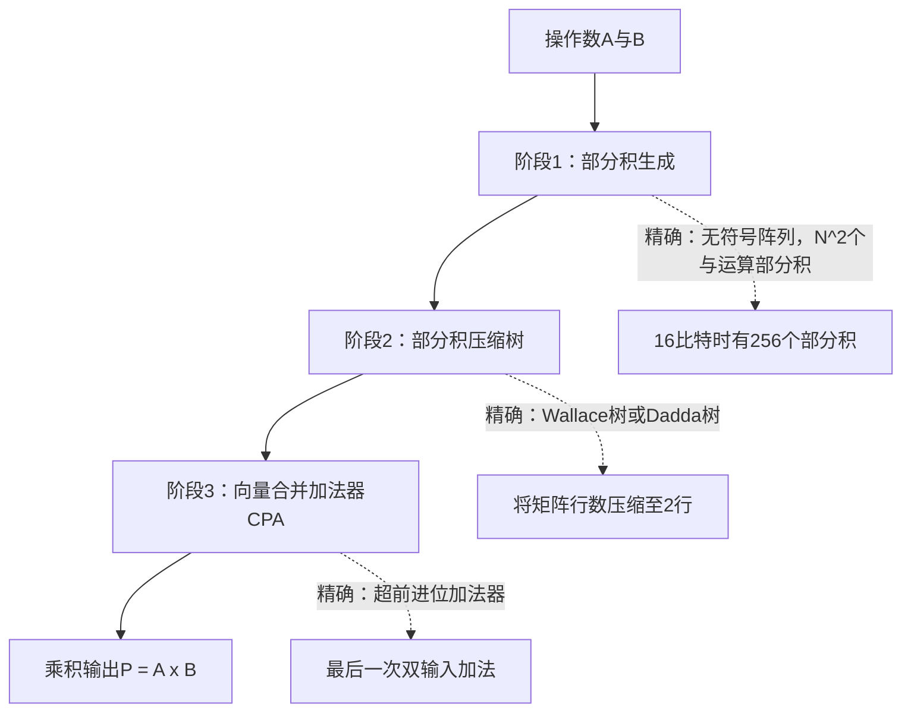
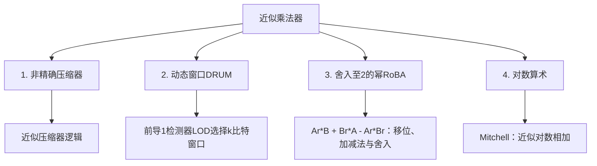

# 近似乘法器分类

乘法器可能占用数字处理器中较多的功耗和面积；具体占比取决于数据通路和工作负载。

本页介绍精确乘法器的结构，以及用数值精度换取实现成本的近似技术。

<strong>初次阅读？</strong> 你需要掌握[比特与进位](../start/bits-and-carry.md)中的二进制位权和进位。[加法器页中或运算与加法的比较](adders.md#read-a01)可作补充。入门部分从二进制加法讲起，说明硬件如何做乘法，以及成本较低的乘法器在哪些环节简化计算。标有“参考”或“深入阅读”的内容是本页原有的技术参考部分，初读时可以跳过。

<strong>读完入门部分，你将能够：</strong>

1. 用4比特二进制按四个硬件步骤计算3 × 5：生成各行、按位权排列、压缩各列、将最后两行相加；
2. 解释全加器如何把同一列的三个比特压成两个，以及4:2压缩器的输出位权为什么是1、2、2；
3. 用较小整数手算列截断、RoBA和DRUM，并区分列截断与清除已完成乘积的低位。

## 从二进制的3 × 5开始

两个数都是<strong>无符号4比特</strong>数：A = 3 = `0011`，B = 5 = `0101`。只需用到两条规则：

- 一个数乘以单个比特，结果要么为0，要么为这个数本身。硬件中，每个比特用一个与门（AND）完成。
- 二进制数向左<strong>移位（shift）</strong>一位，数值翻倍：`0011`（3）变为`0110`（6）；左移两位得到`1100`（12）。

### 第1步：为B的每一位生成一行

| B的比特 | 该比特的位权 | 行（A与该比特做与运算，再按位置移位） | 该行数值 |
|---|---:|---|---:|
| b0 = 1 | 1 | `0011` | 3 |
| b1 = 0 | 2 | `0000`，左移1位 | 0 |
| b2 = 1 | 4 | `0011`左移2位 = `1100` | 12 |
| b3 = 0 | 8 | `0000`，左移3位 | 0 |

这些行中的每个比特都是一个<strong>部分积位（partial-product bit）</strong>\(a_i b_j\)：A的第\(i\)位与B的第\(j\)位做与运算。

### 第2步：按位权排列比特

比特\(a_i b_j\)应放在位权为\(2^{i+j}\)的列中。对于4比特操作数，位权为1、2、4、8、16、32、64的各列分别容纳1、2、3、4、3、2、1个比特。中间列最高；硬件必须先把每列压缩到至多两个比特，再做最后一次加法。

<strong>先预测：</strong> 对于3 × 5，每一列各有几个1？

核对3 × 5的各列

| 列位权 | 列中的比特 | 1的个数 |
|---:|---|---:|
| 64 | 0 | 0 |
| 32 | 0 0 | 0 |
| 16 | 0 0 0 | 0 |
| 8 | 0 1 0 0 | 1 |
| 4 | 1 0 0 | 1 |
| 2 | 0 1 | 1 |
| 1 | 1 | 1 |

位权为1、2、4、8的每列都恰有一个1，因此乘积为`1111` = 15。B中有两个0比特，所以大部分部分积位为0；硬件仍为每个比特保留位置。

### 第3步：将三行压缩成两行

<strong>全加器（Full Adder，FA）</strong>接收<strong>同一列</strong>的三个比特，统计其中1的个数。它把计数写成留在本列的<strong>和位（sum bit）</strong>，以及送往下一列（位权翻倍）的<strong>进位（carry）</strong>：

\[x+y+z = S + 2C.\]

例如，1 + 1 + 1 = 3 = 1 + 2 × 1，因此S = 1、C = 1。3 × 5的位权4列包含0、0、1：S = 1留在位权4列，C = 0送往位权8列。全加器把3个比特变成2个，因此也称为<strong>3:2压缩器（3:2 compressor）</strong>。使用足够多的全加器，就能把每列压到至多两个比特，也就是两行。

<strong>4:2压缩器（4:2 compressor）</strong>处理同一列的四个比特，加上相邻压缩器送来的输入进位\(C_{in}\)。它输出位权为1的和位S，以及位权都为2的C和\(C_{out}\)：

\[x_1+x_2+x_3+x_4+C_{in} = S + 2C + 2C_{out}.\]

四个输入均为1且\(C_{in}=0\)时，计数为4 = 0 + 2 × 1 + 2 × 1。

### 第4步：做最后一次加法

最后两行由普通的带进位加法器相加，其类型见[加法器页](adders.md)。3 × 5的结果为`1111` = 15。

近似乘法器通过改变某个步骤减少计算：少生成一些比特（截断），在生成前改变操作数（RoBA、DRUM），或以非精确方式统计一列的值（近似压缩器）。

## 用较小整数比较三种低成本规则

下方实验将这三种规则用于<strong>1至255的无符号8比特操作数</strong>。其中<strong>相对误差距离（Relative Error Distance，RED）</strong>是对单个操作数对计算的|近似结果 − 精确结果| ÷ 精确结果；输入不允许为0，因此精确结果始终非零。

<strong>列截断（column truncation，无校正）。</strong> 不生成最低四列的比特（位权为1、2、4、8，即\(i+j<4\)）。对于3 × 5，四个1都在这些列中，因此输出为0，RED为100%。这与先算出精确乘积、再清除其低4位<strong>不同</strong>：

| 7 × 7（精确值49 = `110001`） | 结果 | 原因 |
|---|---:|---|
| 列截断（不生成位权1–8的各列） | 16 | 低位列中的八个1（总值33）在进位到达位权16和32之前就被丢弃 |
| 先算精确乘积，再清除结果的低4位 | 48 | 只丢失最终位权为1的比特 |

<strong>基于舍入的乘法器（Rounding-Based Multiplier，RoBA）。</strong> 按<strong>数值距离</strong>将操作数舍入到最近的2的幂：5 → 4；3恰在2与4的中点，按论文规则舍入为2。然后计算\(A_r B + B_r A - A_r B_r\)；由于\(A_r\)与\(B_r\)都是2的幂，只需移位和加法：2 × 5 + 4 × 3 − 2 × 4 = 14。误差为\(-(A_r-A)(B_r-B) = -(2-3)(4-5) = -1\)。

<strong>动态范围无偏乘法器（Dynamic Range Unbiased Multiplier，DRUM）的DRUM-4版本。</strong> 从每个操作数的前导1开始保留4比特窗口。如果丢弃了更低位，就将窗口最低位置为1，再将乘积移回对应位置。3和5都能装进4位，所以DRUM-4精确输出15。A = 25 = `11001`（5位）时，窗口为`1100`；最低位置1后为`1101` = 13，代表13 × 2 = 26。因此25 × 3变成26 × 3 = 78，精确乘积则为75。如果没有强制置1，窗口代表24，结果为72。强制置1使误差既可能向上也可能向下；这是DRUM的设计目标，并非对每种工作负载的保证。

| 规则 | 3 × 5（精确值15） | 25 × 3（精确值75） | 改变的步骤 |
|---|---:|---:|---|
| 列截断 | 0（RED 100%） | 64（RED 14.67%） | 第1步：生成更少比特 |
| RoBA | 14（RED 6.67%） | 82（RED 9.33%） | 第1步之前：舍入操作数 |
| DRUM-4 | 15（RED 0%） | 78（RED 4.00%） | 第1步之前：截取较短的操作数窗口 |

一个操作数对只能说明会出现误差，不能说明出错频率。实验的穷举统计覆盖全部65,025个操作数对。这些数值都不能说明面积或能耗。

<strong>下一步：</strong> 下方的一般N比特结构是参考内容，可[直接进入实验任务](#mul-lab)。

---

## 🔬 硬件乘法器的组成

*参考（初读可跳过）：将上述四步推广到一般N比特情况。第1、2步合称“部分积生成”；Booth编码以及Wallace树、Dadda树分别是第1步和第3步的进阶实现方法。可[直接进入实验任务](#mul-lab)。*

硬件计算两个$N$比特无符号二进制数（$A = \sum_{i=0}^{N-1} a_i 2^i$和$B = \sum_{j=0}^{N-1} b_j 2^j$）的乘积时，可分为三个逻辑阶段（不必为各阶段单独设置流水线）：

### 阶段1：部分积生成（Partial Product Generation，PPG）
- <strong>标准阵列</strong>：用简单的与门`AND`生成$N \times N$比特矩阵（$16 \times 16 = 256$比特），其中$p_{i,j} = a_i \cdot b_j$。
- <strong>基4改进Booth编码（Modified Booth Encoding，MBE）</strong>：每组三个乘数比特$(b_{2i+1}, b_{2i}, b_{2i-1})$编码倍数$\{0, \pm 1A, \pm 2A\}$，将有符号操作数的主要部分积行数减少到约$\lceil N/2\rceil$；无符号操作数需要补零扩展，可能还需额外一行。此外还需要符号扩展位和校正位。

### 阶段2：部分积压缩（Partial Product Reduction，PPR）
高的部分积矩阵通过多层<strong>全加器（3:2压缩器）</strong>和<strong>4:2压缩器</strong>压缩到仅剩两行：

- <strong>Wallace树</strong>：每级都尽可能充分压缩，以尽量减少总层数（$\mathcal{O}(\log_{1.5} N)$）。
- <strong>Dadda树</strong>：推迟压缩，以尽量减少所需全加器总数，从而节省硅面积。

### 阶段3：向量合并（最终CPA）
最后两行由高速<strong>进位传播加法器（Carry-Propagate Adder，CPA）</strong>相加，例如Kogge-Stone或超前进位加法器，得到最终的$2N$比特乘积。

---

## 🎛️ 交互实验：乘法器实验台

拖动操作数滑块，比较<strong>精确乘法</strong>、<strong>列截断（无校正）</strong>、<strong>RoBA</strong>和<strong>DRUM</strong>。列截断丢弃位权低于$2^4$的部分积位；图像实验则清除每个已完成乘积的低位。这是两种不同模型：

<iframe
  src="../../labs/multiplier-explorer.html"
  title="交互式乘法器探索实验"
  style="width: 100%; height: 960px; border: none; background: transparent; margin: 12px 0;"
  loading="lazy"
></iframe>

若实验未加载，可[单独打开乘法器探索实验](../labs/multiplier-explorer.html)。

<strong>实验任务：3 × 5与25 × 3。</strong> 实验默认A = 125、B = 89，并选中RoBA。拖动滑块，或单击后按方向键设置数值（每按一次改变1）。

1. <strong>预测：</strong> 根据[上表](#mul-cheap)，A = 3、B = 5时四个菜单选项分别输出多少？
2. 将<strong>操作数A</strong>设为3，<strong>操作数B</strong>设为5。依次选择<strong>近似架构</strong>中的各项，读取<strong>精确结果（A × B）</strong>、<strong>近似输出</strong>与<strong>相对误差距离（RED）</strong>。选择RoBA时，菜单下的灰框显示舍入后的操作数Ar与Br。
3. 将A设为25、B设为3，选择<strong>DRUM-4</strong>并读取灰框，其中显示保留窗口及移位量。
4. <strong>解释：</strong> 为什么列截断会丢失3 × 5的全部数值，而DRUM-4毫无损失？

核对实验读数

| 操作数 | 近似架构 | 近似输出 | RED | 灰框内容 |
|---|---|---:|---:|---|
| 3 × 5 | 精确 | 15 | 0.00% | 参考：精确乘积 |
| 3 × 5 | 列截断 | 0 | 100.00% | 丢弃i + j < 4的比特 |
| 3 × 5 | 无符号RoBA | 14 | 6.67% | Ar = 2，Br = 4 |
| 3 × 5 | DRUM-4 | 15 | 0.00% | A片段 = 11（移位0），B片段 = 101（移位0） |
| 25 × 3 | DRUM-4 | 78 | 4.00% | A片段 = 1101（移位1），B片段 = 11（移位0） |

列截断移除最低四列，而3 × 5的每个1都位于其中。DRUM-4只改变超过4位的操作数；3和5都更短，所以没有丢弃任何位。

<strong>硬件成本</strong>始终显示“未建模”：实验只计算数值，不计算面积或能耗。底部给出所选规则在全部255 × 255 = 65,025个操作数对上的穷举统计，滑块变化不会改变统计。“错误结果数”对应错误率（Error Rate，ER），“平均RED”是整个输入域上的平均相对误差距离（Mean Relative Error Distance，MRED）。

### 检查你的理解

先在纸上作答，再展开核对。答案不会被保存或发送到任何地方。

<strong>问题MUL-1。</strong> 写出6 × 5，即`0110` × `0101`的各行部分积，并相加。

<strong>问题MUL-2。</strong> 位权4列的全加器接收到1、1、0。和位与进位分别是多少，各送到哪一列？

<strong>问题MUL-3。</strong> 对7 × 7，截断最低四列得到16，而清除精确乘积49的低4位得到48。用一句话解释为何这两种“丢弃低位”的方法相差这么多。

核对问题MUL-1至MUL-3

<strong>MUL-1。</strong> B = `0101`在位权1和4处为1。各行为：`0110` = 6（对应b0）、0（对应b1）、`0110`左移2位 = `11000` = 24（对应b2）、0（对应b3）。和为6 + 24 = 30 = 6 × 5。

- 移位方向错误或完全不移位会得到6 + 6 = 12；每行都必须按B中对应比特的位置向左移位。

<strong>MUL-2。</strong> 1 + 1 + 0 = 2 = 0 + 2 × 1，因此S = 0留在位权4列，C = 1送往位权8列。核对：2 × 4 = 8，正是该进位表示的数值。

- 将进位写在本列，会将其位权算成4而不是8。

<strong>MUL-3。</strong> 列截断在部分积相加<strong>之前</strong>丢弃比特，也丢失了它们原本会向高位产生的进位（本例丢失总值33）；清除已完成乘积的比特，只去掉最终留在这些位上的值（本例为1）。

- 本实验使用列截断模型。本站其他图像实验清除的是已完成乘积的低位，两者数值不能互换。

---

## 深入阅读

以下是本页原有的参考内容，回答前面的题目不需要用到它们。

- [四类核心近似乘法器架构](#the-four-core-approximate-multiplier-architectures)
- [非精确压缩器](#1-inexact-compressors)（Momeni等人的设计1、2）与[4:2压缩器实验及任务](#mul-lab-compressor)
- [DRUM](#2-dynamic-range-unbiased-multiplier-drum)、[RoBA](#3-rounding-based-multiplier-roba)、[TOSAM](#4-truncation-rounding-based-scalable-multipliers-tosam)及[Mitchell对数乘法](#logarithmic-multiplication)
- [原始文献](#primary-literature-ieee-citations)

包含Booth编码、Wallace树和Dadda树的一般N比特结构见[本页前文](#anatomy-of-a-hardware-multiplier)。

---

## 🏛️ 四类核心近似乘法器架构

---

### 1. 非精确压缩器
传统精确4:2压缩器有四个数据输入和一个进位输入，其加权规格为

$$x_1+x_2+x_3+x_4+C_{\mathrm{in}}=S+2C+2C_{\mathrm{out}}.$$

和位是全部五个输入的异或（XOR）；进位输出用于保持计数正确。晶体管数量取决于单元实现。

实验实现Momeni等人发表的两种近似设计（[作者稿](https://www.ece.ualberta.ca/~jhan8/publications/ApproximateCompressor_FinalforReview.pdf)，式5–9和表II–III）。定义$u=\overline{x_1\oplus x_2}$、$v=\overline{x_3\oplus x_4}$和$g=(x_1\lor x_2)\land(x_3\lor x_4)$。

- <strong>设计1</strong>保留五个输入：$C'=C_{\mathrm{in}}$、$C'_{\mathrm{out}}=g$、$S'=\overline{C_{\mathrm{in}}}\land(u\lor v)$。将$S'+2C'+2C'_{\mathrm{out}}$与五个输入之和比较：32种情况中有20种精确。
- <strong>设计2</strong>有四个输入，没有输入进位和输出进位：$C'=g$、$S'=u\lor v$。将$S'+2C'$与四个输入之和比较：16种情况中有12种精确。

每个错误行的有符号误差（近似结果减精确结果）均为$+1$或$-1$。这些是真值表的穷举计数，不是芯片测量值。

---

## 🗜️ 交互实验：4:2压缩器实验台

比较精确五输入压缩器与设计1或四输入设计2。设计2忽略输入进位开关：

<iframe
  src="../../labs/compressor-4to2-playground.html"
  title="4:2近似压缩器实验台"
  style="width: 100%; height: 790px; border: none; background: transparent; margin: 12px 0;"
  loading="lazy"
></iframe>

若实验未加载，可[单独打开4:2压缩器实验台](../labs/compressor-4to2-playground.html)。

<strong>实验任务：同一列中的四个1。</strong> 只需用到[入门部分第3步](#step-3-compress-three-rows-into-two)。实验默认X₂ = 1、X₄ = 1，其余为0，并选中设计1。单击圆圈可在0与1之间切换该比特。

1. <strong>预测：</strong> X₁ = X₂ = X₃ = X₄ = 1且输入进位 = 0时，精确压缩器必须表示多少？设计1能算对吗？
2. 设置这些输入。读取<strong>精确4:2压缩器</strong>卡片、<strong>近似设计</strong>卡片和<strong>当前输入</strong>。
3. 将输入进位改为1，再次读取。然后在顶部菜单选择<strong>近似设计2</strong>，输入进位仍保持1。
4. <strong>解释：</strong> 输入进位为1时，为什么设计2卡片中的<strong>应得值</strong>仍为4？

核对压缩器读数

| 输入 | 设计 | 精确卡片数值 | 近似值（应得值） | 当前输入 |
|---|---|---:|---:|---|
| X₁–X₄ = 1，输入进位 = 0 | 设计1 | 4 | 3（4） | 错误（−1） |
| X₁–X₄ = 1，输入进位 = 1 | 设计1 | 5 | 4（5） | 错误（−1） |
| X₁–X₄ = 1，输入进位 = 1 | 设计2 | 5 | 3（4） | 错误（−1） |

实验用普通连字符显示差值，例如“错误（-1）”。设计2没有进位输入，因此只与X₁ + X₂ + X₃ + X₄比较；输入进位圆圈被忽略。错误行计数器在设计1显示12/32，在设计2显示4/16：它们是真值表的穷举计数，不是芯片测量值。

---

### 2. 动态范围无偏乘法器（DRUM）
对于无符号$N$比特输入及设计时确定的窗口宽度$k$，令$\ell_X=\lfloor\log_2 X\rfloor$，其中$X>0$，并令$s_X=\max(\ell_X-k+1,0)$。[作者的DRUM RTL](https://github.com/scale-lab/DRUM/blob/master/DRUM4_16_u.v)选择的操作数为

$$m_X=\begin{cases}X,&s_X=0,\\ (X\gg s_X)\mathbin{\mathrm{OR}}1,&s_X>0.\end{cases}$$

结果为$P'=m_A m_B\,2^{s_A+s_B}$；操作数为零时结果为零。将选定窗口的最低有效位置1，是DRUM与简单窗口截断的区别。小型乘法核心之外仍有选择和移位逻辑，因此仅凭核心门数不能确定总面积。“无偏”描述设计希望达到的误差分布目标，不是对任意工作负载的保证。有符号变体需要单独处理符号。

---

### 3. 基于舍入的乘法器（RoBA）
对于无符号幅值，按<strong>数值距离</strong>舍入到最近的2的幂，而不是舍入$\log_2 X$。原论文（第III-A节，录用稿第2–3页）在中点$3$处舍入到$2$，其他中点则向上舍入。教学模型显式定义$r(0)=0$。

$$P'=A_r B+B_r A-A_r B_r,\qquad P'-AB=-(A_r-A)(B_r-B).$$

被省略的残差使误差随舍入方向而正或负。可变移位仍需要硬件。论文使用三次移位、一个加减法组合和舍入逻辑。有符号RoBA先处理幅值，再恢复符号；精确与近似符号恢复变体是不同模型。无符号$N$比特幅值可能舍入至$2^N$，因此舍入值需要$N+1$比特，中间运算也必须足够宽。无符号教学模型保留$2N$比特输出，中间结果不回绕。

---

### 4. 基于截断与舍入的可扩展乘法器（TOSAM）
TOSAM结合截断与舍入提供设计取舍；它并不保证能在运行时切换到完全精确的乘法。

### 对数乘法
对于$A,B>0$，写成$A=2^{a}(1+x)$和$B=2^{b}(1+y)$，其中$x,y\in[0,1)$。Mitchell未校正模型将近似对数$a+x$与$b+y$相加，再应用分段线性逆变换：

$$P_M=\begin{cases}2^{a+b}(1+x+y),&x+y<1,\\2^{a+b+1}(x+y),&x+y\ge1.\end{cases}$$

在输出量化之前，结果小于或等于精确无符号乘积。零需要单独的零结果通路；有符号操作数需要处理幅值和符号。该模型与DRUM、RoBA不同。

---

## 📚 原始文献与IEEE引用

- A. Momeni, J. Han, P. Montuschi, F. Lombardi, *"Design and Analysis of Approximate Compressors for Multiplication"*, IEEE Transactions on Computers 64(4):984–994, 2015. [出版方记录](https://doi.org/10.1109/TC.2014.2308214).

- Soheil Hashemi, R. Iris Bahar, Sherief Reda, *"DRUM: A Dynamic Range Unbiased Multiplier for approximate applications"*, 2015 IEEE/ACM International Conference on Computer-Aided Design (ICCAD), 2015. [出版方记录](https://doi.org/10.1109/ICCAD.2015.7372600).

- Reza Zendegani, Mehdi Kamal, Milad Bahadori, Ali Afzali-Kusha, Massoud Pedram, *"RoBA Multiplier: A Rounding-Based Approximate Multiplier for High-Speed yet Energy-Efficient Digital Signal Processing"*, IEEE Transactions on Very Large Scale Integration (VLSI) Systems, 2017. [出版方记录](https://doi.org/10.1109/TVLSI.2016.2587696).

- Naman Maheshwari, Zhixi Yang, Jie Han, Fabrizio Lombardi, *"A Design Approach for Compressor Based Approximate Multipliers"*, 2015 28th International Conference on VLSI Design, 2015. [出版方记录](https://doi.org/10.1109/vlsid.2015.41).

- Shaghayegh Vahdat, Mehdi Kamal, Ali Afzali-Kusha, Massoud Pedram, *"TOSAM: An Energy-Efficient Truncation- and Rounding-Based Scalable Approximate Multiplier"*, IEEE Transactions on Very Large Scale Integration (VLSI) Systems, 2019. [出版方记录](https://doi.org/10.1109/TVLSI.2018.2890712).

- John N. Mitchell, *"Computer Multiplication and Division Using Binary Logarithms"*, IEEE Transactions on Electronic Computers, 1962. [出版方记录](https://doi.org/10.1109/TEC.1962.5219391).
